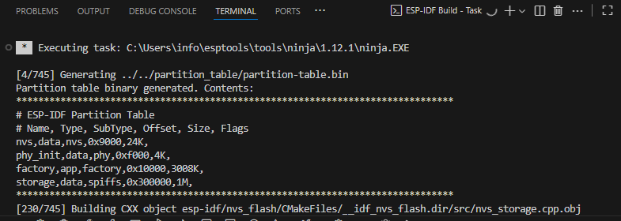
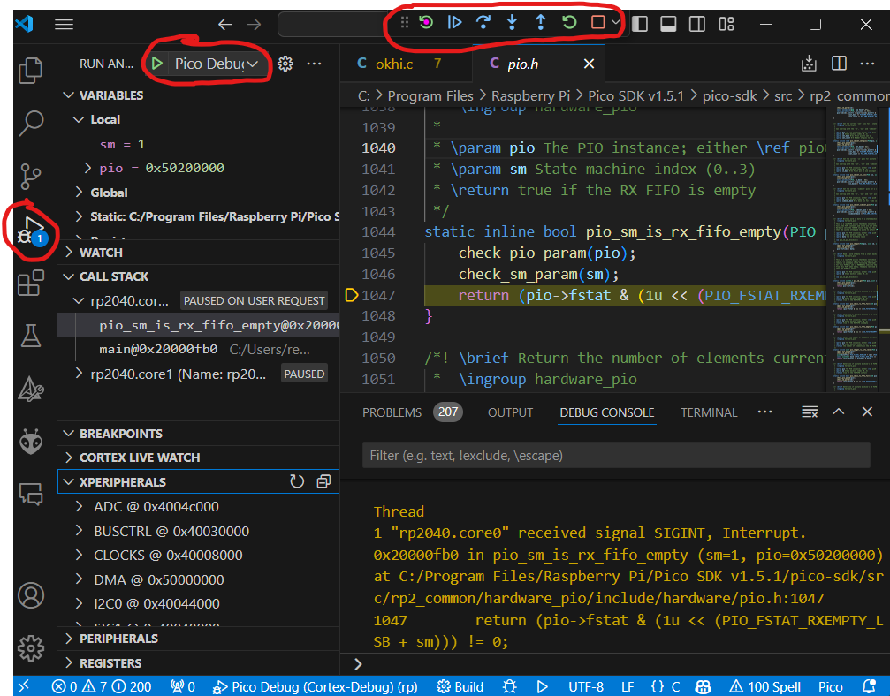
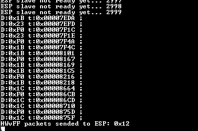

# okhi: Open Keylogger Hardware Implant


okhi is an implant that logs keystrokes from a USB/PS2 keyboard. It is made to hide easily inside a keyboard, laptop, or tower case, and the keyboard cable itself powers it. You connect to it over WiFi and watch the keystrokes in real time.

## You can now buy it at [https://www.rootkit.es ](https://www.rootkit.es/)

If you register on Elecrow using this link before buying the product, you’ll help me support and maintain this project even more:

https://www.elecrow.com/referral-program/OTI1MDhqMnQ/

------

okhi is based on two chips: an RP2040 that sniffs and parses the keyboard data, and an ESP32-C2 that sends it over WiFi.

The RP2040 has a dual-core Arm Cortex-M0+ processor, so it handles several tasks at the same time (PIO rlz!).

The ESP32-C2 is a new chip from Espressif, specifically the ESP8684, with a small single-core RISC-V CPU. The ESP8266, ESP8285, and ESP8685 are different chips: do not confuse them with the ESP8684.

----


----

okhi is a proof of concept and an educational tool. It is not intended for malicious use.

okhi draws ~120mA (107 mA measured on average), with short WiFi bursts up to 430 mA. The target & cable must supply this, or the implant will not work. Details in [Power consumption](#power-consumption-measured-with-a-nordic-ppk2).

The keyboard draws current too. USB 2.0 allows at most 500mA: never exceed it.

Just connect VBUS, GND and data lines to okhi, and you are ready to go.

You can connect okhi to the end of the cable, to a through-hole pin connector inside the tower, or to accessible pads or traces. Wherever the keyboard data is present, okhi can sniff it.

okhi connected with copper wires to the pads of a keyboard PCB:


# Contents

- Using okhi: [Features](#features) · [Getting Started](#getting-started) · [Firmware update](#firmware-update) · [OTA](#firmware-update-over-the-air-ota) · [Keyboard layouts](#multi-language-keyboard-support) · [Persistent keystroke log](#persistent-keystroke-log) · [Adapters that work](#ps2-usb-adapters-working-with-okhi) · [Reporting issues](#reporting-issues)
- Hardware: [What a mess of names!](#what-a-mess-of-names) · [ESP32-C2 module](#esp8684-mini-1-h4-module-esp32-c2) · [USB pinout](#usb-a-male--female-pinout) · [PS2 pinout](#ps2-pinout) · [Hardware Design](#hardware-design) · [TCXO](#tcxo--25-ppm-for-rp2040) · [Power consumption](#power-consumption-measured-with-a-nordic-ppk2)
- Developers: [Developers setup](#developers-setup) · [Your own WiFi](#putting-the-implant-on-your-own-wifi) · [Flashing over a cable](#flashing-over-a-cable-and-the-traps-in-it) · [Generating a New Release](#generating-a-new-release) · [OTA developer reference](#ota-developer-reference) · [Web Developers](#web-developers) · [Developers hardware pack](#developers-hardware-pack) · [PS2 & USB keyboard by UART](#ps2--usb-keyboard-by-uart)
- Diagnostics: [Link benchmarks](#link-speed-benchmarks-spi--uart-measured-limits) · [Built-in self test](#built-in-self-test-what-it-checks-and-how-to-read-it) · [WiFi speed test](#wifi-speed-test-measured-from-the-browser) · [Crystal calibration](#the-same-from-the-web-page-without-reflashing)
- In depth: [The ESP32-C2 as an SPI slave](#the-esp32-c2-as-an-spi-slave-behavior-quirks-and-how-they-shaped-the-code) · [Passive USB-to-PS/2 adapters](#passive-usb-to-ps2-adapters-the-keyboard-speaks-ps2-not-the-adapter) · [PS2 Captures](#ps2-captures) · [Reusable dual-chip OTA](#reusable-dual-chip-ota-for-rp2040--esp32-boards) · [Wired USB keyboards](#wired-usb-keyboards-report-formats-bus-packets-and-product-classification) · [PS/2 firmware guide](#ps2-sniffer-firmware-developers-guide) · [USB firmware guide](#usb-sniffing-code-documentation)

# Appearance

Front (black or green)


Back (black or green)


# Size (mm)


Check the size before buying: it may be too big for your target, or you may need to drill some space inside the keyboard.

# Features

- Supports PS2 and USB keyboards: on USB, low speed and full speed (the same firmware switches by itself) and the report formats keyboards use (6KRO, NKRO, report IDs, keys on several interfaces)
- WiFi + web support
- Real-time viewing of keystrokes
- Persistent capture: every keystroke is also stored in the implant's own flash within a few seconds, so the log survives reboots, power cuts and long stretches with nobody watching the page. Download or wipe it from the web interface. See [Persistent keystroke log](#persistent-keystroke-log)
- Multi-language keyboard layouts: pick the layout of the target keyboard in the web interface and the keystrokes are decoded with it
- OTA updates (since v7): update both chips over WiFi from the web interface, with no cable, probe board or disassembly
- Warns on the web page when a USB keyboard cannot be captured (a high speed keyboard, a full speed keyboard with reports longer than 8 bytes whose descriptors okhi never saw, or nothing attached)
- Hardware self test, SPI/UART link benchmarks and a WiFi speed test, all from the web page
- Crystal calibration tools: the implant can act as a 12 MHz reference clock or as a frequency meter to tune the crystal of other RP2040 boards, see [The same from the web page, without reflashing](#the-same-from-the-web-page-without-reflashing)
- [Reusable dual-chip OTA](#reusable-dual-chip-ota-for-rp2040--esp32-boards): use the whole OTA system in your own RP2040 + ESP32 board, MIT licensed, commercial use included
- Open Hardware
- Open Source (MIT License)
- Community support

# Getting Started

## okhi implant

The implant sits between the USB/PS2 keyboard and the computer, records the keystrokes and shows them over WiFi in real time.


The implant ships with no firmware: program the latest one before using it. The first time you program it you need an implant probe board, and later updates can go over WiFi.

## USB implant probe


This board lets the implant sniff USB data from outside the keyboard, with no soldering and nothing installed inside it, so you can test the implant just by plugging it in.

This board is also how you program and update the okhi implant by cable.

Note: on earlier PCB revisions the implant was programmed through the same USB port used for sniffing, and you had to disconnect the target keyboard each time. Newer USB implant probe revisions have a USB port just for programming the implant.

## PS2 implant probe


This board lets the implant sniff PS2 data from outside the keyboard, with no soldering and nothing installed inside it, so you can test the implant just by plugging it in.

This board is also how you program and update the okhi implant by cable.

Important: on earlier PCB revisions only the USB implant probe could program the implant. Newer PS2 implant probe revisions have a USB port just for programming the implant.

This board already converts PS2 signals from 5V to 3.3V, so the okhi implant runs safely on it.

## 5v -> 3V3 shifter mini board


This compact board converts PS2 signals from 5V to 3.3V, which the okhi implant needs to work properly. Use it to connect the okhi implant inside a PS2 keyboard. USB sniffing does not need it.

## Buying the necessary components

You need to buy these yourself:
- 1 PS2 male to PS2 male cable (MINI-DIN 6P)
- 1 PS2<->USB adapter
- 1 USB extension cable 
- 1 USB keyboard, low or full speed
- 1 PS2 Keyboard (Lenovo PS2 KEYBOARD on Aliexpress is OK) 

## How to program okhi implant

Insert the okhi implant into the "program zone female pins" of the USB implant probe or the PS2 implant probe, with the GND pin aligned with **okhi-G**. Then press and hold the BOOT button while you connect the probe to your computer through the program zone's USB male connector.

An RP2040 mass storage device appears on your computer. Copy the firmware to it, and the RP2040 reboots by itself.


## How to test okhi implant

Insert the okhi implant into the "sniff zone female pins" of the USB implant probe or the PS2 implant probe. Before connecting, make sure the GND pin lines up with the **okhi-G** pin.


### Test USB keyboard

Connect the male USB of the sniff zone to your computer, then the USB keyboard to the female USB port of the sniff zone. Also connect the program zone's USB to your computer as an extra power source, so the okhi implant has enough power.


The USB okhi captures low speed and full speed keyboards with the same firmware. The RP2040 tells them apart by the idle level of D+ and D- (a low speed device pulls D- up, a full speed one D+). While it captures, it switches to the other speed once nearly all its samples over 2 ms show that speed's idle level (see [6. PIO0: the bit sampler](#6-pio0-the-bit-sampler)). So it follows a newly plugged keyboard while the PC still waits out the 100 ms it gives every new device before talking to it.

It logs the keys of the report formats keyboards use: the 8-byte boot report, an NKRO bitmap, a longer key array, reports with report IDs, and keys spread over several interfaces, the way hybrid gaming keyboards send them (formats 1 to 6 in section 2 of [Wired USB Keyboards](#wired-usb-keyboards-report-formats-bus-packets-and-product-classification)). It learns each keyboard's format from the keyboard's HID descriptors, read off the wire while the PC fetches them as the keyboard is plugged in, so okhi has to be running by then. It captures 0.1 s after a reset, and an implant in line powers up together with the keyboard. If okhi restarts while a keyboard stays plugged in (an update of its RP2040 firmware does that), it takes that keyboard's format back from its flash, where it keeps the formats of the keyboards it saw enumerate.

In each of 167 report descriptors, the decoder finds the key fields the descriptor declares. Of those, 120 come from published dumps of 43 devices (32 keyboards, one of them in two configurations, 10 receivers and dongles, and a foot pedal that enumerates as a keyboard) and 47 from the source of keyboard firmwares and of the Linux kernel. On the test bench okhi logged the okhi-kbd test keyboard exactly in each of its formats.

A high speed keyboard still works on the PC through the implant, but nothing it types is logged. A low speed keyboard behind a full speed hub (a keyboard with a built-in USB 1.1 hub) is not logged either, and gets no warning: the cable then idles at full speed, the host's packets to the keyboard travel at low speed after a PRE token, the keyboard's replies travel at low speed with no PRE, and the full speed capture cannot read them. A Logitech Unifying receiver on a Linux host should not be logged (not tested): Linux's driver switches it to a vendor mode whose reports carry no keyboard fields.

The web page shows a warning under the link status when the capture port holds nothing at all (or a high speed keyboard, which looks the same on the wire), a full speed keyboard sending reports longer than 8 bytes whose descriptors okhi did not see (plug it in again), or an impossible line state (a wiring fault). It hides the warning while a keyboard it captures is attached. The verdict comes from the same line levels, sampled once a millisecond, and needs two quarter-second windows that agree, so plugging in or a bus reset never makes it flicker. The ESP passes it on as `usb_bus=` in `/stats` (`low`, `full`, `wide` for the keyboard with unseen descriptors, `none`, `invalid`, or `unknown` while the RP2040 link is down) and in the `X-Okhi-Bus` header of the `/buffer` replies the page already polls, so the warning costs no request of its own.

On a hub with one transaction translator for all its ports, like the test bench's, a full speed keyboard shares its wires with what the hub repeats to every full speed port: the tokens, the data and the handshakes the host sends to the other full speed devices on that hub. Keys only ever travel as an IN answered by DATA, and so do the descriptors that say how to read them, on endpoint 0 after the PC's SETUP request. So the RP2040 stores only the INs answered by DATA, the SETUPs with their DATA, the frame marks (SOF), a DATA whose token went into the previous buffer and the packets it cannot classify, and a busy neighbor does not crowd the capture buffers. On the test bench a USB serial adapter on the same hub was polled 36000 times a second, a buffer still lasted about 4 s, and every keystroke was logged (measured before the SETUPs were kept as well).

Such a hub also repeats to its full speed ports what the host sends to a low speed device behind it, such as a mouse: a PRE token and the low speed packet after it. The RP2040 drops those, and the end of each is too short to count as a bus reset: on the test bench, with a low speed mouse behind the same transaction translator, 12 s idle gave no false bus reset and 6 pairs of overlapped keys were logged exactly.

### Test PS2 keyboard

Plug the PS2 keyboard into the 'TARGET' PS2 port of the sniff zone. Then connect the other sniff zone PS2 port, 'PC', to a PS2<->USB adapter with a PS2 male-to-male cable (Amazon and AliExpress sell them). Last, connect the program zone's USB to your computer as an extra power source, so the okhi implant has enough power.

This extra power matters most with a PS2<->USB adapter, since some adapters do not supply enough power for the implant.


### Firmware update

The firmware has two parts, one for the RP2040 and one for the ESP32-C2, and the RP2040 programs the ESP32-C2. So you first burn a temporary firmware to the RP2040 for that job, then burn the ESP firmware to the ESP32-C2 through the RP2040 USB port, and last burn the final firmware to the RP2040. That's all. It takes a few minutes, and after it, updates can go over WiFi instead.

Follow these steps to update the firmware:

- Download the latest firmware from the releases section: https://github.com/therealdreg/okhi/releases/latest

- Insert the implant into the "program zone female pins" (PROG) of the implant probe.


- Press and hold the programming button (BOOT) while you connect the implant probe to the computer. This puts the implant in program mode.


- Copy the uart_bridge.uf2 file to the implant, which shows up on your computer as a MASS STORAGE DEVICE RP2040 (e.g., drive E:). The drive ejects by itself once the copy completes.


- Disconnect the implant from USB, then reconnect it to a USB port without pressing any button, so it starts in normal mode.

- Run the upload_firmware.bat script, which programs the ESP32-C2 for you.

- Type the COM port number of the implant (e.g., COM3). If you are not sure which one it is, the batch file shows a list of the available COM ports, and you may have to try them one by one.


- Wait for the script to finish. The ESP32-C2 is then programmed and ready.


- Disconnect the implant from USB, then press and hold the programming button (BOOT) while you plug it back in, to enter program mode again.


- Copy the okhi.uf2 file to the implant, which shows up again as a MASS STORAGE DEVICE RP2040 (e.g., drive E:). The drive ejects by itself after the copy.


- The RP2040 is now programmed and ready to use. Disconnect the implant from USB.

- Connect the implant to the sniff zone of the implant probe.


- Connect the implant probe to the computer.


- Also connect the program zone's USB to your computer as an extra power source, so the implant has enough power.

- Join the ESP WiFi network (PS2/USB_<device_id>, password '1234567890') and open the web interface at http://192.168.4.1/ in a web browser.


The release zip includes a `last_esptool` folder with pre-built esptool binaries for several platforms, so you don't need to install Python or esptool separately:

| Folder | Platform |
|---|---|
| `esptool-windows-amd64` | Windows 64-bit (x86_64) |
| `esptool-linux-amd64` | Linux 64-bit (x86_64) |
| `esptool-linux-aarch64` | Linux ARM 64-bit |
| `esptool-linux-armv7` | Linux ARM 32-bit |
| `esptool-macos-amd64` | macOS Intel (x86_64) |
| `esptool-macos-arm64` | macOS Apple Silicon (M1/M2/M3...) |

Pick the binary that matches your OS and architecture.

### Firmware update over the air (OTA)

OTA (over the air) means updating the implant's firmware through its own WiFi network, instead of taking it out of the target, plugging it into an implant probe board and copying files over USB. okhi updates both chips this way. Once the implant is hidden inside a keyboard, laptop or tower case, you never have to open it again to put a newer firmware on it: connect to its WiFi, open the web interface and upload one file.

The whole update is a single file, `okhi_USB_ota.pkg` or `okhi_PS2_ota.pkg`, included in the release package. It carries the ESP32-C2 firmware and the RP2040 firmware together, tagged with the variant (USB or PS2) and protected by a CRC32 for each half, so the device refuses a package built for the other variant or a corrupted one.

To update, join the device WiFi network (`USB_xxxxxxxxxxxx` or `PS2_xxxxxxxxxxxx`, password `1234567890`), open http://192.168.4.1/, pick the `.pkg` in the **Firmware update** card and press **Upload firmware**. The ESP then validates the package, writes its own half to the spare flash slot and reboots into it. Then **reconnect and load the page within 5 minutes to confirm the update**. Once that confirmation arrives, the RP2040 pulls its own image over the internal SPI link, checks its CRC32, backs up its current firmware to a golden slot, applies the new one and reboots, which restarts the ESP too.

Without that confirmation the update does not stick: if nobody loads the page within 5 minutes, the ESP assumes the new firmware is broken (or unreachable), drops the RP2040 image and rolls back to the previous firmware, so both chips stay on the old release. A power loss while the package is uploading is harmless too (the old firmware keeps running from the other slot). A new RP2040 firmware gets three boots to be confirmed by one good SPI poll after 10 s of uptime; on the fourth the RP2040 restores the golden backup.

A `.pkg` update also wipes the stored settings, on purpose, even one that rolls back (see [Settings are wiped by any ESP firmware change, on purpose](#settings-are-wiped-by-any-esp-firmware-change-on-purpose)). So an implant you had joined to your own network comes back on its own access point after the update, unless its firmware was built with your network compiled in. Join that access point and load the page there to confirm the update within the 5 minutes, then set your network again from the **Network** card.

While the update runs, keystroke capture is suspended for the few seconds the SPI transfer and the commit take. The keyboard keeps working normally, but those keystrokes are not recorded. On the USB variant the RP2040 then restarts with the keyboard still plugged in and takes the keyboard's format back from its flash, so an NKRO keyboard or one with report IDs goes on being logged.

Do not power the device off during an update.

#### Checking that an update really landed, the ESP, the RP2040 and the web page

An implant is three separate things that are updated at three different moments: the ESP32-C2 firmware, the RP2040 firmware and the web page it serves (embedded inside the ESP firmware, not stored as a file). A page that loads and a device that answers do not prove that any of them is current: the ESP can be new while the RP2040 is still the old one, and the page can be the one you edited but never regenerated. So judge an update by the identity of each part.

The web interface prints five lines at the very top, and every release folder has a `MANIFEST.txt` with the values the first four should show. Compare them to know exactly what is on the device:

```
ESP  v9  sha 1a6977f9c662d2df  Oct 12 2026 20:37:16  [usb, ota_0, idf v6.0.2]
RP   v9 usb Oct 12 2026 20:38:05  [hw vFF]
WEB  2026-10-12 18:35:05Z  src 138764 B  sha c1803f25399b  node v26.4.0
FP   318d0d0fa06f9746  (compare with the release manifest)
RST  1 since the last flash
```

- `ESP` identifies the ESP32-C2 application by the `sha` right after the version. That sha is unique per compilation and is the value to compare. The date after it is the ESP-IDF build date, which does not change on an incremental rebuild, so a date that looks old is normal and proves nothing on its own.
- `RP` is the RP2040 identity string, baked in at compile time and unique per compilation.
- `WEB` is the page itself: when it was generated, the size of the source it came from and a hash of that source. If it says `NOT GENERATED`, the firmware was built around an `index.html` that nobody ran `webgen.js` over.
- `FP` is a single fingerprint computed over the other three, and the one line worth checking: if it matches, all three parts are the ones in that release, with no need to compare three strings by eye.
- `RST` counts the restarts since the ESP firmware last changed. It goes up by one on every reboot, which is how the **Reset the RP** button proves the board really restarted. It is not part of the fingerprint.

If `FP` does not match the manifest, the three lines above it show which part is behind: that is the one that did not update. The usual causes are an ESP update that was never confirmed within 5 minutes and rolled back (upload it again and load the page this time), an interrupted update (repeat it: the device is designed to survive this), and mixing files from different release folders (take all of them from the same one).

The two chips can legitimately end up on different releases, for example when a new RP2040 firmware fails its three boots and the RP2040 restores its golden backup while the ESP keeps the new release, or after updating one chip alone. The implant keeps working, so nothing looks wrong, but the fingerprint tells you. Repeating the update fixes the second case. After a golden restore, the RP2040 refuses the image that failed and takes only a different one.

Important: OTA only works on devices already running an OTA capable firmware, v7 or newer. A device coming from an older release has to be programmed once by cable, with `upload_firmware.bat` and the `.uf2` files as described above, because the ESP partition table changed and that change cannot be migrated over the air. After that first cable install, every update can go over WiFi.

The release package also ships `ota_esp.bin` and `ota_rp.bin`, the same two images loose, to update one chip on its own. Those are meant for development: for normal use, always use the `.pkg`. The details, with the `curl` commands and how to check the result on http://192.168.4.1/stats, are in [OTA developer reference](#ota-developer-reference).

### Multi-language keyboard support

A keyboard sends key positions (HID usage IDs on USB, scan codes on PS2), not characters. The keyboard layout configured in the target computer turns a position into a character, so the same physical key is `;` on an English keyboard and `ñ` on a Spanish one.

The web interface has a **Keyboard layout** selector at the top. Pick the layout the target computer uses and the keystrokes are decoded with it, including the characters the Spanish layout types with AltGr (`@`, `#`, `€`, `[`, `]`, and so on); the English layout has no AltGr characters. Decoding happens in the browser, so the selector changes how new keystrokes are shown from that moment on. The text already on screen keeps the characters it was decoded with, and **Download all data** saves the selected layout together with the capture.

The layouts included are **english** (default) and **spanish**. A new one needs no C code: the tables live in `webusb\index.html` (USB firmware, `LAYOUTS` object) and `webps2\index.html` (PS2 firmware, `PS2_LAYOUTS` object), one entry per layout with three tables (`base`, `shift` and `altgr`, plus a `caps` list on USB) mapping key code to character. The USB tables are indexed by HID usage ID and the PS2 ones by set 2 scan code, since that is what each protocol puts on the wire. The letters keep their QWERTY keys outside those tables, so AZERTY or QWERTZ also needs the page's decoder changed. Add your layout there, add an `<option>` to the selector, regenerate the web with `webgen.js` and rebuild the ESP firmware, as described in [Web Developers](#web-developers). Pull requests with new layouts are very welcome.

Note: the raw stream is always kept next to the decoded keys (**HID reports** on USB, **PS/2 data** on PS2) and both go into the downloaded file, so nothing is lost by having the wrong layout selected while capturing.

### Persistent keystroke log

Every keystroke is also written to the implant's own flash memory, so the log survives reboots, power cuts, and stretches where nobody is watching the web page. Writes go out in small batches, at most about five seconds after the keys were typed (sooner while someone types fast), so a power cut can only cost the last few seconds.

The log is kept as two files of 340 KB each on the ESP32-C2's SPIFFS partition. When the current one fills up it replaces the older one, so the device always holds the most recent 340 to 680 KB, roughly 3,000 to 7,000 typed characters, and drops the oldest records first. The log always leaves room on the partition for an RP2040 update to be stored.

To download the stored log, press **Download persistent log** in the "Persistent log" section of the web interface. The browser saves a text file with the decoded keystrokes (in the selected keyboard layout) and the raw wire records, so you can decode the log again later with another layout. The status text shows the download progress.

To erase the stored log, press **Clear persistent log**. It wipes the log files from the device's flash and cannot be undone, so the page asks you to confirm first.

Both operations work whether the device is in WiFi access-point mode or connected to your LAN as a station.

## Thanks to PCBWAY for sponsoring the okhi project

Special thanks to PCBWay for sponsoring this project! PCBWay is a well-known PCB prototyping and manufacturing service, providing high-quality boards and excellent customer support. I have worked with their boards in the past and can say that they are of great quality. I easily placed an order for PCBs on their platform for this project without any problems. The sponsorship also included a free quick delivery option. If you’re looking for reliable PCB prototyping and manufacturing services, I highly recommend checking them.


https://www.pcbway.com


## DIY USB & PS2Keylogger POC

https://github.com/therealdreg/pico-usb-sniffer-lite


https://github.com/therealdreg/pico-ps2-sniffer


# Project files

Gerber, pick and place files and the BOM are not published yet.

----

The step-by-step guides here are written for Windows. The command-line RP2040 build is documented for Linux (see [RP2040 minimal command-line build](#rp2040-minimal-command-line-build-no-vs-code)), `make_release.py` runs on Windows, Linux and macOS, and the release ships esptool for all three. I am only one person, so please be patient....

 ----

# What a mess of names!

The okhi board has two main processors: the RP2040 and the ESP8684-MINI-1-H4 / ESP8684-MINI-1-H4X. The RP2040 is a dual-core Arm Cortex-M0+ processor running at up to 200 MHz, with 264 KB of on-chip SRAM. It has no flash memory of its own, so the board adds 16 MB of external flash. The RP2040 also overclocks well, and it is the chip on the Raspberry Pi Pico microcontroller board.

The ESP8684-MINI-1-H4 module runs at up to 120 MHz and has 4 MB of internal flash memory and a built-in PCB antenna, so it needs no external one. It is a PCB-to-PCB module that holds the ESP8684 chip along with the other components it needs.

The ESP8684 / ESP8684H4X (Chip Revision v2.0) is the chip inside the ESP32-C2 modules (ESP32-C2 is a generic name): a 32-bit single-core RISC-V processor with 272 KB of SRAM (16 KB of it for cache) and 576 KB of ROM. The ESP32-C2 is a low-cost chip with Wi-Fi 4 and Bluetooth 5 (LE), and it beats the older ESP8266 in size and performance.

The ESP8684-DevKitM-1 is the development board for the ESP8684-MINI-1-H4 module.


# ESP8684-MINI-1-H4 module (ESP32-C2)

okhi uses the small ESP8684-MINI-1-H4 module (ESP32-C2).


ESP8684-MINI-1-H4 module vs ESP8684-WROOM-02C-H4 module:


The module's WiFi goes up to 72Mbps (9MB/s). Real-world speeds are typically much lower, but still enough for a web interface that shows keystrokes.

## Compatible with both modern and older ESP32-C2 versions

The okhi firmware is designed to support all versions of the ESP32-C2 chip, both the legacy v1.x and the v2.0 revision.

Note: You must use an ESP32-C2 module with a **26 MHz crystal** and **4 MB** of flash memory. Some chips do not work properly with a 40 MHz crystal: the symptoms include clock issues and garbled characters printed at power-on.

[Compatibility Advisory for ESP32-C2 Chip Revision v2.0 ar2025-001_en.pdf](stuff/Compatibility%20Advisory%20for%20ESP32-C2%20Chip%20Revision%20v2.0%20ar2025-001_en.pdf)

The firmware gives up the extra SRAM and flash of v2.0 so that one binary, and one build to test, covers both revisions (see [ESP32-C2 firmware build & hardware notes](#esp32-c2-firmware-build--hardware-notes)).

# PS2<->USB adapters working with okhi

Note: some adapters use purple for the keyboard, others green... wtf! If it doesn't work in one, try the other.

- 1 (adapter from hell, it works, but not recommended) (Amazon)


- 2 Aliexpress (OK)


- 3 Aliexpress (OK)


- 4 Aliexpress (OK)


- 5 Aliexpress (OK)


- 6 StarTech (Amazon) (OK)


- 7 Aliexpress (OK)


- 8 Aliexpress (OK)


Logic analyzer captures of adapters 1, 2, 5, 6, 7 and 8 are in [PS2 Captures](#ps2-captures).

# NEVER BUY THIS PS2<->USB


# Reporting issues

If you have a PS2<->USB adapter that doesn't work with the sniffer, please send me captures of it made with a logic analyzer or with the pico-ps2-diagnostic-tool, which captures and replays the DATA and CLOCK lines of a PS/2 interface:

https://github.com/therealdreg/pico-ps2-diagnostic-tool


A short pulse was captured on the original CLOCK signal, and the replayed signal reproduced it.

# Developers setup

## Start here

| Path | What it is |
|---|---|
| `firmware/usb/rp`, `firmware/ps2/rp` | the RP2040 capture firmware of each variant |
| `firmware/usb/esp`, `firmware/ps2/esp` | the ESP32-C2 project of each variant; its code (WiFi, the web server, the keystroke log, OTA) is in the shared `firmware/com/com_esp.h` |
| `firmware/com` | the headers both variants share: the SPI link, OTA, pins, the clock modes ([Taking it into your own project](#taking-it-into-your-own-project)) |
| `webusb`, `webps2` | the web page of each variant and `webgen.js`, which links it into the ESP firmware ([Web Developers](#web-developers)) |
| `firmware/leonardo_uart2keyboard` | okhi-kbd, a Pro Micro that types what it gets over UART: the test keyboard ([PS2 & USB keyboard by UART](#ps2--usb-keyboard-by-uart)) |
| `firmware/uart_bridge` | an RP2040 firmware that makes okhi a USB to UART bridge, to flash the ESP |
| `make_release.py` | builds every target and packs the `.pkg` ([Generating a New Release](#generating-a-new-release)) |

Use pico-sdk 2.3.1, ESP-IDF 6.0.2 and node 26.4.0, and no other versions. The next two sections set up pico-sdk and ESP-IDF, and [Web Developers](#web-developers) sets up node.

How the code works: the [USB Sniffing Code Documentation](#usb-sniffing-code-documentation) (with its [map of the source](#where-each-piece-lives-in-the-source) and its [gotchas](#12-gotchas-for-new-developers)), the [PS/2 Sniffer Firmware: Developer's Guide](#ps2-sniffer-firmware-developers-guide), the [OTA developer reference](#ota-developer-reference) and [the ESP32-C2 as an SPI slave](#the-esp32-c2-as-an-spi-slave-behavior-quirks-and-how-they-shaped-the-code).

When you change the code:

- keep the RP2040 clock of each build (120 MHz on USB, 125 MHz on PS/2), every RP image at `-O2` (pinned in each `CMakeLists.txt`), and the size and pins of the PIO programs: the USB capture timing depends on all three, and on both builds the SPI delays scale with the clock ([quirk 2](#2-cs-setup-and-hold-matter-and-the-official-esp-example-shows-you-must-delay-around-cs));
- keep `SPI_FRAME_VERSION` the same on both chips: a release that bumps it cannot be installed over the air ([the limits](#being-straight-with-you-about-the-limits));
- keep the pulls of the two handshake lines, which are ESP32-C2 strapping pins ([quirk 5](#5-the-two-handshake-gpios-are-also-esp32-c2-strapping-pins-on-purpose));
- run `webgen.js` before an ESP build whenever the page changed;
- bump `HID_STORE_VERSION` in `usb_hid.h` when a field of the HID maps changes meaning: the USB RP keeps them in the last 64 KB of its flash.

To see what the firmware does: the [RP2040 UART log](#the-rp2040-uart-log-is-the-best-debugging-tool-here), `/stats` and `/versions` on the ESP, and the [built-in self test](#built-in-self-test-what-it-checks-and-how-to-read-it).

## RP2040 DEV SETUP

The RP2040 firmware uses pico-sdk 2.3.1 (released September 2026). All you need is the official Raspberry Pi Pico extension for Visual Studio Code, which downloads and sets up pico-sdk 2.3.1, the toolchain and picotool: https://marketplace.visualstudio.com/items?itemName=raspberry-pi.raspberry-pi-pico

**The code is tested only with, and designed for, pico-sdk 2.3.1. Other SDK versions and the standalone pico-setup-windows installer are not supported.**

- Clone this repo or download the zip file: https://github.com/therealdreg/okhi/archive/refs/heads/main.zip

- Open Visual Studio Code with the Raspberry Pi Pico extension installed

- Open the okhi project with File > Open Folder...


- Select the RP folder `firmware\ps2\rp` and click Select Folder

- Click "Trust the authors" if VS Code asks


- Press shift+ctrl+p, type cmake cache and select "CMake: Delete Cache and Reconfigure"


- Press shift+ctrl+p, type cmake build and select "CMake: Build"


- If the build succeeds, the OUTPUT window (bottom) shows a message like this:


- The new `firmware\ps2\rp\build\okhi.uf2` is ready to be uploaded to okhi

The firmware always compiles at `-O2`, the level it is tested at, whatever build type the IDE picks (`target_compile_options` in each `CMakeLists.txt`). The default build type is `RelWithDebInfo`. A `Debug` build differs only in keeping the SDK's `assert` checks. Without the `-O2` option, `Release` would build at `-O3`, which costs about 10 KB of RAM in this `copy_to_ram` image for no gain on the RP2040.

### RP2040 minimal command-line build (no VS Code)

To build the RP2040 firmware without VS Code or any extension, a plain terminal with the pico-sdk 2.3.1 sources and the standard build tools is enough. An example on a Debian or Ubuntu Linux box:

```
# 1. Install the build tools (cmake, ninja, the ARM cross-compiler, git and Python 3)
sudo apt update
sudo apt install -y git cmake ninja-build gcc-arm-none-eabi libnewlib-arm-none-eabi build-essential python3

# 2. Get pico-sdk 2.3.1 (the ONLY tested/supported version) with its submodules
git clone --branch 2.3.1 --depth 1 https://github.com/raspberrypi/pico-sdk.git
cd pico-sdk
git submodule update --init
cd ..
export PICO_SDK_PATH=$PWD/pico-sdk

# 3. Get okhi and build the RP2040 firmware
git clone https://github.com/therealdreg/okhi.git
cd okhi/firmware/ps2/rp
cmake -G Ninja -B build
cmake --build build
```

When it finishes, the firmware is at `firmware/ps2/rp/build/okhi.uf2`, ready to be uploaded to okhi.

Notes:
- `PICO_SDK_PATH` must point at your pico-sdk 2.3.1 checkout; `pico_sdk_import.cmake` picks it up from that environment variable.
- The same commands work on Windows/macOS as long as `cmake`, `ninja` and the `arm-none-eabi` GCC toolchain are on your `PATH` (on Windows use a shell where you can set `PICO_SDK_PATH`, e.g. `set PICO_SDK_PATH=...` in cmd or `$env:PICO_SDK_PATH=...` in PowerShell).
- Compiling needs no board or flashing tools: it produces the `.uf2` you then copy to the device as described in [Firmware update](#firmware-update).

## ESP-C2 DEV SETUP

The ESP firmware is built on the native ESP-IDF framework. One firmware runs on both the legacy and the new ESP32-C2 2.0 (H4X) chips; older ESP-IDF versions cannot build firmware for the 2.0 chips.

esptool flashing an H4X (ESP32-C2 2.0):
```
....
esptool v5.0.2
Connected to ESP32-C2 on COM42:
Chip type:          ESP32-C2 (revision v2.0)
Features:           Wi-Fi, BT 5 (LE), Single Core, 120MHz
Crystal frequency:  26MHz
MAC:                80:f3:da:17:b1:00
....
```

The partition offsets and the raw esptool commands are in [ESP32-C2 firmware build & hardware notes](#esp32-c2-firmware-build--hardware-notes), and the mandatory erase and the other traps of a cable flash in [Flashing over a cable, and the traps in it](#flashing-over-a-cable-and-the-traps-in-it) below.

Follow the official ESP-IDF installation instructions for your platform:

https://docs.espressif.com/projects/esp-idf/en/v6.0.2/esp32/get-started/index.html#installation

Windows: https://docs.espressif.com/projects/esp-idf/en/v6.0.2/esp32/get-started/windows-setup.html

```
winget install Espressif.EIM
```

Open the EIM GUI app:


Create a new installation and select Custom Installation:


Select the esp32c2 chip:


Install ESP-IDF **v6.0.2**, even when the installer offers a newer version.


Click Next through the remaining prompts with the default values and finish the installation. It takes a few minutes.

- Install the ESP-IDF extension (`espressif.esp-idf-extension`, https://github.com/espressif/vscode-esp-idf-extension) from the VS Code Marketplace. The firmware is built with version 2.3.0.

- Go to File > Open Folder...


- Select the ESP folder `firmware\ps2\esp`


- Open the ESP-IDF extension and click "Full Clean"


- In the same extension, click "Select current ESP-IDF version" and pick v6.0.2 in the list it opens


- Then click "Build Project"


- Wait for the build to finish.



The new ESP firmware is now built:


To build the USB firmware, follow the same steps with the `firmware\usb\rp` and `firmware\usb\esp` folders.

## ESP32-C2 firmware build & hardware notes

`sdkconfig.defaults` pins the settings below, which are easy to get wrong when touching the ESP build. Treat it as the source of truth: `sdkconfig` is generated and can be deleted at any time, and a regenerated `sdkconfig` silently drops any setting kept only there, which breaks devices in the field.

| Setting | Value | Why |
|---|---|---|
| `CONFIG_XTAL_FREQ_26` | 26 MHz, never 40 | every okhi board uses a 26 MHz crystal; wrong here garbles the serial console and breaks WiFi/timing |
| `CONFIG_ESP32C2_REV_MIN_1` | v1.0 | devices in the field are any revision from v1.0 to v2.0; a v2.0-minimum binary refuses to flash on anything older (Espressif advisory AR2025-001). Costs ~20 KB SRAM / ~100 KB flash that a v2.0-only build could reclaim, accepted on purpose |
| `CONFIG_ESPTOOLPY_FLASHSIZE_4MB` | 4 MB | the `storage` SPIFFS partition runs to the end of the chip; anything smaller does not fit |
| `CONFIG_PARTITION_TABLE_CUSTOM` | `partitions.csv` | the default single-app table has no `storage` partition |

Partition layout, two OTA slots and no `factory` slot on purpose (a third would leave under 60 KB headroom per app):

    nvs       0x9000    16K
    otadata   0xd000    8K
    phy_init  0xf000    4K
    ota_0     0x10000   1408K
    ota_1     0x170000  1408K
    storage   0x2d0000  1216K

That is the full 4 MB, no spare region: growing the app means taking space from `storage`, and since `ota_0`/`ota_1` must match, every extra 1 MB of app costs 2 MB of flash.

For ESP-IDF 6.0, `main/CMakeLists.txt` names the per-peripheral driver components `esp_driver_gpio`, `esp_driver_spi` and `esp_driver_uart`, and [firmware/com/com_esp.h](firmware/com/com_esp.h) includes `<sys/stat.h>` itself, since picolibc, the default C library, does not pull it in through other headers.

**The SPI callbacks must stay in IRAM** (`CONFIG_SPI_SLAVE_ISR_IN_IRAM`, `CONFIG_GPIO_CTRL_FUNC_IN_IRAM`, both callbacks marked `IRAM_ATTR`). The SPI slave ISR runs from IRAM and calls them to drive `ELOG_SLAVEREADY`; if either sat in flash, a transaction arriving while the cache is disabled (a SPIFFS read, an NVS write) would dereference unmapped memory: a crash, or a handshake that never rises and hangs the RP forever.

DIRAM is a single ~191 KB pool: the ESP32-C2 has no separate IRAM and DRAM, so anything placed in IRAM comes straight out of the heap. `CONFIG_ESP_WIFI_IRAM_OPT` and `CONFIG_ESP_WIFI_RX_IRAM_OPT` are both off (they default on and buy sustained WiFi throughput this firmware never needs), which returns ~30 KB. Watch `min_free_heap` in `/stats`, not the link-time "Remain" figure, since WiFi and lwIP allocate at runtime. Rule of thumb after a few minutes with the web page open: above 20 KB is comfortable, 10-20 KB leaves no margin, and below 10 KB, allocations start failing. `RING_ENTRIES` in `com/com_esp.h` at 256 instead of 512 would give back ~16 KB, but the persistent log's backlog (`keylog_pending` in `/stats`) reached about 450 entries during a log file rotation at 78 reports a second.

The HTTP server handles `HTTP_MAX_CONN` (4) connections in one `select()` loop on non-blocking sockets, so a browser's speculative preconnects that send nothing cannot stall it. Its endpoints:

| Endpoint | What it does |
|---|---|
| `/` | `index.html.gz`, streamed from the embedded copy |
| `/buffer` | HID/PS2 records; `?from=N` for a stateless cursor |
| `/stats`, `/versions` | full counter dump; build identity of both chips plus link state |
| `/wifi` | network settings |
| `/selftest` | hardware self test, see [Built-in self test](#built-in-self-test-what-it-checks-and-how-to-read-it) below |
| `/spibench` | SPI/UART link benchmark, see [Link speed benchmarks](#link-speed-benchmarks-spi--uart-measured-limits) below |
| `/wifidown`, `/wifiup` | WiFi throughput test payload, see [WiFi speed test](#wifi-speed-test-measured-from-the-browser) below |
| `/rpreset`, `/rpbootsel` | ask the RP to reboot normally, or into BOOTSEL |
| `/ota`, `/rpimage` + `/rpcommit` | firmware update, see [OTA developer reference](#ota-developer-reference) below |
| `/keylog` | the persistent keystroke log: `?from=N` downloads it in chunks, `?clear=1` erases it |
| `/clock` | crystal calibration modes, clock output and frequency meter, see [The same from the web page, without reflashing](#the-same-from-the-web-page-without-reflashing) |
| `/esp`, `/rp` | the latest debug lines of each chip, as shown in the page's debug panels |
| `/ver`, `/hwver` | firmware version and hardware revision |

Raw esptool commands, for when `upload_firmware.bat` is not an option (run `erase-flash` first every time, see [The full erase is not optional](#the-full-erase-is-not-optional) below):

    esptool --chip esp32c2 --baud 921600 erase-flash
    esptool --chip esp32c2 --baud 921600 write-flash -z --flash-mode dio --flash-freq 60m --flash-size 4MB \
        0x0000   bootloader.bin \
        0x8000   partition-table.bin \
        0x10000  okhi.bin \
        0x2d0000 storage.bin

Serial monitor: 74880 baud.

## Putting the implant on your own WiFi

By default the ESP runs its own access point and you join that. During
development it is easier to have it join your network: the web page then lives
at an address on your LAN, you keep your normal internet connection while you
use it, and anything that can reach your LAN can poke the endpoints.

Create the file below. It is in `.gitignore`, and its name differs from the
tracked `wifi_client.h` on purpose, so it has never been in the index and
cannot be committed by accident:

```
firmware/usb/esp/src/wifi_secret.h        (and/or the ps2 one)
```

```c
#ifndef __WIFI_SECRET_H__
#define __WIFI_SECRET_H__

#define OKHI_DEV_STA_SSID "your network"
#define OKHI_DEV_STA_PASS "your password"

#endif
```

Rebuild the ESP from a clean `build/` with ccache off (`IDF_CCACHE_ENABLE=0`;
`make_release.py --clean` does both): an incremental build can keep the object
compiled without the file. Check that the build prints the `#pragma message`
`wifi_secret.h is compiled in`, then flash it. `wifi_client.h` is tracked and
holds no secrets; all it does is `#include "wifi_secret.h"` when that file
exists next to it.

**Never put credentials in `wifi_client.h` itself.** Anything written into it can
end up in a commit, and removing it from history means rewriting that commit and
every commit after it.

### Build output holds the password

A build made with `wifi_secret.h` carries your SSID and password inside `okhi.bin`
and `okhi.elf`. The SSID is in plain text, but a short password may be there only
as instruction immediates, so search a build for the network name, not the
password. All of `build/` is gitignored, so git never tracks those files. If you
fork this and track build output, keep builds made with `wifi_secret.h` out of it.

If you would rather not think about it at all, skip the header and set the
network from the **Network** card on the web page: it stores to NVS, touches no
build output, and is the same setting. The header only buys you a network that
survives a reflash, which wipes stored settings by design.

### What those two defines actually change

They change the factory default, nothing more. The order of precedence at boot
is:

1. Whatever is stored in NVS, if the build stamp matches. This is what the
   Network card on the web page writes.
2. Otherwise `OKHI_DEV_STA_SSID` / `OKHI_DEV_STA_PASS` if they were compiled in.
3. Otherwise the access point.

So a developer build comes up on your network the first time, and you can still
change it from the web page afterwards without rebuilding.

### Finding the address it landed on

Two ways, and neither needs you to go hunting in your router:

- The RP prints it on its
  [debug UART](#the-rp2040-uart-log-is-the-best-debugging-tool-here) (uart1)
  whenever it changes, in either mode: `esp wifi client, address 192.168.1.57`.
  The production implant has no serial header.
- `GET /wifi` returns it, along with the mode and the build stamp the stored
  settings belong to.

### Settings are wiped by any ESP firmware change, on purpose

The ESP writes the sha of its running image (the `sha` on the ESP line at the
top of the page) into NVS as the build stamp and compares it on every boot. A mismatch resets NVS
(all but a pending RP update) to the factory default above.

Settings that outlive the firmware which understood them are how a board ends up
joined to a network nobody remembers configuring, with no way back except a
serial cable. Reflashing is the escape hatch, so it has to reset things. A clean
rebuild of the same source gets a new sha, so it resets them too.

A board that fails twice in a row to join a network that never worked comes
back as an access point, keeping the setting on record so you can see what it
was trying to join. A typo cannot lock you out. Once the board has joined a
network, it retries that network forever.

## Flashing over a cable, and the traps in it

None of this is obvious from the commands themselves, and every item below has bitten someone
on a real board.

### Keep the machine idle while flashing

**Do not compile, run builds in the background, or do anything CPU heavy while a flash is in
progress.** Serial flashing sometimes just breaks when the PC is loaded: esptool has to keep
up with the port, and a CPU spike makes it lose frames. A loaded PC is the most common cause
of a flash that fails for no visible reason.

### You have about 50 seconds after the first esptool reset

When esptool resets the ESP over DTR/RTS, the RP2040 notices that reset on `ESP_RESET_GPIO`,
prints

    external ESP-RESET detected!
    rebooting in 50 secs!!!

and reboots itself, leaving a marker in `.uninitialized_data`. On the way back up,
`delay_boot_if_esp_reset_detected()` runs `sleep_ms(50000)`. During that deliberate 50 second
nap the RP stays off the SPI bus and the shared GPIOs, so you can flash the ESP in peace.

**After those 50 seconds the RP holds the ESP in reset while it starts again, and that kills
a flash still in progress.** The RP arms its reset detection again only after the nap, so a
second esptool command inside the 50 seconds gets no window of its own. The erase takes ~4 s
and the write ~15 s: run them back to back, or wait for `esp link UP` in the RP log before
the next command.

### The full erase is not optional

    esptool --port COMx --chip esp32c2 --baud 921600 erase-flash

`write-flash` does not touch `otadata` at 0xd000. Skipping the erase leaves a stale boot
selector there: a board that took an OTA can boot the old image in `ota_1`, and a pre-OTA
board misreads the old `nvs` bytes. The erase has three side effects:

- **It wipes NVS**, so any saved WiFi settings are gone. The board only comes back on your
  network by itself if the credentials are compiled in (see
  [Putting the implant on your own WiFi](#putting-the-implant-on-your-own-wifi)). Otherwise it
  returns as an access point at `192.168.4.1`.
- **It also erases the persistent keystroke log**, which lives in the `storage` partition.
  Download it from the web page first if you need it. `upload_firmware.bat` runs this erase
  for you, so the same applies to it.
- `esp_partition` goes back to `ota_0`, because `otadata` is left at 0xff and the
  bootloader falls back to the base slot. Seeing `ota_0` in `/versions` afterwards is
  expected.

### Two error messages that are harmless

Both appear on a successful flash, so do not chase them:

- openocd, at the end of a perfectly good SWD flash:
  `Error: [rp2040.core0] Execution of event reset-init failed: args[i] option value ('CX') is
  not valid`. It is a quirk of `rp2040.cfg` in openocd 0.12; look for
  `** Programming Finished **` and `** Verified OK **` instead.
- esptool, right after the last partition reaches 100%:
  `A fatal error occurred: Invalid head of packet (0x00): Possible serial noise or
  corruption`. It fires during the final reset, most likely the RP2040 waking from its 50
  second nap. The partitions that matter each report `Hash of data verified` before it.

Because both tools can "fail" on a good flash, **never trust the exit code**. Verify against
the device instead:

    curl http://<board-ip>/versions

`esp_image` is the first 8 bytes of the `app_elf_sha256` embedded in the binary itself, so it
can be compared directly with `okhi.bin[0xB0:0xB8]`. `rp_identity` carries the RP's build
date and time, which is unique per compile. If both match what you built, it went in.

### Flashing the RP2040 over SWD

The Pico VS Code extension ships openocd, and a CMSIS-DAP probe needs no extra setup:

    openocd -f interface/cmsis-dap.cfg -f target/rp2040.cfg -c "adapter speed 5000" -c "program {path/to/firmware/usb/rp/build/okhi.elf} verify reset exit"

Pass the **`.elf`**, not the `.bin`, so openocd places every section correctly. To test the
probe without writing anything, swap the `program` line for `-c "init" -c "targets" -c
"shutdown"`; it should list `rp2040.core0` and `rp2040.core1`.

On the USB variant openocd's `reset` leaves core 1 halted in the boot ROM and the board
silent. Follow the flash with a watchdog reset (openocd reports that write as failed, because
the RP resets under it):

    openocd -f interface/cmsis-dap.cfg -f target/rp2040.cfg -c init -c "mww 0x40058000 0x80000000" -c shutdown

Flashing the RP this way writes straight over the app slot and leaves the OTA meta
record describing the image that *used* to be there. The board boots normally, but the RP goes
on reporting that old image's CRC32 to the ESP as its running image, and the golden backup
keeps the previous firmware, until the next OTA commit rewrites both.

### The RP2040 UART log is the best debugging tool here

On a development board, hook a serial terminal to the RP's debug UART (TX on GPIO4, RX on
GPIO5: the TP1/TP2 header on a hw vFF board, see
[RP2040 Board Debug UART Console](#rp2040-board-debug-uart-console)) at 921600 baud and log to
a file. It prints far more than the web page can show, and it is the fastest way to understand
what a board is doing:

    okhi USB started! Hardware vXX          identity and build timestamp
    flash JEDEC id / size detected          whether OTA is even possible on this part
    ota map: app/golden/staging/meta/esp    the flash layout in use
    ota boot check: ...                     what it decided at boot
    ota meta: state N attempts N            OTA state machine and trial-boot counter
    esp link UP/DOWN, esp fw vN             SPI link transitions
    esp wifi client, address 192.168.x.x    the IP it just got
    rp image offered / STAGED ok / ABORTED  every step of an OTA, with byte counts and CRCs
    rp commit: backing up ... to golden     the commit sequence, in order
    usb bus: low speed keyboard             what is on the capture port (USB variant)
    usb spi resent from the esp's ...       records sent again (ps2 spi resent on PS/2): recovery, not loss
    Synchronization error after N packets   the USB capture lost sync, the rest of that buffer is gone
    capture: N records dropped, ...         records that lost or gained a FIFO word, each left as an error record
    capture: PIO RX FIFO was full, ...      core 0 fell behind the PIO and samples were lost

`rp image transfer ABORTED at block N (attempt N)` means one block could not be fetched in 24 tries, or came back with the wrong length.
The RP tries the whole transfer again on a later poll, up to 6 attempts for the same image.

## Generating a New Release

The repository does not carry build output, so a release starts from source every time:

1. `python make_release.py` builds all five targets (`usb/esp`, `usb/rp`, `ps2/esp`, `ps2/rp`
   and `uart_bridge`) and packages them. `--no-build` packages what is already built, and
   `--deep-clean` rebuilds everything from scratch first.
2. The script gathers those artifacts into `release/<timestamp>/` and produces the combined
   `okhi_{USB,PS2}_ota.pkg` for both chips. That directory is gitignored, so a release you
   built for testing can never be committed by mistake.
3. It also writes a `MANIFEST.txt` with the values each variant must show at the top of the
   web page (see
   [Checking that an update really landed](#checking-that-an-update-really-landed-the-esp-the-rp2040-and-the-web-page)).

If it reports `[FAIL] MISSING <path>`, that target has not been built yet.

**Publishing a release for other people: build it without your network inside.** Move both
`wifi_secret.h` files out of the repository, run `python make_release.py --deep-clean`, then put
the files back. Use the deep clean: incremental builds and the compiler cache do not always
pick up a header that was added or removed, so only a build from scratch is safe either way.
While the header is in, the ESP build prints `wifi_secret.h is compiled in`, and that message
must not appear; searching the release files for your network name is a quick final check.
Afterwards rebuild your own ESP projects from scratch, so your next build has your network
again.

Note: I modified the original usb-sniffer-lite project by Alex Taradov (porting to pico-sdk). I am not an RP2040 expert, so I am learning a lot with this project.

## OTA developer reference

User-facing OTA usage is in **Firmware update over the air (OTA)** above; this is the protocol level, for updating one chip at a time during development or troubleshooting a failed update.

The package format that `make_release.py` builds (magic `"OKHI"`):

    0   4   magic "OKHI"              4   4   package format version
    8   4   variant tag, "USB\0" or "PS2\0"
    12  4   ESP image length          16  4   ESP image crc32
    20  4   RP image length           24  4   RP image crc32
    28  4   crc32 of bytes 0..27
    32  ..  ESP image, then RP image

`POST /ota` also accepts a bare ESP image (magic `0xE9`, sniffed from the first byte), for updating just that chip.

To update one chip on its own:

    curl -X POST -H "Expect:" --data-binary "@ota_esp.bin" http://<board-ip>/ota

    curl -X POST -H "Expect:" --data-binary "@ota_rp.bin" http://<board-ip>/rpimage
    curl http://<board-ip>/rpcommit

`/rpimage` stores the image on the ESP's filesystem, and the RP copies it into its own staging slot on its next polls; `/rpcommit` tells the RP to verify that copy and apply it. Use the combined `.pkg` for anything that leaves the lab: it updates both chips from one release.

An `/rpimage` image lasts until the ESP restarts, and every RP boot restarts the ESP too: after a reset of either chip, upload it again. The RP's reboot after a commit is one of those restarts, so an upload sent while a commit is being applied is cut off; wait for the RP to come back. Before the first byte of an RP image (from `/rpimage` or a `.pkg`) lands on the filesystem, the ESP collects room for all of it, which can hold the upload for a few seconds. With no room left, even after dropping an RP image still staged, it answers 507 (500 for a `.pkg`): download the keystroke log, clear it, and upload again.

After a `.pkg` the ESP offers the RP image, and asks the RP to commit it, only once its own new half is confirmed; the reason is in [How it flows](#how-it-flows). The NVS marker of the pending RP image keeps the sha of the ESP image it came with, and the ESP drops the RP image at boot when another ESP image runs. As soon as a new ESP image boots on trial it clears the marker flag an older ESP firmware (v7) reads, so a rollback to that firmware does not commit the RP image either. The RP's control frames carry the app CRC32 from its OTA record, and once that matches the ESP's copy, the ESP deletes it. The ESP asks for no commit before the first of those frames, nor for the image that CRC names, and an `/rpimage` of it answers 409. An image not applied 5 minutes after its commit request (the RP restored golden before the new image ever polled, its flash map does not fit, or six transfers failed) is dropped, and `rp_restore` says so.

The RP flash map and the flash size it needs are in [RP2040 flash map](#rp2040-flash-map); the map is why a bad RP update recovers on its own, and `report_ota_state()` prints it at boot. A new RP image gets three boots to be confirmed (one good poll after 10 s of uptime confirms it); on the fourth boot the RP restores the golden backup. A crash or a capture stall reboots the RP; a missing ESP link does not.

The limits that bite during development (a `SPI_FRAME_VERSION` bump, a power cut while the RP rewrites its app) are in [Being straight with you about the limits](#being-straight-with-you-about-the-limits).

To check the result, watch these `/stats` fields:

    partition        ESP slot in use, ota_0 or ota_1
    pending_verify   1 if the ESP image is still on trial
    booted_pending   1 if this ESP boot started on trial
    rp_image_ready   1 while an RP image is still staged
    rp_restore       what the ESP did with the RP image
    ota_last_error   why the last /ota upload failed, if it did

## The ESP32-C2 as an SPI slave: behavior, quirks, and how they shaped the code

The two chips talk over a private SPI link plus two side-band GPIO lines. The RP2040 is the SPI master and the ESP32-C2 is the SPI slave: the RP is the real time capture engine, so it owns the clock and decides when anything moves, while the ESP is the WiFi, web and OTA brain that only ever answers. The slave side is ESP-IDF's `driver/spi_slave.h`, driven from [firmware/com/com_esp.h](firmware/com/com_esp.h); the RP master side lives in [firmware/com/com_rp_hw.h](firmware/com/com_rp_hw.h). Everything below is behavior of the ESP32-C2 slave and of the ESP-IDF `spi_slave` driver that we hit during development, and the protocol and its timing hacks exist to work around it.

The link runs SPI mode 0 (CPOL=0, CPHA=0), MSB first, at 4.8 MHz (`SPI_BAUD` in com_rp_hw.h asks for 5 MHz, and the RP2040's divider gives 4.8), with DMA on the ESP side. A frame is 256 bytes (`SPI_FRAME_SIZE` in [firmware/com/com.h](firmware/com/com.h)): a 16-byte lead, an `OKHI` / `OKHC` magic, a small header, then a payload area. The ESP arms its DMA buffers at that full size, but the master does not always clock all 256 bytes (see quirk 3). Both ends stamp `SPI_FRAME_VERSION` into their frames, and the ESP rejects a control frame whose version does not match (counted as `spi_proto_mismatch`), so a version skew between the two firmwares is caught rather than silently misparsed.

The ESP-IDF slave driver caps non-DMA transfers at 64 bytes, so the 256-byte frames need DMA and the slave is brought up with `SPI_DMA_CH_AUTO`. The ESP SPI pins (MOSI 7, MISO 2, SCLK 6, CS 10 in com_esp.h) are the ESP32-C2 IO_MUX defaults for SPI2, so the signals stay on the dedicated pins instead of going through the GPIO matrix. At 5 MHz that is not a performance requirement (the ESP-IDF docs note that at 80 MHz and below both routings behave identically), and 5 MHz is far below the slave's rated 60 MHz ceiling.

### 1. The slave must be armed before the master clocks a single bit

An ESP SPI slave does not listen for free. A DMA transaction has to be queued with `spi_slave_queue_trans()` before the master pulls CS and starts clocking. If the master clocks while nothing is queued, that data is not captured. Most of the design follows from this:

- The slave pre-queues a ring of 8 transactions at startup (`SPI_QUEUE_DEPTH`, `spi_task()` in com_esp.h) and re-queues each buffer as soon as it has processed it, so there is always one waiting.
- A dedicated ready line, `ELOG_SLAVEREADY` (ESP to RP), tells the master when the slave has a transaction loaded. The slave raises it in `spi_post_setup_cb()`, which the driver fires after it has loaded a queued transaction into the SPI hardware, and drops it in `spi_post_trans_cb()`. Both callbacks are `IRAM_ATTR` because they run from interrupt context.
- The master treats that line as a hard interlock. `my_spi_to_esp_write_blocking()` in [firmware/usb/rp/okhi.c](firmware/usb/rp/okhi.c) raises `EBOOT_MASTERDATAREADY` (RP to ESP), waits up to 2 ms for `ELOG_SLAVEREADY` to go high, and only then drives CS and clocks the frame out. On a timeout it sends nothing. At boot, `init_esp_seq()` checks the line briefly and goes on either way, and the poll loop retries until the ESP answers.

The ESP-IDF slave docs ask for this: they say that "a Host should not start a transaction before its Device is ready for receiving data" and recommend a dedicated GPIO handshake to sync the two sides. The official `spi_slave` receiver example raises that handshake line in its `post_setup_cb` and drops it in its `post_trans_cb`, which is what okhi's `spi_post_setup_cb` / `spi_post_trans_cb` do with `ELOG_SLAVEREADY`.

### 2. CS setup and hold matter, and the official ESP example shows you must delay around CS

The ESP slave can miss the last bit of a frame when CS deasserts too close to the last clock edge, that is, when CS reaches the slave faster than the clock does. The official ESP-IDF `spi_slave` "sender" example handles this on the master side: `cs_ena_posttrans = 3` in its master device config keeps CS asserted for a few SPI clock cycles after the last bit. That example master runs at 5 MHz in mode 0, the rate okhi asks for and the mode it uses. The comment above the `delay_cs()` macro in [firmware/com/com_rp_hw.h](firmware/com/com_rp_hw.h) quotes that example, its URL and its reasoning verbatim ("Keep the CS low 3 cycles after transaction, to stop slave from missing the last bit when CS has less propagation delay than CLK").

okhi cannot use `cs_ena_posttrans`, because the RP drives CS in software rather than with the hardware CS pin (`rp_spi_master_init()` sets the CS GPIO by hand). So it reproduces the same margins itself, inside the `CS_LOW()` / `CS_HIGH()` macros that wrap every transfer:

- Hold after the last bit: `delay_cs_pos()` keeps CS low for a short NOP delay after the last clock before releasing it, the direct analog of `cs_ena_posttrans = 3`. The comment in com_rp_hw.h works out the size: about 90 NOPs, a few SPI clock cycles at 5 MHz, matching the example's 3. Both variants use this default.
- Setup after asserting CS, before the first clock: the USB build waits 25 us (`delay_cs_pre()` / `SPI_CS_SETUP_US` in [firmware/usb/rp/okhi.c](firmware/usb/rp/okhi.c)), and the PS/2 build keeps the same default NOP delay.

If you change the CPU clock or the SPI rate, re-check these delays, since the NOP timing scales with the clock (com_rp_hw.h spells out the 125 MHz and 250 MHz cases).

### 3. Fixed-size DMA buffers, word-aligned, with a separately reported transfer length

The slave's DMA works in fixed length buffers, so the RX and TX buffers are a fixed 256 bytes each and every transaction is armed for that full length (`length = SPI_FRAME_SIZE * 8` bits in `spi_task()`). The ESP-IDF docs say that `length` is only the buffer capacity: the real transaction length is decided by the master's clock and CS, and can only be read afterwards from `trans_len`. So the master does not have to clock all 256 bytes. The driver should report the real bit count in `trans_len`, but on the ESP32-C2 in full duplex it reports fewer bits, sometimes zero, even when all 256 bytes arrive. The ESP keeps `trans_len` only for diagnostics and recovers the payload length by scanning the received buffer in `spi_payload_length()`. This is how the PS/2 variant can forward short keystroke lines while the poll, status and OTA-data frames use the full 256-byte layout. The RX/TX buffers carry `WORD_ALIGNED_ATTR` because, with DMA, the driver requires the buffer to start on a 32-bit boundary and be a multiple of 4 bytes long, and it errors out of `spi_slave_queue_trans()` otherwise; the fixed 256-byte size meets the length-multiple part.

### 4. The slave can never start a transfer, so everything is poll plus piggyback

A slave only responds. The ESP cannot push a byte when it wants to; it can only place data in its TX buffer and wait for the master to clock it out on MISO. The whole protocol is built around that constraint:

- The RP periodically clocks a control frame (magic `OKHC`, `SPI_CTRL_TYPE_POLL`) in `poll_esp()`, driven by `poll_esp_if_due()`, as one full-duplex 256-byte transfer. On that same transfer the ESP's already-queued TX buffer rides back on MISO as a status frame with flag bits (`SPI_FLAG_RP_IMAGE_READY`, `SPI_FLAG_RP_COMMIT`, and so on). The ESP filled each of the 8 queued TX buffers when its own transaction last completed, so the status the RP reads can be up to eight transfers old. Only two fields skip that delay, the record sequence and the clock line acknowledgment: the ESP writes them into every queued buffer as soon as they change.
- OTA of the RP image is pure request/response over polling. The RP asks for block N with `SPI_CTRL_TYPE_REQUEST_BLOCK`. The ESP acts on that request only after the transfer completes: it loads block N into the *next* TX buffer in `spi_fill_frame()`, so the RP reads it back on a following poll (`ota_fetch_block()` retries for this reason). The RP pulls the image 128 bytes at a time.
- Captured keystrokes travel the other way, from the RP to the ESP on MOSI, and the ESP confirms their delivery. Each record starts with a marker and a sequence number and ends in CRLF. The ESP keeps only well-formed records that arrive in order, files them into its ring (and from there into the persistent log), and publishes the sequence of the last one it accepted in every status frame. The RP sends at most four records past the last confirmed one, polls between those windows, and when the sequence has not moved for 30 ms it sends everything after it again (go-back-N). A record leaves the RP's own buffer only once the ESP's sequence has passed it, so a frame cut short while the single-core ESP is busy writing flash or serving the page is sent again instead of lost. If nothing is confirmed for 1.5 s the RP treats the ESP as gone and keeps the records until the link answers again. Both variants work this way (`usb_report_flush()` in [firmware/usb/rp/okhi.c](firmware/usb/rp/okhi.c), `ps2_record_flush()` in [firmware/ps2/rp/okhi.c](firmware/ps2/rp/okhi.c)).

### 5. The two handshake GPIOs are also ESP32-C2 strapping pins, on purpose

This one catches people new to the ESP32-C2. On the ESP side, the two side-band handshake lines are the chip's two strapping pins:

| line | RP2040 pin | ESP32-C2 pin | ESP strapping role at reset |
|---|---|---|---|
| `EBOOT_MASTERDATAREADY` (RP to ESP) | GPIO14 | GPIO9 | selects the boot mode |
| `ELOG_SLAVEREADY` (ESP to RP) | GPIO15 | GPIO8 | selects ROM-log printing |

Pins are defined in [firmware/com/com_rp_pins.h](firmware/com/com_rp_pins.h) (RP side) and [firmware/com/com_esp.h](firmware/com/com_esp.h) (ESP side); the [old v3 schematic](#old-schematic-v3), `stuff/images/schematic.png`, shows the same two lines.

At power-up or reset, before any firmware runs, the ESP32-C2 samples a small fixed set of GPIOs, the strapping pins, to decide how it boots. It latches those values and then frees the pins to be used as normal IO for the rest of the run. The datasheet says so (`stuff/esp8684_datasheet_en.pdf`, chapter 3 "Boot Configurations", tables 10, 12 and 13). Reusing these two for the SPI handshake afterwards is deliberate and legal, because the datasheet guarantees they are free after reset, and that is why they were picked. The names are the hint: `EBOOT` = ESP boot-select, `ELOG` = ESP ROM-log.

GPIO9, the `EBOOT` line, sets the boot mode. It is the ESP's BOOT pin, the equivalent of the BOOT button on a devkit. At reset:

- GPIO9 = 1 selects SPI boot (run the app in flash). This is the default: GPIO9 has an internal weak pull-up (datasheet table 10), so left alone it reads 1.
- GPIO9 = 0 selects Joint Download Boot, the UART flashing mode that esptool drives.

The rule the okhi RP follows: **while the ESP is in reset the RP must not pull GPIO9 low, or the ESP drops into flashing mode instead of running the app.** So the RP leaves `EBOOT` as an input with its pad pulls off (high-Z) during the ESP's boot (`rp_board_boot_init()` in [firmware/com/com_rp_hw.h](firmware/com/com_rp_hw.h)), and the ESP's own pull-up selects SPI boot. The pulls have to be turned off: an RP2040 pad leaves reset with a 50 to 80 kΩ pull-down that `gpio_init()` keeps, and against the ESP's 45 kΩ pull-up it would hold GPIO9 at about 1.7 to 2.1 V, under the 0.75 × VDD the ESP needs to read a 1 (ESP8684 datasheet table 17). `esp_link_master_init()` turns `EBOOT` into a driven output 1 s after the ESP leaves reset (2 s on PS/2 and in the clock modes), long after the 3 ms the strap must hold. To enter flashing mode on purpose, hold GPIO9 low and reset.

GPIO8, the `ELOG` line, is the other strap: it controls ROM-log printing. For SPI boot its level does not matter for the boot mode itself (datasheet table 12), but together with the `EFUSE_UART_PRINT_CONTROL` eFuse it still decides whether the boot ROM prints its messages on UART0 (table 13). Unlike GPIO9 it has no internal pull at all (table 10, "N/A"), so whatever pull you attach externally sets that strap at every reset. okhi puts an internal pull-up on `ELOG` from the RP side before the ESP leaves reset (`rp_board_boot_init()` in com_rp_hw.h, and again in `esp_link_uart_init()`), which pins the ROM-log strap high.

Because the RP holds `ELOG` high with that pull-up, there is a window right after any ESP reset (an OTA of the ESP, a WiFi settings change that restarts it, a brownout, the first seconds of power-on) where the ESP has not yet driven GPIO8, so the line floats high on the RP's pull-up. The master then reads `SLAVEREADY = high = armed` while the slave is still booting, clocks a frame at it, and those bytes are lost. **Never solve a strapping-pin problem by changing the strap**: flipping the RP pull to a pull-down, so that a floating line reads not-ready, would change what the ESP samples at every reset, because that pin is the ROM-log strap. The fix stays in software on the master side: the RP keeps the keystrokes in its own buffer (the PS/2 build sends none until a poll has come back with a valid answer from the ESP, `esp_link_up`), never has more than four unconfirmed ones out, and the sequence confirmation described in quirk 4 sends again anything that still got lost.

If you are wiring your own two-chip board:

- Read the strapping table before you assign a handshake to GPIO8 or GPIO9.
- Choose any pull on a strapping pin to match the level the strap needs at reset, not just the level your handshake wants when idle.
- Prefer to leave a strapping pin at its strap default (high-Z, let its own pull decide) during the other chip's reset, and drive it only once that chip is past boot, as the `EBOOT` input-then-output flip does here. The strapping setup/hold window is short (datasheet table 11: hold 3 ms after CHIP_EN is released), but short is not zero, so a line that stays quiet across the other chip's reset is the safe design.
- On an RP2040 that includes the pad pulls: `gpio_init()` and `gpio_set_dir()` keep the reset pull-down, so call `gpio_disable_pulls()`, or set the pull the strap needs, before you release the other chip from reset.

### ESP-IDF specifics

The slave lives entirely in the `spi_slave` driver of ESP-IDF v6.0.2 (set up in [ESP-C2 DEV SETUP](#esp-c2-dev-setup)): the DMA queue, the two IRAM callbacks and the fixed-frame model above are all ESP-IDF behavior.

### In hindsight: the master and slave roles are arguably backwards

Every quirk in this section comes from the ESP32-C2 being the slave. Flipping the roles, with the RP2040 as the SPI slave and the ESP32-C2 as the master, would likely have been the cleaner choice. The RP2040's PIO can implement a tightly timed SPI slave in hardware, and an ESP master could start a transfer whenever it wanted data instead of waiting to be clocked. That would have removed the `SLAVEREADY` / `MASTERDATAREADY` arming handshake and much of the software-CS setup and hold tuning that the current roles force. But that is not how it was built, and in practice it does not matter: the current design has proven reliable in the field, so it stays as is.

## Link speed benchmarks (SPI & UART): measured limits

okhi has a built-in link benchmark that sweeps the RP2040 to ESP32-C2 links across
clock and baud rates, checks every frame with CRC32 and sequence numbers in both
directions, and reports the highest rate that stays clean. It is driven over HTTP (the
board's web page has buttons; the raw endpoint is `/spibench`), so you can characterize
your own PCB.

Measured on the production hw v0F board (firmware v7, 2026-08). A short sweep finds the highest
rate that survives one step (the `ms=` of the commands below), but that overestimates the sustainable rate. A soak (the
benchmark's `soak` mode, run here for a full hour) is the honest test: it exposes rare errors
the sweep is too short to catch. Three numbers matter per link: the sweep ceiling, that ceiling
held for an hour, and the highest rate that survives an hour with zero errors.

| Link | Sweep ceiling (short burst) | Ceiling held 1 h | **Safe max (0 errors, 1 h soak)** | Normal operating rate |
|---|---|---|---|---|
| **SPI** (RP master, ESP slave, no core overclock) | ~34.5 MHz | 34.5 MHz: 20.7M frames, 2 corrupted, no reset (about 1 error per 10M) | **30 MHz**: 22.4M frames, **0 errors**, no reset | 5 MHz (~6x under the safe max) |
| **UART** (RP uart0, ESP UART0) | 3 Mbaud (ladder top) | 1.5 Mbaud: 9M frames, 3 corrupted + 9 lost + 142 resyncs (3 Mbaud fails outright) | **1 Mbaud**: 6.5M frames, **0 errors**, no reset | 74880 baud (~13x under the safe max) |

So for this PCB the safe maximum link speeds are 30 MHz (SPI) and 1 Mbaud (UART), each verified
with a full hour of soak, zero errors of any kind and no board reset. Held for an hour, the
sweep ceilings corrupt or lose frames. The errors typically appeared after 20-30 min and then leveled off,
so they are likely thermal. Both limits are set by signal integrity on the PCB, not by the
firmware: overclocking the RP2040 core to 240 MHz does not raise the SPI ceiling (the wall is
the bus, and an overclocked board can brown out first).

**Do not keep the web page open during a long run.** The ESP32-C2 has a single core, and
serving the page (or any other HTTP or WiFi work) now and then delays it enough to cut a
benchmark frame, which counts as an error even though the link is fine. On a development board
at the 4.8 MHz operating rate, a two minute confirmation polled every 3 seconds showed 2
corrupted and 2 lost frames out of 217,080; the same run left alone until it finished showed
none. In normal use those cut frames are harmless, because the record delivery described in the
SPI slave notes sends them again. To measure the link, start the run and look at the result
only when it is done.

On a hw vFF development board (firmware v7, 2026-10), with sweeps and two minute
confirmations: every SPI step passes up to 34.5 MHz and every step from 35 MHz fails
outright, the same wall as v0F; the UART confirms 1.5 Mbaud clean for two minutes, while
2 and 3 Mbaud fail; and the WiFi speed test gave 2.97 Mbit/s down and 2.42 Mbit/s up at -47
dBm.

Reproduce it (replace the IP with your board's):

```
# SPI, no overclock, 2-40 MHz (values in kHz), 500 ms per step
curl "http://<board-ip>/spibench?start=1&kind=0&ms=500&min=2000&max=40000&steps=15&soak=0&down=0&oc=0"
# UART, full baud ladder 9600..3000000 (values in baud), 300 ms per step
curl "http://<board-ip>/spibench?start=1&kind=1&ms=300&min=9600&max=3000000&steps=13&soak=0&down=0"
# 1-hour soak at a single fixed rate (SPI 34.5 MHz here): min=max, steps=1, soak in ms
curl "http://<board-ip>/spibench?start=1&kind=0&ms=500&min=34500&max=34500&steps=1&soak=3600000&down=0&oc=0"
# then poll the result:
curl "http://<board-ip>/spibench"           # state= and best_khz=
curl "http://<board-ip>/spibench?from=0"    # per-step table
```

Parameters: `kind` is 0 for the SPI link or 1 for the UART; `ms` is the per-step duration;
`min`/`max` are in **kHz for SPI** and in **baud for UART**; `steps` is the coarse sweep
count; `oc=1` enables RP2040 core overclock for the SPI sweep (brownout-prone); `soak`
runs a longer confirmation at the best rate. The benchmark never stops at the first
failure (the link can be non-monotonic due to resonances): it sweeps the whole range and
then reports the highest clean rate.


## Built-in self test: what it checks and how to read it

Every board can test itself without any external instrument. The web page has a
**Hardware self test** card; the raw endpoint is `/selftest`. Both chips take part: the ESP
checks itself and then arms the RP2040, which runs its own list and streams each result
back over the SPI link. A full run is 36 rows and takes a few seconds.

```
# run everything, including the flash read/write probe and the USB switch
curl "http://<board-ip>/selftest?start=1&flash=1&sw=1"
# poll the summary and the rows (8 per page)
curl "http://<board-ip>/selftest"
curl "http://<board-ip>/selftest?from=8"
```

Rows come back as `t=id,verdict,a,b,text`, with verdict `0` pass, `1` fail, `2` warn,
`3` skipped, `4` informational and `5` waiting for you to answer. `flash=1` adds the
erase/write/read check on the spare sector, and `sw=1` adds the USB switch and sniff pin
tests; both are opt-in because they touch state the running firmware otherwise owns.

A healthy hw v0F board with no target keyboard attached reports **29 pass, 0 fail,
0 warn**, with the rest informational, skipped, or waiting on you:

| Area | Covered by |
|---|---|
| RP2040 core | firmware build, hardware straps, die temperature |
| Clocks | `clk_sys` and `clk_peri` at the build's rates (120 and 48 MHz on USB, both 125 MHz on PS/2), `clk_usb`/`clk_adc` 48 MHz, U4 TCXO 12 MHz, ROSC |
| U3 flash (W25Q128) | JEDEC id, 16 MB size against what the build expects, erase/write/read |
| GPIO | pull-up and pull-down follow, push-pull drive, and a full pin-to-pin bridge scan |
| U1 USB switch | mux select and output enable both directions, sniff pair follows, previous state restored |
| SPI link | 256 real frames, magic and version verified, worst search offset reported |
| UART link | one real 460800 baud benchmark step, both directions CRC and sequence checked |
| Handshake lines | MASTERDATAREADY (RP14 to ESP IO9) and SLAVEREADY (ESP IO8 to RP15) both toggle |
| CHIP_PU | R7 holds the ESP enable up, also against the RP's internal pull-down |
| ESP32-C2 | chip revision, MAC, flash id and size, heap, reset reason, partitions, SPIFFS, WiFi |
| LEDs | LED1 (ESP IO0 through R8) and LED2 (RP GPIO26 through R10), **you confirm these** |
| Clean exit | every pin the sweep borrowed is verified to be back exactly as it was found |
| WiFi speed | filed by the browser after the throughput test below, both directions with CRC32 |

The two LED rows are the only ones a machine cannot judge: the board blinks and you
answer with `?led=1&ok=1` for LED2 or `?led=2&ok=1` for LED1 (the web page turns that
into a yes/no prompt). `ST_RP_ADC_PIN` reports skipped on both builds (`not fitted on this
variant`). Nothing checks U2 (the 3V3 regulator), the protection
diodes and fuse, the RUN reset network, or the RP2040's own USB port on H2: the first
three have no observable output the firmware can read, and the last needs a host at the
other end.

On the hw vFF development boards two rows always read badly, and neither is a fault. The
**GPIO pulls** row fails on LED2 because the LED on GPIO26 overpowers the RP2040's weak
internal pull. The **die temperature** row warns with an impossible reading close to a
thousand degrees below zero (-874 C and -1055 C on the two boards measured), a quirk of that
board's ADC. Every vFF board measured gives exactly those two, so a vFF board whose only bad
rows are those is healthy.

Three design notes, because all three cost real debugging time:

- The link tests move real traffic instead of reading a status word. A burst that arrives
  intact exercises the whole path at once, so a single row covers clock, both data lines,
  chip select and the two handshake wires. They reuse the benchmark code described above
  for frame checking.
- The handshake lines are latched, not sampled. Neither line can be probed by holding a
  level and then asking the far side, because the only way to ask is an SPI transfer and
  every transfer drives both lines itself: the question always arrives after the answer
  has been overwritten. So each side records both levels it sees while handshaking, and
  the test runs traffic and reads that latch.
- The board is fully usable the moment a run ends. The sweep drives, pulls and
  reconfigures pins that the running firmware owns, so each one is photographed before
  the run (function, direction, level, pulls) and put back exactly as it was, with the
  peripheral function restored last so a pin belonging to PIO or the UART is not left on
  SIO. The link pins are then reasserted to their known running state. The last row
  compares every borrowed pin against its photograph, so a test that forgets to clean up
  is caught at once instead of showing up later as a board that misbehaves after a self
  test.


### Proving the USB switch with a ground wire

The sweep can tell that the switch's control pins move and that the sniff lines follow a
pull, but not that the switch itself passes and blocks a signal: with nothing attached,
both sides of it look the same. So the web page offers a guided check, under the self
test, that settles it with a single dupont wire. It only applies to boards that carry the
TS3USB3000; earlier revisions without the switch skip it.

Unplug the target keyboard, then, **one line at a time**:

1. Bridge **D+** (DATA on a PS/2 board) on the sniff header to **GND** and press Check.
2. Move the wire to **D-** (CLOCK) and press Check again.

For each line the RP holds it up with its internal pull-up and takes three readings:

| Reading | What it proves |
|---|---|
| the line goes low with the switch closed | the switch really passes the signal through |
| the **other** line stays high at the same time | no solder bridge between the two neighboring pins |
| the line springs back high with the switch open | the switch really isolates, it is not stuck closed |

The bridge reading is why you ground one line at a time: if the two pads are bridged, grounding one
drags the other down with it and the check fails. The verdict names which of the three
readings went wrong, so `no ground through it` means the wire or the switch,
`BRIDGED to its neighbour` means the two pads, and `will not open` means a switch stuck
closed. Both pins are put back exactly as they were afterwards, so the board is sniffing
again the moment you remove the wire.

### Rebooting the RP2040 as a USB drive

The card below the self test has a **Reboot the RP as a USB drive (BOOTSEL)** button. It
restarts the RP2040 into its own bootloader, where it enumerates as the usual RPI-RP2 mass
storage device on the USB programming header, ready for a `.uf2` to be copied onto it. This
is the escape hatch when the OTA path is not an option, for instance when flashing a
completely different firmware onto the RP.

The RP stops running the moment you press it, so the SPI link goes down and the page will
report the RP as missing until you either flash something or power cycle the board. The
ESP is unaffected and keeps serving the page throughout, which is what makes the button
usable in the first place.

The RP reboots on its way there, and it has to. The request arrives inside the SPI poll,
which runs on core 1, and `reset_usb_boot()` called from there does jump to the bootrom but
never produces a usable device: core 0 is still running the capture, with its PIO programs
and DMA channels live, over the RAM and the peripherals the bootrom needs for itself. The
board ends up stranded between the two, neither keylogger nor bootloader, and only a power
cycle recovers it. So core 1 records the request in a marker that survives a reset and
reboots instead; `ota_bootsel_check()` then enters the bootloader from the top of `main()`,
on core 0, before core 1 is launched and with every peripheral back at its reset state. That
is the same path the physical BOOTSEL button takes, which is why that one always worked. The
marker is cleared before the jump, so power cycling out of the bootloader brings the
keylogger back rather than dropping into it again.

When checking whether the jump happened, watch `rp_link_age_ms` in `/stats` rather than
`link`: the age starts climbing immediately, while `link` takes about three seconds to turn
`stale`. And a link that goes quiet only proves `reset_usb_boot()` ran, not that the
bootloader came up.


## WiFi speed test, measured from the browser

The page has a throughput test under **WiFi speed**. It runs from the browser that is
looking at the page, one direction after the other, and also files the result in the self
test table. **Time per direction** is a dropdown: 30 seconds, 1, 2, 5, 10 or 15 minutes.
Thirty seconds is enough to see roughly where a link sits. The longer settings show whether
it holds that rate, since a radio that starts fast and degrades, or an access point that
reshuffles rates under sustained load, only shows up over minutes.

The test takes nothing on faith:

- The payload is random, not zeros. The board generates the download from a linear
  congruential sequence and the browser fills each upload block with
  `crypto.getRandomValues()`, so the data is incompressible enough that no layer in between
  can flatter the result by squeezing it.
- Every block carries a CRC32 and is checked at the far end. On the way down the board
  appends the checksum of the block as eight hex digits after the payload, and the browser
  recomputes it over what actually arrived. On the way up the browser sends the checksum of
  what it generated and the board recomputes it over what actually landed, answering `ok=1`
  or `ok=0`. A link that is fast but drops or mangles bytes fails instead of scoring well.
- Nothing is stored. The uploaded bytes are hashed as they arrive and discarded, so the test
  measures the radio and not the flash.

The browser loops one block at a time until its own stopwatch runs out, rather than doing a
single huge transfer, so a slow link still makes progress and a fast one is not dominated by
one long request. The average is total bytes over elapsed time, which is why the figure is
real throughput including every per request overhead, not a peak.

### What this PCB actually manages, a room away

Measured with the page's own benchmark at the 15 minute setting, which is 15 minutes down
followed by 15 minutes up, on a production board joined to an ordinary home network as a
client. The board sat about five meters from the laptop, in the next room, with one wall in
between. Signal at the board was -45 dBm, a strong link, and the self test reports it next to
the network name so the figures below always come with the conditions that produced them.

| direction | rate | in bytes per second | moved in 15 min | integrity |
|---|---|---|---|---|
| **download** (board to browser) | **2.50 Mbit/s** | **0.31 MB/s** = 313 KB/s (0.30 MiB/s, ~305 KiB/s) | 268 MiB | every block verified |
| **upload** (browser to board) | **1.31 Mbit/s** | **0.16 MB/s** = 164 KB/s (0.16 MiB/s, ~160 KiB/s) | 141 MiB | every block verified |

The test reports Mbit/s because that is what radios are rated in, but bytes per second is
what most people picture, so both are given. Divide megabits by 8 to get megabytes:
2.50 Mbit/s is 0.31 MB/s. The values in parentheses are the binary units, MiB/s and KiB/s,
which divide by 1024 rather than 1000; they run 2 to 5% lower for the same speed.

Not one byte of 409 MiB failed its CRC. At this range the link is slow, but it is not
marginal.

#### Read these numbers for what they are

This is application throughput measured end to end from a browser, not the radio's raw rate,
and the gap between the two is large and normal. These are already subtracted from the
figures:

- 802.11 itself: preambles and framing, an acknowledgment for every frame, retries, waiting
  for the channel to be free, and the rate the access point decides to use.
- TCP: the page fetches one block at a time and the board answers `Connection: close`, so
  every block pays a fresh three way handshake and starts again in slow start. That is a
  deliberate part of the test, because it is also how anything else will talk to this board.
- HTTP: request and response headers on every block.
- The ESP32-C2 doing the work: a single small core that also generates the payload and
  computes its CRC32 as it streams, on a four connection server with a 2 kB send buffer, on
  top of lwIP. On a part this size the processor and the stack, not the antenna, usually set
  the ceiling.

So the table shows what a program pulling data off the board will really see, the number to
know when the board is full of capture and you want it out. It does not measure how good the
radio or the antenna is, and it should not be compared against a PHY rate or a phone's speed
test.

#### It is a range, not a figure

Download held 2.5 Mbit/s flat for the full fifteen minutes. Upload did not: it ran at roughly
2.1 Mbit/s for five minutes and then settled to around 0.8, which is what drags its fifteen
minute average down to 1.31. From then on the whole link, both directions, sat at about
1.2 Mbit/s and stayed there. Leaving the board idle for three minutes did not bring it back,
and neither did rebooting it, while the signal stayed at -45 dBm and the heap stayed flat at
31 kB free with no leak. So it is not the board running out of memory and it is not a weak
signal; something outside it, the access point or the channel, settled into a slower
arrangement and kept it.

Expect 1.2 to 2.5 Mbit/s at five meters through a wall, which is 0.15 to 0.31 MB/s (150 to
313 KB/s, or roughly 146 to 305 KiB/s), and re-measure rather than assume. That spread is why
the longer settings exist: a 30 second run would have reported 2.5 Mbit/s down and about 2.1
up and told you nothing about what the link does once it is asked to keep it up.

#### Is that fast enough for a keylogger?

For the job the board does, the link is not close to being the limit, even though 2.5 Mbit/s
sounds slow next to any modern link.

Capturing keystrokes needs almost nothing. Someone typing hard, around 120 words per minute,
produces roughly 20 HID events per second counting key down and key up. At the size these
records are stored and served, that is on the order of 300 to 600 bytes per second. The
measured link moves 313 000 bytes per second downward, about 500 to 1000 times what the
keylogger generates. Sustained typing does not stress this radio and never will: the capture
side is bounded by the USB bus and by human fingers, not by WiFi.

The one place the speed is felt is the OTA. Uploading a 913 KB combined package took
8.3 seconds on this link, an effective 110 KB/s, which is 67% of the 1.31 Mbit/s the benchmark
measured for uploads. The update is a single POST, so the per block overhead above does not
apply; the ESP also writes its flash as the bytes arrive. Eight seconds for a full two chip
firmware update is comfortable. On a weaker link this is the operation that gets uncomfortable
first, not the capturing.

For a device that is supposed to sit somewhere untouched and stay reachable, what those runs
proved matters more than the rate: a link that is slow but correct and predictable beats a
fast one that occasionally mangles a block. That is why the 15 minute setting is worth more
here than the 30 second one.

Nothing depends on a page being open, either. The ESP keeps the latest `RING_ENTRIES` = 512
captured records in RAM for the live view, and the same records go to the persistent keystroke
log within a few seconds whether anybody is watching or not. While the page is open it polls
`/buffer` every 800 ms, which at 20 events per second is about 16 records per poll. A page
that falls behind, a laptop that slept with the page open for instance, can only catch up on
the last 512 records and shows the rest as **DROPPED**. Those keystrokes are still in the
persistent log, and **Download persistent log** gets them.

The result lands in the self test as **WiFi speed**, which passes when both directions moved
verified data at a reasonable rate, warns when either direction crawls, and fails outright if
any block failed its checksum. The raw endpoints are there if you would rather drive it
yourself:

```
# download: <bytes> of payload followed by 8 hex digits, the CRC32 of that payload
curl -s "http://<board-ip>/wifidown?bytes=262144&seed=7" --output block.bin
# upload: the board replies bytes=, crc= and ok=, having hashed what it received
curl -s -X POST --data-binary @block.bin "http://<board-ip>/wifiup?crc=<crc32 as decimal>"
```

# Web Developers

The web page is `webps2\index.html` for the PS2 firmware and `webusb\index.html` for the USB firmware. Change it as you like: add keyboard layouts, improve the keyboard protocol parsing (JavaScript)...

Installing node.js on Windows
```
https://github.com/coreybutler/nvm-windows
```

Open cmd

```
nvm.exe install 26.4.0
```

Switch to 26.4.0 with `nvm use`:
```
nvm.exe use 26.4.0
```

Check node version
```
node.exe -v
v26.4.0
```

**WARNING: type "node.exe" instead of "node"**

`webgen.js` needs `html-minifier`, and the repository already carries it in `webusb\node_modules` and `webps2\node_modules`, so there is nothing to install.

Edit `index.html`, run the script from inside `webusb\` or `webps2\`, then rebuild the ESP firmware:

```
node.exe webgen.js
```

The script reads `index.html` and writes `..\firmware\<variant>\esp\main\index.html.gz` relative to that folder.

Keep in mind that the page is very simple, only a proof of concept, and the ESP flash must be kept for other features: do not add tons of code, only what a useful feature needs.

The page is embedded in the binary, not in SPIFFS. `webgen.js` writes `main/index.html.gz`, which links into the app via `EMBED_FILES` and is served straight out of mapped flash (`http_reply_index()`). So a page change needs no separate `storage.bin` reflash, the firmware and the page cannot drift apart, and the page travels over OTA, which only ever writes app partitions. `webgen.js` gzips the original HTML, not a minified one, because `html-minifier`'s JS minifier only understands ES5 and the page uses template literals and arrow functions.

Rules for the page itself:

- Everything inline: no CDN, web font or remote image. As an access point the device has no route to the internet, so a remote resource never loads at all.
- `<meta name="viewport">` is mandatory, or phones render the page at desktop width and then zoom out.
- Inputs need `font-size:16px`, or iOS zooms the whole page on focus.
- Colors come from CSS variables redefined under `prefers-color-scheme: dark`. Status colors set from JS are inline on purpose and must stay readable in both themes.
- `webusb/index.html` and `webps2/index.html` must stay feature-identical. Apart from the variant's name, its package tag and the wording of the switch test, only the captured-data panel, its decoder and the USB bus warning (`busAlert`) differ.

# Developers notes for PS2 PIO

The PS2 firmware is based on the RP2040's PIO (Programmable IO), which it uses to sniff and parse the PS2 data. It can look unnecessarily complex, but it is the only reliable and stable way to parse PS2 data, because of the adapter from hell (Amazon, adapter 1 in [the adapter list](#ps2-usb-adapters-working-with-okhi)). Please avoid this adapter!

This PS2<->USB adapter is a little nightmare. It behaves very strangely, and the PIO code and the main cores' code must cope with it.

PIO code for PS2 should be very simple: wait for a start state after idle (KEYBOARD to PC / PC to KEYBOARD), then parse the data.

## IDLE behavior (adapter from hell)

Normal PS2 behavior: idle (CLK+DAT HIGH), start state, finish state, back to idle:


The IDLE state of the adapter from hell:


In this adapter's IDLE state DAT is HIGH (that is ok), but... wtf, a CLOCK pulse every time? And this CLOCK pulse is longer than the normal CLOCK pulses of the PS2 protocol.

Another PS2<->USB adapter from Aliexpress, with a fast 1.8us low pulse on CLOCK:


These "glitches" do not affect the PS2 keyboard or the adapter at all, but they are a problem for a generic sniffer.

So, PIO code can't wait for a normal IDLE state like the ps2kbd library does:

https://github.com/lurk101/ps2kbd-lib/blob/master/ps2kbd.pio

```
.program ps2kbd

    wait 0 pin 1     ; skip start bit
    wait 1 pin 1

    set x, 7         ; 8 bit counter
bitloop:
    wait 0 pin 1 [1] ; wait negative clock edge
    in pins, 1       ; sample data
    wait 1 pin 1     ; wait for positive edge
    jmp x-- bitloop

    wait 0 pin 1     ; skip parity and stop bits
    wait 1 pin 1
    wait 0 pin 1
    wait 1 pin 1
```

And one more thing: sometimes a wild, very short pulse appears on the CLOCK line:


A ~8us pulse! So there are two main problems: a weird long CLOCK every time and short pulses before the real packet.

So the PIO code must work with this adapter and with normal PS2 adapters too, which makes the PIO code and the main cores' code more complex than expected.

PIO code tasks:
- Track the IDLE state for all adapters (including adapter from hell)
- Track the start state for all adapters
- Track host to keyboard and keyboard to host states & data
- Helper to discard short pulses and long clock pulses

[Current PIO code for PS2](firmware/ps2/rp/okhi.pio)

I coded (very fast) only what the adapter from hell and the others need, so the PIO code and the main cores' code will be improved in the future. Not all the PIO code tasks are implemented yet (they may not be needed).

I tested the current PIO and main cores' code with different PS2 adapters and it works fine.

# Developers hardware pack

Debugging, testing and developing the firmware on the implant itself can be a pain, so I made some PCBs to make it easier.

The pack includes:
- 1 USB sniffer board for developers:


- 1 PS2 sniffer board for developers (it converts the PS2 signals to 3v3 for the RP2040 board):


Buy these yourself:

- 1 RP2040 board with 16 MB of flash, Raspberry Pi Pico form factor (soldered version) + USB cable. **A stock Raspberry Pi Pico is not enough**, see the note below

- 1 Raspberry Pi Debug Probe (debugger) + USB cable
- 1 ESP8684-DevKitM-1 (soldered version) + USB cable
- 1 kit Dupont cables (Female-Female, Male-Male, Male-Female)
- 3-JST-SH to 3-Female Dupont cable
- 3-JST-SH to 3-Male Dupont cable
- 3-JST-SH to 3-JST-SH cable

With these three JST-SH cables the Raspberry Pi Debug Probe connects over SWD and UART to the vast majority of RP2040 boards sold online, whatever connector they use:


Buy a couple of JST-SH sets of each cable, so you have spares and do not lose the connection during testing or debugging.

- 1 Cheap logic analyzer ~8$ (compatible with Saleae software if possible)
- Everything in [Buying the necessary components](#buying-the-necessary-components), with the USB extension cable and both keyboards optional here

So this is the okhi implant in a big format! The PCBs just make it easy to sniff and to connect the RP2040 board, the ESP32-C2 and the keyboard.

## About the RP2040 board

A stock Raspberry Pi Pico is not enough: its 2 MB of flash leave the RP2040 OTA off (it [needs 8 MB or more](#rp2040-flash-map)). You need a board with the same form factor, pinout and GPIO mapping as the Pico but with a 16 MB flash chip, like the implant. Everything else must stay identical, or the firmware and the developer boards above will not line up.

There are plenty of cheap ones online, many with USB-C instead of micro-USB. The one I use and recommend is the YD-RP2040 (16 MB version).


# Extract boards from the female header pins


https://github.com/therealdreg/removal_tool_cw308_ufo_chipwhisperer

Use this 3D-printable removal tool for the CW308 UFO ChipWhisperer platform to pull the RP2040 board out of the female header pins without damaging the board or the pins. It is designed to fit the RP2040 board precisely.

Pry up each of the four corners a little at a time, going around the board, until it comes free from the female pins. Do not force it: work slowly.

[Short video of a safe extraction: stuff/images/extractfig.gif](stuff/images/extractfig.gif)

# PS2 & USB keyboard by UART

A serial cable that types: send `TYPE hello` down a 9600 baud line and the target PC sees a real keyboard type `hello`, over USB or PS/2, with nothing installed on that PC. It is a self-contained firmware for the ATmega32U4, running on a Pro Micro or an Arduino Leonardo, that shares no code with okhi.

It is not a Rubber Ducky. Keystroke injectors like that replay a script off a microSD card or over WiFi, and all they have to do is land the text in the OS. Here what matters is how the keys arrive on the wire, whether they reach the OS or not: which of the nine HID report formats carries them, low speed or full speed, the polling interval, how long each key is held down, the gap between keys, boot protocol or report protocol, 6KRO or NKRO, the keyboard layout the characters are built from (es-ES or en-US), USB or PS/2. The board gives fine grained control over each of those, so the okhi sniffer can be pushed through every shape a real keyboard can take, one variable at a time.

For a developer this is the automated end-to-end test rig: script the board to type known input into a PC while okhi captures it, then compare what okhi logged against what you sent, all programmatically and repeatably. Full documentation (wiring, flashing, command reference) is in [firmware/leonardo_uart2keyboard/README.md](firmware/leonardo_uart2keyboard/README.md).


The photo shows one way to wire that end-to-end setup, for PS/2:

- An Arduino Leonardo (ATmega32U4) running the `okhi-kbd-avr` firmware is the keyboard that types. In PS/2 mode it drives two GPIO pins into a PS/2 breakout: **D7 = CLK, A7 = DATA, plus GND**. The okhi PS/2 implant plugs into that PS/2 socket, so the implant sees a normal keyboard. (The photo shows the PS/2 lines on A5/A4. The firmware uses D7/A7 on both boards.)
- A USBasp clone on the Leonardo's 2x3 ICSP header (the gray ribbon cable) flashes and reads back the firmware. The board carries no USB bootloader, so USBasp is the only way to program it.
- An FTDI FT232 USB-to-UART adapter on the Leonardo's pins 0/1 (adapter TX to board pin 0), 9600 8N1, is the command channel: the test PC sends `TYPE ...` lines there to make the board type on demand.
- The okhi PS/2 implant captures and logs those keystrokes, and the same PC then pulls the log back over WiFi to check it against what was sent.

For PS/2, use a USB power bank or the PS/2 port's +5 V (a PC on its USB makes it a USB keyboard). For USB, skip the PS/2 breakout and let the implant sit between the Leonardo's USB and the host, with no other supply, so each plug is a real power-on.

The photo below is the same rig rebuilt properly, as a DIY Pro Micro board on perfboard. It does exactly what the Arduino Leonardo setup above does, with no Dupont jumpers anywhere: every connection is soldered underneath in enameled copper wire, so it is far more compact and tidier, and it survives being picked up and moved without a wire working loose.


What is on that perfboard, top to bottom:

- The FTDI FT232 USB-to-UART adapter, the small red board, on the Pro Micro's pins 0/1 (adapter TX to board pin 0), 9600 8N1: the command channel, as before.
- A 2x5 ICSP header, added by hand. A stock Pro Micro has no ICSP header at all, so this one is soldered to the SPI pins on the perfboard. The USBasp plugs into it instead of clipping jumpers onto pins 14, 15 and 16 on every reflash, and with no USB bootloader on the board you reflash over ISP a lot.
- The Pro Micro (ATmega32U4) running `okhi-kbd-avr`, the board that does the typing.
- The PS/2 breakout, the small green board at the bottom, with the mini-DIN-6 socket. In PS/2 mode the Pro Micro drives **D7 = CLK, A7 = DATA, plus GND** into it, and the okhi PS/2 implant plugs in there exactly as a real keyboard would.

Two pins differ from the Leonardo build. A Pro Micro leaves out PC7, so the status LED is the board's own RX LED on PB0. That LED is wired the other way around, and the firmware inverts it. BUSY on PD6 has no pad to reach it, so it is lost. Details in [firmware/leonardo_uart2keyboard/README.md](firmware/leonardo_uart2keyboard/README.md).

To the right of the photo sits the okhi devboard itself with its ESP32-C2 and RP2040, a Raspberry Pi Debug Probe on the SWD header, and a powered USB hub feeding the whole bench.

Same setup for USB keyboard testing, with the Pro Micro's USB plugged in:


## Flash RP2040 Board PS2 firmware using Raspberry Pi Debug Probe

Connect the SWD and UART of the Raspberry Pi Debug Probe to the RP2040 board:


Example with a Pi Pico and the Debug Probe:


The final setup for PS2 development, with SWD and UART debugging:


Connect the debug probe and the RP2040 board to the computer, each with a USB cable.

In Visual Studio Code with the Raspberry Pi Pico extension, open the okhi ps2 project, press shift+ctrl+p, type ">Tasks: Run Task", press enter, select "Flash" and press enter.

## Debugging RP2040 Board PS2 firmware using Raspberry Pi Debug Probe

Set up as for flashing, then open Run and Debug (shift+ctrl+d), select "Pico Debug (Cortex-Debug)" and press the green arrow.



The debugger stops at `main()` (`runToEntryPoint` in `.vscode/launch.json`). From there you can set breakpoints, etc.

## RP2040 Board Debug UART Console

The RP2040 board is 3v3, so use a 3v3 USB to UART adapter. Connect its GND to the GND pin of the RP2040 board and its RX to the TX pin (GPIO 4):


The Raspberry Pi Debug Probe also works as the adapter, since it has a USB to UART connector:


Open a terminal (putty, teraterm, etc.), select the COM port of the USB to UART adapter and set the baud rate to 921600. The debug messages show up in the terminal.




## Flash & Monitor ESP32-C2 firmware using ESP8684-DevKitM-1

Install CP210x Universal Windows Driver from Silicon Labs: https://www.silabs.com/documents/public/software/CP210x_Universal_Windows_Driver.zip

Connect the ESP8684-DevKitM-1 to the computer using a USB cable.

- Open `firmware\ps2\esp` in VS Code, as in **ESP-C2 DEV SETUP**

- Go to ESP-IDF extension -> Select Flash Method -> UART


- Open Windows Device Manager to find the COM port of the ESP8684-DevKitM-1

- Go to ESP-IDF extension -> Select Port to use (COM,TTY, etc...) and select the correct port

- Go to ESP-IDF extension -> Select Monitor Port to use (COM,TTY, etc...) and select the correct port


- Click on "Full Clean"


- Click on "Build, Flash and monitor":


It takes a few minutes. When it works, the TERMINAL window (bottom) shows `Hash of data verified.` for each image, the board resets and the debug UART window appears.

This flash also writes `otadata` and the `storage` image (the keystroke log goes with it), so it does not need the erase that raw `esptool` does. If old firmware in the flash still gets in the way, erase it before you flash: build, press Ctrl+Shift+P, type "> ESP-IDF: Erase Flash Memory from Device", press enter, then flash again. The erase also wipes [NVS and the keystroke log](#the-full-erase-is-not-optional).


# USB A male & female pinout


## Read the orientation before you read the pins

Both connectors are photographed head-on but in different positions, and that is where the mistake usually happens:

- The male plug has its white insulator at the bottom of the metal shell, resting on the shell floor, and its four gold contacts face up.
- The female receptacle has its white plastic tongue at the top of the opening, hanging from the shell ceiling, and its four gold contacts face down.

That is how the two mate: the plug slides in underneath the receptacle tongue and the two rows press together, plug contacts facing up into receptacle contacts facing down. Since each connector is shown in its mating position, the left to right order is the same in both pictures, so a contact at a given position in one photo touches the contact at the same position in the other.

Flip either connector over and the order mirrors left to right. That includes looking at a plug held with its contacts facing down, the way it goes into a horizontal port on a desktop tower. Get that wrong and you wire +5V into GND.

## Wire colors

| Position in the photo (left to right) | Signal | Wire color | USB-IF pin number |
| :---: | :--- | :--- | :---: |
| 1st | GND (Ground) | Black | 4 |
| 2nd | D+ (Data+) | Green | 3 |
| 3rd | D- (Data-) | White | 2 |
| 4th | +5V (VBUS) | Red | 1 |

Two warnings about that table:

- **The numbers printed on the image are not the USB-IF pin numbers.** The picture counts 1 to 4 starting from GND, while the specification numbers the same four contacts the other way round, pin 1 = VBUS and pin 4 = GND. That is the numbering used in every datasheet and in the [passive adapter wiring table](#the-adapter-is-passive-it-moves-contacts-it-does-not-translate) further down, so go by color and function, never by the number in the picture.
- **The outer pair is power, the inner pair is data.** Black and red on the ends, green and white in the middle. It is the fastest sanity check on any USB Type-A connector.

The colors are only a convention. Cheap cables, shielded cables with an extra drain wire and captive keyboard cables do stray from it, so before soldering onto anything you care about, check each conductor for continuity against the connector contacts with a multimeter.

# PS2 male to PS2 male adapter (MINI-DIN 6P)

Instead of a PS/2 male-to-male cable, you can use a PS/2 male-to-male adapter, which is shorter and easier to work with.


I have only found it for sale in one place, but it is really handy.

https://cablematic.com/es/productos/adaptador-de-conector-ps2-minidin-6-pin-macho-a-macho-CS015/


# PS2 PINOUT


# Passive USB-to-PS/2 Adapters: the keyboard speaks PS/2, not the adapter

You can test the PS2 implant with an ordinary low-speed USB keyboard plugged into an adapter with a USB female socket on one side and a PS/2 male plug on the other: the cheap molded adapters sold under names like "USB Adapter Converter Keyboard Mouse USB Female To PS2 PS/2 Male".


## The adapter is passive: it moves contacts, it does not translate

Inside the shell there is no silicon (no microcontroller, no level shifter, no logic), only four wires that remap the USB contacts onto the PS/2 connector. The conventional wiring is:

| USB Type-A pin | Signal | PS/2 mini-DIN pin | Signal |
| :---: | :--- | :---: | :--- |
| 1 | VBUS (+5V) | 4 | VCC (+5V) |
| 2 | D- | 1 | DATA |
| 3 | D+ | 5 | CLK |
| 4 | GND | 3 | GND |

## Proof: sniff the USB side and you already see PS/2

Plug the low-speed USB keyboard into the adapter, then clip a logic analyzer onto the two data conductors on the USB side, before the adapter.


The physical USB D+ and D- wires carry no USB signaling, only PS/2 framing: a clock line toggling in the roughly 10 kHz to 16.7 kHz range and a data line carrying 11-bit frames. The keyboard already speaks PS/2 on those two pins, so the adapter has nothing to translate.

## Why: the intelligence lives in the keyboard, not in the wire

Keyboards and mice from the years when both interfaces coexisted shipped with a dual-mode controller, often called a combo controller, that implements USB and PS/2 in the same chip and picks one of them at power-on. In a combo device the same two pins are USB D+/D- or PS/2 CLK/DATA depending on the mode, which is why a passive adapter works at all. The controller tells the two hosts apart because a USB host and a PS/2 host load the two data lines in opposite ways.

A USB host's downstream port holds both D+ and D- toward ground through 15 kOhm pull-down resistors. A low-speed device then identifies itself with a 1.5 kOhm pull-up from D- to its 3.3V reference (a full-speed device puts that pull-up on D+ instead). One line ends up at a valid high level (around 3V, set by the 1.5 kOhm pull-up working against the host's 15 kOhm pull-down) while the other stays low. Shortly after, the host drives both lines low into the single-ended zero state (SE0, both D+ and D- at ground), and an SE0 lasting past a few microseconds is what a device recognizes as a USB bus reset.

A PS/2 host's port has no pull-downs and generates no USB traffic. CLK and DATA both idle high, pulled up to +5V through the host's pull-up resistors (the exact value depends on the host, commonly several kOhm), and stay there until a device or the host clocks a frame.

At power-on the combo controller samples the electrical state of its two data pins. If it sees the pulled-up idle-high state of a PS/2 port and no USB reset or bus activity arrives, it concludes it is attached to a PS/2 host through the adapter. It then switches those two pins away from the USB transceiver and drives them as open-collector PS/2 CLK and DATA lines: it pulls each line low and releases it to the pull-up for a high. The passive adapter connects those pins straight through, so the PS/2 waveform appears on the conductors that would otherwise carry USB D+ and D-, and that is what the analyzer captures.

The exact detection sequence depends on the vendor. Some controllers key on the presence of the host pull-downs, some on the absence of a bus reset within a timeout, some on the idle voltage level (a PS/2 line can reach +5V while a USB pull-up only reaches about 3.3V). In all of them the two hosts look electrically different at idle, and the controller latches its decision before any keystroke is sent.

## What the implant sees on the wire

Once the keyboard has selected PS/2, the implant sees standard PS/2 traffic, clocked by the keyboard, with the keystrokes in the device-to-host scancode stream. With the clock at roughly 10 kHz to 16.7 kHz, a bit lasts about 60 to 100 microseconds and an 11-bit frame roughly 0.7 to 1.1 milliseconds. The frame format, the host inhibit and the bus states are in the [PS/2 protocol crash course](#3-ps2-protocol-crash-course).

## Passive adapter versus active converter: do not confuse them

Two physically similar products exist and they are not interchangeable:

- A passive adapter, the kind described here, is a plain connector shell with four wires and no electronics. It works only because the keyboard itself can speak PS/2. Feed it a keyboard that cannot, and nothing comes out of the PS/2 side.
- An active converter has a microcontroller that talks USB to the keyboard on one side and synthesizes PS/2 on the other. It is a real USB host to the keyboard, so the keyboard stays in USB mode, and the PS/2 you would capture comes from the converter, not from the keyboard.

For testing the PS2 implant you want the passive adapter, because it delivers untouched PS/2 straight from a real keyboard controller. You can tell the two apart by feel and price: the passive adapter is a small hollow molded plug with no board inside, while an active converter has a visible cable, a housing for the microcontroller, and usually a higher price.

## Consequences worth remembering

- This technique needs a keyboard whose controller still implements PS/2. The dual-mode controller was dropped gradually as PS/2 ports disappeared from motherboards, and most keyboards produced from the late 2000s onward are USB-only. So use a simple low-speed HID keyboard, the class most likely to still carry a combo controller.
- What reaches the implant is authentic PS/2 with the framing and timing described above, so the passive adapter drives the PS2 implant with real PS/2 traffic, with no need for a machine that still has a physical PS/2 port.

# PS2 Captures

I captured the signals of several PS2<->USB adapters (pictured, with the same numbers, in [the adapter list](#ps2-usb-adapters-working-with-okhi)) and real motherboards with the Saleae Logic software, PulseView and the pico-ps2-diagnostic-tool. The captures show how much these devices differ: the PIO code must work with all of them. The diagnostic tool can also replay a capture into the implant to check that it works.

All captures are in the `stuff/ps2caps` folder. Each one holds these keystroke events:

drg[Caps Lock]

Pressing [Caps Lock from another keyboard] also sends the PS2 keyboard the LED SET event.

## ASUS 970 PRO GAMING/AURA ACPI BIOS Revision 1001

[Download Captures: ASUS 970 PRO GAMING/AURA ACPI BIOS Revision 1001](stuff/ps2caps/asus_970_pro_gaming_aura_acpi_bios_revision_1001.zip)

This board has two PS2 ports, for a PS2 keyboard and a PS2 mouse:


## Adapter from Hell (AMAZON)

[Download Captures: Adapter from Hell](stuff/ps2caps/adapter_from_hell.zip)

Its quirks, and why the PIO code is built around them, are in [IDLE behavior (adapter from hell)](#idle-behavior-adapter-from-hell).

## Adapter 2 from Aliexpress

[Download Captures: Adapter 2 from Aliexpress](stuff/ps2caps/adapter2_aliexpress.zip)

This adapter is somewhat easier to parse, but it still has its problems: the PS2 parser of Saleae's Logic software can have trouble decoding some events.

## Adapter 5 from Aliexpress

[Download Captures: Adapter 5 from Aliexpress](stuff/ps2caps/adapter5_aliexpress.zip)

This adapter is one of the most reliable and one of the easiest to parse: Saleae's Logic software decodes all events.

## Adapter 6 StarTech from Amazon

[Download Captures: Adapter 6 StarTech from Amazon](stuff/ps2caps/adapter_6_amazon.zip)

This adapter is somewhat easier to parse, but it still has its problems. Saleae's Logic software decodes all events.

## Adapter 7 from Aliexpress

[Download Captures: Adapter 7 from Aliexpress](stuff/ps2caps/adapter_7_aliexpress.zip)

This adapter is one of the most reliable and one of the easiest to parse: Saleae's Logic software decodes all events.

## Adapter 8 from Aliexpress

[Download Captures: Adapter 8 from Aliexpress](stuff/ps2caps/adapter_8_aliexpress.zip)

This adapter is one of the most reliable and one of the easiest to parse: Saleae's Logic software decodes all events.


# Hardware Design

## USB SWITCH

The latest okhi revisions put a TS3USB3000RSER USB switch (Texas Instruments) on the USB and PS2 sniffing lines, so no voltage from the sniffed device reaches the RP2040's sniffing GPIO pins while the RP2040 powers on.

This is the current schematic:


By default, while the RP2040 is powering on, the sniffing lines are routed to USB+ and USB- (where no GPIO is present). The TS3USB3000 guarantees it in two ways: its internal 6 MΩ pull-down on SEL selects the USB channel while the RP2040 GPIO driving SEL is still high-impedance, and its power-off protection forces every I/O pin to high-impedance while the switch's VCC is absent. Once the RP2040 firmware initializes, it drives SEL high to redirect the sniffing lines to MHL+ and MHL-, which are connected to the GPIO pins of the RP2040. (This assumes the switch's VCC and the RP2040's IOVDD come from the same 3.3 V rail, so they power up together.)

For USB the switch is not needed for voltage reasons: the USB data lines D+/D- are 3.3 V logic (Full/Low-Speed) or only ~400 mV differential (High-Speed), never the 5 V of VBUS, so they are already GPIO-safe. What it adds is power-up isolation: it keeps the sniffing GPIOs disconnected from the target until the firmware is ready. If you cannot fit the 5V to 3V3 shifter board and must sniff 5V PS2 directly, the implant can still be used, but know what the switch does: it protects the timing (the GPIO is only connected once the RP2040 is powered and the firmware is ready), and it does **not** reduce the 5 V level. I strongly advise against sniffing 5V PS2 lines directly with the implant: the switch is no safe substitute for the level shifter.

It is a high-speed USB 2.0 analog switch, so it suits okhi's role as a USB sniffer (6.1 GHz bandwidth and ~5 Ω on-resistance are far more than USB or PS2 need). One caveat about 5V PS2: the switch's I/O withstand up to 5.5 V (overvoltage tolerance), so the switch itself survives 5 V. But it is a passive pass-gate, not a level shifter, so it passes that 5 V straight through (RON ≈ 5.7 Ω) to the RP2040 GPIO, and 5 V is already above the switch's own recommended analog-I/O range of 0 to 3.6 V.

[TS3USB3000RSER Datasheet](stuff/ts3usb3000.pdf)

If you search online or consult forums about "RP2040 5V tolerance" and check the datasheet, the accurate picture is this: **the RP2040 GPIOs are NOT 5V-tolerant.** The datasheet sets the absolute-maximum pin voltage at IOVDD + 0.5 V (§5.2.3.1), only ~3.8 V at a 3.3 V IOVDD, so 5 V is outside the rated range. When people say it "handles" 5 V, that is narrower than it sounds: Raspberry Pi engineers have stated on the forums that the ordinary digital pins (GP0 to GP25, which have no ESD diode to IOVDD) do survive up to 5 V as an input, but this is explicitly unqualified/untested, it applies only while IOVDD (3.3 V) is powered, and it applies neither to a pin driven as an output nor to the ADC-shared pins GP26 to GP29 (which do have a clamp diode to IOVDD and must stay within the datasheet). With IOVDD unpowered, those same pins tolerate only ~3.6 V, so 5 V applied before the 3.3 V rail is up back-feeds and over-stresses the chip. Per Raspberry Pi's engineers, the failure mode on the tolerant pins is voltage-driven transistor stress, not current, so a series resistor does not make 5 V safe. The only in-spec fix is to level-shift 5V PS2 down to ≤3.3 V.


#### Why the forums insist "IOVDD must be present"

That phrase is everywhere, and it is easy to misread as "5 V is fine as long as the board is powered." It only describes a survival condition. The non-ADC pins survive ~5 V while IOVDD (3.3 V) is up and only ~3.6 V with IOVDD at 0 V, for two reasons, both reported by Raspberry Pi engineers and seen in independent testing:

1. The pin's overvoltage tolerance is referenced to IOVDD. With a solid 3.3 V on IOVDD the input transistors are biased to hold off about 5 V; with IOVDD at 0 V the same transistors are over-stressed at about 3.6 V.
2. When a pin sits above IOVDD, current is injected from that pin into the chip. A real, low-impedance 3.3 V rail simply absorbs it. If IOVDD is missing or still ramping, that current has nowhere to go and starts to power the RP2040 "backwards" through the GPIO, an undefined state that can latch up or degrade the pin.

The trap is timing. In a typical setup the sniffed device's 5 V is already up before okhi's 3.3 V, so at power-on there is a window with 5 V on the pin while IOVDD is still at 0 V, which is the exact damaging case. That window is precisely what the USB switch closes: it keeps the GPIO off the 5 V until firmware (and therefore IOVDD) is up.

So "IOVDD must be present" is a necessary condition for the pin to survive, not a sufficient one for it to be safe.

**WARNING**: if the RP2040 loses the 3.3V on its IOVDD pins for any reason while a 5V signal is on the GPIO pins, the chip could be damaged. Use the 5V to 3V3 shifter board with the implant to prevent it.

A Raspberry Pi Pico user reported that after exposing their chips to 5V on the GPIO pins, the affected pins still work as inputs but no longer drive as outputs, a classic sign of a permanently damaged output driver. I have not tested this myself, but for input-only sniffing that failure mode would still be usable :)

### Failure scenarios: what the switch protects, and what it doesn't

Sniffing 5V PS2 directly runs the RP2040 outside its ratings, so know exactly where the safety net is and where it is not. Everything below is documented TS3USB3000 behavior and assumes a sniff path from the target through the TS3USB3000 to the RP2040 GPIO, with the switch's VCC and the RP2040's IOVDD on the same 3.3 V rail.

There is one non-ideal path: per datasheet §8.3.3 (Figure 14), if a D+/D- (common) pin rises more than 1 V above VCC, a defined leakage path to VCC starts conducting, with I_leak ≈ (V_pin − VCC) / 12 kΩ. At 5 V that is ~0.14 mA when VCC = 3.3 V, and ~0.4 mA when VCC = 0. It is small and current-limited (not a hard short), but not zero, so the isolation is not perfect.

| Scenario | What actually happens | Net result |
|---|---|---|
| okhi off, 5 V on the sniffed lines | VCC = 0, so power-off protection holds the pass-gates in Hi-Z and the 5 V does not pass through to the other throw / the GPIO. The only remaining path is the §8.3.3 leakage into the VCC rail (~0.4 mA at 5 V). | Isolated through the switch; ≤ ~0.4 mA can trickle into the dead 3.3 V rail |
| okhi powering up (3.3 V rising), 5 V present | The internal 6 MΩ pull-down holds SEL low: the common is parked on the USB dead-end and the GPIO (MHL) side stays disconnected until firmware raises SEL, by which point IOVDD (same rail) is already up | GPIO protected during the power-up window |
| okhi loses 3.3 V mid-operation (brownout, yanked cable) | As VCC collapses the switch returns to power-off Hi-Z and pulls the 5 V off the now-unpowered GPIO, exactly the "5 V on an unpowered pin" danger the switch exists to mitigate | Big risk reduction; see caveats |
| Firmware running, sniffing 5 V PS2 directly | SEL is high, the GPIO is connected, and the passive switch (RON ≈ 5.7 Ω) passes the full 5 V straight through to the GPIO, over the RP2040's ~3.8 V absolute max | **Not protected**; only the level shifter fixes this |
| Spike > 5.5 V on the I/O, or 5 V forced onto SEL/OE | Switch I/O and control pins are rated 5.5 V absolute max (the 9 V rating on D+/D- only holds while VCC is powered and OE is high); beyond that the switch itself can be damaged | **Not protected** above 5.5 V |

Caveats on the "protected" rows:

- Power-off protection and the leakage figures are characterized for VCC ≈ 0. A real brownout can leave the rail at an intermediate voltage where neither the switch nor the RP2040 is cleanly powered or cleanly off. No datasheet guarantees anything in that gray zone, and the ~0.4 mA leakage into a dead rail can leave the RP2040 in an undefined, partially-biased state. The switch greatly reduces the power-loss risk, but it is no certified clamp.
- The switch only guards the path through it. Any 5 V that reaches the RP2040 by another route is not covered.

The TS3USB3000 is there for the power-sequencing hazards (5 V present while okhi is off, powering up or browning out), and within its specified conditions it handles them well. For anything you care about, use the 5V to 3V3 shifter board below. Sniffing 5 V lines directly without it runs the RP2040 outside its datasheet ratings, at your own risk. No guarantee is made or implied.

### Shifter board (5v->3V3)


## TCXO +-2.5 PPM for RP2040

The latest hardware revision uses an ATXAIG-H12-F-12.000MHz-F25 TCXO (Temperature Compensated Crystal Oscillator). It is much more stable and precise than a typical crystal, helps keep the clock accurate as the temperature changes, and needs no external capacitors whose values depend on the thickness and design of the PCB.

[ATXAIG-H12-F-12.000MHz-F25 Datasheet](stuff/ATXAIG-H12.pdf)

This TCXO costs about €2.5, against €0.1 for a typical crystal, and its advantages are worth the difference.

It generates a 3.3V square wave at 12MHz that goes straight into the RP2040's XIN pin, with XOUT left disconnected, and it works without any issues.

- The ATXAIG-H12-F-12.000MHz-F25 can drive the RP2040's XIN directly at 3.3 V. Its CMOS output specifies VOH ≥ 0.9·Vdd and VOL ≤ 0.1·Vdd, and the RP2040 in square-wave input mode on XIN requires VIH ≥ 0.65·IOVDD and VIL ≤ 0.35·IOVDD, so with both at 3.3 V the logic levels are comfortably met (XOUT left unconnected).
- Its output timing is specified for a 15 pF CMOS load (5 ns rise/fall time measured at 10% to 90% Vdd). Heavier capacitive loading slows the edge.
- To preserve the output behavior this design assumes, keep the clock trace as short as possible, route it to a single destination only, and avoid unnecessary capacitive loading from extra connections, long stubs or measurement points.
- Per its datasheet, the tri-state control pin (INH, pin 1) must not be left floating: if you are not using the enable/disable function, tie it to Vdd (logic "1") so the oscillator always runs. The datasheet also recommends a ~0.01 µF bypass capacitor between Vdd (pin 4) and GND (pin 2).

Why a TCXO, if I already had a good design with a typical crystal? This is an open hardware and open source project, and some people will order their own PCBs with different thicknesses or make their own modifications.

What does that have to do with the crystal? Look at this post on the Raspberry Pi forums:

https://forums.raspberrypi.com/viewtopic.php?t=375990

```
custom RP2040 PCB - crystal does not oscillate
Report this post
Sun Sep 01, 2024 12:42 am

I'm designing PCBs around the RP2040 with KiCAD,
....
I've had a few wins! However, my second iteration
of this one fails to oscillate,
and I cannot figure out why.
....
What changed
The differences between PCB 1 and PCB 2:
- moved the crystal left and up,
but XIN/XOUT lengths changed only slightly
- switched from 1.6mm PCB to 1mm PCB - layer 2/3 dielectric
 thickness from 1.1mm to 0.45mm
- routed +1.1V under XIN/XOUT
...
Again using an online microstrip capacitance calculator,
it's appears that my 0.2104mm dielectric DOUBLES
capacitance relative to a 1mm dielectric.
```

Search online and you will find other users having trouble with the crystal they selected, the capacitors they chose, the design of the crystal tracks, the PCB thickness, and so on.


The pico-sdk adds another problem: it assumes the crystal starts within a certain time. Some users have had to modify `PICO_XOSC_STARTUP_DELAY_MULTIPLIER` in their firmware to give the crystal on their custom RP2040 PCB enough time to oscillate correctly. Anyone working with such an RP2040 board has to know about it and adjust `PICO_XOSC_STARTUP_DELAY_MULTIPLIER` in their firmware, or it will not work properly.

That is why the RP2040 datasheet and the "Hardware Design with RP2040.pdf" strongly recommend the Abracon ABM8-272-T3 crystal with their suggested design, tracks and capacitors included, to avoid all these issues. It seems everything is designed to "encourage" you to use that specific crystal ;-)

(Some custom RP2040 boards also need `PICO_DEFAULT_BOOT_STAGE2=boot2_generic_03h` and `PICO_BOOT_STAGE2_CHOOSE_GENERIC_03H 1`. The USB build ignores that default: `pico_set_boot_stage2` gives it `boot2_okhi.S`.)

To keep the TCXO clear of these problems, I added a generous startup delay: when the RP2040 powers up the oscillator is already fully stable, and `PICO_XOSC_STARTUP_DELAY_MULTIPLIER` needs no change. This delay does not matter for PS/2. On USB it comes out of the time okhi has to start capturing before the PC reads the keyboard's descriptors.

This is the current design:


With such a generous delay, a modder who later wants to use a slower one needs no further changes.

### If you want to keep using a crystal in okhi

If you don't understand why using a typical passive oscilloscope probe of 10pF in 10X on XIN or XOUT is a problem, USE THE TCXO!


From my experiments:

1. Choose a crystal that works well with the RP2040 and has characteristics similar to the Abracon ABM8-272-T3.

2. You may need to experiment with the load capacitor values for the crystal you choose: adjust them with a frequency meter until the crystal oscillates at the desired frequency.

3. Design the crystal tracks correctly, with no interference from other signals: keep them as short as possible and do not cross other traces.

Adjust the 1k resistor specified in "Hardware Design with RP2040.pdf" to the crystal you selected and to your PCB design.

When selecting the crystal, also check:

- The load capacitance matches the crystal's specification. Wrong values can cause frequency deviations or startup problems.

- The ESR (Equivalent Series Resistance) is within the range the RP2040 accepts. A higher ESR can keep the crystal from oscillating reliably.

- There is a series resistor to limit the crystal's drive level. Over-driving can damage the crystal or shorten its life.

If the crystal takes time to start, modify `PICO_XOSC_STARTUP_DELAY_MULTIPLIER`.

The 12MHz crystals I tested and found to work on earlier versions of okhi, with a 6-layer PCB (0.8mm thickness):

- ABM8-272-T3 (okhi 15-18pF): use this one whenever possible.
- X322512MSB4SI (okhi 27-33pF): popular for the RP2040 and used in the Bus Pirate v5, but you need to know what you're doing.
- ABM8-12.000MHZ-20-B1U-T (okhi 30-33pF): worked in my prototypes and stress tests (what boredom can lead to, haha). I do not recommend it.

I know some of the crystals I tested are outside the RP2040 recommendations (MAX ESR, etc.), but I wanted to see whether they worked in my units once everything was properly characterized.

Some results from my first tests, which ignored the crystal's startup time and only fine-tuned the frequency to 12MHz:


Sometimes you have to give up some frequency accuracy for a faster startup. As the designer, you decide what is best for your use of the board.

**WARNING**: a crystal that runs at a very precise frequency on your board with certain capacitors does not prove those are the best capacitor values for your PCB. Crystals have a tolerance and each unit is slightly different, so you must account for that tolerance and know how to measure the actual capacitance of your PCB design.

To measure the crystal of okhi or of your own RP2040 board with an oscilloscope in a "cheap", safer and more precise way, I used a 1.3 GHz FET probe.

https://hackaday.io/project/184924-diy-13-ghz-fet-probe
https://lectronz.com/products/-1300-mhz-fet-probe

A 1.3 GHz active scope probe with FET input and very low input capacitance (about 0.3 pF):

- AC coupled
- Minimum frequency: 100 kHz
- Attenuation: 1:10 (1:20 with 50 Ohm termination)
- Supply: 5V through u.Fl
- Reverse voltage protection
- Output through u.Fl
- Can be soldered directly to the device under test for minimal lead inductance

Its load is minimal, only a few pF, so it is safer. My setup:


With the oscilloscope I usually check whether I am overloading or underloading the crystal, how long it takes to start, and any irregularities in the waveform. Do not look only at the frequency.

I also wrote pico-freq-meter-tcxo-ref to measure the frequency of my okhi RP2040 boards:

https://github.com/therealdreg/pico-freq-meter-tcxo-ref

It uses a Pico with an external 12MHz reference from the same TCXO model as the new okhi boards, and compares it with the crystal signal of the implant under test. That crystal signal comes out on a pin as a 3.3V square wave (`clock_gpio_init` + `CLOCKS_CLK_GPOUT0_CTRL_AUXSRC_VALUE_XOSC_CLKSRC`), so one of the okhi sniffing pins provides the clock without interfering with the original crystal, which makes it well suited to fine-tuning the board's capacitors.

The latest okhi boards have a TCXO, so I wrote firmware that makes these implants do the same job as pico-freq-meter-tcxo-ref. With it you can use an okhi TCXO implant to adjust the crystal capacitors of your RP2040 boards.

To measure the crystal of an okhi implant with an okhi TCXO implant:

1. Flash this firmware onto your okhi target board with a crystal installed: https://github.com/therealdreg/okhi/tree/main/stuff/clock/build/clock.uf2

2. Flash the frequency meter onto the TCXO implant: https://github.com/therealdreg/okhi/tree/main/stuff/pico_clock_calc/build/pico_clock_calc.uf2

3. Wire GPIO21 of the TCXO implant to GPIO21 of the target board and join the grounds.

4. Power both the okhi target board and the TCXO implant.

Connect teraterm to the TCXO implant over USB.


From the reading shown, slightly raising the pF of the crystal's capacitors brings it closer to 0, and going too far makes it negative. Lowering the pF raises the value. Aim for close to 0 ppm.

#### The same from the web page, without reflashing

Both okhi firmwares (USB and PS/2) carry these two tools, so a board does not have to be reflashed to become one. The web page has two menus for it, **Clock output (crystal reference)** and **Frequency meter (calibrate a crystal)**:

- **Clock output** is `stuff/clock`: GPIO21 (sniff `-`) carries the board's 12 MHz crystal straight from the oscillator through GPOUT0. On a TCXO board that is a clean ±2.5 ppm reference. GPIO20 (sniff `+`) stays high impedance.
- **Frequency meter** is `stuff/pico_clock_calc`: it counts the rising edges on GPIO21 for the gate time you choose, timed by the board's own crystal, and prints the frequency, the difference and the error in ppm against the target you choose (12 MHz and 5000 ms by default). Put a TCXO board in this mode, the board to tune in clock output, wire GPIO21 to GPIO21 and join the grounds. A positive error means the measured crystal runs fast, so add load capacitance; a negative one means it runs slow, so remove some.
- Every gate starts and ends exactly on a tick of the meter's microsecond timer, which runs from its own crystal, and the gates follow each other with nothing missed in between. So a reading resolves one edge of the measured clock over the gate: about 0.02 ppm with the default 5 s gate and 0.1 ppm with 1 s. The accuracy is the meter's own crystal: ±2.5 ppm with the TCXO.
- Tick the **Self-check** box in the meter menu and GPIO20 (sniff `+`) drives 12 MHz derived from the meter's own crystal. Bridge GPIO20 to GPIO21 and the reading should be the target, 0.00 ppm. Without the box GPIO20 stays high impedance, so it never drives against whatever is wired to it.

The page shows the tool's console line by line, as teraterm does for the standalone firmware. While a tool runs **the implant does not capture keystrokes**: the page says so in a red banner with the button that stops it. Starting, switching and stopping reboot the implant (the ESP restarts with it), so the page drops for about ten seconds and reconnects on its own. The mode survives a reboot but not a power cut: cutting the power always brings the keylogger back. If the RP2040 cannot reach the ESP for a minute while in a tool, it goes back to capture by itself, since the page is the only way to stop it.

The frequency meter on the web page, reading the 12 MHz crystal of an RP2350 board wired to GPIO21 with 5 s gates: 42.7 ppm slow against the meter's timebase, and consecutive readings move by a single edge (0.2 Hz, about 0.02 ppm):


Both pins must be free. On the PS/2 probe board the 5V to 3V3 shifter sits on GPIO20 and GPIO21: the clock output cannot drive the line there (measured, the pin stays high and a few tens of millivolts of 12 MHz cross the shifter) and the meter only sees what crosses the shifter. For calibration use the implant on the USB probe board with nothing plugged into its sniff port, or wire its pins directly.

The same is available without the page: `GET /clock?set=out`, `/clock?set=meter&gate=5000&target=12000000&ref=0` (gate 100 to 600000 ms, target 1 to 200000000 Hz, `ref=1` for the self-check reference), `/clock?set=off`, and `GET /clock?from=N` for the mode and the console lines after line N. `/stats` reports `clock_mode=off|out|meter`.

#### Example with ABM8-272-T3

ABM8-272-T3 **8pF** caps okhi-6-layer thick 0.8:


ABM8-272-T3 **15pF** caps okhi-6-layer thick 0.8:


ABM8-272-T3 **18pF** caps okhi-6-layer thick 0.8:


#### Example X322512MSB4SI 33pF: 0.8 thick vs 1.6 thick

X322512MSB4SI **33pF** caps okhi-6-layer thick **0.8**:


X322512MSB4SI **33pF** caps okhi-6-layer thick **1.6**:


Both use the same crystal, PCB design, capacitors and number of layers; only the PCB thickness differs, and the readings are ~-7.7 ppm against ~-3.1 ppm, a ~4.7 ppm difference.

**WARNING**: the crystal's startup time is just as critical as its frequency! Some crystals may have to be forced to start within the required delay at the specified frequency, which could shorten their life.

For your final design: if the TCXO has a maximum error of ±2.5 ppm and the tested crystal measures ±10 ppm, the worst-case combined error is ±12.5 ppm. (The ±2.5 ppm is the TCXO's temperature-stability spec, the dominant term at roughly constant room temperature. Its full accuracy as a reference also carries ~±1 to 2 ppm initial tolerance and ~±1 ppm/yr aging, so budget a few ppm total. That ±12.5 ppm is the worst-case linear sum of the reference error and the crystal's ±10 ppm tolerance, and the conservative bound on how well you know the finished board's frequency; the statistical combination is RSS ≈ √(2.5² + 10²) ≈ 10.3 ppm.)

A measurement with the TCXO calc firmware applies only to the crystal unit and the PCB tested. With the same crystal model from a different batch, the capacitor selection and the ppm figures of the tested unit may no longer be valid. Always measure the actual crystal on your own PCB and adjust the capacitors or the calculations: do not assume results transfer unchanged between units (or PCB thicknesses and designs).

Use the capacitor value that centers the crystal's frequency (brings it closest to the target), whether you test a worst-case or a best-case crystal.

That ±12.5 ppm is easily acceptable for the RP2040: USB full-speed tolerates ±2500 ppm, so it is roughly 200× inside spec. For USB the batch does not matter, worst case or best case, and the capacitor value chosen on the tested unit can still be used in the final design.

Check that the oscillator also starts reliably, not only that it is accurate in ppm. In a Pierce oscillator the MCU provides negative resistance, and you want enough margin over the crystal's ESR for it to start across temperature, voltage and part variation. To quantify that margin, populate the series damping position between XOUT and the crystal with increasing SMD resistor values (e.g., 33 Ω, 68 Ω, 100 Ω, 150 Ω, 220 Ω, 330 Ω …), power-cycle after each swap, and record the smallest value where startup fails (R\_FAIL). Estimate the available negative resistance as $|R_{neg}| \approx R_{FAIL} + ESR_{crystal}$ and compute the safety factor $S_f = |R_{neg}|/ESR$; target $S_f \ge 5$ for MHz crystals (ST AN2867 uses $\ge 5$ for MHz and $\ge 3$ for 32 kHz; some vendors, e.g. TI, want up to ~10 for extra startup margin). If the board keeps a permanent series drive-limiting resistor $R_{ext}$ in that same XOUT position, that resistor is loss in the loop too, so per ST AN2867 (§3.5.3) you must fold it into the ESR and judge the shipped circuit with $S_f = |R_{neg}|/(ESR + R_{ext})$, not the bare-crystal figure. If margin is low, reduce the series resistor and/or trim the load caps slightly to recover gain. As a final check, verify that the drive level is within the crystal's µW rating, so you are not over-driving the unit; one common approximation is $DL \approx ESR \cdot I_{RMS}^2$ (measure or infer the current). This swap-and-cycle method is standard in vendor notes and gives you a concrete, repeatable pass/fail criterion for startup.

#### Example: choosing \~1 kΩ by startup-margin sweep

Setup: RP2040 + 12 MHz crystal (ESR≈50 Ω), 3.3 V, load caps \~12 pF. We place a series resistor between XOUT and the crystal and power-cycle after each swap.

| Series R at XOUT | Starts? | Cold start time (ms) |
| ---------------: | :-----: | -------------------: |
|            220 Ω |   yes   |                  0.25 |
|            330 Ω |   yes   |                  0.35 |
|            470 Ω |   yes   |                  0.45 |
|            680 Ω |   yes   |                  0.52 |
|       **1.0 kΩ** |   yes   |                  0.65 |
|           1.5 kΩ |   yes   |                  0.80 |
|           2.2 kΩ |   yes   |                 1.3 |
|           3.3 kΩ |   yes   |                 2.3 |
|           3.9 kΩ |   yes   |                 3.0 |
|       **4.7 kΩ** |    no   |                  n/a |

* Smallest value that fails to start: R\_FAIL ≈ 4.7 kΩ (the true threshold is somewhere between the 3.9 kΩ that still started and 4.7 kΩ, so treat it as ~4 to 5 kΩ, not an exact number).
* Estimate the oscillator's negative-resistance magnitude:

$$
|R_{neg}| \approx R_{FAIL} + ESR \approx 4700 + 50 \approx 4.75\ \text{k}\Omega
$$

* Bare-crystal safety factor (crystal-selection margin, no series resistor in the loop):

$$
S_f = \frac{|R_{neg}|}{ESR} \approx \frac{4750}{50} \approx 95
$$

That 95 describes the bare crystal only. The shipped board keeps a 1.0 kΩ drive-limiting resistor in the same XOUT position, and per ST AN2867 (§3.5.3) that resistor adds to the ESR when you judge startup, so the margin of the production board is:

$$
S_{f,\text{eff}} = \frac{|R_{neg}|}{ESR + R_{ext}} \approx \frac{4750}{50 + 1000} \approx 4.5
$$

So the number for the shipped board is ~4.5, right around AN2867's $\ge 5$ target for MHz crystals, not 95. That is also why the RP2040 oscillator is famously fragile: the same 1 kΩ that protects the crystal from over-drive eats most of the startup margin, so a little extra stray capacitance (thick PCB / thin dielectric) or a higher-ESR crystal can push it below the startup threshold. The sweep confirms this unit still starts with far more than the 1 kΩ used, so ~1.0 kΩ is a reasonable compromise between drive-limiting and startup margin, but characterize your own board: Raspberry Pi does not publish the RP2040 oscillator's transconductance or negative resistance ([pico-feedback #351](https://github.com/raspberrypi/pico-feedback/issues/351)), so there is no datasheet figure to lean on. If you want a clean $S_{f,\text{eff}} \ge 5$, drop the series resistor a little (checking drive level stays in spec) or use a lower-ESR crystal.

Drive-level check, as an example: measure the crystal current with a current probe in series with the crystal (AN2867 §3.5.2). If that gives about I\_RMS ≈ 1.2 mA:

$$
DL \approx ESR \cdot I_{RMS}^2 \approx 50\,\Omega \cdot (1.2\,\text{mA})^2 \approx 72\,\mu W
$$

well within the ABM8-272-T3 drive-level range of 10 to 200 µW (200 µW max). If your measured current is higher, increase the series resistor (re-check startup and DL).

If your R\_FAIL is low, say R\_FAIL ≈ 1.2 kΩ, then |R\_neg| ≈ 1.25 kΩ and picking 1 kΩ sits right on the cliff: with the 1 kΩ in the loop the effective $S_f = 1250/(50+1000) \approx 1.2$, barely oscillating. Improve the margin by reducing the load caps slightly and/or lowering losses (smaller series R), then re-run the sweep until the effective $S_f = |R_{neg}|/(ESR + R_{ext}) \ge 5$.

Once the PCB design is final, validate the crystal oscillator. Check that the crystal frequency matches the firmware/clock requirements, use the manufacturer's recommended load capacitance (accounting for PCB stray capacitance), and verify the crystal's ESR and any recommended series or damping resistor, so the drive level is safe and the oscillator stable. Check the layout too: short, symmetric traces to the MCU, load capacitors as close as possible to the crystal pins, a solid ground plane and no noisy signals nearby. Then validate on the bench with an oscilloscope and an active probe: frequency, waveform shape and amplitude, startup time, and any spurious or unstable oscillation modes, each compared against the crystal datasheet.

That is why a TCXO is better than a regular crystal: it saves you a lot of trouble, and it also gives you a TCXO frequency meter with an error of ±2.5ppm to measure the crystals of your own RP2040 boards.

Thanks to Carlos (@EB4FBZ) for his feedback on my work with crystals and TCXO.

## Heat and Cold Testing for the Crystal and PCBs with TCXO

I like to test the crystals and the PCBs with a TCXO at different temperatures, to see how the components behave at the extremes and check that they work in a variety of environments.

I cool the components quickly with a spray and test them hot with a heat gun.


With an infrared thermometer in hand, I checked the temperatures at which the units I had at home stopped working. I heated and cooled them slowly, measuring the temperature, and everything kept working properly across many units. That gave me a better idea of how the product performs under varying conditions.

I also check at which temperatures, cold and hot, the unit powers on and works properly.

I know my method is not the best, but it is the best I can do with the tools, knowledge and resources I have.

# Power consumption (measured with a Nordic PPK2)

I profiled okhi's real power draw with a Nordic Power Profiler Kit II (PPK2) in Source Meter mode, feeding the implant 5 V and logging its current at 100 kS/s for 10 s. It was a worst case, with everything running: during the capture I was connected to okhi's WiFi and typing on the keyboard while watching the keystrokes live in the web interface, so the RP2040 sniffer and the ESP32-C2 radio were both fully active the whole time. These are okhi's own numbers: a sniffed keyboard draws its own current on top.

| Measurement | Value |
|---|---|
| Baseline (very stable) | about 100 mA |
| Mean over the run | 107 mA (about 0.54 W at 5 V) |
| Peak | 430 mA (about 2.1 W at 5 V) |
| Consumption | about 107 mAh per hour |

The draw is not flat. On a rock steady 100 mA baseline the ESP32-C2 fires short current bursts while it transmits over WiFi, reaching 430 mA and lasting up to about 6 ms. Those bursts are only a few percent of the time and about 10 percent of the total charge, but they are what matters for powering okhi, because they are when the implant is most sensitive to a weak supply. The 107 mA average is only about a fifth of a USB 2.0 port's 500 mA budget and dissipates only about half a watt, low enough that heat is not a concern even when the implant is concealed inside a keyboard.


Powered from a battery instead of the cable, the same average sets the runtime: at 107 mA, a USB power bank good for about 2000 mAh at its 5 V output runs okhi for roughly 18 hours, or about 9 hours per 1000 mAh. Power banks are rated at the 3.7 V cell, so their real capacity at 5 V is lower than the printed number.

Power-on inrush: the full session was recorded from the instant the supply was switched on, so it also caught the turn-on transient that the 10 s table leaves out. At power-on okhi draws one brief inrush spike peaking at about 680 mA, roughly 1.6 times the steady WiFi peak and about six times the average, but it lasts under half a millisecond and carries almost no charge. It is the board's input capacitance charging at switch-on, normal and benign, the kind any powered device produces and smaller than the inrush of many USB peripherals. The board then sits at only about 45 mA for the first few seconds while it boots with the radio not yet transmitting, and climbs to the roughly 100 mA baseline with WiFi bursts once the radio comes up. That inrush is the highest current the whole supply path ever sees, so a very weak cable could struggle to start okhi cleanly at plug-in, but it is far too short to matter once okhi runs: the sustained WiFi bursts do. It was measured under the PPK2's controlled turn-on, so a hard hot-plug into a live USB port may look different.


In this current range the PPK2 is specified to about plus or minus 15 percent typical, so treat these as solid relative figures, not lab grade absolutes. Raw data: [ppk2 session](stuff/ppk2-20260720T082307.ppk2) and [CSV export](stuff/ppk-20260720T082257.csv).

## Powering okhi inside a real keyboard: what can go wrong

The real install is invasive: you open the target keyboard and solder okhi straight onto the USB lines where the cable lands on the keyboard PCB, tapping VBUS and GND for power and D+ and D- for sniffing at the same spot. That spot is the far end of the keyboard's own captive cable, the lowest-voltage point in the whole path, and the keyboard's current and okhi's both flow through that cable. So okhi inherits the cable's full voltage drop, with no better tap near the PC: okhi lives behind whatever cable the keyboard ships with.

A realistic case: you buy some random cheap keyboard off Amazon or AliExpress to implant. It has a 1.5 to 2 m captive cable made of the thinnest wire the factory could get away with (a 28 or 30 AWG power pair), and okhi ends up soldered at the far end of exactly that cable. A cheap hub or extension between the keyboard and the target PC only piles more drop on top. Two separate things can go wrong.

1. The captive cable eats voltage exactly when okhi needs it. Thin wire has real resistance, and the drop is the current times the round trip resistance of the cable (out on VBUS, back on GND). A cheap 2 m 28 AWG captive cable, plug included, is roughly 1 ohm round trip; a keyboard with a short, thick cable is a fraction of that. okhi's WiFi bursts pull 430 mA, so about 0.4 V vanishes in a 1 ohm cable on every burst, and okhi, soldered at the far end, sees the worst of it. Add a power hungry backlit or RGB keyboard sharing the same wires and the implant can be down near 4.3 V during bursts. okhi makes its own 3.3 V on board and needs some headroom to ride through those sharp bursts, so when you starve it the ESP32-C2 browns out and resets, or WiFi drops and stutters. Since it only misbehaves during WiFi traffic, it looks like a flaky firmware bug when it is really the host keyboard's cable.

2. The current budget. The keyboard and okhi share whatever the port can give. okhi averages about 107 mA, which is nothing behind a plain keyboard, but a modern RGB, backlit, or gaming keyboard can already pull several hundred mA by itself, and keyboard plus okhi can cross 500 mA, the classic USB 2.0 per-port budget. A modern PC is more generous: a USB 3.x (SuperSpeed) port is specified for up to 900 mA per port, dedicated charging ports (USB Battery Charging) offer up to 1.5 A, and USB-C ports advertise 1.5 A or 3.0 A at 5 V, so on a current machine a combined draw approaching 900 mA is well within spec and not unusual. The tight case is an old USB 2.0 port, an unpowered hub, or some laptop ports: there, keyboard plus okhi crossing 500 mA can make the host trip its over-current protection and cut power to everything, so you lose the keyboard and the implant at once. Size the install for the weakest port the target might actually use.

What to do:

- The target keyboard's own captive cable is the single biggest factor, since okhi is stuck at its far end. Favor a keyboard with a short, reasonably thick cable and avoid the ones with a long, hair-thin cable.
- Solder VBUS and GND right at the pads where the cable lands, and keep okhi's own leads short and of a decent gauge so you do not stack extra resistance on top of the cable.
- Verify before you close it up: with okhi soldered in, power the keyboard, open the web interface, and measure VBUS at okhi's pads while it transmits. Near 5 V with only a small dip is fine; sagging toward 4.4 V or dipping hard on every burst means this keyboard is a poor host, so pick another.
- Prepare and test the exact keyboard model on the bench beforehand when you can, so a marginal cable does not surprise you in the field.
- Tapping inside a tower instead, at a motherboard header or a front panel connector, puts okhi close to the source: that is the easy case, a small drop and nothing to worry about. A separate 5 V feed also fixes it, but a second wire out of a sealed keyboard usually breaks concealment, so it suits a tower install or the external test rig more than a covert keyboard implant.

# Reusable: dual-chip OTA for RP2040 + ESP32 boards

> Building your own board with an RP2040 and an ESP32? Take this: it is MIT. Use it in open
> source projects, in commercial products, in anything. Keep the MIT notice; there is no license
> fee and no other string.

The RP2040 has no radio. An ESP32 next to it gives your board WiFi, but then the RP2040 has
nothing to update itself over the air with. okhi solves that in a way that is not okhi-specific,
so here it is as a component you can lift out.

One file, uploaded from a browser, updates both chips. The ESP32 takes the WiFi side and its own
half of the image, then feeds the RP2040 its half over the SPI link the two chips already share.

## What you actually get

| | |
|---|---|
| A combined package format | one `.pkg` carrying both firmwares, each CRC32'd, with a variant tag so a board refuses an image built for a different board |
| A/B updates on the ESP32 | standard `ota_0` / `ota_1` slots, plus a rollback window: no request to the new firmware in 5 minutes and the old one comes back |
| Self-update on the RP2040 | it fetches its own new image over SPI, stages it, verifies it, then rewrites its own application flash |
| A **golden image** rescue | a backup of the RP firmware the last commit replaced. Three failed boots and the new image's own boot check restores it, with no host involved |
| Crash tolerance | the update state lives in flash: a power cut while staging or backing up is harmless, the next boot carries on |
| A build and packaging script | `make_release.py` builds every target and produces the `.pkg`, self-tests its own CRC32 table, and re-parses what it wrote before declaring success. Pure Python, no dependencies, runs anywhere |

## How it flows


The ESP writes and boots its own half first. The RP gets its half only once the new ESP firmware
has served a request, then stages it and rewrites its app. In the reverse order, a rolled back
ESP would leave the RP on the new release. When the new ESP firmware is not confirmed in 5
minutes it deletes the RP image before it reboots to roll back. Any other reset while it is on
trial (a crash, a power cut, an RP2040 reboot) rolls back too, and the previous firmware does
not commit the RP image either (see [OTA developer reference](#ota-developer-reference)). The RP2040
commits a staged image only when the ESP offers that same image in the same frame, so an older
copy left in its staging slot is not applied by a later commit.

## RP2040 flash map

The map ends at 0x601000, so it needs a flash part of 8 MB or more. `ota_map_fits_flash()`
checks the JEDEC-detected size at boot and disables OTA on a smaller one rather than risk
corrupting it.

```
0x000000   app       1 MB    the running image
0x100000   golden    1 MB    the firmware the last commit replaced, the rescue path
0x200000   staging   1 MB    incoming image, verified before it is used
0x300000   meta      4 KB    state + sizes + CRC32s, magic 0x494B4B4F
0x301000   esp       3 MB    reserved for an ESP32 image, not used yet
```

The meta record is written **before** the app is overwritten. When a boot finds
`OTA_STATE_APPLYING`, `ota_boot_check()` re-verifies staging against its CRC32 and copies it
again, as long as the half-written app still runs that far.

## Taking it into your own project

Everything shared lives in [firmware/com/](firmware/com/) and is plain headers, no build
system to adopt:

| file | what it is |
|---|---|
| [com_rp_ota.h](firmware/com/com_rp_ota.h) | RP2040 side: SPI poll, fetch, stage, verify, apply, golden image, boot check |
| [com_esp.h](firmware/com/com_esp.h) | ESP32 side: HTTP upload, package parsing, `esp_ota_*`, rollback window, block server |
| [com.h](firmware/com/com.h) | the wire contract: frame layout, package format, flags |
| [com_rp_hw.h](firmware/com/com_rp_hw.h) | RP2040 flash helpers and SPI wrappers |
| [com_rp_pins.h](firmware/com/com_rp_pins.h) | pin map, pure macros, no SDK includes |
| [com_rp_clock.h](firmware/com/com_rp_clock.h) | crystal calibration modes; `com_rp_ota.h` calls three of its functions, so take it or stub them |
| [com_rp.h](firmware/com/com_rp.h) | LED blink helper that `com_rp_hw.h` includes |

On the RP2040 side the contract is four calls, documented at the top of `com_rp_ota.h`:

```c
ota_boot_check();      // very early in main(), BEFORE the watchdog and before touching flash
report_flash_size();   // optional
report_ota_state();    // optional
poll_esp_if_due();     // regularly, from whichever core owns the SPI bus
```

Change the pins in `com_rp_pins.h`, the ESP partition table and, if you want more than one board
type, the variant tags. `SPI_FRAME_VERSION` is yours to own.
With a watchdog you **must** define `OTA_WATCHDOG_UPDATE()` as `watchdog_update()`: applying an
image takes seconds and the long loops feed it through that macro. Call `watchdog_disable()`
first in `main()` too: `ota_boot_check()` feeds the watchdog before `watchdog_enable()` sets its
timeout, which is harmless only while it is disabled.

## What it actually guarantees

The image is CRC32 checked three separate times before it can become the running app: in flight
over the SPI stream, read back from flash at commit time, and again after the copy. Reading
staging back from flash is what makes an interrupted transfer harmless: a half-written staging
area no longer matches its recorded CRC.

The crash safety comes from the write order:

1. the golden backup is written **and read back verified** before anything destructive
2. only then is the meta record armed with `OTA_STATE_APPLYING` and flushed to flash
3. only then is the app slot touched

If the copy finishes but fails its CRC, the next boot finds `APPLYING` and copies staging
again. A power cut during the *golden* copy is harmless: `golden_size` and
`golden_crc` are only updated after that copy verifies, so a torn golden slot can never be
restored over a good app. The meta record carries its own CRC32, so a torn sector reads as
invalid rather than as garbage that looks plausible.

## Being straight with you about the limits

This is a crash-tolerant updater, not a secure one:

- **No signature, no authentication, no anti-rollback.** CRC32 detects corruption, not
  tampering. Anyone who can reach the web endpoint can push arbitrary firmware to both chips.
  If your product needs signed updates, this is the layer you must add.
- **The golden image is not a factory image.** It is a rolling snapshot of whatever was in
  the app slot at the last commit. Two bad updates in a row, where the first one boots well
  enough to look healthy, and your safety net is now a copy of the first bad image.
- **"Healthy" means one successful SPI poll after at least 10 seconds of uptime**
  (`OTA_HEALTHY_MIN_MS`). That is the whole criterion that disarms the rollback. Firmware that
  boots and answers on SPI but is broken in every other way will happily disarm it.
- **The meta sector has no A/B copy.** `ota_meta_write()` erases and reprograms one sector;
  a power cut inside that window loses the only state record there is.
- **One window has no software recovery**: the couple of seconds while the RP2040 rewrites
  its own application flash. Lose power exactly there and the half-written app may not boot;
  then flash a `.uf2` over USB in BOOTSEL mode.
- **Changing `SPI_FRAME_VERSION` breaks OTA for that release**, on both chips, because the
  update needs the very link it is changing. That one ships over a cable.
- **An ESP OTA wipes NVS**, by design: see
  [Settings are wiped by any ESP firmware change](#settings-are-wiped-by-any-esp-firmware-change-on-purpose).

Protocol-level details, the exact package byte layout and single-chip update commands are in
[OTA developer reference](#ota-developer-reference), in the developers part above.

# Wired USB Keyboards: Report Formats, Bus Packets and Product Classification

A reference for driver developers. Applies to USB 2.0 devices and the HID class definition version 1.11.

## 1. Scope and conventions

In scope: wired keyboards on USB 2.0 at low speed (1.5 Mb/s), full speed (12 Mb/s) and high speed (480 Mb/s); the HID interrupt pipe that carries key state; the control requests that configure it.

Out of scope: Bluetooth, proprietary 2.4 GHz links, HID over I2C, PS/2, and vendor protocols layered on HID (lighting, macros, profiles).

Conventions: hexadecimal bytes are written as two digits (`C3`). Multi-byte descriptor and request fields are little endian on the wire. Packet bytes are shown the way a byte-oriented bus decoder displays them, with SYNC and EOP omitted. 6KRO and NKRO are product terms that appear in neither the USB nor the HID specification. Here 6KRO means at most six non-modifier keys reported at once, and NKRO means no fixed limit.

## 2. Timeline of keyboard report formats

The formats are numbered in the order they appeared, and later sections use these numbers.

| Order | Format | Introduced | Origin | Status today |
|---|---|---|---|---|
| 1 | Boot layout under boot protocol: 8-byte report, six-key array, no report ID | 1996, first HID class specification | Defined so that firmware (BIOS, later UEFI) can read a keyboard without parsing descriptors | Mandatory on every boot-capable keyboard interface; used by BIOS, UEFI, KVM switches and consoles |
| 2 | Boot layout under report protocol: the same 8 bytes described by a report descriptor, optional report ID | Same specification, adopted by operating systems as their HID stacks appeared | Report protocol is the default mode after reset; the descriptor for the boot layout is the reference example in the HID specification | The format of nearly all office keyboards and of the boot interface of many gaming keyboards |
| 3 | Extended array: the array scheme with more than six slots | Late 2000s to early 2010s, proprietary firmware of the first NKRO-over-USB keyboards; the first product cannot be pinned down with certainty | Simplest change to the boot layout that raises the limit | Rare in current products |
| 4 | Multiple six-key reports: several boot-layout reports on separate interfaces or report IDs | Same period as format 3 | Works with any host that already handles the boot layout; the host sees several keyboards | Uncommon in current products |
| 5 | Bitmap: one bit per key usage, declared as Variable items | Early 2010s, open-source keyboard firmware (TMK, later inherited by QMK); adopted by most mechanical and gaming keyboards during the 2010s | Fixed size, unlimited rollover, cheapest diff on the host | The practical NKRO standard |
| 6 | Hybrid configuration: a boot-capable interface with format 1 and 2, plus a second interface or report ID with format 5 | 2010s gaming keyboards; the default configuration of QMK when NKRO is enabled | Keeps firmware compatibility while offering NKRO to operating systems | The standard configuration of gaming and mechanical keyboards |
| 7 | Sub-millisecond polling at high speed: the same formats, delivered on a 480 Mb/s device with bInterval 1 or 2 | October 2020 (Corsair K100 RGB, 4000 Hz), September 2021 (Razer Huntsman V2, 8000 Hz), 2021 (Corsair K65 RGB Mini, 8000 Hz), February 2022 (Corsair K70 RGB PRO, 8000 Hz), 2023 (Razer Huntsman V3 Pro, 8000 Hz), 2024 (Wooting 80HE, 8000 Hz) | Full speed cannot poll faster than 1000 Hz, so rates above that require high-speed operation | Premium gaming keyboards; ships at 1000 Hz and is raised by vendor software |

## 3. USB transport as seen by a keyboard

### 3.1 Speed tiers

| Tier | Bit time | Max interrupt packet | bInterval | Fastest polling | EP0 max packet |
|---|---|---|---|---|---|
| Low speed, 1.5 Mb/s | 666.7 ns | 8 bytes | Milliseconds. The descriptor field accepts 1 to 255; the interrupt transfer rules restrict low-speed endpoints to 10 ms or more | 100 Hz declared, 125 Hz after host rounding | 8 bytes |
| Full speed, 12 Mb/s | 83.3 ns | 64 bytes | Milliseconds, 1 to 255 | 1000 Hz | 8, 16, 32 or 64 bytes |
| High speed, 480 Mb/s | 2.083 ns | 1024 bytes (up to 3 transactions per microframe for high-bandwidth endpoints) | Exponent, 1 to 16: period = 125 µs × 2^(bInterval minus 1). bInterval 1 = 125 µs, 2 = 250 µs, 4 = 1 ms | 8000 Hz | 64 bytes |

Rules that follow:

1. Windows and Linux round full-speed and low-speed interrupt intervals down to a power of two. A keyboard that declares 10 ms is polled every 8 ms (125 Hz); a keyboard that declares 1 ms is polled every 1 ms.
2. A report longer than wMaxPacketSize is delivered as consecutive maximum-size packets, one transaction per polling interval on a normal (single-bandwidth) endpoint, until a short packet or the declared length. A 32-byte report on a low-speed keyboard would occupy four polling intervals.
3. bInterval is read from the endpoint descriptor at enumeration, so changing the polling interval takes a new enumeration, or a SET_INTERFACE to an alternate setting with another bInterval. How a vendor tool triggers it is implementation specific.
4. Low-speed devices never receive SOF packets; the hub sends a low-speed keep-alive (an EOP) on the port at least once per frame. On a full-speed segment, host-to-device low-speed packets are preceded by a PRE packet. Behind a high-speed hub, low-speed and full-speed transactions travel between host and hub as split transactions handled by the hub's transaction translator. None of this reaches the HID driver, but it shows up in bus captures.
5. A high-speed-capable device answers the device qualifier descriptor request at either speed; a full-speed-only device returns STALL, which `lsusb -v` prints as an error. The error is only a hint: `lsusb` prints the same line for hubs and some quirky devices.

### 3.2 The complete packet set

USB 2.0 names 16 PIDs in 15 of the 16 possible codes: PRE and ERR share `1100`, and `0000` is reserved. The PID byte carries the 4-bit code in its low nibble and the complement in its high nibble. A capture of a keyboard can contain at most 13 distinct PIDs.

| PID | Byte | Class | Structure after SYNC | When a keyboard driver sees it |
|---|---|---|---|---|
| IN | `69` | Token | PID, ADDR (7 bits), ENDP (4 bits), CRC5 | Every polling interval on the interrupt IN endpoint; data and status stages of control transfers |
| OUT | `E1` | Token | Same as IN | Data stage of SET_REPORT; status stage of GET_DESCRIPTOR; interrupt OUT endpoint when declared |
| SETUP | `2D` | Token | Same as IN | First packet of every control transfer |
| SOF | `A5` | Token | PID, frame number (11 bits), CRC5 | Every 1 ms at full speed, every 125 µs at high speed; never delivered to a low-speed device |
| PRE | `3C` | Special | PID only | Precedes host-to-device low-speed packets on a full-speed segment |
| SPLIT | `78` | Special | PID, hub address, port and control fields, CRC5 | Between host and high-speed hub for a low-speed or full-speed keyboard behind that hub; the keyboard never sees it |
| ERR | `3C` | Special | PID only | Handshake from a high-speed hub's transaction translator on a split transaction error; same code as PRE |
| DATA0 | `C3` | Data | PID, 0 to N data bytes, CRC16 | Reports and control payloads; SETUP stage is always DATA0 |
| DATA1 | `4B` | Data | Same as DATA0 | Alternates with DATA0; first packet of a data stage and every status stage is DATA1 |
| DATA2 | `87` | Data | Same as DATA0 | Not used by keyboards (high-bandwidth high-speed endpoints only) |
| MDATA | `0F` | Data | Same as DATA0 | Not used by keyboards |
| ACK | `D2` | Handshake | PID only | Successful reception of a data packet |
| NAK | `5A` | Handshake | PID only | Keyboard has nothing new this interval, or cannot accept data yet |
| STALL | `1E` | Handshake | PID only | Endpoint halted, or unsupported control request |
| NYET | `96` | Handshake | PID only | High speed only: OUT data accepted but the next packet must be preceded by PING; also a transaction translator's answer to a complete-split not finished yet |
| PING | `B4` | Special | Same as IN | High speed only: flow control token for control and bulk OUT data stages |

Field rules common to all packets: data fields are transmitted least significant bit first; the line code is NRZI with a stuffed zero after six consecutive ones; CRC5 (generator x^5 + x^2 + 1) protects the 11 bits after the PID in tokens; CRC16 (generator x^16 + x^15 + x^2 + 1) protects the data field of data packets. Both CRC generators start at all ones, and the remainder is transmitted inverted, most significant bit first. A receiver that shifts data plus CRC through the same generator obtains the residual 0x0C for CRC5 and 0x800D for CRC16 when the packet is intact. The SYNC field is 8 bits at low and full speed and 32 bits at high speed. The EOP is SE0 for two bit times followed by a J at low and full speed, and a deliberate bit-stuffing violation at high speed.

### 3.3 Token and data packet layouts

Token packet, 3 bytes:

| Byte | Bits 0 to 7 as transmitted |
|---|---|
| 0 | PID |
| 1 | ADDR bit 0 to ADDR bit 6, then ENDP bit 0 |
| 2 | ENDP bit 1 to ENDP bit 3, then the five CRC5 bits, most significant first |

Worked tokens (all verified against the CRC residual):

| Token | Bytes |
|---|---|
| SETUP, address 0, endpoint 0 (first request after reset) | `2D 00 10` |
| SETUP, address 3, endpoint 0 | `2D 03 50` |
| IN, address 3, endpoint 0 | `69 03 50` |
| OUT, address 3, endpoint 0 | `E1 03 50` |
| IN, address 3, endpoint 1 (interrupt IN of a keyboard) | `69 83 E0` |
| IN, address 3, endpoint 2 (second interface of a hybrid keyboard) | `69 03 79` |

Data packet: PID, then the data bytes in order, then the two CRC16 bytes. A zero-length DATA1 packet, used in every status stage, is `4B 00 00`.

### 3.4 One interrupt polling cycle, byte by byte

Device address 3, interrupt IN endpoint 1, full speed, bInterval 1. The keyboard uses format 1 and reports Left Shift, a and s held.

| Step | Direction | Bytes | Meaning |
|---|---|---|---|
| 1 | Host to device | `69 83 E0` | IN token |
| 2a | Device to host | `5A` | NAK, nothing changed. The host repeats step 1 at the next interval; no handshake follows a NAK. |
| 2b | Device to host | `C3 02 00 04 16 00 00 00 00 76 6A` | DATA0 with the 8-byte report and its CRC16 |
| 3 | Host to device | `D2` | ACK. Both sides advance the toggle; the next report is sent as DATA1. |

The same cycle carries every other format. Only the length of the data field changes:

| Report | Data packet |
|---|---|
| Format 1 or 2, nothing pressed | `C3 00 00 00 00 00 00 00 00 BF F4` |
| Format 1 or 2, Left Shift + a + s | `C3 02 00 04 16 00 00 00 00 76 6A` |
| Format 1 or 2, seven keys held (ErrorRollOver) | `C3 02 00 01 01 01 01 01 01 92 50` |
| Format 5 (QMK layout), Left Shift + a + s | `C3 06 02 10 00 40` followed by 27 bytes `00`, then CRC16 `7E 02` (32 data bytes) |

Three rules follow from the cycle:

1. The device never sends unsolicited data. Worst-case latency is the polling interval plus the device's scan and debounce time.
2. NAK is the normal answer when nothing changed. With idle duration 0 the keyboard reports only on change; with a non-zero idle duration it repeats the current report at that rate even when nothing changed.
3. The data toggle is reset to DATA0 by SET_CONFIGURATION, SET_INTERFACE and CLEAR_FEATURE(ENDPOINT_HALT). A receiver that sees the wrong toggle returns ACK and discards the packet; that is correct for a retransmission after a lost ACK, but a device whose toggle falls out of sync after a reset (a firmware bug) loses reports silently.

### 3.5 Control transfers used with a keyboard

Every control transfer runs on endpoint 0. Stages: SETUP stage (SETUP token, DATA0 with the 8-byte request, ACK), an optional data stage (IN or OUT tokens, data packets starting with DATA1 and alternating, ACK), and a status stage (a zero-length DATA1 in the opposite direction of the data stage, or IN direction when there is no data stage). The examples use address 3 and interface 0.

| Request | SETUP stage data packet (DATA0 with request and CRC16) | Data stage | Status stage |
|---|---|---|---|
| SET_PROTOCOL, boot | `2D 03 50` then `C3 21 0B 00 00 00 00 00 00 C6 E0` then `D2` | None | `69 03 50`, device `4B 00 00`, host `D2` |
| SET_PROTOCOL, report | `2D 03 50` then `C3 21 0B 01 00 00 00 00 00 C7 31` then `D2` | None | Same as above |
| SET_IDLE, duration 0, all reports | `2D 03 50` then `C3 21 0A 00 00 00 00 00 00 D6 20` then `D2` | None | Same as above |
| SET_REPORT, Output, ID 0, 1 byte (LED report, Caps Lock on) | `2D 03 50` then `C3 21 09 00 02 00 00 01 00 9D 70` then `D2` | `E1 03 50`, host `4B 02 C1 7E`, device `D2` | `69 03 50`, device `4B 00 00`, host `D2` |
| GET_DESCRIPTOR, Report descriptor, 63 bytes | `2D 03 50` then `C3 81 06 00 22 00 00 3F 00 F9 AF` then `D2` | `69 03 50`, device `4B` + up to 64 descriptor bytes + CRC16, host `D2`, repeated with alternating DATA1/DATA0 until the last packet | `E1 03 50`, host `4B 00 00`, device `D2` |
| GET_REPORT, Input, ID 0, 8 bytes | `2D 03 50` then `C3 A1 01 00 01 00 00 08 00 5E 80` then `D2` | `69 03 50`, device `4B` + 8 report bytes + CRC16, host `D2` | `E1 03 50`, host `4B 00 00`, device `D2` |

Request bytes are bmRequestType, bRequest, wValue (low, high), wIndex (low, high), wLength (low, high). The data stage is limited by the EP0 packet size: on a low-speed keyboard with an 8-byte EP0, a 65-byte report descriptor arrives in nine IN transactions (eight full packets and one of a single byte). A device may answer NAK in the data or status stage; the host retries.

Packets per tier:

- Low speed: IN, OUT, SETUP, DATA0, DATA1, ACK, NAK, STALL, plus PRE on full-speed segments, and SPLIT, NYET and ERR between host and hub when a high-speed hub is in the path.
- Full speed: the same without PRE, plus SOF. The exception is a full-speed keyboard that shares its full-speed segment with a low-speed device (the same full-speed hub, or the same transaction translator of a high-speed hub): the hub repeats PRE and the low-speed packet after it to its full-speed ports too (USB 2.0 11.8.4).
- High speed: IN, OUT, SETUP, DATA0, DATA1, ACK, NAK, STALL, PING and NYET, with SOF every 125 µs.

## 4. HID layer

### 4.1 Descriptors

A keyboard interface has bInterfaceClass 3. A boot-capable keyboard interface adds bInterfaceSubClass 1 (Boot Interface) and bInterfaceProtocol 1 (Keyboard). The interface descriptor is followed by a HID descriptor (bDescriptorType `21`) that declares the length of the report descriptor (bDescriptorType `22`). The host fetches the report descriptor with a standard GET_DESCRIPTOR addressed to the interface: bmRequestType `81`, wValue `2200`, wIndex = interface number, wLength = the declared length.

Report descriptor items that determine a keyboard's format:

| Item | Bytes | Role |
|---|---|---|
| Usage Page | `05 xx` | Selects the usage table: `01` Generic Desktop, `07` Keyboard/Keypad, `08` LED, `0C` Consumer |
| Usage, Usage Minimum, Usage Maximum | `09 xx`, `19 xx`, `29 xx` | Assign usages to the fields that follow |
| Logical Minimum, Logical Maximum | `15 xx`, `25 xx` | Value range of each field |
| Report Size, Report Count | `75 xx`, `95 xx` | Bits per field and number of fields |
| Report ID | `85 xx` | Prefixes every report of that ID with one byte. Once any report on an interface declares an ID, every report on that interface carries its ID byte. Absent in format 1. |
| Input | `81 xx` | Declares fields of an Input report. Data byte: bit 0 Data (0) or Constant (1); bit 1 Array (0) or Variable (1); bit 2 Absolute (0) or Relative (1) |
| Output | `91 xx` | Declares fields of an Output report (LEDs), same data byte |
| Collection, End Collection | `A1 xx`, `C0` | A keyboard is an Application collection (`A1 01`) with Usage Keyboard (`09 06`) on the Generic Desktop page |

The Array versus Variable bit is the whole difference between the six-key formats and the bitmap:

1. `81 00` (Data, Array, Absolute): each field carries a usage index; the number of fields limits how many keys can be reported at once.
2. `81 02` (Data, Variable, Absolute): each field is one control; with Report Size 1 every key has its own bit.

### 4.2 Class-specific requests

All requests target the interface (wIndex = interface number).

| Request | bRequest | bmRequestType | wValue | Notes |
|---|---|---|---|---|
| GET_REPORT | `01` | `A1` | High byte report type (1 Input, 2 Output, 3 Feature), low byte report ID | Polled read through EP0; not the normal path for key input |
| SET_REPORT | `09` | `21` | Same encoding | Standard path for the LED Output report when no interrupt OUT endpoint exists |
| GET_IDLE | `02` | `A1` | Low byte report ID | Returns the idle duration |
| SET_IDLE | `0A` | `21` | High byte duration in units of 4 ms (0 = indefinite), low byte report ID (0 = all) | The HID specification recommends 500 ms as the default for keyboards; Linux sets 0 when it binds the interface, so the keyboard reports only on change |
| GET_PROTOCOL | `03` | `A1` | 0 | Returns 0 (boot) or 1 (report) |
| SET_PROTOCOL | `0B` | `21` | 0 = boot, 1 = report | Only meaningful on a boot-capable interface; devices default to report protocol after reset |

An interface may declare an interrupt OUT endpoint. When it does, Output reports are sent on that endpoint (Linux does this); otherwise they go through SET_REPORT on EP0.

### 4.3 The two protocols

| | Boot protocol | Report protocol |
|---|---|---|
| Selected by | SET_PROTOCOL with wValue 0 | Default after reset, or SET_PROTOCOL with wValue 1 |
| Report layout | Fixed 8-byte keyboard report, no report ID | Whatever the report descriptor declares |
| Host parses the report descriptor | No | Yes |
| Typical hosts | BIOS and UEFI firmware, KVM switches, game consoles, minimal embedded hosts | Operating systems |
| Rollover | 6 keys plus modifiers | Depends on the descriptor |

A boot-capable interface must produce the fixed layout whenever boot protocol is selected, whatever its descriptor declares for report protocol. Most boot-capable interfaces declare the boot layout itself as their report-protocol format, so both protocols produce the same bytes.

## 5. Key input report formats, in chronological order

In every format, a report is a snapshot of the keys currently held. The host keeps the previous snapshot and derives press and release events from the differences. USB keyboards do not implement auto-repeat; the host generates repeats from the held state.

### 5.1 Format 1: boot layout under boot protocol

Input report, 8 bytes, no report ID:

| Byte | Content | Encoding |
|---|---|---|
| 0 | Modifiers | Bit field, one bit per modifier usage `E0` to `E7` |
| 1 | Reserved | `00`, reserved for OEM use |
| 2 to 7 | Key array | Up to six usages from the Keyboard/Keypad page; `00` marks an empty slot |

Modifier bits of byte 0:

| Bit | Usage | Key |
|---|---|---|
| 0 | `E0` | Left Control |
| 1 | `E1` | Left Shift |
| 2 | `E2` | Left Alt |
| 3 | `E3` | Left GUI |
| 4 | `E4` | Right Control |
| 5 | `E5` | Right Shift |
| 6 | `E6` | Right Alt |
| 7 | `E7` | Right GUI |

Reserved values in the key array:

| Value | Name | Meaning |
|---|---|---|
| `00` | No event | Empty slot |
| `01` | ErrorRollOver | Too many keys pressed, or the matrix cannot resolve the combination (ghosting). All six slots carry `01`; the modifier byte remains valid. |
| `02` | POSTFail | Keyboard self-test failure |
| `03` | ErrorUndefined | Undefined error |

The order of usages inside the array carries no meaning; the host must not assume that byte 2 holds the oldest key.

Output report, 1 byte: bit 0 Num Lock, bit 1 Caps Lock, bit 2 Scroll Lock, bit 3 Compose, bit 4 Kana (LED page usages `01` to `05`); bits 5 to 7 are constant padding.

Reference report descriptor for this layout, 63 bytes. Real products often widen Logical Maximum and Usage Maximum to `FF` and reorder items; the resulting report is identical.

```
05 01        Usage Page (Generic Desktop)
09 06        Usage (Keyboard)
A1 01        Collection (Application)
05 07          Usage Page (Keyboard/Keypad)
19 E0          Usage Minimum (E0, Left Control)
29 E7          Usage Maximum (E7, Right GUI)
15 00          Logical Minimum (0)
25 01          Logical Maximum (1)
75 01          Report Size (1)
95 08          Report Count (8)
81 02          Input (Data, Variable, Absolute)      byte 0: modifier bits
95 01          Report Count (1)
75 08          Report Size (8)
81 01          Input (Constant)                       byte 1: reserved
95 05          Report Count (5)
75 01          Report Size (1)
05 08          Usage Page (LEDs)
19 01          Usage Minimum (Num Lock)
29 05          Usage Maximum (Kana)
91 02          Output (Data, Variable, Absolute)     LED report, 5 bits
95 01          Report Count (1)
75 03          Report Size (3)
91 01          Output (Constant)                      LED report, padding
95 06          Report Count (6)
75 08          Report Size (8)
15 00          Logical Minimum (0)
25 65          Logical Maximum (101)
05 07          Usage Page (Keyboard/Keypad)
19 00          Usage Minimum (0)
29 65          Usage Maximum (101)
81 00          Input (Data, Array, Absolute)          bytes 2 to 7: key array
C0           End Collection
```

Examples (Left Shift = bit 1 of byte 0, a = `04`, s = `16`):

| Situation | Report |
|---|---|
| Nothing pressed | `00 00 00 00 00 00 00 00` |
| Left Shift + a + s | `02 00 04 16 00 00 00 00` |
| Release a, keep Shift + s | `02 00 16 00 00 00 00 00` |
| Seven letters held with Left Shift | `02 00 01 01 01 01 01 01` (ErrorRollOver) |

### 5.2 Format 2: boot layout under report protocol

The same 8 bytes, described by the report descriptor and parsed by the operating system's HID stack. Two differences from format 1 are possible:

1. A report ID may prefix the report, making it 9 bytes on the interrupt pipe. When the host selects boot protocol, the ID is dropped and the fixed 8-byte layout is sent.
2. The descriptor may declare wider ranges (Usage Maximum `FF`, Logical Maximum `FF`), which changes nothing in the byte layout.

### 5.3 Format 3: extended array

The array scheme of format 1 with more slots: Report Count N (for example 10, 14 or 16) with `81 00`, so the report is 2 + N bytes and carries up to N keys. Overflow handling is device specific; some products signal ErrorRollOver, others drop the surplus keys. Any HID parser handles it, since Array items are standard, but it is rare in current products because the bitmap gives unlimited rollover at a fixed size.

### 5.4 Format 4: multiple six-key reports

Several boot-layout reports, each on its own report ID or on its own interface. The host enumerates them as several keyboards and merges their state; a given key always appears in the same report, so no coordination is needed on the host side. Without report IDs each report is 8 bytes and fits a low-speed packet, but a low-speed device can have at most two endpoints besides EP0 (USB 2.0 5.3.1.2), so 12 keys at most.

### 5.5 Format 5: bitmap

The key field is declared as Variable with Report Size 1, so each key usage owns one bit. The structure below is the one QMK generates for its NKRO report with the default bitmap of 30 bytes; item order may differ between firmware versions.

```
05 01        Usage Page (Generic Desktop)
09 06        Usage (Keyboard)
A1 01        Collection (Application)
85 06          Report ID (6)
05 07          Usage Page (Keyboard/Keypad)
19 E0          Usage Minimum (E0)
29 E7          Usage Maximum (E7)
15 00          Logical Minimum (0)
25 01          Logical Maximum (1)
95 08          Report Count (8)
75 01          Report Size (1)
81 02          Input (Data, Variable, Absolute)      modifier bits
05 07          Usage Page (Keyboard/Keypad)
19 00          Usage Minimum (00)
29 EF          Usage Maximum (EF)
15 00          Logical Minimum (0)
25 01          Logical Maximum (1)
95 F0          Report Count (240)
75 01          Report Size (1)
81 02          Input (Data, Variable, Absolute)      240-bit key bitmap
05 08          Usage Page (LEDs)
19 01          Usage Minimum (Num Lock)
29 05          Usage Maximum (Kana)
95 05          Report Count (5)
75 01          Report Size (1)
91 02          Output (Data, Variable, Absolute)     LED report
95 01          Report Count (1)
75 03          Report Size (3)
91 01          Output (Constant)                      LED padding
C0           End Collection
```

Resulting Input report, 32 bytes on the interrupt pipe:

| Byte | Content |
|---|---|
| 0 | Report ID `06` (QMK versions before 2021 used ID 5 for this report) |
| 1 | Modifier bits, identical to byte 0 of format 1 |
| 2 to 31 | 240-bit key bitmap: usage u is bit (u & 7) of byte 2 + (u >> 3) |

Examples:

| Situation | Report |
|---|---|
| Left Shift + a + s | `06 02 10 00 40` followed by 27 bytes `00`. a = `04` sets bit 4 of byte 2; s = `16` sets bit 6 of byte 4. |
| Seven letters held | Seven bits set; same 32-byte length, no error state |

Properties: fixed size, no overflow state, trivial diffing (XOR with the previous report). The bitmap range also covers the modifier usages `E0` to `E7`; QMK reports modifiers in byte 1 and leaves those bits clear, so a host must accept a modifier from either location.

### 5.6 Format 6: hybrid configuration

A boot-capable interface with format 1 and 2, plus a second interface or report ID carrying format 5 (rarely format 3 or 4). The boot interface keeps firmware compatibility, and the operating system gets NKRO from the other one. In QMK, enabling NKRO places the bitmap report on a shared interface with report IDs while the keyboard interface keeps its 8-byte boot layout; the keycode NK_TOGG switches between six-key and bitmap reporting, and the default state depends on the firmware build.

### 5.7 Format 7: sub-millisecond polling at high speed

The device enumerates at 480 Mb/s and declares bInterval 1 (125 µs, 8000 Hz) or 2 (250 µs, 4000 Hz) on its interrupt IN endpoint. The report bytes are the same as at full speed. Vendors ship these keyboards at 1000 Hz and raise the rate from their software, since sustained 8000 Hz polling costs measurable CPU time on the host.

## 6. Differences at a glance

| Property | Formats 1 and 2 | Format 3 | Format 4 | Format 5 |
|---|---|---|---|---|
| Descriptor item for keys | `81 00`, Report Size 8, Count 6 | `81 00`, Report Size 8, Count N | Several `81 00`, Count 6 each | `81 02`, Report Size 1, Count = number of usages |
| Report length | 8 bytes (9 with report ID) | 2 + N bytes | 8 bytes each | 1 + bitmap bytes (+1 with report ID) |
| Data packet on the wire (payload only) | 8 bytes | 2 + N bytes | 8 bytes per report | 32 bytes in the QMK layout |
| Rollover | 6 | N | Unlimited in aggregate | Unlimited |
| Overflow signaling | ErrorRollOver in all slots | Device specific | None needed | None needed |
| Host cost per report | Set comparison of up to 6 values | Set comparison of up to N values | Set comparison per report | XOR of the bitmap |
| Works without parsing the descriptor | Yes (boot protocol) | No | No | No |
| Fits one low-speed packet | Yes (without report ID) | Only for N up to 6 | Yes, per interface | Not at practical sizes |
| Typical use | Office keyboards, boot interface of gaming keyboards | Legacy NKRO designs | A few proprietary firmwares | Mechanical and gaming keyboards, QMK |

## 7. Host-side processing

1. Protocol selection. Firmware-level hosts send SET_PROTOCOL with wValue 0 and read fixed 8-byte reports. Operating systems either leave the default (report protocol) or send SET_PROTOCOL with wValue 1, fetch the report descriptor and build field maps from it.
2. Report ID demultiplexing. If any report on the interface declares a report ID, every report on that interface starts with its ID byte and field offsets are counted after it.
3. Array fields. Build the set of non-zero usages in the array; usages that disappeared since the previous report are releases, usages that appeared are presses. Modifiers come from the separate bit field, but the driver should also accept usages `E0` to `E7` inside the array, because some devices place them there. Linux maps these usages to modifier keys by usage value, independent of item type.
4. ErrorRollOver. If an array field contains usage `01`, keep the previous keys and still take the modifier field; releasing every held key would be wrong. Linux's HID core ignores only that array field.
5. Variable fields. XOR the new bitmap with the previous one; each set bit of the result is a press or a release according to the new value. The usage of bit j in bitmap byte i is Usage Minimum + 8i + j.
6. Multiple keyboard collections. Treat each collection or interface as an independent source and merge into one key state; a well-behaved device never reports the same physical key in two collections at once.
7. Repeat and layout. Auto-repeat, keymap translation and modifier semantics are host responsibilities; the device delivers usages only.
8. LEDs. Send the 1-byte Output report through the interrupt OUT endpoint if declared, otherwise with SET_REPORT. Keyboards take lock state from this report, not from their own key presses.
9. Idle rate. Send SET_IDLE with duration 0 unless periodic repeats of the unchanged report are wanted.
10. Multi-packet reports. Reassemble reports longer than wMaxPacketSize before parsing; the host controller driver normally does this, but code that reads raw endpoints must do it itself.

## 8. Commercial keyboards and their classification

Descriptor data comes from the devices' own USB descriptors; polling and rollover figures are the vendors' specifications.

| Product (VID:PID) | Speed tier | Interfaces and endpoints | Formats | Rollover |
|---|---|---|---|---|
| Logitech K120 (046d:c31c) | Low speed (bcdUSB 1.10, EP0 8 bytes, 90 mA) | Interface 0: boot keyboard, report descriptor 65 bytes, EP1 IN 8 bytes, bInterval 10. Interface 1: HID with non-key usages (consumer and system control), report descriptor 159 bytes, EP2 IN 4 bytes, bInterval 255; Linux registers it as a generic HID device, not as a keyboard. | 1 and 2 on interface 0 | 6 keys |
| Dell KB216 (413c:2113) | Low speed | Boot-capable keyboard interface with the 8-byte layout; media keys on a separate report | 1 and 2 | 6 keys |
| Corsair K63 wired (1b1c:1b40) | Full speed (bcdUSB 2.00, bcdDevice 3.08, EP0 64 bytes, 500 mA, no device qualifier) | Interface 0: boot keyboard, report descriptor 132 bytes, EP1 IN 64 bytes, bInterval 1; report 1 is the modifier bits and a 152-bit key bitmap (21 bytes with its ID), report 2 consumer control, reports 3 and 14 vendor. Interface 1: vendor usage page FFC2, one 64-byte Feature, Input and Output report, EP2 IN and EP2 OUT 64 bytes, bInterval 1, used by iCUE. | 1 under boot protocol, 5 under report protocol, both on interface 0 | 6 keys under boot protocol, NKRO under report protocol |
| Keychron Q1, Q2, Q3 wired (QMK firmware) | Full speed | Boot-capable keyboard interface with the 8-byte layout, plus a shared interface carrying the QMK reports with report IDs (NKRO bitmap = ID 6); NK_TOGG switches the mode | 1 and 2 on the keyboard interface, 5 on the shared interface (format 6) | 6 keys or NKRO |
| Corsair K70 RGB PRO (1b1c:1bb3), Corsair K65 RGB Mini | High speed (K70 RGB PRO: 480 Mb/s, three interfaces, 500 mA) | Boot keyboard interface plus NKRO reporting; polling selectable up to 8000 Hz (bInterval 1); ships at 1000 Hz, raised in iCUE | 6 and 7 | NKRO |
| Razer Huntsman V2, Huntsman V3 Pro | High speed | Boot keyboard interface plus NKRO reporting; 8000 Hz polling | 6 and 7 | NKRO |

Notes on the classification:

1. The K120 and the KB216 are the low-speed reference case: one 8-byte report, six keys, polled every 8 ms after host rounding, and nothing else on the keyboard interface.
2. The K63 sends its NKRO bitmap on the boot interface itself: under report protocol, interface 0, polled every millisecond, sends report 1 (21 bytes); under boot protocol it must send the 8-byte boot layout. With iCUE running, each key change also arrives as vendor report 3 (64 bytes) on EP1, and iCUE writes its lighting to EP2 OUT.
3. Keychron QMK boards are the open-source reference case: the descriptor is public in the QMK source and the NKRO report follows section 5.5 unless the vendor build changes the bitmap size.
4. The high-speed products carry the same report formats as full-speed products; their only transport difference is bInterval 1 at 480 Mb/s. A driver written for the full-speed hybrid case works unchanged. Their endpoint descriptors have not been dumped for this document.
5. No current mainstream product using format 3 or 4 was verified for this document, so none is listed.

## 9. Verification checklist on a host

1. `lsusb -t`: speed per interface (1.5M, 12M, 480M) and the bound driver.
2. `lsusb -v -d VID:PID`: bcdUSB, bMaxPacketSize0, bInterfaceSubClass and bInterfaceProtocol per interface, wMaxPacketSize and bInterval per endpoint, report descriptor length.
3. Report descriptor: `/sys/class/hidraw/hidrawN/device/report_descriptor` (binary) or `usbhid-dump -e descriptor`; decode with `hidrd-convert` or any HID descriptor parser. Look for `81 00` versus `81 02` on the Keyboard/Keypad page.
4. Live reports: `usbhid-dump -e stream` or `xxd /dev/hidrawN` shows raw Input reports including report IDs.
5. Bus level: Wireshark with usbmon (Linux) or USBPcap (Windows) shows each transfer (control requests, report data, completion status) as the host driver sees it; a hardware analyzer is needed to see tokens, NAKs, PRE, SPLIT and CRCs.
6. Windows: USB Device Tree Viewer shows speed, descriptors and the parsed report descriptor.

# PS/2 Sniffer Firmware: Developer's Guide

> Written for someone who has never used the RP2040 PIO. Section 12 holds the
> arithmetic behind the clock dividers and the timing windows.

The guide covers two halves of the firmware:

- Sniffing, the hard-real-time half: the PIO state machines that recover the bits off
  the two PS/2 wires without ever driving them, and the interrupt handlers on core0
  that decide when a byte on the bus is real.
- Parsing, the small, cheap half: turning the eight recovered bits of each frame back
  into a byte value and tagging it by direction of travel.

Anything above that (scancode to key translation, higher-level protocol meaning) is out
of scope, and so is the transport that carries captured bytes to ESP: the guide stops
at the byte.

## 1. What this firmware actually does

The firmware is a passive PS/2 bus sniffer running on an RP2040 (the chip on the
Raspberry Pi Pico). It sits on the two wires of a PS/2 bus, CLOCK and DATA, that run
between a real host (a PC, a KVM, a protocol converter) and a real device (a keyboard
or mouse). It records the bytes flowing in both directions, timestamps them, and hands
them off for logging.

Four facts shape the design:

1. It never drives the PS/2 lines. `DAT_GPIO` and `CLK_GPIO` are inputs with pull-ups
   (set in `main()`), and every PIO program only reads those pins (`in`, `wait`,
   `jmp pin`). The sniffer is neither the host nor the device, and nothing it does is
   visible on the bus.
2. The program names give the direction of the traffic. `host_to_device` captures
   bytes the host sends to the keyboard or mouse; `device_to_host` captures bytes the
   keyboard or mouse sends to the host.
3. It captures raw bytes and decodes nothing: no scancode to key translation and no
   parity checking. It steps over the parity and stop bits without storing them.
4. The hard part is knowing when a byte is real. Cheap PS/2 to USB adapters emit
   [runt pulses](#idle-behavior-adapter-from-hell), cut the last clock of a frame short and seize the bus for milliseconds.
   Most of the logic exists to drop that garbage before it becomes a byte in your
   stream, instead of logging it and filtering it later.

## 2. The 30-second mental model

Four PIO state machines work in two pairs, together with the two CPU cores:

| Role | Program | Where | Runs at | Job |
|---|---|---|---|---|
| Capturer | `device_to_host` | PIO0, SM1 | ~133.6 kHz | Read the 8 data bits of a device-to-host byte |
| Capturer | `host_to_device` | PIO1, SM0 | ~133.6 kHz | Read the 8 data bits of a host-to-device byte |
| Referee | `inhibited_signal` | PIO0, SM0 | 1 MHz | Detect the host inhibiting the bus; raise IRQs |
| Referee | `idle_signal` | PIO1, SM1 | 1 MHz | Detect the bus going idle; raise an IRQ |

- The two capturers do the bit capture: skip the start bit, sample 8 data bits,
  `push` the byte into an RX FIFO. They store no timing and no framing bits.
- The two referees watch the shape of the bus (is it inhibited? is it idle?) and raise
  interrupts. They capture no data.
- core0 runs the interrupt handlers that arm, disarm, and restart the capturers at the
  right instants, plus a loop that drains the two FIFOs, tags each byte by direction,
  and timestamps it.
- core1 drains that log and ships it to ESP (out of scope here).

```
        PS/2 bus (CLOCK + DATA, both open-collector)
                       |  (read-only tap)
        +--------------+-------------------------------------+
        v              v                                     v
  inhibited_signal   device_to_host / host_to_device   idle_signal
  (PIO0 SM0)         (PIO0 SM1 / PIO1 SM0)              (PIO1 SM1)
     | IRQ0/IRQ1         | push byte                     | IRQ0
     v                   v                               v
  +---------------- core0 (main) ------------------------------+
  |  pio0_irq / pio1_irq  ->  arm / disarm / restart capturers |
  |  main loop            ->  drain RX FIFOs, tag + timestamp  |
  +-----------------------------------------------------------+
                              v
                            core1  ->  ESP
```

## 3. PS/2 protocol crash course

The reference used throughout the code is Adam Chapweske's writeup
(`computer-engineering.org`).

### 3.1 Open-collector lines

Both CLOCK and DATA have a pull-up to +5 V. Either side can only pull a line LOW;
when it releases the line, the pull-up brings it back HIGH. So idle means both lines
high: nobody is pulling anything.

### 3.2 The four bus states

The device always generates the clock, but the host can seize the bus at any time.
You read the current state from the two line levels:

| DATA | CLOCK | Meaning |
|---|---|---|
| high | high | Idle: nobody is transmitting |
| high | low | Inhibited: the host is holding the bus, nobody may transmit |
| low | high | Request-to-Send (RTS): the host wants to transmit |
| any | toggling | A transfer is in progress |

The first three rows come from the protocol reference; the fourth only says that
CLOCK pulses while bits are moving.

### 3.3 Frame format: one byte per frame, LSB first

Each frame wraps its byte in framing bits:

```
  start   data (LSB to MSB)             parity   stop   [ACK]
   0    b0 b1 b2 b3 b4 b5 b6 b7           P        1    (host->device only)
```

- start bit: always 0 (the falling edge that announces a frame).
- 8 data bits: least significant first (`b0` leaves first, `b7` last).
- parity bit: odd parity. This firmware ignores it.
- stop bit: always 1.
- ACK bit: only on host-to-device frames, and the device drives it (section 3.5
  explains why that one bit is special).

### 3.4 Worked example: the byte 0x1C

The rest of the guide follows one byte: `0x1C`, the make code a keyboard sends for the
A key in the default scan code set. You can produce it on a real bus and watch it
travel through the whole pipeline.

Written on paper, `0x1C = 0001 1100` (MSB on the left, LSB on the right). PS/2 puts
the LSB on the wire first, so the bits leave in this order:

```
 byte value:   0x1C  =  0 0 0 1 1 1 0 0     <- how you read it (MSB ... LSB)
                        |             |
                   b7 --+             +-- b0
                  (=0)                   (=0)

 on the wire (LSB first, b0 leaves first):
     b0 b1 b2 b3 b4 b5 b6 b7
      0  0  1  1  1  0  0  0
      ^ first             ^ last

 full frame:  0     0 0 1 1 1 0 0 0     0      1
             start      <- data ->    parity  stop
                                    (odd -> 0)
```

`0x1C` has three `1` bits (an odd count), so odd parity sets the parity bit to `0` to
keep the total odd. A byte with an even number of `1` bits gets a parity bit of `1`.

The classic decode bug: read that same wire stream `0 0 1 1 1 0 0 0` left to right as
if the MSB came first and you decode `0x38` (the bit reversal of `0x1C`) instead of
`0x1C`. Getting LSB and MSB backwards is a common mistake when reading a serial
bus by hand. Section 7 shows why the capture path gets this right for free.

### 3.5 Which edge samples the data (the crux of the two capturers)

One rule explains why the two capturers differ: the side that drives DATA changes it
around one clock edge, and the receiver samples on the other edge, where the level has
settled. The direction of the frame decides which side owns DATA, so it also decides
which edge is the valid sampling instant.

- Device to host: the device drives DATA, and the host samples on the falling edge of
  CLOCK. DATA is valid while CLOCK is LOW, so `device_to_host` samples in the LOW half
  of each clock cycle.
- Host to device: the host drives DATA, and the device samples on the rising edge of
  CLOCK. DATA is valid while CLOCK is HIGH, so `host_to_device` samples in the HIGH
  half of each clock cycle.

Side by side, with the sniffer sampling where the receiver would (`v` marks the sample
instant; not to scale):

```
device -> host   (DATA stable while CLOCK is LOW; sample after the FALLING edge)

           ____        ____        ____
 CLOCK ___/    \______/    \______/    \___
               |           |           |
               v           v           v          v = sniffer samples here
 DATA  __<   bit0   ><   bit1   ><   bit2   >__    (each bit stable through the LOW half)


host -> device   (DATA stable while CLOCK is HIGH; sample after the RISING edge)

       ____        ____        ____        ____
 CLOCK     \______/    \______/    \______/    \__
               |           |           |
               v           v           v          v = sniffer samples here
 DATA  __<   bit0   ><   bit1   ><   bit2   >__    (each bit stable through the HIGH half)
```

The ACK bit (host-to-device frames only) is the exception: it is the one bit the
device drives, so it changes while CLOCK is HIGH and would be sampled on the falling
edge, the opposite of the other eleven bits in that frame. This firmware does not need
ACK, so it steps over it (section 6.2).

### 3.6 Timing you can rely on

CLOCK runs at 10 to 16.7 kHz, so each half cycle (HIGH or LOW) lasts about 30 to 50 µs.
A real host inhibit holds CLOCK low for at least 100 µs. The referees use the gap
between those two numbers: CLOCK held low for 100 µs is the host grabbing the bus,
never a normal clock pulse.

## 4. RP2040 PIO crash course

PIO (Programmable I/O) is a tiny, deterministic co-processor block. The RP2040 has two
PIO blocks (`pio0`, `pio1`), each with four state machines (SMs) that share the block's
32-instruction program memory.

Concepts used in this codebase:

- State machine (SM): an independent little engine that executes PIO instructions.
  There are nine instructions (`jmp`, `wait`, `in`, `out`, `push`, `pull`, `mov`,
  `irq`, `set`). Each takes one PIO clock cycle unless it carries a delay (`[n]` adds
  `n` idle cycles).
- Clock divider: the SM clock is `clk_sys / divider`. This project sets the divider so
  referees run at exactly 1 MHz (1 µs per instruction, which makes the timing math
  trivial) and capturers at ~133.6 kHz (about 7.5 µs per instruction, giving at least
  8 SM cycles per PS/2 clock cycle so the `wait`s have room to work).
- `wait 0/1 pin N`: stall until input pin N reads 0 or 1. `N` is an index from the SM's
  IN pin base. Here the base is `DAT_GPIO`, so `pin 0` is DATA and `pin 1` is CLOCK.
- `in pins, 1`: sample 1 bit from the IN base pin (DATA) into the ISR (Input Shift
  Register).
- ISR and shift direction: the ISR is a 32-bit register that data shifts into. This
  project shifts it right, so each sampled bit enters at bit 31 and older bits slide
  toward bit 0. After 8 samples the byte sits in the top byte (bits [31:24]); section 7
  explains why that matters.
- RX FIFO and `push`: `push` moves the ISR into the RX FIFO, a small hardware queue the
  CPU reads. `push noblock` never stalls the SM: with the FIFO full, it drops the data.
  `FIFO_JOIN_RX` merges the unused TX FIFO into the RX FIFO to make it 8 words deep.
- `jmp pin`: conditional jump, taken if one chosen GPIO is HIGH. The pin is set
  separately from the IN base (via `sm_config_set_jmp_pin`). This project uses it two
  ways: as a real bus test (jump if CLOCK is high) and as a software arm/abort switch
  driven by a spare GPIO (section 6.1).
- `.wrap_target` / `.wrap`: define a hardware loop. After the instruction at `.wrap`,
  the program counter goes back to `.wrap_target` at no cycle cost, with no explicit
  jump.
- `irq nowait N`: set PIO IRQ flag N and keep going (do not wait for the CPU to clear
  it). Routed to the NVIC, the flag calls a C handler.
- `mov isr, null`: zero the ISR. Cheap, but required here (section 7c).

## 5. Pin map, and why the order is not negotiable

From the `.c`:

```c
#define AUX_H2D_JMP_GPIO 19 // software JMP helper for host->device SM (free GPIO)
#define DAT_GPIO         20 // PS/2 DATA
#define CLK_GPIO         21 // PS/2 CLOCK
#define AUX_D2H_JMP_GPIO 22 // software JMP helper for device->host SM (free GPIO)
```

The numeric order **must** stay 19, 20, 21, 22, for two reasons:

1. DATA and CLOCK must be consecutive (`CLK = DAT + 1`). The capture programs set their
   IN pin base to `DAT_GPIO`, so DATA is "in pin 0" and CLOCK is "in pin 1". A single
   call, `pio_sm_set_consecutive_pindirs(..., DAT_GPIO, 2 or 3, false)`, then
   configures 2 or 3 pins starting at DATA as inputs.
2. `AUX_D2H_JMP_GPIO` (22) sits at base+2, so the `device_to_host` SM can set 3
   consecutive input directions (DATA, CLOCK, AUX) in one call while still using pin 22
   as its `jmp pin` arm/abort switch.

The two `AUX_*` pins are software-only GPIOs, not wired to the PS/2 bus. They exist
only so core0 can steer a PIO `jmp pin`. (`AUX_H2D_JMP_GPIO` is set up, but the loaded
`host_to_device` program keys off CLOCK instead; see section 13, quirk 3.)

At startup, `main()` also enables internal pull-ups on DATA and CLOCK, drives
`AUX_D2H` LOW (device-to-host capture armed) and `AUX_H2D` HIGH, then loads the four
programs in a fixed order so the SM indices come out identical on every boot. The
author's reason: to "avoid mental uncertainty when solving problems and knowing where
things are."

## 6. The four loaded programs

Line numbers match the `; NN` comments in the `.pio`.

In both capturers, every `in pins, 1` follows a `wait ... [1]`: the SM waits for the
clock edge, then delays one PIO cycle (about 7.5 µs) so the sample lands in the settled
part of the half cell instead of on the transition. The divider leaves room for this,
with at least 8 SM cycles per PS/2 clock (section 10).

### 6.1 `device_to_host`: the device to host capturer (PIO0, SM1)

It captures one byte the keyboard or mouse sends to the host, sampling each bit just
after a falling edge (section 3.5).

Its `jmp pin` is `AUX_D2H_JMP_GPIO`, not the clock: a spare GPIO that core0 drives as a
software arm/abort switch.

- AUX pin HIGH parks the SM: line 00, `jmp pin wait_for_start_signal`, keeps jumping to
  itself.
- AUX pin LOW starts a capture: line 00 falls through.
- Raising the AUX pin mid-capture aborts it: line 10 tests the pin again right before
  the `push`, and if it went HIGH, the SM jumps back to the top and pushes nothing,
  discarding the half-formed byte.

That is how core0 can start, stop, and abort a device-to-host capture at will (via
`start/stop_device_to_host_sm()`, section 8).

```
00 wait_for_start_signal: jmp pin wait_for_start_signal   ; park while AUX(arm) HIGH; fall through when LOW
01                        mov isr, null                   ; clear leftover bits before a fresh capture
02 skip_start_bit:        wait 0 pin 1                     ; CLOCK LOW  -> start bit is being clocked
03                        wait 1 pin 1                     ; CLOCK HIGH -> start bit done (skipped)
04 proceed_to_capture:    set x, 7                         ; loop counter: 8 data bits (x = 7..0)
05 capture_8_bits_loop:   wait 0 pin 1 [1]                 ; falling edge, +1 cyc to settle in the LOW cell
06                        in pins, 1                       ; sample 1 DATA bit (LSB first, shift right)
07                        wait 1 pin 1 [1]                 ; rising edge (end of this bit cell)
08                        jmp x-- capture_8_bits_loop      ; repeat until all 8 bits are in
09 skip_parity_and_stop_bits: wait 0 pin 1 [1]             ; falling edge of PARITY (not stored)
10                        jmp pin wait_for_start_signal [1]; ABORT HOOK: if AUX went HIGH, drop this frame
11                        push noblock                     ; commit the 8 bits to the RX FIFO
12                        wait 1 pin 1                      ; rising edge of parity bit
13                        wait 0 pin 1 [1]                 ; falling edge of STOP bit
14                        wait 1 pin 1                      ; rising edge of STOP bit -> frame complete -> .wrap
```

The park, capture, and abort states, drawn as one loop:

```
       AUX HIGH
   +---------------+
   |   line 00     |  <----------------------------+
   |  (parked,     |                               | AUX raised mid-capture:
   |   spins here) |                               | line 10 jumps back, push skipped
   +-------+-------+                               |
           | AUX LOW                               |
           v                                       |
   +-----------------------------+                 |
   | lines 01..09: clear ISR,    |                 |
   | skip start, sample 8 bits   |-----------------+
   +--------------+--------------+
                  | AUX still LOW at line 10
                  v
   +-----------------------------+
   | line 11: push byte to FIFO  |
   | lines 12..14: ride out      |  --> .wrap back to line 00
   | parity/stop, stay aligned   |
   +-----------------------------+
```

Lines 12 to 14, after the push, only wait out the frame. They give core0 a window to
notice an anomaly and reset the SM before the next frame, and they keep the SM
phase-aligned to the real clock.

### 6.2 `host_to_device`: the host to device capturer (PIO1, SM0)

It captures one byte the host sends to the keyboard or mouse, sampling each bit just
after a rising edge (section 3.5). A host transfer always opens with an inhibit (CLOCK
held low), so this program triggers itself off that inhibit and needs no software arm
pin. Its `jmp pin` is CLOCK.

```
00                       mov isr, null                 ; clear leftover bits from a previous/aborted frame
01 wait_for_inhibition:  set x, 5                       ; timeout counter; 2 cyc/iter x 6 iters ~= 90 us
02 check_inhibition_loop:jmp pin wait_for_inhibition    ; CLOCK HIGH? not inhibited yet -> reload & wait
03                       jmp x-- check_inhibition_loop  ; CLOCK LOW -> count down the ~90 us inhibit window
04 skip_start_bit:       wait 1 pin 1                    ; CLOCK HIGH -> start bit is being clocked
05                       wait 0 pin 1                    ; CLOCK LOW  -> start bit skipped
06 proceed_to_capture:   set x, 7                        ; loop counter: 8 data bits
07 capture_8_bits_loop:  wait 1 pin 1 [1]                ; rising edge, +1 cyc to settle in the HIGH cell
08                       in pins, 1                      ; sample 1 DATA bit (LSB first, shift right)
09                       wait 0 pin 1 [1]                ; falling edge (end of this bit cell)
10                       jmp x-- capture_8_bits_loop     ; repeat until all 8 bits are in
11 skip_parity_and_stop_bits: wait 1 pin 1 [1]           ; rising edge of PARITY (not stored)
12                       push noblock                    ; commit the 8 bits to the RX FIFO
13                       wait 0 pin 1                     ; falling edge after parity
14                       wait 1 pin 1 [1]                ; rising edge of STOP bit
15 skip_ack_bit:         wait 0 pin 1 [1]                ; falling edge where the DEVICE drives ACK -> step over it
```

The inhibit gate at lines 01 to 03 is what lets this SM run without an arm pin: it
waits for the host to hold CLOCK low long enough (about 90 µs, the same threshold
`inhibited_signal` uses), then proceeds. The firmware steps over the ACK bit, which
the device drives (line 15, section 3.5). The `.pio` comment shows the two-line change
if you ever want to capture it.

> Because of the default-config getter used in the `.c`, this 16-instruction program
> runs with a 15-instruction wrap window, so line 15 (`skip_ack_bit`) falls just
> outside the loop and is dead code. It is harmless; section 13 (quirk 1) explains it.

### 6.3 `inhibited_signal`: the inhibit referee (PIO0, SM0)

It watches for the host inhibiting the bus (CLOCK held LOW for about 90 µs, whatever
DATA does), then tells core0 whether the host followed with an RTS. It runs at 1 MHz.

The window is about 90 µs instead of the textbook 100 µs: it never fires on an
ordinary clock-low half cycle (at most about 50 µs), and it still catches an inhibit a
little shorter than the spec time.

```
      restart:            mov isr, null              ; 00 clear ISR so no stale bit pollutes the DATA sample below
      wait_for_inhibited: set x, 30                  ; 01 timeout counter; 3 cyc/iter x 31 iters ~= 93 us
      check_inhibited:    jmp pin wait_for_inhibited  ; 02 CLOCK HIGH? not inhibited -> reload & retry
                          jmp pin wait_for_inhibited  ; 03 sample CLOCK again to reject a sub-us glitch
                          jmp x-- check_inhibited     ; 04 CLOCK still LOW -> keep counting down
                          irq nowait 0                ; 05 window survived -> raise IRQ0 (INHIBIT detected)
                          wait 1 pin 1                ; 06 block until the host RELEASES CLOCK (CLOCK -> HIGH)
                          in pins, 1                  ; 07 sample DATA right after release: what does the host intend?
                          mov y, isr                  ; 08 move the sampled bit into Y to test it
                          jmp !y, restart             ; 09 DATA==0 -> host pulling DATA low -> valid RTS -> restart
                          irq nowait 1                ; 10 DATA==1 -> released with NO RTS -> raise IRQ1 ("nothing coming")
```

The double `jmp pin` at lines 02 and 03 rejects glitches: a real inhibit must read LOW
at both samples, so a sub-microsecond blip back to HIGH reloads the whole counter.
Lines 06 to 10 rely on the same ISR clearing as the capturers: line 00 zeroes the ISR,
line 07 samples exactly one DATA bit into it, and `jmp !y` then tests just that bit.

The two IRQs mean different things to core0:

- IRQ0: the host is inhibiting the bus (a host-to-device frame is likely starting, or a
  device-to-host frame is being interrupted).
- IRQ1: the inhibit ended without an RTS (host let go, nothing coming).

If the inhibit is followed by an RTS (DATA low at line 07), this SM raises no IRQ and
just restarts, because the `host_to_device` capturer is already waiting for that same
inhibit on its own and will grab the byte.

### 6.4 `idle_signal`: the idle referee (PIO1, SM1)

It detects the bus going idle (CLOCK and DATA both HIGH long enough to be sure it is
quiet) and raises IRQ0 so core0 can re-arm the capturers for the next frame.
It runs at 1 MHz.

```
      wait_for_idle:    set x, 30              ; 00 idle-window counter (see the ~124 us note below)
      check_idle_loop:  mov osr, !pins         ; 01 read DATA+CLOCK, INVERTED, into OSR (both-high -> both-zero)
                        out y, 2               ; 02 pull the two inverted line bits (DATA, CLOCK) into Y
                        jmp !y, next_idle_check ; 03 Y==0 -> both lines were HIGH -> still idle -> keep counting
      not_idle_detected:jmp wait_for_idle       ; 04 Y!=0 -> a line was LOW -> not idle -> reload & start over
      next_idle_check:  jmp x-- check_idle_loop  ; 05 decrement and re-sample until the window elapses
      idle_detected:    irq nowait 0            ; 06 both lines HIGH for the whole window -> raise IRQ0 (IDLE)
```

The idle window is about 124 µs (4 cycles per iteration, 31 iterations, at 1 MHz),
more than twice the longest clock-high half cycle (about 50 µs), so a stray short clock
pulse or a mid-frame gap is never taken for idle. It is a little longer than the
roughly 90 µs inhibit window because its loop has one more instruction per pass (the
invert and extract). `mov osr, !pins` then `out y, 2` tests both lines at once:
both-high inverts to both-zero, so a single `!y` test covers the whole idle condition.

## 7. From wire bits to a byte: the parsing step

Three details make byte reconstruction almost free.

### 7a. LSB first plus shift right lands the byte in the top FIFO byte

PS/2 sends the data LSB first. The ISR is configured to shift right
(`sm_config_set_in_shift(&c, true, false, 0)`, meaning shift_right = true, autopush =
false). Each `in pins, 1` puts the new bit in bit 31 and slides everything toward bit 0.

For the running example, `0x1C` (wire order `b0..b7 = 0,0,1,1,1,0,0,0`), the top byte
(bits 31 down to 24) fills from the left as each bit arrives (a dot is a slot not
filled yet):

```
 sampled bit     ISR bits [31..24]        note
   b0 = 0        0 . . . . . . .          b0 enters at bit 31
   b1 = 0        0 0 . . . . . .          b0 slid to bit 30, b1 at bit 31
   b2 = 1        1 0 0 . . . . .
   b3 = 1        1 1 0 0 . . . .
   b4 = 1        1 1 1 0 0 . . .
   b5 = 0        0 1 1 1 0 0 . .
   b6 = 0        0 0 1 1 1 0 0 .
   b7 = 0        0 0 0 1 1 1 0 0          8 bits in
                 ^bit31        ^bit24
```

After 8 samples, bit 31 holds `b7` (the last, most significant bit) and bit 24 holds
`b0` (the first, least significant bit). Read bits [31:24] as an ordinary byte and you
get `0b00011100 = 0x1C`, exactly the value the keyboard sent, already in the right
order.

Shifting right moves the first bit the furthest, and that undoes the LSB-first wire
order. Shift left instead and the first bit would land at the top: you would
reconstruct the bit reversal (`0x38` for this byte), the decode bug from section 3.4.
Section 12 checks this numerically.

### 7b. The C side reads only that top byte

Sliding the byte down to bits [7:0] would take one more PIO instruction
(`in null, 24`), and PIO instruction slots are scarce, so the firmware reads the top
byte of the 32-bit FIFO word directly:

```c
uint8_t byte = *((io_rw_8 *)&pio0->rxf[kbd_sm] + 3);   // "+3" = top byte [31:24] of the word
```

Casting the FIFO register to an 8-bit pointer and adding 3 selects bits [31:24]. (A
DMA channel could also harvest that top byte automatically.) The host-to-device path
does the same on `pio1->rxf[kbd_h2d_sm]`.

### 7c. `mov isr, null` is cleared constantly, on purpose

Every capture program zeroes the ISR at its very top, and that line must stay. core0
can rewrite an SM's program counter at any instant (to abort a bad capture, section 8),
so a capture can be torn down half finished. Clearing the ISR first guarantees that no
leftover bits from a previous, aborted frame pollute the next one. The `.pio` file
warns against "optimizing" these lines away, and the same reasoning is why
`inhibited_signal` clears the ISR before its single DATA sample (section 6.3).

### 7d. What a captured byte looks like

Once a byte is read from the FIFO, core0 tags it by direction, stamps it with a time,
and formats it as a short ASCII record:

```c
sprintf(..., "%c:0x%02X t:0x%08X ; ", 'D', byte, us_to_ms(time_us_64()));
```

For the running example, pressing A shows up in the log as roughly:

```
D:0x1C t:0x........ ;
```

The tag is `D` for a device-to-host byte or `H` for a host-to-device byte, `0x1C` is
the reconstructed byte value, and the `t:` field is a timestamp derived from the RP2040
microsecond clock (`time_us_64()`), converted by `us_to_ms`.

## 8. The choreography: how the interrupts steer everything

The referees raise IRQs, and two C handlers turn them into arm, disarm, and restart
actions on the capturers. In the helpers, "restart" just forces an SM's program counter
back to its first instruction:

```c
// Force an SM back to its entry point.
static void restart_device_to_host_sm(void) {
    pio_sm_exec(pio0, kbd_sm, pio_encode_jmp(offset_kbd));
}
static void restart_host_to_device_sm(void) {
    pio_sm_exec(pio1, kbd_h2d_sm, pio_encode_jmp(offset_kbd_h2d));
}

// Disarm device->host: raise the arm pin, spin until we read it back HIGH (so the
// level really propagated), then restart the SM so it parks at line 00.
static void stop_device_to_host_sm(void) {
    gpio_put(AUX_D2H_JMP_GPIO, true);
    while (!gpio_get(AUX_D2H_JMP_GPIO)) { tight_loop_contents(); }
    restart_device_to_host_sm();
}

// Arm device->host: drop the arm pin LOW so the SM may leave its park loop, then
// restart it at the top to capture the next start bit cleanly.
static void start_device_to_host_sm(void) {
    gpio_put(AUX_D2H_JMP_GPIO, false);
    restart_device_to_host_sm();
}
```

`pio0_irq` handles the inhibit events from `inhibited_signal`:

```c
void pio0_irq(void) {
    if (pio0_hw->irq & 1) {           // IRQ0: host is INHIBITING the bus
        pio0_hw->irq = 1;             //   clear the flag (write-1-to-clear)
        stop_device_to_host_sm();     //   disarm D->H so a half-formed byte can't be pushed as garbage
    } else if (pio0_hw->irq & 2) {    // IRQ1: inhibit ended with NO Request-to-Send
        pio0_hw->irq = 2;
        start_device_to_host_sm();    //   re-arm D->H
        restart_host_to_device_sm();  //   re-align H->D for whatever comes next
    }
}
```

`pio1_irq` handles the idle events from `idle_signal`:

```c
void pio1_irq(void) {
    if (pio1_hw->irq & 1) {           // IRQ0: the bus is IDLE
        pio1_hw->irq = 1;
        start_device_to_host_sm();    //   arm D->H
        restart_host_to_device_sm();  //   re-align H->D
    } else if (pio1_hw->irq & 2) {    //   never raised by idle_signal; just clears the flag if it fires
        pio1_hw->irq = 2;
    }
}
```

The whole coordination in one table:

| Event on the bus | Detected by | Signal | core0 handler does | Net effect |
|---|---|---|---|---|
| Host inhibits (CLOCK low ~90 µs) | `inhibited_signal` | IRQ0 | `stop_device_to_host_sm()` | `device_to_host` disarmed and parked, so a half-formed byte cannot be pushed |
| Inhibit released with RTS (DATA low) | `inhibited_signal` | none | nothing | `host_to_device` grabs the byte on its own |
| Inhibit released without RTS (DATA high) | `inhibited_signal` | IRQ1 | `start_device_to_host_sm()` + `restart_host_to_device_sm()` | both capturers re-armed and re-aligned |
| Bus goes idle (both high ~124 µs) | `idle_signal` | IRQ0 | `start_device_to_host_sm()` + `restart_host_to_device_sm()` | both capturers armed, phase-aligned for the next frame |

## 9. Three complete lifecycles

A) Keyboard sends a scancode (device to host).

1. The bus was idle, so `idle_signal` had fired IRQ0 and core0 armed `device_to_host`
   (`AUX_D2H` LOW). The SM has left line 00 and waits for the first falling edge.
2. The keyboard starts clocking. `device_to_host` skips the start bit and samples the
   8 data bits, one per LOW cell.
3. Clock-low half cycles last about 30 to 50 µs, below the roughly 90 µs inhibit
   window, so `inhibited_signal` never fires and the capture runs undisturbed.
4. At line 11 the SM `push`es the byte. core0 reads the top FIFO byte, tags it `D`,
   timestamps it, and logs it (for the A key, `D:0x1C`, from section 7d).

B) Host sends a command (host to device).

1. The host inhibits: CLOCK low for at least 100 µs. Two SMs react to that same
   inhibit. `inhibited_signal` trips at about 90 µs and raises IRQ0, and core0 calls
   `stop_device_to_host_sm()` to disarm `device_to_host`, since this is not a
   device-to-host frame. The inhibit gate of `host_to_device` (lines 01 to 03) trips
   too, and that SM proceeds to capture.
2. The host asserts RTS (DATA low) and releases CLOCK. `inhibited_signal` samples DATA
   at line 07, sees 0 (RTS), and restarts without raising IRQ1, because
   `host_to_device` is already on the job.
3. `host_to_device` skips the start bit, samples the 8 data bits (one per HIGH cell),
   and `push`es at line 12. core0 reads the byte, tags it `H`, and timestamps it.
4. The SM steps over parity, stop, and ACK. The bus returns to idle, `idle_signal`
   fires IRQ0, and core0 re-arms `device_to_host` for the next frame.

C) A device-to-host frame gets interrupted (the reason all this machinery exists).

1. The keyboard is mid-scancode when the host decides to grab the bus (holds CLOCK low
   longer than about 90 µs).
2. `inhibited_signal` fires IRQ0, so `stop_device_to_host_sm()` raises `AUX_D2H` and
   restarts `device_to_host`. The half-captured byte is discarded two ways at once: the
   SM is restarted before its `push`, and even without that, the line-10 abort hook
   would have caught the arm pin going HIGH.
3. No garbage byte reaches the FIFO. Per the PS/2 spec, the device must retransmit an
   interrupted frame, so when the bus goes idle again and `device_to_host` is re-armed,
   the retransmission is captured cleanly.

## 10. Timing budget and clock dividers

All values assume the default `clk_sys = 125 MHz`; the code reads the actual
`clock_get_hz(clk_sys)`, so it adapts if you change the system clock.

| Quantity | Formula in the `.c` | Result | Why |
|---|---|---|---|
| Capturer SM clock | `clk_sys / (8 * 16700)` | 133.6 kHz (~7.485 µs/cyc) | at least 8 SM cycles per PS/2 clock (max 16.7 kHz) |
| Referee SM clock | `clk_sys / 1_000_000` | 1 MHz (1 µs/cyc) | makes the µs windows trivial to count |
| Inhibit window (`inhibited_signal`) | 3 cyc/iter x 31 iters @ 1 MHz | ~93 µs | below the 100 µs minimum of a real inhibit, above any clock-low half cycle |
| Inhibit gate (`host_to_device`) | 2 cyc/iter x 6 iters @ 7.485 µs | ~89.8 µs | same threshold, computed in capturer time |
| Idle window (`idle_signal`) | 4 cyc/iter x 31 iters @ 1 MHz | ~124 µs | more than twice the longest clock-high half cycle (about 50 µs) |

## 11. The auxiliary programs (not loaded)

The bottom of the `.pio` holds eight helper programs that the current firmware does
not load. They are building blocks for bring-up and for measuring a misbehaving bus,
such as the adapters in [IDLE behavior (adapter from hell)](#idle-behavior-adapter-from-hell).

Pin mirrors and inverters, run at the highest practical frequency, for bring-up, level
tests, and routing the two lines to scope-friendly outputs:

- `two_pin_mirror`: copy DATA to out0, CLOCK to out1 unchanged (`mov pins, pins`).
- `two_pin_reverse`: swap the two lines to the outputs (`mov pins, ::isr`, where `::`
  is bit reverse).
- `two_pin_inverter`: invert both lines in place (`mov pins, !pins`).
- `two_pin_mirror_reverse_inverter`: invert and swap the two lines.

Glitch detectors, run at 8 MHz (0.125 µs per instruction) with `AUTOPUSH` on at a
32-bit threshold, and CLOCK as the IN and JMP pin:

- `glitch_det_fast_rise`: measures from a falling edge to the next rising edge and
  flags a glitch if the rise happens within an approximately 8 µs window (64
  instructions = 32 loop iterations of 2). The counter `X` does double duty: it flags
  the event, and its remaining value is a coarse timestamp of when inside the window
  the rise landed.
- `glitch_det_fast_fall`: the same idea for the opposite transition (rising edge to an
  early falling edge).

High-resolution pulse timers, run at 125 MHz (8 ns per instruction) with `AUTOPUSH`
on, and CLOCK as the IN and JMP pin:

- `rise_counter`: times a CLOCK-low period by seeding `X = 0xFFFFFFFF` and counting
  down (loop body of 2 instructions, 16 ns per iteration) until the rising edge, then
  pushing `X`. Elapsed time is `(0xFFFFFFFF - X) * 16 ns`. Overclocking to 250 MHz with
  divider 1 halves the step to 8 ns.
- `fall_counter`: the same for a CLOCK-high period (rising edge to falling edge).

Both counters carry a note to run in parallel with a glitch detector so the glitch
event and its timestamp line up.

## 12. Verification notes

If you change a divider or a counter, redo this arithmetic.

- Capturer divider: `125e6 / (8 * 16700) = 935.63`, giving 133 600 Hz, period 7.485 µs.
- Referee divider: `125e6 / 1e6 = 125`, giving 1 MHz, period 1.000 µs.
- Inhibit window: `3 * 31 * 1 µs = 93 µs`. Idle window: `4 * 31 * 1 µs = 124 µs`.
  `host_to_device` inhibit gate: `2 * 6 * 7.485 µs = 89.8 µs`.
- Glitch window: `64 * 0.125 µs = 8.0 µs`. Counter step: `2 * 8 ns = 16 ns`.
- ISR shift-right reconstruction: injecting data bits `b0..b7 = 0,1,0,1,0,1,0,1` leaves
  the top byte `0xAA`, confirming LSB-first order and the `+3` top-byte read. Injecting
  the running example `0,0,1,1,1,0,0,0` leaves the top byte `0x1C`; read MSB first, the
  same wire stream would give the bit reversal `0x38`.

## 13. Gotchas and known quirks

All five are in the code, and each is by design or harmless.

1. `host_to_device` is configured with `device_to_host`'s default config. In the `.c`,
   it is set up with `device_to_host_program_get_default_config(offset_kbd_h2d)`, the
   wrong getter by name. Both programs put `.wrap_target` on their first instruction,
   but `device_to_host` is 15 instructions (wrap bottom = offset+14) while
   `host_to_device` is 16 (offset+15). So the wrap window comes out one instruction
   short: after line 14 (rising edge of the stop bit) the SM wraps back to the top, and
   line 15 (`skip_ack_bit`) becomes dead code. This is harmless because the firmware
   does not use ACK, and the short (about 30 to 50 µs) ACK clock-low can never trip the
   roughly 90 µs inhibit gate on the next loop. (Documented in the source.)

2. `pio_sm_set_consecutive_pindirs` is called with `kbd_sm` where `kbd_h2d_sm` was
   meant. At that point in `main()`, `kbd_sm` is still 0 and
   `pio_claim_unused_sm(pio1, ...)` also returned SM 0 for `kbd_h2d_sm`, so the two
   names happen to refer to the same SM. Pin directions apply at the GPIO level for the
   whole PIO anyway, so DATA and CLOCK end up as inputs regardless. This is a harmless
   coincidence, but it relies on both being SM 0.

3. `AUX_H2D_JMP_GPIO` (GPIO 19) is set up but not used by the loaded program. It is
   initialized as an output and driven HIGH, but the active `host_to_device` program
   keys its `jmp pin` off CLOCK, and its restarts rewrite the PC
   (`restart_host_to_device_sm`). Treat pin 19 as reserved.

4. No parity or stop-bit validation. Both capturers skip parity and stop bits, so a
   byte with a parity error is captured and logged like any other. If you ever need
   error detection, `device_to_host` has a spare slot where parity could be sampled,
   and the frame-integrity check would live downstream, not in the PIO.

5. `idle_signal` re-fires roughly every 124 µs during a long idle. Each time it
   completes its window it raises IRQ0 again, so the handler re-arms the capturers
   repeatedly while the bus stays quiet. That is a little wasteful but intentional and
   harmless: re-arming an SM that is already waiting just restarts it at the top. It
   also helps with buggy hardware: some adapters emit
   [spurious CLOCK pulses during idle](#idle-behavior-adapter-from-hell) that can nudge a capturer into a half-started state, and the periodic re-arm puts
   the SMs back at a clean start, so the sniffer recovers on the next idle window
   instead of staying out of sync.

# USB Sniffing Code Documentation

The USB sniffing subsystem has two halves: two PIO state-machine programs that recover bits
off the wire, and a pipeline on the CPU that turns those raw samples into decoded USB packets.
Flash management, hardware version detection and the ESP forwarding transport appear only
where they touch the capture path.

The firmware is a Raspberry Pi Pico SDK port of Alex Taradov's
[usb-sniffer-lite](https://github.com/ataradov/usb-sniffer-lite) (BSD-3-Clause) for USB
Low Speed (1.5 Mbit/s) and Full Speed (12 Mbit/s), with the same program and firmware for
both. It does not capture High Speed.

The sections follow the path of a byte: the wire and its encoding (§3), the clock that makes
sampling possible (§4), the pins (§5), the two PIO programs that do the real-time capture
(§6, §7), the format they hand to the CPU (§8), the two-core pipeline (§9), and the software
that decodes and validates each packet (§10, §11). If you only have five minutes, read §1,
§2, and Appendix A (one packet traced through every stage). Keep Appendix B open while you
work: it is a one-screen cheat sheet of line states, PIDs, flags, and magic numbers.

The sniffer is a passive tap: it never drives the bus or acknowledges a packet, and every PIO
instruction only reads the two data lines.

---

## Where each piece lives in the source

This table maps each section back to the code. It names functions and PIO programs instead
of line numbers, which change, so a `grep` for the name always lands in the right place.

| Doc section | File | Function / program to read |
|---|---|---|
| §3 Signalling primer | `.pio` | Header comment block |
| §4 Clocking | `.c`, `usb_speed.h` | `set_sys_clock_khz(120000, ...)` in `main()`, the dividers in `usb_speed_set()` |
| §5 Pin mapping | `.c` | `DP_INDEX` / `DM_INDEX` / `START_INDEX`, `sm_config_set_in_pins` / `sm_config_set_jmp_pin` |
| §6 PIO0 sampler | `.pio` | `.program tar_lowsp_pio0` |
| §6 Speed switch | `usb_speed.h` | `usb_speed_set()`, `usb_speed_switch_due()`, `usb_speed_at_boot()` |
| §7 PIO1 start sync | `.pio` | `.program tar_pio1` |
| §8 FIFO format | both | PIO `push`/ISR side; consumed by the capture loop in `main()` |
| §9 Two-core pipeline | `.c` | capture loop in `main()` (core 0); `core1_main()` (core 1); `dbuff1` / `dbuff2`; `multicore_fifo_*` |
| §9 Full-Speed filter | `usb_speed.h` | `usb_fs_skip()`, `usb_fs_kind()` |
| §9 Boot | `boot2_okhi.S`, `.c` | the ring oscillator divider; `main()` up to the capture loop |
| §10 Software decoding | `.c` | `process_buffer()`, `process_packet()`, `crc5_usb()`, `crc16_usb()`, `handle_folding()`, `print_packet()` |
| §10 Report formats | `usb_hid.h` | `usb_hid_setup()`, `hid_ctrl_data()`, `hid_parse_config()`, `hid_parse_report()`, `usb_hid_in()`, `hid_report()`, `hid_park()`, `hid_adopt()` |
| §10 Maps kept in flash | `usb_hid.h`, `.c`, `com_rp_ota.h` | `hid_store_save()`, `hid_store_load()`; `hid_store_boot()`, `hid_store_tick()`, `hid_store_write()`, `hid_store_flush()`; `rp_state_area()` |
| §11 Data formats | `.c` | `dbuff_t`, `buffer_info_t`, the `CAPTURE_*` defines, the PID `enum`, `start_time()` |

---

## 1. What this code does

The firmware turns the RP2040 into a passive USB Low-Speed and Full-Speed bus sniffer. The
end-to-end flow is:

```
USB D+/D-  ->  PIO1 (SE0 start sync) --START--> PIO0 (bit sampler)
                                                    |
                                           RX FIFO  |  raw, still-encoded line samples
                                                    v
   [CORE 0]  drains PIO0's FIFO into a double buffer (dbuff1 / dbuff2)
                                                    |
                            multicore FIFO handoff  |
                                                    v
   [CORE 1]  process_buffer() -> process_packet():
               - NRZI decode
               - bit de-stuffing
               - SYNC / PID / CRC5 / CRC16 validation
             display_buffer() forwards the interesting traffic onward
```

The two PIO blocks and the two CPU cores work together so that no bus traffic is missed: the
PIO does the hard-real-time bit recovery, and the CPU does the slower protocol decoding.

## 2. The big idea: split real-time and heavy lifting

USB Full Speed clocks a bit every 83.33 ns, 10 cycles of the 120 MHz system clock. There is
no time in that window to decode NRZI, remove bit stuffing and check CRCs for every bit, so
the work is split by latency budget:

- The PIO does the minimum needed to recover bits in real time: lock onto the bit clock,
  sample the line once per bit, detect start and end of packet, and push raw samples to the
  CPU. It does no decoding.
- The CPU does everything else afterward, from a buffer, where timing is relaxed: NRZI
  decode, de-stuffing, and SYNC/PID/CRC validation.

Keeping the PIO this simple lets a 15 MHz state machine (120 MHz at Full Speed) keep pace
with the USB line while software does the rest, and nearly every design choice downstream
follows from that. The PIO does not interpret what it captures, which is why the FIFO carries
encoded line levels and not bytes (§8), and why all of §10 runs on the CPU.

## 3. USB Low-Speed signalling primer

USB is a differential bus on two wires, D+ and D-. Only a few line states exist, and their
meaning depends on bus speed. At Low Speed:

| Line state | D+   | D-   | Meaning                                        |
|------------|------|------|------------------------------------------------|
| **J** (idle) | low  | high | Bus idle / logical resting state             |
| **K**        | high | low  | The "other" signaling state                  |
| **SE0**      | low  | low  | Single-Ended Zero: End-Of-Packet and bus reset |
| **SE1**      | high | high | Illegal, never occurs on a healthy bus       |

> At Full Speed the J/K polarity is reversed (J = D+ high / D- low), so the sampler watches the
> opposite line there: see the pin notes (§5) and the speed switch (§6).

USB sends bits in NRZI encoding: a data bit of 0 is a transition (J to K, or K to J), and a
data bit of 1 is no transition (the line holds its current J or K state). The PIO does not
decode NRZI. It records the raw D+ level each bit time and lets the CPU reconstruct the data,
and §10 shows how one XOR undoes the encoding for a whole 32-bit word at once.

Bit stuffing makes sure the receiver always sees edges to synchronize to: the transmitter
inserts a 0 (a forced transition) after any run of six consecutive 1s. Those stuffed bits are
on the wire, so the PIO captures them and the CPU strips them out (§10, step 2).

Every packet starts with the SYNC pattern KJKJKJKK. Its seven alternating transitions give the
receiver a burst of edges to lock onto, and the final `KK` (a missing transition) marks where
SYNC ends and the PID begins.

The packet layout on the wire:

```
SYNC (KJKJKJKK) | PID | [payload] | [CRC] | EOP
```

DATA packets carry 0 to 8 payload bytes at Low Speed and up to 64 at Full Speed (1023
isochronous). The fields and CRCs of every packet type are in
[Wired USB Keyboards, 3.2](#32-the-complete-packet-set).

SOP (Start-Of-Packet) is the idle J breaking into the first K of SYNC. EOP (End-Of-Packet)
is two bit-times of SE0 followed by a return to J. A Low-Speed bus has no SOF packet: the
hub port (the root hub on a PC) sends a keep-alive EOP at least once per 1 ms frame, which this code
treats as the Low-Speed frame delimiter (§10 shows how it is classified). A Full-Speed bus carries a real SOF token every
1 ms.

## 4. Clocking: why 120 MHz matters

Both PIO blocks run at 15 MHz at Low Speed and at 120 MHz at Full Speed:

| Quantity                 | Low Speed   | Full Speed  |
|--------------------------|-------------|-------------|
| PIO cycle                | 66.67 ns (1 / 15 MHz) | 8.33 ns (1 / 120 MHz) |
| USB bit                  | 666.67 ns (1 / 1.5 MHz) | 83.33 ns (1 / 12 MHz) |
| Divider from 120 MHz     | 8 | 1 |
| **PIO cycles per bit**   | **exactly 10** | **exactly 10** |

The PIO runs at 10 times the USB bit rate at either speed, so each captured bit gets exactly
10 PIO cycles. Each sampling loop is hand-tuned to take those 10 cycles, which is how the state
machine acts as its own bit clock. §6 has the cycle budget of both loops.

> **The system clock must be 120 MHz, not the default 125 MHz.**
> At 120 MHz the PIO clock divider is `120 / 15 = 8.000` exactly: an integer divider with no
> jitter. At 125 MHz it would be `8.333…`, a fractional divider that makes the PIO alternate
> between /8 and /9, which smears the sample point and causes capture errors. That is why
> `main()` calls `set_sys_clock_khz(120000, true)`, and `usb_speed_set()` sets each divider to
> `(float)clock_get_hz(clk_sys) / (fs ? 120000000.0f : 15000000.0f)`.

The firmware also runs entirely from RAM (`copy_to_ram` enabled), so no flash access stalls
core 0 while it drains the PIO's FIFO.

## 5. Pin mapping

The PIO reads D+, D-, and START through a single IN pin base, so these three GPIOs
**must be consecutive and in this exact order**. The absolute GPIO numbers can be anything
as long as that `DP, DM, START` order is preserved.

| PIO-relative name | Signal | GPIO (this build) | Role                                  |
|-------------------|--------|-------------------|---------------------------------------|
| `PIN 0`           | D+     | `DP_INDEX` = 20   | Data line; also the Low-Speed JMP pin |
| `PIN 1`           | D-     | `DM_INDEX` = 21   | Data line; also the Full-Speed JMP pin |
| `PIN 2`           | START  | `START_INDEX` = 22 | PIO1 to PIO0 handshake signal        |
| `JMP PIN`         | D+ / D- | 20 / 21          | D+ at Low Speed, D- at Full Speed (`usb_speed_set()`) |

The pins arrive in the order D+ (bit 0), D- (bit 1), START (bit 2), and the state machines
want `{D+, D-}` without START. The `::PINS` bit-reverse trick does it: because `OUT` shifts
from the MSB end, `mov OSR, ::PINS` first bit-reverses the pin snapshot into `OSR` (D+ to
bit 31, D- to bit 30), then `out Y, 2` pulls the top two bits into `Y`. The result is
`Y = {D+, D-}`, with START dropped:

| `Y` | D+ | D- | Line state (Low Speed) |
|-----|----|----|------------|
| 0   | 0  | 0  | SE0        |
| 1   | 0  | 1  | J (idle)   |
| 2   | 1  | 0  | K          |
| 3   | 1  | 1  | SE1        |

Both state machines read the current line state with this `{ snapshot -> OUT 2 -> test }`
idiom: in the sampler (§6), in the reset poll, and in the START synchronizer (§7). Memorize
the `Y` column above and those programs read almost like plain English.

## 6. PIO0: the bit sampler

The sampler, `tar_lowsp_pio0`, runs on PIO block 0. It locks onto the USB bit clock, samples
D+ once per bit, detects Start- and End-Of-Packet, and streams the raw (still NRZI-encoded,
still bit-stuffed) samples to the CPU through the RX FIFO.

The state-machine configuration, set in C:

- `FIFO_JOIN_RX`: RX FIFO depth 8, TX FIFO disabled (all FIFO space goes to capture).
- IN shift: left, autopush on, threshold 31 bits.
- OUT shift: left, autopull off, threshold 32 bits (used for the `::PINS` trick).
- `IN base` = D+; `JMP PIN` = D+ (D- at Full Speed).

J and K swap places between the two speeds, so Full Speed runs the same program with three
changes and nothing else: instructions 1 and 2 (`wait 1 PIN 1` and `wait 0 PIN 1`, the waits
on the line that is high in J) become `wait 1 PIN 0` and `wait 0 PIN 0`, the JMP pin moves
from D+ to D-, and both state machines go from divider 8 to divider 1. `usb_speed.h` does it
with the state machines stopped, rewriting the two words of instruction memory in place (the
program must stay at 32 instructions, so there is no room for a second program), and checks
at boot that those two instructions are the ones it expects. PIO1 follows PIO0's clock, so
its four-sample SE0 debounce (100 ns at Full Speed) fits inside the 167 ns of a Full-Speed
EOP.

Core 0 picks the speed. Whenever the PIO's FIFO is empty, `usb_speed_switch_due()` samples
D+ and D- (at most once every 32 µs) and calls for a change once 60 of 64 samples (2 ms) show
the idle level of the speed not being captured. An SE0 (a detach or a bus reset) or both
lines high keep the speed as it is. At boot `usb_speed_at_boot()` reads one such window and
starts at Low Speed unless the lines idle at Full Speed. On a change, core 0 drops the packet
it was receiving, hands over the buffer at its last whole packet if it holds a bus reset or a
packet long enough to be a report (else it drops it, §9), and starts a fresh one at the new
speed, so every buffer holds one speed (`buffer_info_t.fs`). The PC waits at least 100 ms
after a device attaches before it resets the port, so the capture is at the new speed before
the enumeration starts.

### The 32-instruction program and its two "wrap" behaviours

A PIO program can hold at most 32 instructions (indices 0..31), and this one uses all 32 on
purpose. It relies on two different ways the program counter (PC) can return to the top, and it
works only because the entry `WAIT` sits in the very last slot, index 31.

After every instruction the RP2040 updates the PC by this rule (from the datasheet):

1. If the instruction is a `JMP` whose condition is true, `PC` = the jump target.
2. Else if `PC` equals the wrap-top (the `.wrap` point), `PC` = the wrap-bottom (the `.wrap_target` point).
3. Else `PC = PC + 1`, **or 0 if `PC` was 31** (the hardware roll-over).

The two wraps fall straight out of that rule:

- Wrap 1 is the explicit `.wrap`. `.wrap_target` sits on `idle` (index 0) and the `.wrap`
  sits right after instruction 30. When execution runs off the bottom of the loop body at
  instruction 30 (the tail of the SE0 / bus-reset path), rule 2 sends the PC back to `idle`
  without spending a cycle on a `JMP`. That is the normal return to the top of the loop.

- Wrap 2 is the hardware PC roll-over. The entry point is instruction 31, a lone
  `wait 1 PIN 2` that blocks until PIO1 raises START. Index 31 lies outside the `.wrap`
  region (which ends at 30), so wrap 1 never touches it. When the `WAIT` unblocks, rule 3
  applies: `PC` was 31, so it rolls over to 0 and execution falls into `idle`, again with
  no `JMP`.

The control flow below has two different arrows into `idle` (index 0), and neither costs an
instruction:

```
   index                                          how PC returns to idle
   -----                                          ----------------------
   00  idle:        <=====================\   <===============\
   01  wait D- high (J)                    |                   |
   02  wait D- fall (SOP)                  |                   |
   03  start0: nop[2]  <--\  (resync)      | rule 2:           | rule 3:
   04..10 read0 loop -----/                | .wrap  falls      | PC 31 -> 0
   11..20 read1 loop --\                   | back to idle      | rolls into
          (4x jmp PIN)-/-> start0          | from the SE0 tail | idle after
   21..23 eop: push samples + SIZE word    |                   | START fires
   24..30 poll_reset: measure SE0 length --/ (.wrap here)      |
   ---------------------------------------------------------   |
   31  wait 1 PIN 2  (ENTRY: wait for START from PIO1) --------/
```

The program must be exactly 32 instructions because the entry `WAIT` has to live at index 31
for rule 3 to drop it onto index 0. In a shorter program the last slot would not be 31, the
fall from the entry `WAIT` into `idle` would break, and you would need an extra `JMP` (a
cycle this tight loop has no room for) or a different entry point. With all 32 slots filled,
the START gate and the main capture loop share the same fall-through into `idle`, so the
program behaves as if it had two wrap points instead of one.

`usb_speed_start()` starts it with `pio_sm_exec(pio0, usb_speed_sm0, pio_encode_jmp(USB_SPEED_ENTRY))`
(31), which forces the PC to 31, so execution begins at that entry `WAIT` and only reaches `idle`
once PIO1 has signaled a clean bus state.

### The sampling loop: two mirror loops, each exactly 10 cycles

After SOP, the program enters a pair of mirror-image sampling loops, `read0` and `read1`:

- `read0` tracks K, which is D+ high at Low Speed. It loops while D+ stays high, sampling
  once per bit, and falls through to `read1` when D+ drops (a K-to-J transition, which is an
  NRZI data `0`).
- `read1` tracks J (D+ low). It loops while D+ stays low, and jumps to `start0` when D+
  rises (a J-to-K transition, also an NRZI data `0`).

So every NRZI transition switches loops, and a run of no-transitions (NRZI `1`s) stays in
one loop, taking one sample every 10 cycles. That alternation is the bit clock. The bus
starts each packet with SOP (idle J breaking into the first K), so the sampler enters at
`start0 -> read0`, already assuming the line is now K.

Each loop takes exactly 10 PIO cycles, one USB bit. `read0` spends its slack on a single
`nop [3]`, so its one transition test lands late in the bit cell:

| Cyc | Instr (index) | What it does |
|-----|---------------|--------------|
| 0   | `jmp X--` (04) | tick the bit counter (target is just the next instruction) |
| 1   | `in PINS, 1` (05) | sample D+ into the ISR (auto-push every 31 bits) |
| 2   | `mov OSR, ::PINS` (06) | bit-reversed pin snapshot |
| 3   | `out Y, 2` (07) | `Y = {D+, D-}` |
| 4   | `jmp !Y eop` (08) | `Y == 0` means SE0: End-Of-Packet |
| 5-8 | `nop [3]` (09) | 4-cycle pad: pushes the D+ test late in the cell |
| 9   | `jmp PIN read0` (10) | D+ still high? stay in `read0` : fall into `read1` |

`read1` spends its slack differently: it spreads the transition test across four
consecutive `jmp PIN start0` instructions.

| Cyc | Instr (index) | What it does |
|-----|---------------|--------------|
| 0   | `jmp X--` (11) | tick the bit counter |
| 1   | `in PINS, 1` (12) | sample D+ into the ISR |
| 2   | `mov OSR, ::PINS` (13) | bit-reversed pin snapshot |
| 3   | `out Y, 2` (14) | `Y = {D+, D-}` |
| 4   | `jmp !Y eop` (15) | SE0: End-Of-Packet |
| 5   | `jmp PIN start0` (16) | edge? resync (test 1 of 4) |
| 6   | `jmp PIN start0` (17) | edge? (test 2 of 4) |
| 7   | `jmp PIN start0` (18) | edge? (test 3 of 4) |
| 8   | `jmp PIN start0` (19) | edge? (test 4 of 4) |
| 9   | `jmp read1` (20) | no edge (line still J): loop for the next bit |

The four tests in `read1` are a phase resync, a software DPLL. The free-running PIO clock and
the incoming USB bit clock drift against each other, so a J-to-K transition can land on any of
those four cycles. Whichever cycle catches it jumps to `start0`, and `start0`'s `nop [2]`
re-centers the sample point near the middle of the next bit cell. Spreading the test over
four cycles absorbs the phase offset and keeps the sampler locked for the length of a packet.
(The re-centering happens on the `read1 -> start0` path; the `read0 -> read1` fall-through
keeps the existing cadence, which stays correct because every loop is exactly 10 cycles.)

With the 3 cycles of `nop [2]`, the four edge tests (instructions 16 to 19) sit in the middle
of the span where an edge can arrive. With 2 they sit early: an edge about one cycle late
misses them, and the bit after it can be read twice. In a cycle model of the program, 3 cycles
tolerate 8 to 10 ns of jitter at Full Speed (7 ns with all-0xFF data), 14 ns of skew between
the D+ and D- crossings of an edge, and a Low-Speed device 1.75% slow with 8-byte key reports
(1.25% with all-0xFF data; USB allows 1.5%), against 4 ns, 6 ns and 0.5% with 2. The fast side
pays for it: in that model, with all-0xFF data, the limit is 1.0% fast at Low Speed, under
the 1.5% USB allows, and 0.7% at Full Speed, where USB allows 0.25%. A model of the whole
capture path, fed the 46 Full-Speed analyzer captures of the test bench with the analyzer's
one-sample SE0 and SE1 at the crossings kept, replays all 46 exactly with 3 cycles and 13
with 2 (with those merged, both replay all 46).

### End-Of-Packet and reset detection

When SE0 is detected (either `jmp !Y eop`), the `eop` routine:

1. Flushes the ISR with `push noblock` (pushes the last, possibly partial, sample word;
   `noblock` means it drops rather than stalls if the FIFO is full).
2. Moves the X counter into the ISR and pushes it as the SIZE word (§8).
3. Enters `poll_reset`, which counts how long the bus stays in SE0. If SE0 clears quickly,
   it was a normal EOP and the SM returns to `idle`. If SE0 persists for 32 polls 9 cycles
   apart (the `[5]` on instruction 28), about 2.4 µs at Full Speed and 19 µs at Low Speed, it
   is a bus reset: the SM pushes `0xFFFFFFFF` (which the CPU reads as bit count 0) before
   returning to `idle`.

That threshold is longer than the 1.25 to 1.5 µs Low-Speed EOP that a hub sends to its
Full-Speed ports after each PRE (USB 2.0 11.8.4) and that ends a resume (7.1.7.7). With polls
9 cycles apart, the SM is back at `idle` in time for a packet that follows at the 2-bit
minimum gap. Without the `[5]` a reset takes 1.07 µs at Full Speed, under that EOP, so each
EOP reads as a bus reset. On the test bench, with a Low-Speed mouse behind the same
transaction translator as the keyboard, that gave 1495 false resets in 12 s (one per mouse
poll) and logged every key of 6 overlapped pairs twice, against none and every key once with
it.

The PIO counts bits, not time, and core 0 leaves each packet's time slot at 0 (§11), so this
build records no inter-packet timing.

## 7. PIO1: the START synchroniser

The program `tar_pio1` runs on PIO block 1. Its only job is to start PIO0 cleanly. It watches
the bus and, once it sees a stable SE0 (both lines low: a reset, a detach or the boundary
between two packets), raises the START signal that releases PIO0's entry `WAIT`. So capture
begins from a known bus state, never mid-packet.

How it works:

1. Makes the START pin an output and drives it low, so PIO0 stays parked at its entry
   `WAIT` (§6, index 31).
2. Runs a start-up delay (four `nop [31]` instructions, ~128 cycles), so PIO0 is sure to
   have reached its entry `WAIT` before START can be asserted.
3. Reads `{D+, D-}` into `Y` with the same `{ snapshot -> OUT 2 -> test }` idiom (§5), and
   requires SE0 to hold across four consecutive samples (a debounce). Any non-SE0 sample
   restarts the debounce.
4. Once SE0 is stable, drives START high to release PIO0, then spins forever.

PIO1 is a one-shot: after firing once, it has no further job until the next speed change,
when `usb_speed_start()` runs it again from its first instruction.

## 8. The FIFO output format

For every captured packet, PIO0 emits a stream of 32-bit words of two kinds,
distinguished by bit 31:

| Word type | Bit 31 | Contents |
|-----------|--------|----------|
| **DATA word** | `0` | Up to 31 raw line samples, MSB-first. The ISR auto-pushes every 31 bits, so bit 31 is always clear for data. |
| **SIZE word** | `1` | The value of the X counter. X is a down-counter seeded to `0xFFFFFFFF` and decremented once per captured bit, so its top bit stays set. The CPU recovers the bit count as `0xFFFFFFFF - word`. |

That is the whole contract between the PIO and the CPU, and it rests on one choice: X counts
down from `0xFFFFFFFF`, so a SIZE word always has bit 31 set, while a DATA word (only 31
samples wide) always has bit 31 clear. Bit 31 alone tells the CPU which kind of word it is
holding, with no separate framing.

A SIZE word of `0xFFFFFFFF` (bit count 0), pushed for a sustained SE0 with no data, means a
bus reset.

A short packet of 20 sampled bits produces two FIFO words:

```
   word 0:  0b000...0xxxxx   <- DATA word: the 20 samples in the low 20 bits, bit 31 = 0
   word 1:  0b111...101011   <- SIZE word: 0xFFFFFFFF - 20 = 0xFFFFFFEB, bit 31 = 1
```

A packet of N sampled bits comes as N / 31 + 1 DATA words (integer division) followed by its
SIZE word, and a reset marker as a SIZE word alone. Core 0 checks every record against that
count (§9).

## 9. The processor side: two-core pipeline

The two CPU cores pipeline capture against decode, so the bus is never left
unmonitored.

### Core 0: capture (in `main()`)

Core 0 runs the tight capture loop: it polls PIO0's RX FIFO forever with
`pio_sm_is_rx_fifo_empty()` and reads each word with `pio_sm_get()`. While the FIFO is empty it
does its idle work: it feeds the watchdog (below), hands over a waiting report (double
buffering, below) and asks `usb_speed_switch_due()` whether the speed must change (§6). For
each word:

- A DATA word (bit 31 = 0) is appended to the current buffer at `index`. A record longer than
  `CAPTURE_RESERVE_WORDS` (64 words) is dropped whole: no key comes in one (a Full-Speed report
  is 23 words at most), only line noise, isochronous data and the K of a resume read at the
  old speed until core 0 switches, about 2 ms into it.
- A SIZE word (bit 31 = 1) closes the current packet. When the record's word count fits its
  bit count (§8), core 0 writes the bit count (`0xFFFFFFFF - v`) into the packet's header slot,
  reserves a time slot, increments the packet count and opens the next packet. A record whose
  word count does not fit gained or lost a FIFO word. Stored, it would cost core 1 the rest of
  the buffer at a `Synchronization error`, so core 0 stores a 2-sample record in its place,
  which core 1 decodes as a packet with an error, and counts it, logged as
  `capture: N records dropped, their words did not fit their length`. The error record also
  keeps the DATA after a lost IN from pairing with a token stored before it, which a hub
  repeats from another device: dropped alone, the report would go to that device's address.

At Full Speed core 0 first asks `usb_fs_skip()` whether the packet is worth storing, from its
first 16 line samples (SYNC and PID, the same for every packet with that PID) and its length.
It keeps the SOFs, every IN answered by DATA, every SETUP with its DATA (the control requests
`usb_hid.h` follows, §10), a DATA with no token before it in the buffer and anything it cannot
classify. It drops the idle polls (IN + NAK), an IN that only the host's ACK follows (another
device's data), the tokens nothing answers on this port, the data the host sends after OUT,
the lone handshakes, and a PRE with the Low-Speed packet glued to it (no EOP between them,
noise when sampled at Full Speed). ACK and NAK are recognized at 17 samples, or 18 when a hub
stretched the last bit (USB 2.0 7.1.9.1). The filter matters behind a hub with one
transaction translator for all its ports: such a hub repeats everything the host sends to
every Full-Speed port, the PREs and Low-Speed packets for a Low-Speed device behind it
included (11.8.4), so this port also carries the host's side of the other devices' traffic,
while their replies leave by their own ports. Unfiltered, a USB serial adapter on the same hub
(polled 36000 times a second while its port was open) filled a buffer in 0.1 s; filtered, a
buffer lasts about 4 s at idle, as at Low Speed. The `Total:` line of a Full-Speed buffer
adds how many idle polls and other packets were not stored. Nothing is filtered at Low Speed:
a Low-Speed port gets no Full-Speed traffic, only the host's Low-Speed packets.

Core 0 also feeds the 4 s watchdog that `main()` arms, from the capture loop: on every word and
every 4096 turns of an idle loop (`capture_note_traffic()` and `capture_note_idle()`), so a quiet
bus never trips it and only a capture loop stuck for 4 s reboots the device.

Core 0 starts capturing as early as it can, because a keyboard powered up with the implant is
enumerated within a few hundred milliseconds and its report descriptors cross the wire only
then. After the boot checks (BOOTSEL, a pending update, the clock modes), the clock and the
PIO setup, it launches core 1 and enters the capture loop, while core 1 brings up the UART,
the ESP and the SPI link and then decodes the first buffer. Before `main()` runs, crt0 copies
this `copy_to_ram` image out of flash on the ring oscillator, and `boot2_okhi.S` (the SDK's
W25Q080 boot stage 2 with the ring oscillator at divider 4 instead of 16) makes that 4 times
faster: on the dev board the first packet is captured 109 ms after a reset, against 302 ms
with the SDK's boot stage 2.

### Double buffering (ping-pong)

Two buffers, `dbuff1` and `dbuff2`, alternate roles:

- `curr_dbuff`: the buffer core 0 is capturing into.
- `last_dbuff`: the buffer core 1 is decoding and displaying.

Core 0 hands `curr_dbuff` to core 1 through the inter-core FIFO, always between two packets,
at a speed change (below) and in two cases:

- The buffer is full: the packet limit (hard-coded to 5000 packets in this build via
  `capture_limit_value()`) is reached, or less room is left than the largest possible packet
  (`CAPTURE_RESERVE_WORDS`). A packet is never split across the two buffers.
- A report is waiting: 100 ms (`CAPTURE_HANDOFF_US`) after a packet long enough to be an
  8-byte report (`CAPTURE_REPORT_BITS`). Without it a keystroke would wait until the buffer
  fills, 0.5 to 4.4 s on a quiet bus. Core 0 also checks while the FIFO is empty, between two
  packets, so the report is handed over when nothing follows it on the bus (a suspend, an
  unplug).

Core 0 never waits for core 1. It swaps only into a buffer core 1 has released
(`dbuff_released[]`, set once `display_buffer()` is done with it) and keeps capturing
immediately. If the other buffer is still busy, an early handoff is skipped and core 0 keeps
filling. Only if core 1 is a whole buffer behind when the current one fills does core 0 keep
draining the PIO, count the packets it cannot store (`capture overrun` in the log) and swap
at the first packet boundary after the release. Waiting for core 1 instead overflows the
PIO's 8-word RX FIFO within ~3 ms and loses samples; core 1 logs
`capture: PIO RX FIFO was full, samples lost` if that ever happens (the PIO's RXSTALL flag).
Core 0 waits only at a speed change (§6), and only when the buffer holds a bus reset or a
packet long enough to be a report: it stops the PIO first, so no FIFO word can be lost while it
waits. A buffer with neither holds nothing core 1 needs (SOFs, keep-alives, polls)
and is dropped instead. That matters at a resume, which switches the speed twice in about
25 ms (the PC drives K, the other speed's idle level, for 20 ms): core 1 takes about 30 ms to
decode a full buffer of 3984 SOFs (computed), and waiting for it at the second switch would
keep the PIO stopped into the polls after it.

### Core 1: decode and forward (in `core1_main()`)

Core 1 checks the inter-core FIFO on every turn of its loop and, while it is empty, polls the
ESP and forwards queued reports. When core 0 hands over a buffer, core 1 runs `process_buffer()`
(decode) followed by `display_buffer()` (format and forward), then releases the buffer. Each
buffer is decoded and compacted in place: decoded output is never longer than the raw input,
so `process_buffer()` reads ahead of where it writes, with two cursors in the same array.
During decode, raw samples not yet read lie ahead of `g_rd_ptr` and finished decoded packets
behind `g_wr_ptr`.

## 10. Software decoding, step by step

`process_buffer()` walks each raw entry and classifies it by its bit count:

| Bit count | Meaning | Action |
|-----------|---------|--------|
| `0` | Bus reset (sustained SE0) | Tag header `CAPTURE_RESET`; never folded |
| `1` | Low-Speed keep-alive EOP | Used as the LS frame delimiter (`CAPTURE_LS_SOF`); discarded at Full Speed, which has no keep-alive |
| `> 0xFFFF` | Impossible for a real packet | `Synchronization error`: the rest of the buffer is dropped. Core 0 stores no record this long (§9, §12) |
| otherwise | A real packet | Handed to `process_packet(size - 1)` |

> The bit count is one larger than the data bits because it includes the first SE0 sample of
> the EOP, so `process_packet()` decodes `size - 1` actual bits.

`process_packet()` is the software half of the capture. Raw D+ samples (NRZI-encoded,
bit-stuffed) go in, and clean packet bytes plus error flags come out. It runs six steps in
order (NRZI decode, de-stuff, byte assembly, then SYNC, PID and CRC validation). A failure
sets a flag in the packet header instead of aborting, so a malformed packet keeps its place
in the buffer and is counted in the `Total:` line.

**1. NRZI decode.** The raw samples arrive packed 31 bits per word. For each word, the code
computes `v ^= (w ^ (w << 1))`, which sets a bit wherever two adjacent samples differ (a
transition). XOR-ing into the running accumulator `v` carries the phase across word
boundaries. Then, per bit, a transition means data 0 and no transition means data 1. The
accumulator is seeded with a single top bit (`v = 0x80000000`) so the first decoded bit has
a defined "previous sample" reference.

That one line decodes NRZI with no `if`s, and it is the line that trips up newcomers. XOR is
a one-bit "did it change?" test: by definition `a ^ b` is `1` exactly when the two bits
differ:

```
   0 ^ 0 = 0   (same)        0 ^ 1 = 1   (different)
   1 ^ 1 = 0   (same)        1 ^ 0 = 1   (different)
```

NRZI is defined entirely by "did the line change?", so for each sample the decoder only has
to ask whether it differs from the sample just before it. That question is one XOR.

A beginner would write it as a loop with a branch on every bit:

```
   prev = reference
   for each sample s:
       if (s != prev)  emit 0        // the line changed  -> a transition
       else            emit 1        // the line held     -> no transition
       prev = s
```

The trick does all of those tests at once, with one shift and one XOR. Here is `w ^ (w << 1)`
on a real word, cut to 8 samples to keep it short (the real code packs 31 into each word).
Say the samples arrived as:

```
   w = 1 1 0 1 0 0 1 1
```

First, `w << 1` slides every bit one place to the left. The leftmost bit falls off the end
and a `0` comes in on the right:

```
   w        =  1 1 0 1 0 0 1 1
   w << 1   =  1 0 1 0 0 1 1 0      every bit moved one step left, a new 0 on the right
```

Now each column holds a sample on top and, below it, the sample right next to it.

Then `w ^ (w << 1)` XORs the two rows, column by column (`1` where they differ, `0` where
they match):

```
   w         =  1 1 0 1 0 0 1 1
   w << 1    =  1 0 1 0 0 1 1 0
                ---------------   XOR column by column
   result    =  0 1 1 1 0 1 0 1
                s d d d s d s d   d = the two differ = a transition,   s = same
```

Every `d` (a `1` in the result) is a place where the line changed between two neighboring
samples: an NRZI transition, which decodes to a data `0`. Every `s` (a `0`) means no change,
a data `1`.

Finally, `v ^= (...)` folds that result into `v` (`v ^= x` is short for `v = v ^ x`), the
running value the loop reads the decoded bits out of. The loop walks that `result` from the
left, one bit at a time: it takes the top bit and flips it into a data bit (a transition,
`1`, becomes data `0`; no transition, `0`, becomes data `1`), then shifts `v` left to bring
the next bit up to the top:

```
   result (transitions):  0 1 1 1 0 1 0 1
   data bits (flipped) :  1 0 0 0 1 0 1 0     read from the left, top bit first
```

So the first seven columns decode to `1 0 0 0 1 0 1`. The last column holds the last sample
against the 0 shifted in, so it has no answer yet: the next word completes it. In the real
word bit 31 is always clear, so its top column compares the first sample with the one before
it: the seed for a packet's first word, the previous word's last sample for the others.

The CPU's XOR does all 31 "different?" comparisons in parallel, with no per-bit branch and no
lookup table. Two small pieces finish the job:

- The seed `v = 0x80000000` supplies the "previous sample" for the very first bit (the
  leftmost sample has nothing before it to compare against) and makes it high: D+ in the
  Full-Speed J. At Low Speed, whose J has D+ low, the first SYNC bit then decodes as 1, which
  is why SYNC reads `0x81` there (step 4).
- The `^=` (accumulate) instead of `=` (assign) carries the phase across the 31-bit word
  seam: once a word is consumed, its last sample is still sitting in the top of `v`, so
  XOR-ing the next word in compares that leftover against the new word's first sample. The
  boundary between two words decodes correctly with no special-case code.

The trick comes from seeing a 32-bit integer as 32 one-bit lanes you can operate on all at once.
Then "compare every sample with its neighbor" turns into "XOR the word with a shifted copy of
itself": the shift lines the lanes up and the XOR compares them in parallel. This family of
tricks goes by bit twiddling, branchless programming, and SWAR ("SIMD within a register").
Good places to collect more of them:

- Bit Twiddling Hacks https://graphics.stanford.edu/~seander/bithacks.html by Sean Eron
  Anderson: one page, dozens of these, each explained.
- Hacker's Delight by Henry S. Warren Jr.: the book on the subject.
- The Chess Programming Wiki https://www.chessprogramming.org/Bitboards bitboard pages:
  an entire engine culture built on doing 64 things per instruction.

**2. Bit de-stuffing.** A running `stuff_count` tracks consecutive 1s. After six 1s, the
next bit is a stuffed 0 and is discarded. If that bit is a 1 instead, that is seven 1s in a
row, which a healthy sender never sends: a stuffing or line error (`CAPTURE_ERROR_STUFF`).

The stuffed `0` is unconditional and carries no data. It depends only on the bit pattern,
never on where you are inside the packet, so undoing it needs no parser, no lookahead, and no
separate pass over the packet. Suppose the device wants to send a run of eight `1`s:

```
real data   : 0  1 1 1 1 1 1 1 1  0        eight 1s the device meant to send
on the wire : 0  1 1 1 1 1 1 0 1 1  0      a 0 is stuffed in after the 6th 1
                             ^ stuffed 0 (forces an edge, carries no data)
```

The decoder walks the NRZI-decoded bits with one counter, `stuff_count`:

```
   wire bit  :  1  1  1  1  1  1    0     1  1
   run count :  1  2  3  4  5  6    *     1  2       (* = reset to 0)
   emitted?  :  y  y  y  y  y  y   DROP   y  y
                               ^    ^
                 count reaches 6    the next bit is the stuffed 0 -> drop it,
                                    reset the count, and keep going
   recovered :  1  1  1  1  1  1          1  1   ->  1 1 1 1 1 1 1 1  (eight 1s, whole)
```

Every `1` bumps the counter and every `0` resets it to `0`. When the counter reaches 6, the
next bit must be the stuffed one, so it is thrown away and the counter resets: the eight real
`1`s come back out intact. De-stuffing is one integer counter and one branch, run inline with
byte assembly, with no buffering and no knowledge of SYNC, PID or CRC. The rule is local
("drop the bit right after six `1`s"), which is what lets plain software keep up with the
wire.

**3. Byte assembly.** Surviving bits are assembled into bytes LSB-first (USB bit order). A
packet that does not end on a whole-byte boundary is flagged `CAPTURE_ERROR_NBIT`, unless the
leftover is a single 1: the last bit stretched by hub switching skew (USB 2.0 7.1.9.1; up to
15 ns per hub, 7.1.14.1), while every byte before it is still checked by its PID or CRC. In a
model of the capture path this keeps the reports exact up to 130 ns of stretch, past the five
hubs a USB tree allows; without the exception, only up to 40 ns.

**4. SYNC check.** Byte 0 must be the SYNC field. SYNC (KJKJKJKK) decodes to `0x80`, but at
Low Speed the inverted idle polarity shifts the reconstructed byte to `0x81`. A mismatch
sets `CAPTURE_ERROR_SYNC`.

**5. PID check.** Byte 1 is the PID byte: low nibble = PID, high nibble = its complement.
The two nibbles must be complementary, and PID 0 is reserved/illegal; otherwise
`CAPTURE_ERROR_PID`. (For an `IN` token, for instance, this byte is `0x69`: low nibble `9`
is the PID, high nibble `6` is its complement.)

**6. CRC check.**

- Token, SOF, PING and SPLIT packets carry a 5-bit CRC. The code checks the length first
  (SPLIT is 5 bytes, the rest are 4), then runs `crc5_usb()` over the field and the received
  CRC. An intact token leaves the fixed residual `0x09`.
- DATA packets carry a 16-bit CRC. `crc16_usb()` runs over the payload and the received CRC,
  and an intact data packet leaves the fixed residual `0xB001` (the specification's `0x800D`
  with its bits reversed, since the code shifts least significant bit first).

Both CRCs use byte-wise lookup tables (`crc5_usb_tab`, `crc16_usb_tab`). Checking against a
fixed residual avoids splitting the received CRC out of the byte stream: you run the whole
field, CRC included, through the table and confirm the constant a clean packet always
lands on.

**7. Result.** The packet's header word is rewritten in place as `error_flags | byte_count`,
and the write cursor advances past the decoded packet.

During decode, `handle_folding()` tracks whether the current frame has stayed empty and flags
its frame marker retroactively. After decoding, `display_buffer()` walks the decoded packets
and applies frame folding: `print_packet()` skips an "empty" frame, a keep-alive or SOF with
nothing but `IN`/`NAK` polling after it, and `display_buffer()` prints `... : Folded N frames`
only for a run of them that ends the buffer. The traffic that survives folding is formatted
and forwarded.

`print_packet()` pairs each DATA with the IN or SETUP just before it, across a buffer handover
too, and forgets that token after a packet with an error and at a bus reset. `display_buffer()`
forgets it at the start of a buffer that follows an overrun (its first DATA may answer a token
core 0 dropped). So a DATA after one of those is not read with the layout of the token
before it.

On endpoint 0, `usb_hid.h` follows the control reads of each device's configuration
descriptor and of every HID report descriptor, which the PC fetches when the device is plugged
in, and maps every key field: modifiers, key arrays, key bitmaps, report IDs, interfaces. An
array on the keyboard page whose Logical Maximum stops short of its usages (Ortek keyboards, a
Skycable wireless presenter and an Aureal keyboard declare 1) is read up to its last usage.
An interrupt report of a mapped device turns into that keyboard's key state, all its reports
together, forwarded as `KB: 0x<addr> 0x<modifiers>[ 0x<usage>]...;` when it changes.

A configured device that loses its address (a bus reset, or its address given to the device
being enumerated) keeps its maps, parked under its address with bit 7 set, which no device
has. A device that gives the same 18-byte device descriptor takes them back
(`usb hid: 0x<addr> has the device descriptor of a device reset before, its maps kept`), and so
does interrupt traffic at the old address on one of its endpoints, in a packet its maps could
have made (`usb hid: 0x<addr> back at its address, its maps kept`), as when Windows reselects
the configuration after a port reset without reading the report descriptors again. The maps
also outlive a restart of the RP under the keyboard (an OTA commit or a watchdog reset). They
are written to a ring of 16 sectors in the last 64 KB of the flash, 1.5 s after they last
changed, no more often than every 5 s and only when they differ from the newest record, and at
once before the RP reboots on purpose (an OTA commit, or a reset, BOOTSEL or a clock mode asked
from the page). Each
write goes to the next sector with the next record number
(`usb hid: maps of <n> devices kept in flash, <bytes> B, record <r> in sector <s>`). At boot each
device of the newest record is read back parked under its old address
(`usb hid: 0x<addr> <vid>:<pid> maps from flash, parked until it shows up`). On the test bench a
Corsair K63 and a Logitech Unifying receiver each came through a watchdog reset and a reset from
the page with every key state exact (73 and 66 on the K63, 68 and 66 on the receiver), and none
of the receiver's 284 touchpad reports reached the keylog.

A device with no map takes the raw path: an 8-byte DATA packet answering an IN token on an
endpoint other than 0 is forwarded as `IN: 0x<addr>/0x<ep> b0 ... b7;`, and the page reads it
as a boot report. Endpoint 0 is never forwarded. On the raw path a report identical to the
previous one on its endpoint holds no keystroke (a keyboard repeating at its HID idle rate, a
resend after a lost ACK, a second interface mirroring an empty report), so it is logged as
`IN: 0x<addr>/0x<ep> same;` and not forwarded. On a mapped device a resend (the same DATA
toggle and the same bytes) is dropped without a line, a keyboard report that leaves the key
state as it was is logged as `KB: 0x<addr> same;` and not forwarded, and a report with no key
field (a mouse, media or vendor report, a packet on an endpoint that is no HID input) is dropped
without a line.

## 11. Buffer and packet data formats

Each capture buffer, a `dbuff_t`, holds a `uint32_t g_buffer[16000]` plus a `buffer_info_t`
of metadata (the speed, the capture limit, the counts the `Total:` line prints, the bus reset
markers core 0 stored and whether the buffer follows an overrun). During capture the buffer
holds raw words; after `process_buffer()` it holds decoded packets, compacted in place (§9).

The layout of each decoded packet in `g_buffer`:

```
[ header word: flags | byte count ] [ time word ] [ ceil(size / 4) payload words ]
```

The high bits of the header word are flags, and the low 16 bits hold the decoded byte count
(`CAPTURE_SIZE_MASK = 0xFFFF`):

| Bit    | Macro                   | Meaning                                             |
|--------|-------------------------|-----------------------------------------------------|
| 31     | `CAPTURE_ERROR_STUFF`   | Bit-stuffing violation (a 7th consecutive 1)        |
| 30     | `CAPTURE_ERROR_CRC`     | CRC5/CRC16 check failed                             |
| 29     | `CAPTURE_ERROR_PID`     | PID nibble not the complement of its check nibble   |
| 28     | `CAPTURE_ERROR_SYNC`    | First decoded byte was not a valid SYNC             |
| 27     | `CAPTURE_ERROR_NBIT`    | Packet did not end on a whole-byte boundary         |
| 26     | `CAPTURE_ERROR_SIZE`    | Packet too short / wrong length for its PID         |
| 25     | `CAPTURE_RESET`         | Bus reset (sustained SE0, bit count 0)              |
| 24     | `CAPTURE_LS_SOF`        | Low-Speed keep-alive, used as the LS frame marker   |
| 23     | `CAPTURE_MAY_FOLD`      | Frame is "empty" (only IN/NAK), foldable in display |
| 0-15   | `CAPTURE_SIZE_MASK`     | Decoded packet length in bytes                      |

The USB Packet IDs are defined in an enum grouped by class: tokens (`OUT`, `IN`, `SOF`,
`SETUP`), data (`DATA0`, `DATA1`, `DATA2`, `MDATA`), handshakes (`ACK`, `NAK`, `STALL`,
`NYET`), and specials (`PRE/ERR`, `SPLIT`, `PING`). Each value is the 4-bit PID code; the
full list with codes is in Appendix B.

Core 0 writes 0 into the time word, the middle word of each packet, since this build reads no
timer there (the `TIMER slot` line in `main()`). `process_buffer()` then subtracts the
packet's length in µs, `(N * 5461) >> 16` for N / 12 at Full Speed or `(N * 43691) >> 16` for
N / 1.5 at Low Speed (the Cortex-M0+ has no divide instruction), and stores the result relative
to the first packet. So the word holds no time, and no log line prints it.

## 12. Gotchas for new developers

- The system clock must be 120 MHz, not 125 MHz: the PIO dividers would turn fractional and
  smear the sample point (§4).
- One firmware captures both speeds, one speed per buffer. `usb_speed.h` patches
  instructions 1 and 2 of PIO0, the JMP pin and the dividers at run time (§6). The `fs` flag in
  `buffer_info_t` records the speed a buffer was captured at and picks the CPU decode rules
  (the `0x81` or `0x80` SYNC value, the /1.5 or /12 timing reciprocal, keep-alives as frame
  markers or discarded). `g_capture_speed` is not wired up: the speed follows the attached
  device. If someone edits instructions 1 or 2 of `tar_lowsp_pio0`, or changes its length or
  load offset, the boot check fails, the log says `usb capture: unexpected PIO program, low speed
  only`, and capture stays at Low Speed.
- A keyboard's report format comes from its enumeration. `usb_hid.h` reads it from the HID
  descriptors the PC fetches when the keyboard is plugged in (§10). It keeps the maps in the
  last 64 KB of the flash (§10), so an OTA commit or a watchdog reset under the keyboard brings
  them back: each one waits at its old address until the keyboard's traffic or its next
  enumeration claims it.
  A keyboard whose enumeration the RP never saw (okhi powered up after it) has no map. Only
  its 8-byte reports are forwarded, as `IN:` records the page checks for the boot layout. Its
  longer ones (a bitmap, a longer array, a report ID) are counted in the `Total:` line
  (`reports over 8 bytes not forwarded`), the first one after a bus reset is logged, and the
  bus is published as `wide`, so the page warns until the keyboard is plugged in again. The
  maps have fixed pools (4 devices, 8 interfaces, 32 reports and 48 key fields per device, 32
  keys held), and each descriptor read has a 1 KB buffer (`HID_DESC_MAX`): a longer descriptor
  is parsed as far as it fits. Of the 167 real report descriptors it was tried on, the longest
  is 348 bytes.
- The three capture GPIOs must stay consecutive in `D+, D-, START` order. The PIO refers
  to them by relative position, not absolute number (§5).
- PIO0 must remain exactly 32 instructions. Its entry point at 31 and the roll-over to 0
  depend on the program filling the whole instruction memory (§6).
- The PIO captures raw, encoded line levels, not USB data. NRZI decode, de-stuffing, and
  all validation happen later on the CPU. Do not expect readable bytes in the FIFO; a
  debugger dump of the FIFO words shows sample levels, not PIDs.
- The packet limit is hard-coded to 5000 in `capture_limit_value()` (an early `return`);
  the original configurable switch is kept below it but is currently unreachable. The other
  `g_capture_*` / `g_display_*` options should be read the same way: present in the source,
  but not all wired up in this build.
- A bit count above `0xFFFF` means core 1 lost its place in the buffer. Core 0 stores no
  record longer than 64 words or with a word count that does not fit its bit count (§9), so a
  `Synchronization error` does not point at the bus. A FIFO word the PIO lost or gained costs
  the record it falls in (that record and the next when it is a SIZE word), never the rest of
  the buffer. The loss is counted in
  `capture: N records dropped, their words did not fit their length` and as one error in the
  `Total:` line. A lost bus reset marker (a SIZE word on its own) leaves no record behind, only
  `capture: PIO RX FIFO was full, samples lost`.
- During decode, one buffer holds both raw and decoded data at once (§9). If you are
  poking at `g_buffer` in a debugger mid-decode, remember `g_rd_ptr` (raw, ahead) and
  `g_wr_ptr` (decoded, behind) point into the same array.

## Appendix A. Follow one packet end to end

The packet is a Low-Speed IN token, the one a host sends when it polls a keyboard or mouse
endpoint to ask "anything for me?". Each section reference points back to the full treatment
of that step.

**On the wire (§3).** The bus is idle (J). The host starts the packet:

```
   J (idle) | SOP | SYNC (KJKJKJKK) | PID=IN | 7-bit ADDR + 4-bit ENDP | CRC5 | EOP
```

That is SYNC (8) + PID (8) + address/endpoint (11) + CRC5 (5) = 32 data bits, all
NRZI-encoded and subject to bit stuffing. EOP is two bit-times of SE0 followed by a return
to J.

**1. Start (§7, §6).** PIO1 has already seen a clean SE0 and raised START, so PIO0 left its
entry `WAIT` and is sitting at `idle`. `idle` waits for D- high (J), then for D- to fall,
which is SOP.

**2. Sample (§6, §4).** PIO0 runs its 10-cycles-per-bit loops (`read0` tracking K, `read1`
tracking J). It resyncs only on a J-to-K edge, which the four `jmp PIN start0` tests of `read1`
catch; a K-to-J edge only moves it from `read0` to `read1` (§6). It samples D+ once
per bit for all 32 bits and once more in the first SE0 bit-time of EOP, where `jmp !Y eop`
fires. SE0 clears quickly, so this is a normal EOP, not a reset.

**3. Hand to the CPU (§8).** The 32 data bits plus that SE0 sample are 33 samples. Packed
31 to a word, that is two DATA words (31 samples, then 2) followed by one SIZE word of
`0xFFFFFFFF - 33`. Bit 31 is clear on the DATA words and set on the SIZE word.

**4. Close the packet (§9).** Core 0 appends the two DATA words, then the SIZE word closes the
packet: it writes the bit count `0xFFFFFFFF - v = 33` into the header slot, reserves a time
slot, and bumps the packet count.

**5. Classify (§10).** On core 1, `process_buffer()` sees bit count 33: not 0 (reset), not 1
(keep-alive), not `> 0xFFFF` (desync), so it is a real packet. It calls
`process_packet(33 - 1)` to decode the 32 actual bits.

**6. Decode (§10).** `process_packet()`:
- NRZI decode turns the D+ samples into data bits (`v ^= (w ^ (w << 1))`).
- De-stuffing drops any stuffed `0`s (a bare token often has none).
- Byte assembly, LSB-first, gives 4 bytes: `[0x81, 0x69, addr/endp low, endp/CRC5 high]`.
- 32 bits is exactly 4 bytes, so no `CAPTURE_ERROR_NBIT`.

**7. Validate (§10).**
- SYNC: byte 0 is `0x81` (the Low-Speed value). Pass.
- PID: byte 1 is `0x69`, so PID = `0x9` (IN) and its check nibble is `0x6`, complementary
  and non-zero. Pass.
- CRC5: IN is a token, so the length must be 4 (it is), and `crc5_usb()` over the last
  two bytes leaves the residual `0x09`. Pass.

**8. Record (§11).** No error bits were set, so the header word becomes `0 | 4` (four decoded
bytes, clean). The write cursor advances one payload word (`ceil(4 / 4)`).

**9. Display (§10).** `handle_folding()` was told the PID was `IN`, which is one of the
"empty frame" packets. If the surrounding frame carries nothing but `IN`/`NAK` polling,
`print_packet()` skips the whole frame. Otherwise it remembers the token's address and
endpoint, and the `DATA` with a report that answers it leaves as an `IN:` or `KB:` line (§10).

At Full Speed the same token differs in four places: `idle` waits on D+ and the JMP pin is
D- (§6); core 0 keeps the stored IN in `usb_fs_skip()` until the next packet, and a NAK drops
both as an idle poll (counted in the `Total:` line) while a DATA keeps both (§9); SYNC decodes
to `0x80`; and since idle polls never reach core 1, the frames that fold are mostly SOFs with
nothing after them.

## Appendix B. Cheat sheet

### Low-Speed line states

| State | D+ | D- | Meaning |
|-------|----|----|---------|
| J (idle) | low | high | resting state; SOP breaks out of it |
| K | high | low | the other signaling state |
| SE0 | low | low | EOP and (if sustained) bus reset |
| SE1 | high | high | illegal, never on a healthy bus |

At Full Speed the J/K polarity is reversed: J is D+ high, D- low.

### Packet IDs (from the PID enum)

| PID | Code | Group | | PID | Code | Group |
|-----|------|-------|-|-----|------|-------|
| `OUT`   | `0x1` | token | | `ACK`   | `0x2` | handshake |
| `IN`    | `0x9` | token | | `NAK`   | `0xA` | handshake |
| `SOF`   | `0x5` | token | | `STALL` | `0xE` | handshake |
| `SETUP` | `0xD` | token | | `NYET`  | `0x6` | handshake |
| `DATA0` | `0x3` | data  | | `PRE/ERR` | `0xC` | special |
| `DATA1` | `0xB` | data  | | `SPLIT` | `0x8` | special |
| `DATA2` | `0x7` | data  | | `PING`  | `0x4` | special |
| `MDATA` | `0xF` | data  | | `Reserved` | `0x0` | illegal |

On the wire the PID byte is `code` in the low nibble and its 4-bit complement in the high
nibble. Example: `IN` (`0x9`) is the byte `0x69`.

### Header word flags (per decoded packet)

The header word is `flags | byte_count`, with `CAPTURE_SIZE_MASK = 0xFFFF` in the low 16 bits.

| Bit | Macro | Meaning |
|-----|-------|---------|
| 31 | `CAPTURE_ERROR_STUFF` | 7th consecutive 1 (stuffing violation) |
| 30 | `CAPTURE_ERROR_CRC` | CRC5/CRC16 failed |
| 29 | `CAPTURE_ERROR_PID` | PID nibble not the complement of its check nibble |
| 28 | `CAPTURE_ERROR_SYNC` | byte 0 was not a valid SYNC |
| 27 | `CAPTURE_ERROR_NBIT` | did not end on a whole byte |
| 26 | `CAPTURE_ERROR_SIZE` | too short / wrong length for its PID |
| 25 | `CAPTURE_RESET` | bus reset (bit count 0) |
| 24 | `CAPTURE_LS_SOF` | Low-Speed keep-alive (frame marker) |
| 23 | `CAPTURE_MAY_FOLD` | empty frame (only IN/NAK), foldable |

### FIFO word format (PIO0 to CPU)

| Word | Bit 31 | Contents |
|------|--------|----------|
| DATA | 0 | up to 31 raw line samples, MSB-first |
| SIZE | 1 | `0xFFFFFFFF - bit_count`; `0xFFFFFFFF` itself means a reset (count 0) |

### Decoded packet layout in `g_buffer`

```
[ header: flags | byte count ] [ time word ] [ ceil(size / 4) payload words ]
```

### Key numbers and constants

| Thing | Value | Where |
|-------|-------|-------|
| PIO clock | 15 MHz (66.67 ns/cycle) at Low Speed, 120 MHz (8.33 ns) at Full Speed | §4 |
| USB bit | 666.67 ns at Low Speed, 83.33 ns at Full Speed | §4 |
| PIO cycles per bit | exactly 10 | §4, §6 |
| System clock | 120 MHz (PIO divider 8 at Low Speed, 1 at Full Speed, both integer) | §4 |
| SYNC decoded byte | `0x81` (LS) / `0x80` (FS) | §10 |
| NRZI accumulator seed | `0x80000000` | §10 |
| CRC5 residual (clean token) | `0x09` | §10 |
| CRC16 residual (clean DATA) | `0xB001` | §10 |
| Timing reciprocal, /12 (FS) | `5461` | §11 |
| Timing reciprocal, /1.5 (LS) | `43691` | §11 |
| Packet limit (this build) | 5000, hard-coded | §9, §12 |
| Capture buffer | `uint32_t g_buffer[16000]` | §11 |

### Reading the error flags (fast triage)

The log shows only how many packets had an error (`Total: N error`). The flags sit in each
header word, so reading them takes a debugger on `g_buffer`.

- `SYNC` on nearly everything means the wrong speed (§6, §12) or a clock other than 120 MHz
  (§4).
- A `Synchronization error` (a bit count above `0xFFFF`) means core 1 lost its place in the
  buffer: core 0 stores no such record (§9, §12). A FIFO word lost or gained shows instead as
  `capture: N records dropped, their words did not fit their length` plus one error in the
  `Total:` line (a lost bus reset marker leaves no record, §12), a full FIFO as
  `capture: PIO RX FIFO was full, samples lost`. An SWD flash prints that last line until the
  reset: the flash runs on core 0, which then stops draining the FIFO.
- `STUFF` means a 7th consecutive 1 got through: line noise, or sampling drift from a bad
  clock divider.
- `PID` means the PID byte's two nibbles were not complementary: a corrupted PID byte, usually
  downstream of a sampling problem rather than a bug in the decoder.
- `CRC` alone (SYNC and PID clean) means the header decoded fine but the payload/CRC did not
  match: genuine bus corruption on that packet, or a real device error worth keeping.

---


# Developers doc


- https://datasheets.raspberrypi.com/pico/getting-started-with-pico.pdf

- https://datasheets.raspberrypi.com/pico/raspberry-pi-pico-c-sdk.pdf

- https://datasheets.raspberrypi.com/rp2040/rp2040-datasheet.pdf

- https://docs.espressif.com/projects/esp-idf/en/latest/esp32c2/get-started/index.html

- https://www.espressif.com/sites/default/files/documentation/esp8684_datasheet_en.pdf

- https://www.espressif.com/sites/default/files/documentation/esp8684_technical_reference_manual_en.pdf

- https://esp32.com/

- https://forums.raspberrypi.com/

- https://www.usbmadesimple.co.uk/ or [USB_made_simple_part_1-7_2025.pdf](stuff/USB_made_simple_part_1-7_2025.pdf)

- https://www.beyondlogic.org/usbnutshell/usb1.shtml

- https://wiki.osdev.org/Universal_Serial_Bus

The [stuff](stuff) folder has some useful documents:

- [PS2 Keyboard (Adam Chapweske).pdf](stuff/PS2_Keyboard.pdf)

- [USB Documentation (Christopher D Leary and Devrin Talen).pdf](stuff/USB_doc.pdf)

- [USB 101: An Introduction to Universal Serial Bus 2.0](stuff/infineon-an57294-usb-101-an-introduction-to-universal-serial-bus-2.0-applicationnotes-en.pdf)


# Related

- https://github.com/therealdreg/pico-usb-sniffer-lite

- https://github.com/therealdreg/pico-ps2-sniffer

- https://github.com/therealdreg/pico-ps2-diagnostic-tool

- https://github.com/therealdreg/pico-freq-meter-tcxo-ref

- https://github.com/therealdreg/pico-esp-flasher

# Old Schematic v3

PCB revision 3.0 (2024). Later boards add the USB switch on GPIO8 and GPIO9, the LED on GPIO26
and the ADC on GPIO27; the RP2040 to ESP32-C2 wiring and D+ and D- on GPIO20 and GPIO21 are still
the ones the firmware uses.


# Credits

- Juan M Martinez Casais: my friend, a GOD mode electronic engineer

- Alex Taradov (PIO USB & CODE): https://github.com/ataradov/usb-sniffer-lite

# Developers

- Main developer: Dreg

# Thank you

Thank you to our sponsors, early adopters, and everyone for your support! We are committed to improving this project every day.

Special thanks to the early adopters, who were the first to purchase our products.
