# okhi: Open Keylogger Hardware Implant

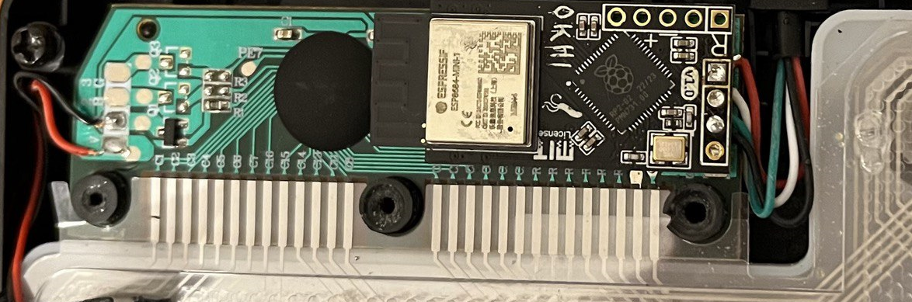

okhi is an implant that logs the keystrokes of a USB or PS/2 keyboard. It is made to hide easily inside a keyboard, laptop or tower case, and the keyboard cable powers it. You connect to it over WiFi and watch the keystrokes in real time.

## You can now buy it at [https://www.rootkit.es 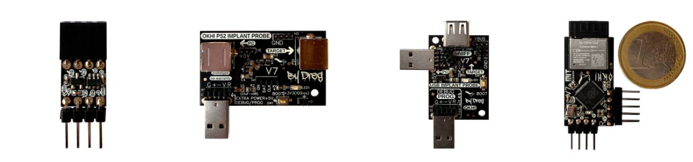](https://www.rootkit.es/)

If you register on Elecrow with this link before you buy the product, you help me support and maintain this project even more:

https://www.elecrow.com/referral-program/OTI1MDhqMnQ/

okhi is based on two chips: an RP2040 that sniffs and parses the keyboard data, and an ESP32-C2 that sends it over WiFi.

The RP2040 has a dual-core Arm Cortex-M0+ processor, so it handles several tasks at the same time (PIO rlz!).

The ESP32-C2 is an Espressif chip, specifically the ESP8684, with a small single-core RISC-V CPU. Do not confuse it with the ESP8266, ESP8285 or ESP8685: those are different chips.

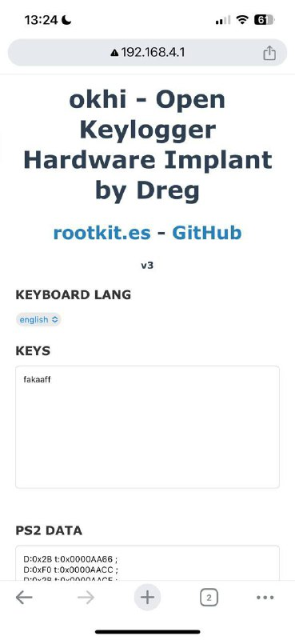

okhi is a proof of concept and an educational tool. It is not intended for malicious use.

okhi draws 107 mA on average (measured), with short WiFi bursts up to 430 mA. The target and the cable must supply this, or the implant does not work. The details are in [Power consumption](#power-consumption-measured-with-a-nordic-ppk2).

The keyboard draws current too. USB 2.0 allows at most 500 mA: never exceed it.

Just connect VBUS, GND and the data lines to okhi, and you are ready to go. For a PS/2 keyboard, connect okhi through the [5V to 3V3 shifter board](#5v---3v3-shifter-mini-board): CLK and DATA are pulled up to 5 V, and the RP2040 GPIOs are not 5 V tolerant.

You can connect okhi to the end of the cable, to a through-hole pin connector inside the tower, or to accessible pads or traces. okhi can sniff the keyboard's own lines anywhere up to the PC port or the first hub. On USB the keyboard must be low or full speed: [Test USB keyboard](#test-usb-keyboard) lists what okhi cannot log.

okhi connected with copper wires to the pads of a keyboard PCB:

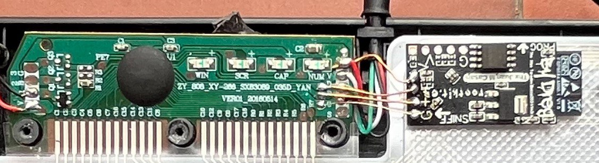

# Contents

- Using okhi: [Features](#features) · [Getting started](#getting-started) · [Firmware update](#firmware-update) · [OTA](#firmware-update-over-the-air-ota) · [Keyboard layouts](#multi-language-keyboard-support) · [Persistent keystroke log](#persistent-keystroke-log) · [Keyboards tested](#keyboards-tested-with-okhi) · [PS/2 male to male adapter](#ps2-male-to-ps2-male-adapter-mini-din-6p) · [PS/2 to USB adapters that work](#ps2-usb-adapters-working-with-okhi) · [Reporting issues](#reporting-issues) · [Passive USB-to-PS/2 adapters](#passive-usb-to-ps2-adapters-the-keyboard-speaks-ps2-not-the-adapter)
- Hardware: [USB pinout](#usb-a-male--female-pinout) · [PS/2 pinout](#ps2-pinout) · [Power consumption](#power-consumption-measured-with-a-nordic-ppk2) · [Hardware design](#hardware-design) · [What a mess of names!](#what-a-mess-of-names) · [ESP32-C2 module](#esp8684-mini-1-h4-module-esp32-c2) · [Old schematic v3](#old-schematic-v3) · [USB switch](#usb-switch) · [TCXO](#tcxo--25-ppm-for-rp2040) · [Crystal calibration from the web page](#the-same-from-the-web-page-without-reflashing) · [Project files](#project-files)
- Diagnostics and benchmarks: [Built-in self test](#built-in-self-test-what-it-checks-and-how-to-read-it) · [WiFi speed test](#wifi-speed-test-measured-from-the-browser) · [Link benchmarks](#link-speed-benchmarks-spi--uart-measured-limits)
- Developers: [Developers setup](#developers-setup) · [Map for new developers](#map-for-new-developers) · [ESP build notes and endpoints](#esp32-c2-firmware-build--hardware-notes) · [Web developers](#web-developers) · [Your own WiFi](#putting-the-implant-on-your-own-wifi) · [Developers hardware pack](#developers-hardware-pack) · [Flashing over a cable](#flashing-over-a-cable-and-the-traps-in-it) · [PS/2 & USB keyboard by UART](#ps2--usb-keyboard-by-uart) · [Generating a new release](#generating-a-new-release) · [OTA developer reference](#ota-developer-reference)
- Design notes: [Reusable dual-chip OTA](#reusable-dual-chip-ota-for-rp2040--esp32-boards) · [The ESP32-C2 as an SPI slave](#the-esp32-c2-as-an-spi-slave-behavior-quirks-and-how-they-shaped-the-code) · [PS/2 PIO notes](#developers-notes-for-ps2-pio) · [PS/2 captures](#ps2-captures)
- Reference: [PS/2 firmware guide](#ps2-sniffer-firmware-developers-guide) · [Wired USB keyboards](#wired-usb-keyboards-report-formats-bus-packets-and-product-classification) · [USB firmware guide](#usb-sniffing-code-documentation) · [Developers doc](#developers-doc)

# Appearance

Front (black)

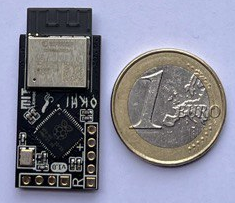

Back (black)

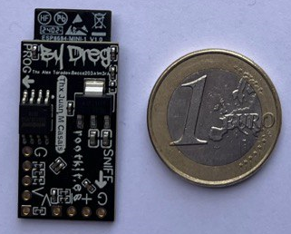

# Size (mm)

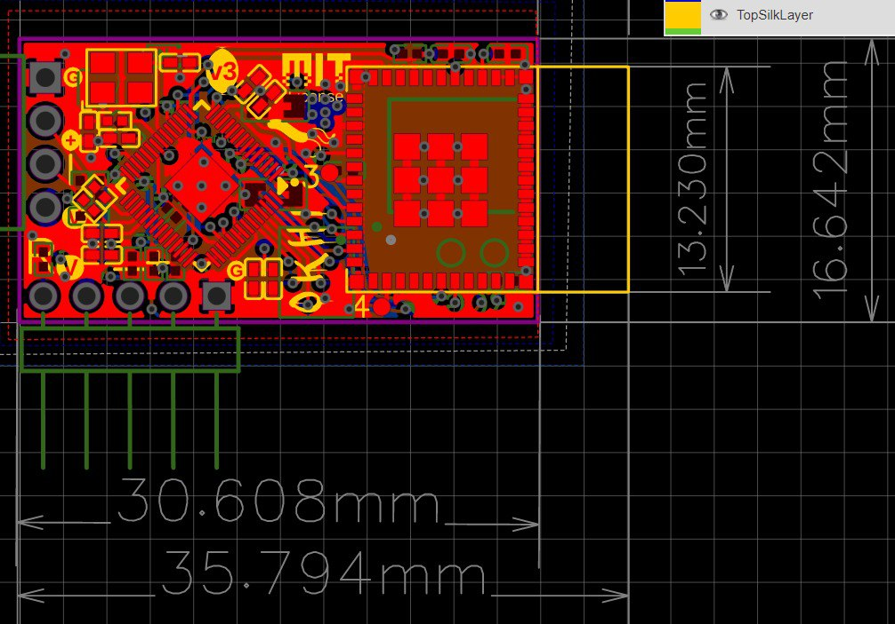

Check the size before you buy: okhi may be too big for your target, or you may need to drill out some space inside the keyboard.

# Features

- Supports PS/2 and USB keyboards: on USB, low speed and full speed (the same firmware switches between them by itself) and the report formats keyboards use (6KRO, NKRO, report IDs, keys on several interfaces). Firmware v9 or newer is needed for full speed and for the formats other than the 8-byte boot report
- WiFi and a web page that shows the keystrokes in real time
- Persistent capture: every keystroke is also stored in the implant's own flash within a few seconds, so the log survives reboots, power cuts and long stretches with nobody watching the page. Download or clear it from the web page (see [Persistent keystroke log](#persistent-keystroke-log))
- Multi-language keyboard layouts: pick the target computer's keyboard layout on the web page and the keystrokes are decoded with it
- OTA updates (since v7): update both chips over WiFi from the web page, with no cable, implant probe or disassembly
- Warns on the web page when a USB keyboard cannot be captured (a high speed keyboard, a full speed keyboard with reports longer than 8 bytes whose descriptors okhi never saw, or nothing attached)
- Hardware self test, SPI and UART link benchmarks and a WiFi speed test, all from the web page
- Crystal calibration tools: the implant can act as a 12 MHz reference clock or as a frequency meter to tune the crystal of other RP2040 boards (see [The same from the web page, without reflashing](#the-same-from-the-web-page-without-reflashing))
- [Reusable dual-chip OTA](#reusable-dual-chip-ota-for-rp2040--esp32-boards): use the whole OTA system in your own RP2040 and ESP32 board, MIT licensed, commercial use included
- Schematic images in this README: [PCB revision 3.0](#old-schematic-v3), and the [USB switch](#usb-switch) and [TCXO](#tcxo--25-ppm-for-rp2040) circuits of the current boards. Gerber, pick and place files and the BOM are not published yet
- Open source (MIT License; the USB capture code is a port of Alex Taradov's usb-sniffer-lite, BSD-3-Clause)
- Community support

# Getting started

## okhi implant

The implant sits between the USB or PS/2 keyboard and the computer, records the keystrokes and shows them over WiFi in real time.

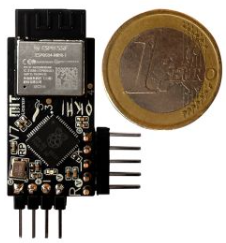

The implant ships with no firmware: program the latest one before you use it. The first time you program it you need an implant probe, and later updates can go over WiFi.

## USB implant probe

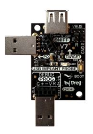

This board lets the implant sniff USB data from outside the keyboard, with no soldering and nothing installed inside it, so you can test the implant just by plugging it in.

This board is also how you program and update the okhi implant by cable.

On earlier PCB revisions the implant was programmed through the same USB port used for sniffing, and you had to disconnect the target keyboard each time. Newer revisions of the USB implant probe have a USB port just for programming the implant.

## PS/2 implant probe

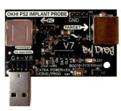

This board lets the implant sniff PS/2 data from outside the keyboard, with no soldering and nothing installed inside it, so you can test the implant just by plugging it in.

This board is also how you program and update the okhi implant by cable.

On earlier PCB revisions only the USB implant probe could program the implant. Newer revisions of the PS/2 implant probe have a USB port just for programming the implant.

This board already converts the PS/2 signals from 5 V to 3.3 V, so the okhi implant runs safely on it.

## 5V -> 3V3 shifter mini board

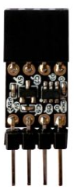

This small board converts the PS/2 signals from 5 V to 3.3 V, which keeps the RP2040 GPIOs within their ratings (they are not 5 V tolerant). Use it to connect the okhi implant inside a PS/2 keyboard. USB sniffing does not need it.

## Buying the necessary components

You need to buy these yourself:
- 1 PS/2 male to PS/2 male cable (MINI-DIN 6P)
- 1 PS/2 to USB adapter
- 1 USB extension cable
- 1 USB keyboard, low or full speed
- 1 PS/2 keyboard (Lenovo PS2 KEYBOARD on AliExpress is OK)

## How to program okhi implant

Insert the okhi implant into the "program zone female pins" of the USB implant probe or the PS/2 implant probe, with its GND pin lined up with the okhi-G pin. Then press and hold the BOOT button while you connect the probe to your computer through the program zone's USB male connector.

An RP2040 mass storage device appears on your computer. Copy a `.uf2` file to it, and the RP2040 reboots by itself. That programs only the RP2040: a blank implant also needs its ESP32-C2 programmed, in the order given in [Firmware update](#firmware-update).

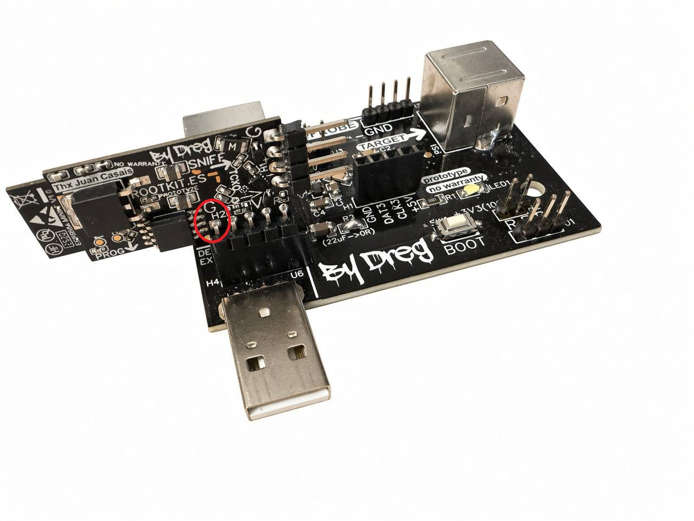

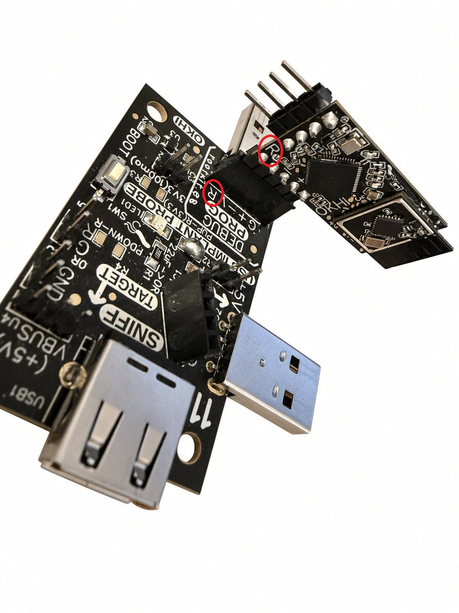

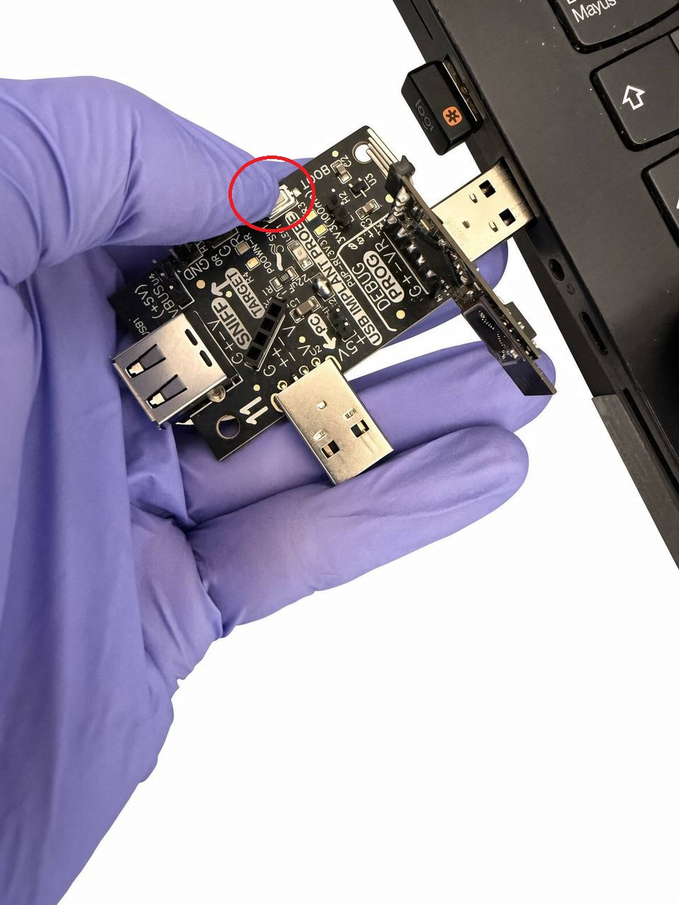

## How to test okhi implant

Insert the okhi implant into the "sniff zone female pins" of the USB implant probe or the PS/2 implant probe. Before connecting, make sure its GND pin lines up with the okhi-G pin.

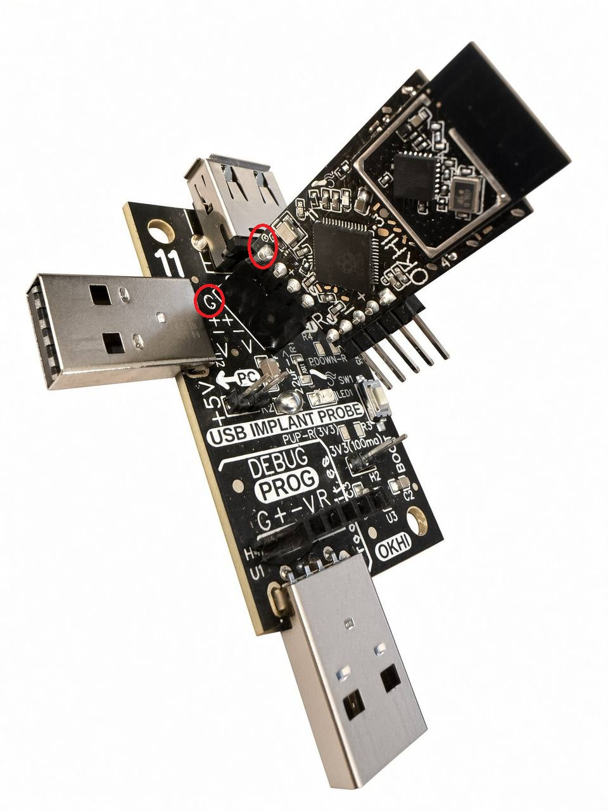

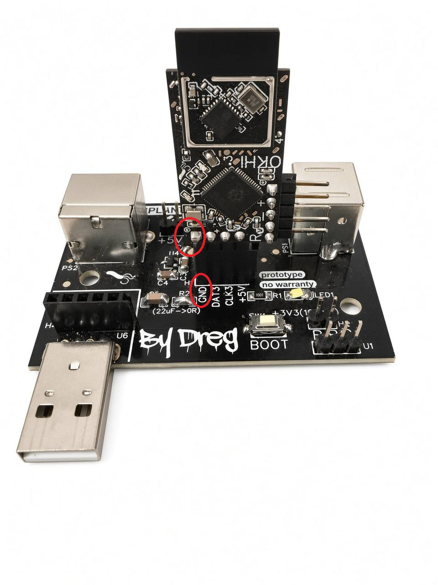

### Test USB keyboard

Connect the sniff zone's male USB to your computer, then the USB keyboard to the sniff zone's female USB port. Also connect the program zone's USB to your computer as an extra power source, so the okhi implant has enough power.

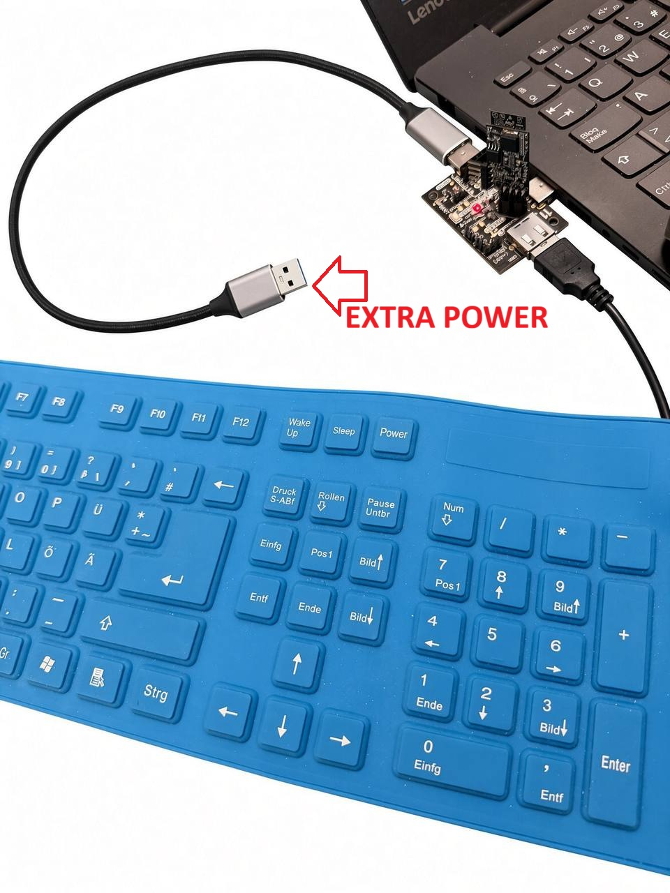

The USB variant of okhi captures low speed and full speed keyboards with the same firmware. The RP2040 tells them apart by the idle level of D+ and D- (a low speed device pulls D- up, a full speed one D+). While it captures, it switches to the other speed once nearly all its samples over 2 ms show that speed's idle level (see [6. PIO0: the bit sampler](#6-pio0-the-bit-sampler)). So it follows a newly plugged keyboard while the PC still waits out the 100 ms it gives every new device before talking to it.

It logs the keys of the report formats keyboards use: the 8-byte boot report, an NKRO bitmap, a longer key array, reports with report IDs, and keys spread over several interfaces, the way hybrid gaming keyboards send them (formats 1 to 6 in section 2 of [Wired USB keyboards](#wired-usb-keyboards-report-formats-bus-packets-and-product-classification)). It learns each keyboard's format from the keyboard's HID descriptors, which it reads off the wire while the PC fetches them as the keyboard is plugged in, so okhi has to be running by then. On the test bench it started capturing 0.1 s after a reset, and it still read a keyboard's descriptors when it restarted up to 0.2 s after the keyboard attached. An implant in line powers up together with the keyboard, and the [TCXO](#tcxo--25-ppm-for-rp2040) startup delay on the RP2040's RUN pin (10 kΩ and 2.2 µF) adds to that 0.1 s. If okhi restarts while a keyboard stays plugged in (an update of its RP2040 firmware does that), it takes that keyboard's format back from its flash, where it keeps the formats of the keyboards it saw enumerate.

In each of 167 report descriptors, the decoder finds the key fields the descriptor declares. Of those, 120 come from published dumps of 43 devices (32 keyboards, one of them in two configurations; 10 receivers and dongles; and a foot pedal that enumerates as a keyboard) and 47 from the source of keyboard firmwares and of the Linux kernel. On the test bench okhi logged the okhi-kbd test keyboard exactly in each of its formats, with the PC on Windows 11 and on Ubuntu 26.04 (kernel 7.0).

okhi logs nothing a high speed keyboard types, and whether such a keyboard still works on the PC through the implant has not been tested. A high speed USB drive worked through the [USB sniffer board for developers](#developers-hardware-pack), which has no USB switch: it read at 21.9 MB/s there, and at 21.7 MB/s plugged straight into a root port of the PC. With logic analyzer leads also clipped on D+ and D-, it failed to enumerate.

A low speed keyboard behind a full speed hub (a keyboard with a built-in USB 1.1 hub) is not logged either, and the page shows no warning for it. The cable then idles at full speed, the host's packets to the keyboard travel at low speed after a PRE token, the keyboard's replies travel at low speed with no PRE, and the full speed capture cannot read them.

A Logitech Unifying receiver is logged on Windows 11, which keeps it on its standard keyboard interface, and on Ubuntu 26.04 (kernel 7.0), whose hid-logitech-dj driver switches it to DJ mode. In DJ mode the keys of a paired keyboard come in the receiver's vendor report 0x20, which okhi decodes too (a K400 Plus there: 48 of 48 key states).

The web page shows a warning under the link status when the capture port holds nothing at all, when a full speed keyboard sends reports longer than 8 bytes whose descriptors okhi did not see (plug it in again), or when the line state is impossible (a wiring fault). A high speed keyboard gets the warning for an empty port, since at the RP2040's pins it reads as nothing: its 400 mV signaling stays under the 0.8 V they are guaranteed to read as low. The page hides the warning while a keyboard that okhi captures is attached. The verdict comes from the same line levels, sampled once a millisecond, and needs two quarter-second windows that agree, so plugging in or a bus reset never makes it flicker. The ESP32-C2 passes it on as `usb_bus=` in `/stats` (`low`, `full`, `wide` for the keyboard with unseen descriptors, `none`, `invalid`, or `unknown` while the RP2040 link is down) and in the `X-Okhi-Bus` header of the `/buffer` replies the page already polls, so the warning costs no request of its own.

On a hub running at full speed, like the test bench's, or on a high speed hub with one transaction translator for all its ports, a full speed keyboard shares its wires with what the hub repeats to every full speed port: the tokens, the data and the handshakes the host sends to the other full speed devices on that hub. Keys only ever travel as an IN answered by DATA, and so do the descriptors that say how to read them, on endpoint 0 after the PC's SETUP request. So the RP2040 stores only the INs answered by DATA, the SETUPs with their DATA, the frame marks (SOF), a DATA whose token went into the previous buffer, and the packets it cannot classify. A busy neighbor then does not crowd the capture buffers: on the test bench, with a USB serial adapter on the same hub polled 36,000 times a second, a buffer still lasted about 4 s and every keystroke was logged (measured before the SETUPs were kept as well).

Such a hub also repeats to its full speed ports what the host sends to a low speed device behind it, a mouse for example: a PRE token and the low speed packet after it. The RP2040 drops those, and the end of each is too short to count as a bus reset. On the test bench, with a low speed mouse behind the same full speed hub, 12 s of idle gave no false bus reset and 6 pairs of overlapped keys were logged exactly.

### Test PS/2 keyboard

Plug the PS/2 keyboard into the sniff zone's "TARGET" PS/2 port. Then connect the sniff zone's other PS/2 port, "PC", to a PS/2 to USB adapter with a PS/2 male-to-male cable (Amazon and AliExpress sell them). Last, connect the program zone's USB to your computer as an extra power source, so the okhi implant has enough power.

The extra power matters most with a PS/2 to USB adapter, since some adapters do not supply enough power for the implant.

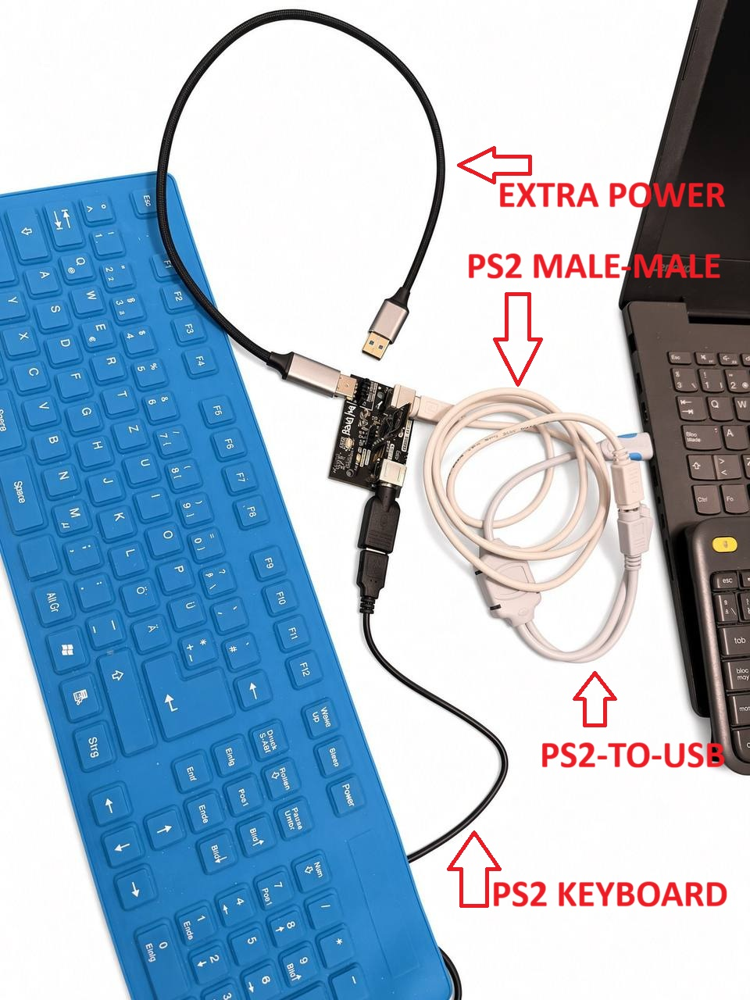

### Firmware update

The firmware has two parts, one for the RP2040 and one for the ESP32-C2, and the RP2040 programs the ESP32-C2. So you first write a temporary firmware to the RP2040 for that job, then write the ESP firmware to the ESP32-C2 through the RP2040's USB port, and last write the final firmware to the RP2040. It takes a few minutes, and after that, updates can go over WiFi instead.

To update the firmware:

- Download the latest firmware from the releases section: https://github.com/therealdreg/okhi/releases/latest

- Insert the implant into the "program zone female pins" (PROG) of the implant probe.


- Press and hold the programming button (BOOT) while you connect the implant probe to the computer. This puts the implant in program mode.


- Copy the `uart_bridge.uf2` file to the implant, which shows up on your computer as a USB drive named RPI-RP2 (e.g., drive E:). The drive ejects by itself once the copy completes.

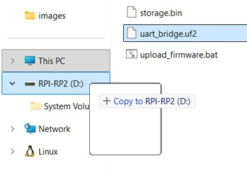

- Disconnect the implant from USB, then reconnect it to a USB port without pressing any button, so it starts in normal mode.

- Run the `upload_firmware.bat` script, which programs the ESP32-C2 for you.

- Type the COM port number of the implant (e.g., COM3). If you are not sure which one it is, the batch file lists the available COM ports, and you may have to try them one by one.

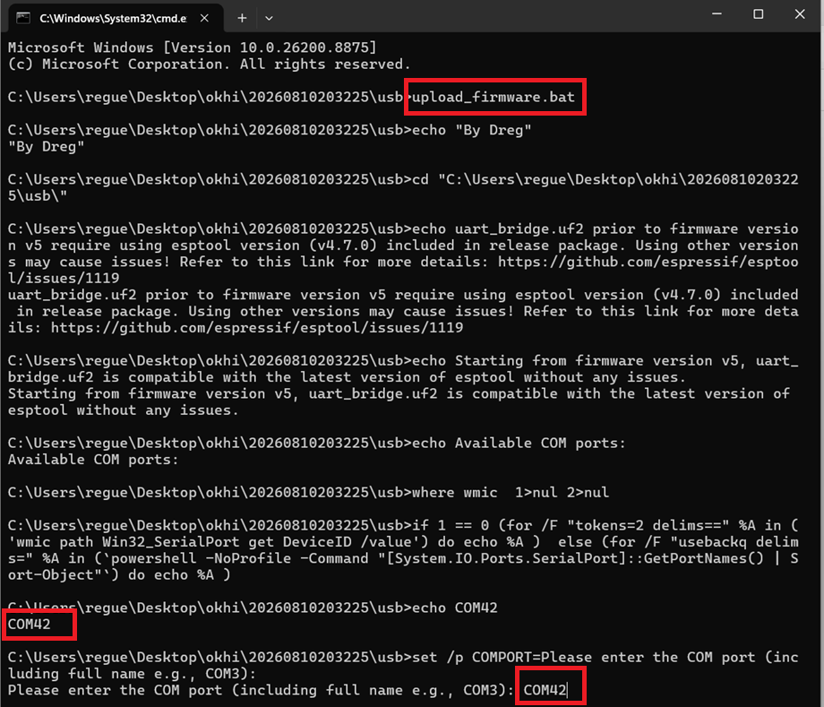

- Wait for the script to finish. The ESP32-C2 is then programmed and ready.

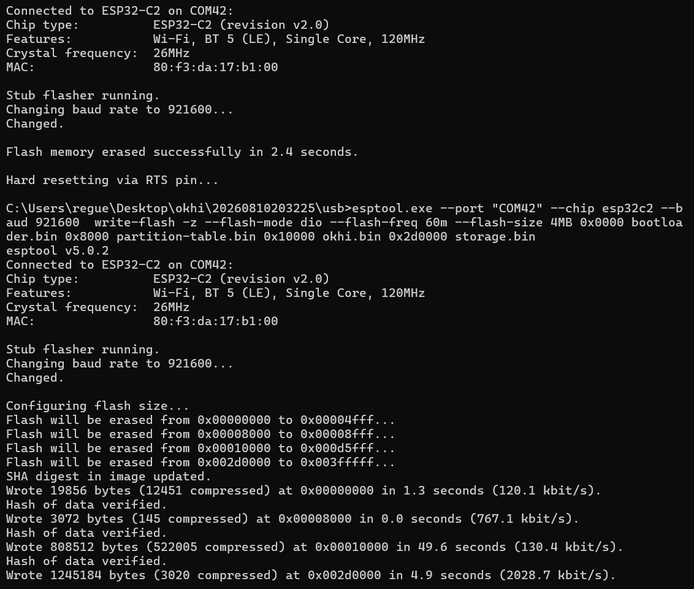

- Disconnect the implant from USB, then press and hold the programming button (BOOT) while you plug it back in, to enter program mode again.


- Copy the `okhi.uf2` file to the implant, which shows up again as the RPI-RP2 drive (e.g., drive E:). The drive ejects by itself after the copy.

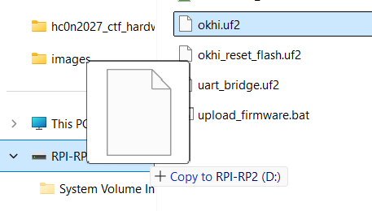

- The RP2040 is now programmed and ready to use. Disconnect the implant from USB.

- Connect the implant to the sniff zone of the implant probe.


- Connect the implant probe to the computer.


- Also connect the program zone's USB to your computer as an extra power source, so the implant has enough power.

- Join the ESP's WiFi network (`PS2_<device_id>` or `USB_<device_id>`, password `1234567890`) and open the web page at http://192.168.4.1/ in a web browser.

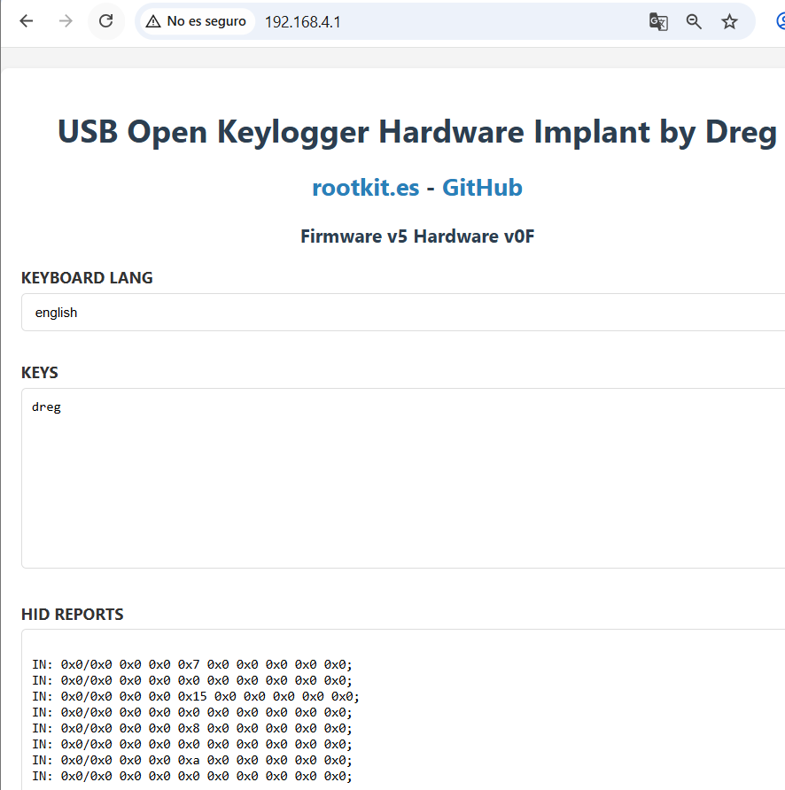

The picture shows the web page of the USB firmware v5. Newer firmware also prints five lines at the top (see [Checking that an update really landed](#checking-that-an-update-really-landed-the-esp-the-rp2040-and-the-web-page)) and calls the selector "Keyboard layout".

The release zip has a `last_esptool` folder with pre-built esptool binaries for several platforms, so you don't need to install Python or esptool separately:

| Folder | Platform |
|---|---|
| `esptool-windows-amd64` | Windows 64-bit (x86_64) |
| `esptool-linux-amd64` | Linux 64-bit (x86_64) |
| `esptool-linux-aarch64` | Linux ARM 64-bit |
| `esptool-linux-armv7` | Linux ARM 32-bit |
| `esptool-macos-amd64` | macOS Intel (x86_64) |
| `esptool-macos-arm64` | macOS Apple Silicon (M1/M2/M3...) |

Pick the binary that matches your OS and architecture. The Linux and macOS binaries come without the execute permission, so first run `chmod +x` on the one you use (`upload_firmware.sh` does it for you). Of those five, only `esptool-linux-amd64` has been run, on Ubuntu 26.04.

#### Firmware update from Linux or macOS

Each variant folder of a release, `usb` and `ps2`, has `upload_firmware.sh` next to `upload_firmware.bat`. It does the same full erase and write as the `.bat`, with the release's own esptool for the OS it runs on, and it can also copy a `.uf2` file to the RPI-RP2 drive. From a terminal in that folder:

- Hold BOOT while you plug the implant probe in, then run `bash upload_firmware.sh uf2 uart_bridge.uf2`. It waits for the RPI-RP2 drive to mount and copies the file.
- Plug the probe back in without pressing BOOT, so the RP2040 starts as a USB to UART bridge (USB ID `2e8a:000a`), then run `bash upload_firmware.sh <port>`, for example `bash upload_firmware.sh /dev/ttyACM0`. Without a port, it lists the serial ports and asks for one.
- Hold BOOT, plug the probe back in, then run `bash upload_firmware.sh uf2 okhi.uf2`.

On Ubuntu 26.04 a user in the `dialout` group opens the port without root (to join it, `sudo usermod -aG dialout $USER`, then log out and in again). `bash upload_firmware.sh --help` also covers ModemManager, brltty, mounting the drive by hand, a lower baud rate and another esptool. A write is good when esptool reports `Hash of data verified` for all four images, whatever its exit code (see [Two error messages that are harmless](#two-error-messages-that-are-harmless)). On a development board the ESP needs only the second step, through the DevKit's own USB port and within [about 50 seconds after the first esptool reset](#you-have-about-50-seconds-after-the-first-esptool-reset). The RP2040's `okhi.uf2` goes on separately.

Tested on Ubuntu 26.04 LTS (kernel 7.0, x86_64) through the CP2102N of a development board's ESP8684-DevKitM-1: two full writes of the ESP with the release's esptool v5.3.1, about 28 and 27 s each, every image verified. Not tested: the RP2040 bridge, a real RPI-RP2 drive, other Linux distributions and macOS.

### Firmware update over the air (OTA)

OTA (over the air) means updating the implant's firmware through its own WiFi network, instead of taking it out of the target, plugging it into an implant probe and copying files over USB. okhi updates both chips this way. Once the implant is hidden inside a keyboard, laptop or tower case, you do not have to open it again to put a newer firmware on it: connect to its WiFi, open the web page and upload one file. A few cases still need a cable install (see the Important note below).

The whole update is one file in the release package, `okhi_USB_ota.pkg` or `okhi_PS2_ota.pkg`. It carries the ESP32-C2 firmware and the RP2040 firmware together, tagged with the variant (USB or PS/2) and protected by a CRC32 for each half, so the device refuses a package built for the other variant or a corrupted one.

To update, join the device's WiFi network (`USB_xxxxxxxxxxxx` or `PS2_xxxxxxxxxxxx`, password `1234567890`), open http://192.168.4.1/, pick the `.pkg` in the "Firmware update" card and press "Upload firmware". The ESP then checks the package, writes its own half to the spare flash slot and reboots into it. Then **reconnect and load the page within 5 minutes to confirm the update**. Once that confirmation arrives, the RP2040 pulls its own image over the internal SPI link, checks its CRC32, backs up its current firmware to a golden slot, applies the new one and reboots, which restarts the ESP too.

Without that confirmation the update does not stick: if nobody loads the page within 5 minutes, the ESP assumes the new firmware is broken (or unreachable), drops the RP2040 image and rolls back to the previous firmware, so both chips stay on the old release. A power loss while the package is uploading is harmless too (the old firmware keeps running from the other slot). A new RP2040 firmware gets three boots to be confirmed, by one good SPI poll after 10 s of uptime; on the fourth boot the RP2040 restores the golden backup.

A `.pkg` update that changes the ESP firmware also wipes the stored settings on purpose, even when the update rolls back (see [Settings are wiped by any ESP firmware change, on purpose](#settings-are-wiped-by-any-esp-firmware-change-on-purpose)). So an implant you had joined to your own network comes back on its own access point after the update, unless its firmware was built with your network compiled in. Join that access point and load the page there to confirm the update within the 5 minutes, then set your network again from the "Network" card.

While the update runs, okhi stops capturing for the few seconds the SPI transfer and the commit take. The keyboard keeps working normally, but those keystrokes are not recorded. On the USB variant the RP2040 then restarts with the keyboard still plugged in and takes the keyboard's format back from its flash, so an NKRO keyboard or one with report IDs goes on being logged. After the update from v7, which kept no formats, plug such a keyboard in again once.

Do not power the device off during an update.

#### Checking that an update really landed, the ESP, the RP2040 and the web page

An implant holds three separate parts, built at three different moments: the ESP32-C2 firmware, the RP2040 firmware and the web page it serves (embedded inside the ESP firmware, not stored as a file). A page that loads and a device that answers do not prove that any of them is current: the ESP can be new while the RP2040 is still the old one, and the page can be the one you edited but never regenerated. So judge an update by the identity of each part.

The web page prints five lines at the very top, and every release folder has a `MANIFEST.txt` with the values the first four should show. Compare them to know exactly what is on the device:

```
ESP  v9  sha 1a6977f9c662d2df  Oct 12 2026 20:37:16  [usb, ota_0, idf v6.0.2]
RP   v9 usb Oct 12 2026 20:38:05  [hw vFF]
WEB  2026-10-12 18:35:05Z  src 138764 B  sha c1803f25399b  node v26.4.0
FP   318d0d0fa06f9746  (compare with the release manifest)
RST  1 since the last flash
```

- `ESP` identifies the ESP32-C2 application by the `sha` right after the version. That sha is unique per compilation and is the value to compare. The date after it is the ESP-IDF build date, which does not change on an incremental rebuild, so a date that looks old is normal and proves nothing on its own.
- `RP` is the RP2040 identity string, baked in at compile time and unique per compilation.
- `WEB` is the page itself: when it was generated, the size of the source it came from and a hash of that source. If it says `NOT GENERATED`, the firmware was built around an `index.html` that nobody ran `webgen.js` over.
- `FP` is a single fingerprint computed over the other three, and the one line to check: if it matches, all three parts are the ones in that release, with no need to compare three strings by eye.
- `RST` counts the restarts since the ESP firmware last changed. It goes up by one on every reboot, which is how the "Reset the RP" button proves the board really restarted. It is not part of the fingerprint.

If `FP` does not match the manifest, the three lines above it show which part did not update. The usual causes are an ESP update that was never confirmed within 5 minutes and rolled back (upload it again and load the page this time), an interrupted update (repeat it: the device is designed to survive this), and mixing files from different release folders (take all of them from the same one).

The two chips can legitimately end up on different releases, for example when a new RP2040 firmware fails its three boots and the RP2040 restores its golden backup while the ESP keeps the new release, or after updating one chip alone. The implant keeps working, so nothing looks wrong, but the fingerprint tells you. Repeating the update fixes the second case. After a golden restore, the RP2040 refuses the image that failed and takes only a different one.

Important: OTA works only on devices that already run an OTA-capable firmware, v7 or newer. A device coming from an older release has to be programmed once by cable, with `upload_firmware.bat` and the `.uf2` files as described above, because the ESP partition table changed and that change cannot be migrated over the air. After that first cable install, updates go over WiFi. A release that changes the ESP partition table again has to be installed by cable too, and so does one that changes `SPI_FRAME_VERSION`, the version of the SPI protocol between the two chips. A power cut in the couple of seconds while the RP2040 rewrites its own app may also leave it needing a `.uf2` by cable ([the limits](#being-straight-with-you-about-the-limits)).

The release package also ships `ota_esp.bin` and `ota_rp.bin`, the same two images loose, to update one chip on its own. Those are meant for development: for normal use, always use the `.pkg`. The details, with the `curl` commands and how to check the result on http://192.168.4.1/stats, are in [OTA developer reference](#ota-developer-reference).

### Multi-language keyboard support

A keyboard sends key positions (HID usage IDs on USB, scan codes on PS/2), not characters. The keyboard layout set on the target computer turns a position into a character, so the same physical key is `;` on an English keyboard and `ñ` on a Spanish one.

The web page has a "Keyboard layout" selector at the top. Pick the layout the target computer uses and the keystrokes are decoded with it, including the characters the Spanish layout types with AltGr (`@`, `#`, `€`, `[`, `]` and so on). The English layout is the US one, which has no AltGr characters. Decoding happens in the browser, so the selector changes how new keystrokes are shown from that moment on. The text already on screen keeps the characters it was decoded with, and "Download all data" saves the selected layout together with the capture.

The layouts included are "english" (the default) and "spanish". A new one needs no C code. The tables live in `webusb\index.html` (USB firmware, `LAYOUTS` object) and `webps2\index.html` (PS/2 firmware, `PS2_LAYOUTS` object), one entry per layout with three tables (`base`, `shift` and `altgr`, plus a `caps` list on USB) that map a key code to a character. The USB tables are indexed by HID usage ID and the PS/2 ones by set 2 scan code, since that is what each protocol puts on the wire. The letters keep their QWERTY keys outside those tables, so AZERTY or QWERTZ also needs a change to the page's decoder. Add your layout there, add an `<option>` to the selector, regenerate the web page with `webgen.js` and rebuild the ESP firmware, as described in [Web developers](#web-developers). Pull requests with new layouts are very welcome.

The page keeps the raw stream next to the decoded keys ("HID reports" on USB, "PS/2 data" on PS/2), and both go into the downloaded file, so a wrong layout loses nothing while the raw records are still there. Each box keeps only its last 400,000 characters, and the raw one fills first: it holds about 12,000 key presses on USB (4,000 for a keyboard logged as raw `IN:` records) and 5,000 on PS/2. Past that its oldest records go, while "Keys" still shows the text decoded from them.

### Persistent keystroke log

Every keystroke is also written to the implant's own flash memory, so the log survives reboots, power cuts and stretches where nobody is watching the web page. Writes go out in small batches, at most about five seconds after the keys were typed (sooner if 256 records pile up first, which takes typing faster than about 200 words per minute on PS/2 or 300 on USB), so a power cut can only cost the last few seconds.

The ESP32-C2 keeps the log as two files of 340 KB each on its SPIFFS partition. When the current one fills up it replaces the older one, so the device always holds the most recent 340 to 680 KB and drops the oldest records first. That is roughly 10,000 to 20,000 typed characters on USB (3,500 to 7,500 for a keyboard logged as raw `IN:` records) or 4,000 to 8,500 on PS/2. As with a clear (below), the dropped records stay in the flash until a garbage collection erases their blocks. The log stops about 400 KB short of filling the partition, which leaves room for an RP2040 update to be stored.

To download the stored log, press "Download persistent log" in the "Persistent log" section of the web page. The browser saves a text file with the decoded keystrokes (in the selected keyboard layout) and the raw wire records, so you can decode the log again later with another layout. The status text shows the download progress.

To clear the stored log, press "Clear persistent log". It deletes both log files, which the device cannot bring back, so the page asks you to confirm first. SPIFFS deletes a file by marking its pages as deleted, and erases their blocks only later, in a garbage collection that makes room for new writes. Until then the records stay in the flash, readable in a dump of the `storage` partition, since ESP-IDF's SPIFFS cannot run on an encrypted partition. A full erase by cable removes them at once (see [The full erase is not optional](#the-full-erase-is-not-optional)). The clear also leaves the ESP's RAM alone: a reload of the page shows up to the last 504 records again, until newer records push them out or the ESP restarts.

Both operations work whether the device is in WiFi access-point mode or connected to your LAN as a station.

## Thanks to PCBWAY for sponsoring the okhi project

Special thanks to PCBWay for sponsoring this project! PCBWay is a well-known PCB prototyping and manufacturing service, with high-quality boards and excellent customer support. I have worked with their boards before, and they are of great quality. I ordered the PCBs for this project on their platform easily and without any problems, and the sponsorship included a free quick delivery option. If you are looking for reliable PCB prototyping and manufacturing services, I highly recommend checking them out.


https://www.pcbway.com


## DIY USB & PS2Keylogger POC

https://github.com/therealdreg/pico-usb-sniffer-lite

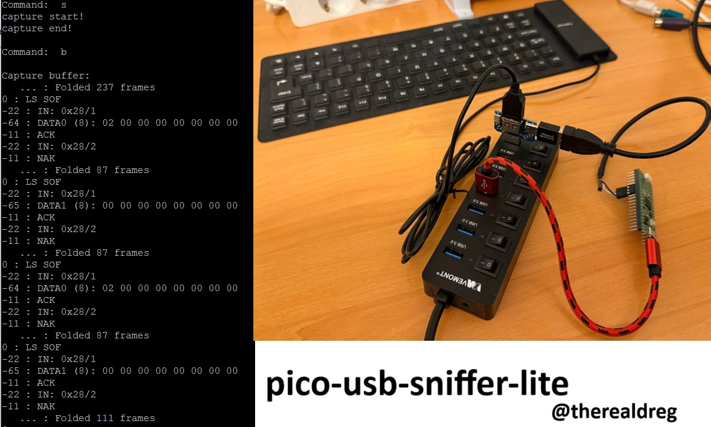

https://github.com/therealdreg/pico-ps2-sniffer

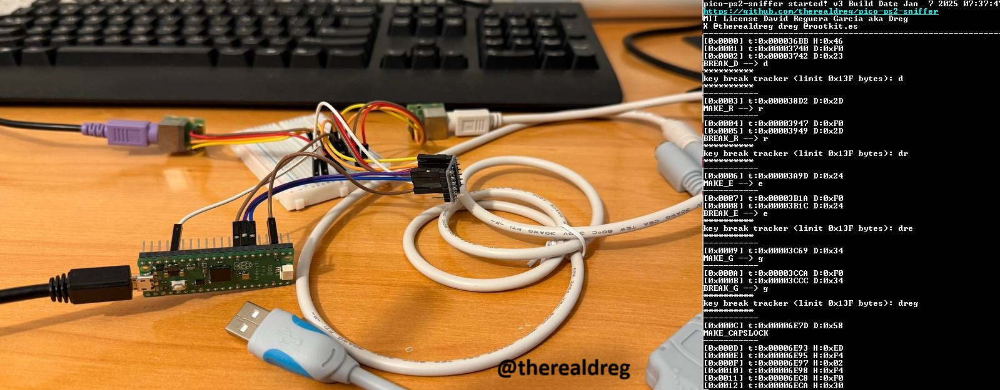

# PS/2 male to PS/2 male adapter (MINI-DIN 6P)

Instead of a PS/2 male-to-male cable, you can use a PS/2 male-to-male adapter, which is shorter and easier to work with.

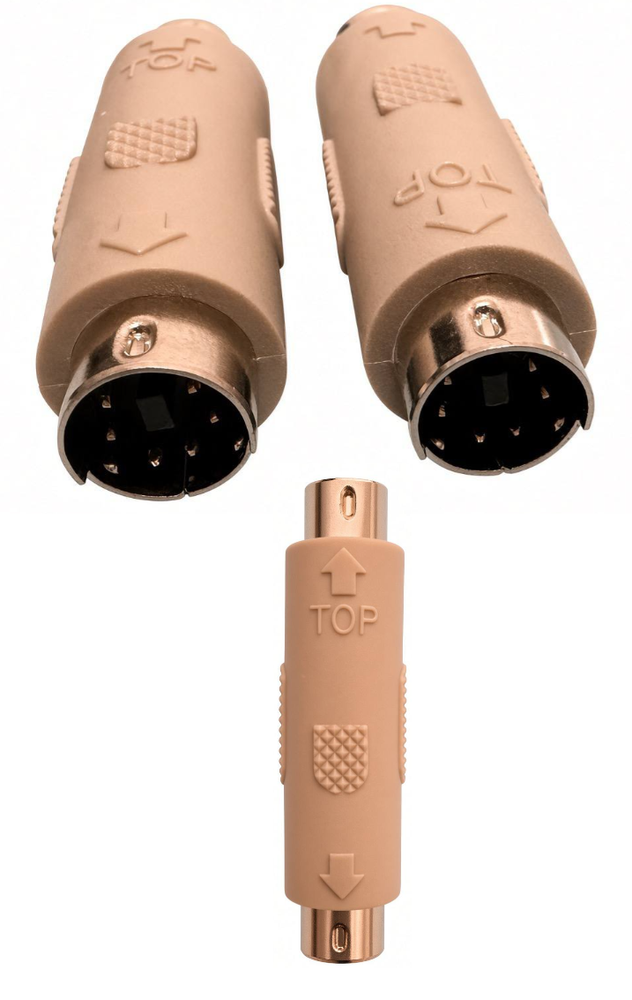

I have only found it for sale in one place, but it is really handy.

https://cablematic.com/es/productos/adaptador-de-conector-ps2-minidin-6-pin-macho-a-macho-CS015/


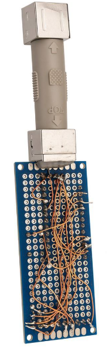

# Keyboards tested with okhi

One row per keyboard and host. The firmware is the version the `RP` line at the top of the web page shows (see [Checking that an update really landed](#checking-that-an-update-really-landed-the-esp-the-rp2040-and-the-web-page)). OK means that what was typed reached okhi's keylog and web page, NOK that some of it did not. In the USB rows a logic analyzer on D+ and D- also recorded the wire, and the RP2040, the keylog and the web page held every key state of it. In the PS/2 row the analyzer recorded one typing run on each date, every byte it decoded reached the keylog, and an 8-minute soak compared the keylog with the bytes okhi-kbd sent.

| Keyboard | Bus, USB ID | Speed, polling | Key report | Host | Firmware | Result | Date, numbers |
|---|---|---|---|---|---|---|---|
| okhi-kbd test keyboard, each of its nine formats ([PS/2 & USB keyboard by UART](#ps2--usb-keyboard-by-uart)) | USB `2341:8036`, `2341:feed` in its two-interface formats | low and full speed; bInterval 10 polled every 8 ms, 64 at low speed every 32 ms | boot, longer array, NKRO bitmap, report IDs, two interfaces, hybrid | Windows 11 | v9 | OK | 2026-11-09: a 2-hour regression, 16 of 16 cases |
| okhi-kbd test keyboard, each of its nine formats | USB `2341:8036`, `2341:feed` in its two-interface formats | low and full speed; bInterval 10 polled every 8 ms, 64 at low speed every 64 ms | the same | Ubuntu 26.04, kernel 7.0 | v9 | OK | 2026-11-09: the same regression, 16 of 16 cases |
| Corsair K63 | USB `1b1c:1b40` | full speed, bInterval 1 | report ID 1: the modifiers and a 152-bit key bitmap | Windows 11, iCUE open | v9 | OK | 2026-11-05: 73 of 73 and 66 of 66 key states, each run after a restart of the RP2040 |
| Corsair K63 | USB `1b1c:1b40` | full speed, bInterval 1 polled every 1 ms | the same, in report protocol | Ubuntu 26.04, kernel 7.0 | v9 | OK | 2026-11-09: 60 of 60; 8 keys held at once with CapsLock and a media key, 30 of 30; 64 of 64 after a reset |
| Logitech K400 Plus on a Unifying receiver | USB `046d:c52b` (the receiver) | full speed, the keyboard endpoint polled every 8 ms | the receiver's boot keyboard interface | Windows 11 | v9 | OK | 2026-11-09: 52 of 52, and 40 of 40 after a reset |
| Logitech K400 Plus on a Unifying receiver | USB `046d:c52b` (the receiver) | full speed, the DJ endpoint polled every 2 ms | DJ report 0x20 on the receiver's third interface (hid-logitech-dj) | Ubuntu 26.04, kernel 7.0 | v9 | OK | 2026-11-09: 50 of 50 and 48 of 48; the touchpad and a media key log nothing |
| okhi-kbd test keyboard in PS/2 mode, through PS/2 to USB adapter 2 | PS/2; the adapter USB `13ba:0018` | PS/2 | PS/2 scan codes | Windows 11 | v9 | OK | 2026-11-08 and 2026-11-09: the end-to-end test 21 of 21, nothing lost in an 8-minute soak |

To add a keyboard, open an issue or a pull request with one row: the keyboard; PS/2 or its USB ID (`lsusb` on Linux, USB Device Tree Viewer on Windows); its speed and bInterval (`lsusb -t` and `lsusb -v`, see [Verification checklist on a host](#9-verification-checklist-on-a-host)); the host OS and its version; the okhi firmware; OK or NOK; the date; and what you typed against what okhi logged. A keyboard running at high speed is NOK: okhi captures only low and full speed (see [Test USB keyboard](#test-usb-keyboard); no high speed keyboard has been tried).

# PS/2<->USB adapters working with okhi

Some adapters use purple for the keyboard, others green... wtf! If it doesn't work in one port, try the other.

- 1 (adapter from hell: it works, but not recommended) (Amazon)

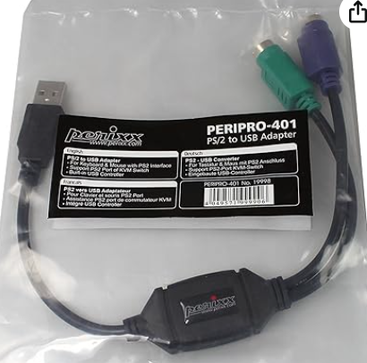

- 2 AliExpress (OK)

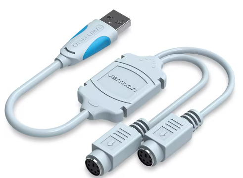

- 3 AliExpress (OK)

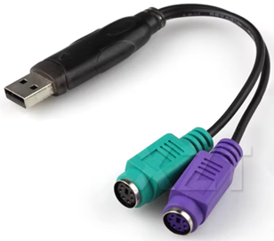

- 4 AliExpress (OK)

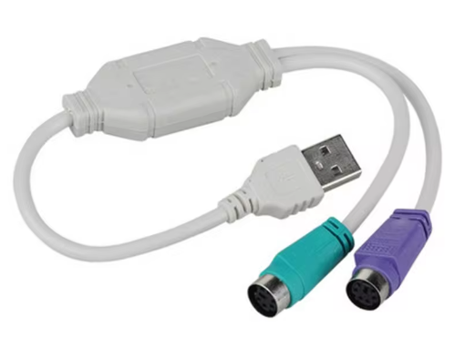

- 5 AliExpress (OK)

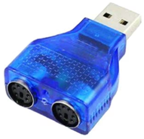

- 6 StarTech (Amazon) (OK)

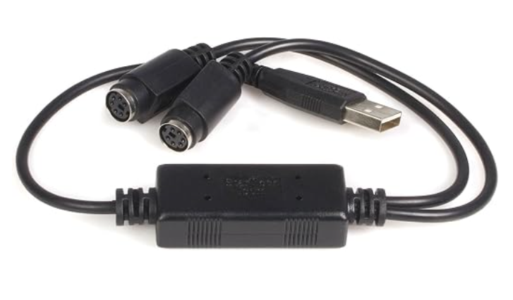

- 7 AliExpress (OK)

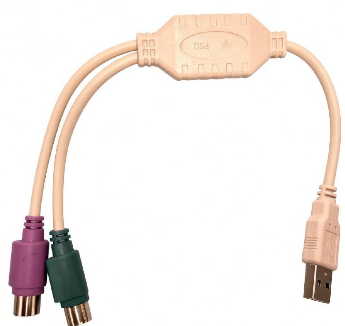

- 8 AliExpress (OK)

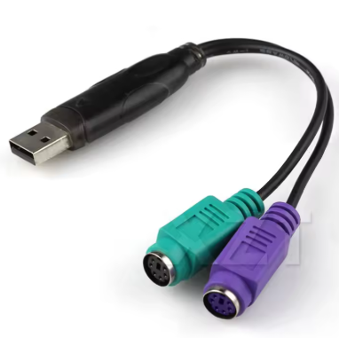

Logic analyzer captures of adapters 1, 2, 5, 6, 7 and 8 are in [PS/2 captures](#ps2-captures).

# Never buy this PS/2<->USB


These small molded plugs are passive: there are no electronics inside. None of them works as the PS/2 to USB adapter on the sniff zone's 'PC' port: that adapter has to turn the keyboard's PS/2 into USB, as the adapters above do. The kind with a USB female socket and a PS/2 male plug still has a use on the 'TARGET' port: testing the PS/2 implant with a USB keyboard that also speaks PS/2, as [Passive USB-to-PS/2 adapters](#passive-usb-to-ps2-adapters-the-keyboard-speaks-ps2-not-the-adapter) explains.

# Reporting issues

If a PS/2 to USB adapter does not work with the sniffer, please send me captures of it made with a logic analyzer or with pico-ps2-diagnostic-tool, which captures and replays the DATA and CLOCK lines of a PS/2 interface:

https://github.com/therealdreg/pico-ps2-diagnostic-tool

The tool captures on GPIO20 (DATA) and GPIO21 (CLOCK) of a Raspberry Pi Pico. The PS/2 lines idle at +5 V and the RP2040 GPIOs are not 5 V tolerant, so connect those two pins to the PS/2 lines through a 5V to 3V3 level shifter.

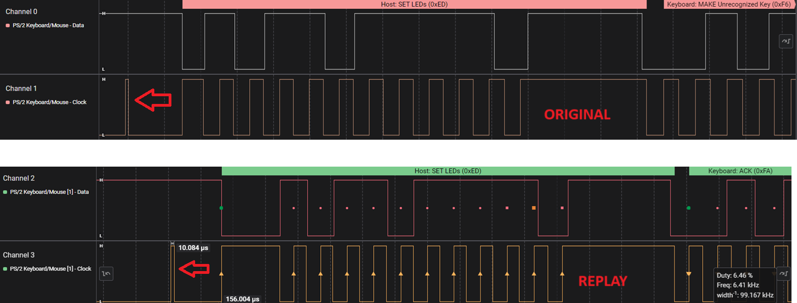

The original CLOCK signal has a short pulse, and the replay reproduces it. Saleae's Logic software labels the keyboard's reply 0xF6 on the original and ACK (0xFA) on the replay. On both, bits 0 to 3 of that reply read 0, 1, 0, 1, as in 0xFA (0xF6 would read 0, 1, 1, 0).

# Passive USB-to-PS/2 adapters: the keyboard speaks PS/2, not the adapter

You can test the PS/2 implant with a low speed USB keyboard whose controller also speaks PS/2, through an adapter with a USB female socket on one side and a PS/2 male plug on the other. These are the cheap molded adapters sold under names like "USB Adapter Converter Keyboard Mouse USB Female To PS2 PS/2 Male".

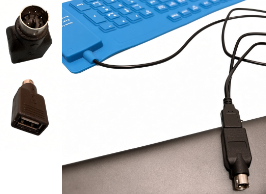

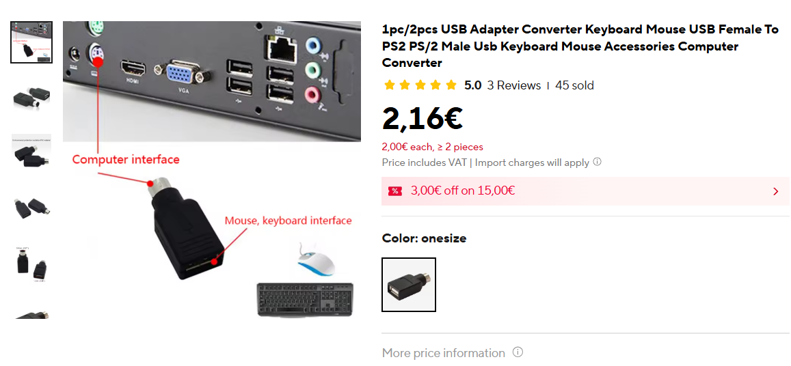

## The adapter is passive: it moves contacts, it does not translate

The shell holds no silicon (no microcontroller, level shifter or logic), only wires that remap the USB contacts onto the PS/2 connector. The usual wiring is:

| USB Type-A pin | Signal | PS/2 mini-DIN pin | Signal |
| :---: | :--- | :---: | :--- |
| 1 | VBUS (+5V) | 4 | VCC (+5V) |
| 2 | D- | 1 | DATA |
| 3 | D+ | 5 | CLK |
| 4 | GND | 3 | GND |

## Proof: sniff the USB side and you already see PS/2

Plug the low speed USB keyboard into the adapter and clip a logic analyzer onto the two data conductors on the USB side, before the adapter.

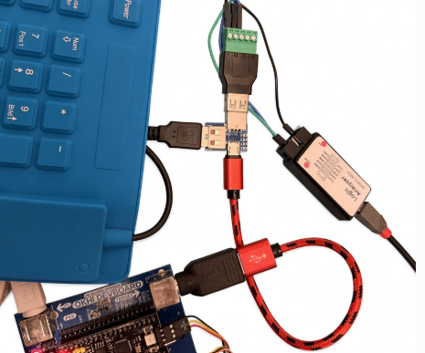

The USB D+ and D- wires carry no USB signaling, only PS/2 framing: a clock line toggling at roughly 10 kHz to 16.7 kHz and a data line carrying 11-bit frames. The keyboard already speaks PS/2 on those two pins, so the adapter has nothing to translate.

## Why: the intelligence lives in the keyboard, not in the wire

Many keyboards and mice from the years when both interfaces coexisted shipped with a dual-mode controller, often called a combo controller: one chip that implements USB and PS/2 and picks one of them at power-on. In a combo device the same two pins are USB D+/D- or PS/2 CLK/DATA depending on the mode, which is why a passive adapter works at all. The controller tells the two hosts apart because a USB host and a PS/2 host load the two data lines in opposite ways.

A USB host's downstream port pulls both D+ and D- toward ground through 15 kΩ pull-down resistors. A low speed device then identifies itself with a 1.5 kΩ pull-up from D- to its 3.3 V reference (a full speed device puts that pull-up on D+ instead). One line ends up at a valid high level (around 3 V, set by the 1.5 kΩ pull-up working against the host's 15 kΩ pull-down) while the other stays low. Shortly after, the host drives both lines low into the single-ended zero state (SE0, both D+ and D- at ground), and a device takes an SE0 longer than a few µs as a USB bus reset.

A PS/2 host's port has no pull-downs and sends no USB traffic. CLK and DATA both idle high, pulled up to +5 V through the host's resistors (the value depends on the host, commonly several kΩ), and stay there until the device clocks a frame or the host pulls CLK low to inhibit the bus or to start a Request-to-Send.

At power-on the combo controller samples the electrical state of its two data pins. If it sees the pulled-up, idle-high state of a PS/2 port and no USB reset or bus activity arrives, it concludes that a PS/2 host is on the other side of the adapter. It then switches those two pins away from the USB transceiver and drives them as open-collector PS/2 CLK and DATA lines: it pulls each line low, or releases it to the pull-up for a high. The passive adapter passes those pins straight through, so the PS/2 waveform appears on the conductors that would otherwise carry USB D+ and D-. That is what the analyzer captures.

The detection sequence depends on the vendor. Some controllers look for the host pull-downs, some for a bus reset that does not come within a timeout, some for D+ staying high (Freescale's DRM014 reference keyboard picks PS/2 when D+ stays high for 1 ms, and USB when a SETUP token arrives). In all of them the two hosts look electrically different at idle, and the controller latches its decision before it sends any keystroke.

## What the implant sees on the wire

Once the keyboard has picked PS/2, the implant sees standard PS/2 traffic, clocked by the keyboard, with the keystrokes in the device-to-host scancode stream. With the clock at roughly 10 kHz to 16.7 kHz, a bit lasts about 60 to 100 µs and an 11-bit frame roughly 0.7 to 1.1 ms. The [PS/2 protocol crash course](#3-ps2-protocol-crash-course) has the frame format, the host inhibit and the bus states.

## Passive adapter versus active converter: do not confuse them

The two look much the same, and one cannot stand in for the other:

- A passive adapter, the kind described here, is a plain connector shell with wires and no electronics. It works only because the keyboard itself can speak PS/2: with a keyboard that cannot, nothing comes out of the PS/2 side.
- An active converter has a microcontroller that talks USB to the keyboard on one side and generates PS/2 on the other. To the keyboard it is a real USB host, so the keyboard stays in USB mode, and the PS/2 you would capture comes from the converter, not from the keyboard.

To test the PS/2 implant you want the passive adapter, because its PS/2 comes untouched from a real keyboard controller. You can tell the two apart by feel and price: the passive adapter is a small molded plug with no board inside, while an active converter has a visible cable, a housing for the microcontroller and usually a higher price. If in doubt, use a multimeter: in a passive adapter, USB D+ and D- have continuity to PS/2 CLK and DATA, as in the wiring table above.

## Consequences worth remembering

This technique needs a keyboard whose controller still implements PS/2. Makers dropped the dual-mode controller gradually as PS/2 ports disappeared from motherboards, and most keyboards made from the late 2000s onward are USB-only. So use a simple low speed HID keyboard, the class most likely to still carry a combo controller. The machine on the other side needs no PS/2 port either: as in [Test PS/2 keyboard](#test-ps2-keyboard), the sniff zone's 'PC' port goes to a PS/2 to USB adapter.

# USB A male & female pinout

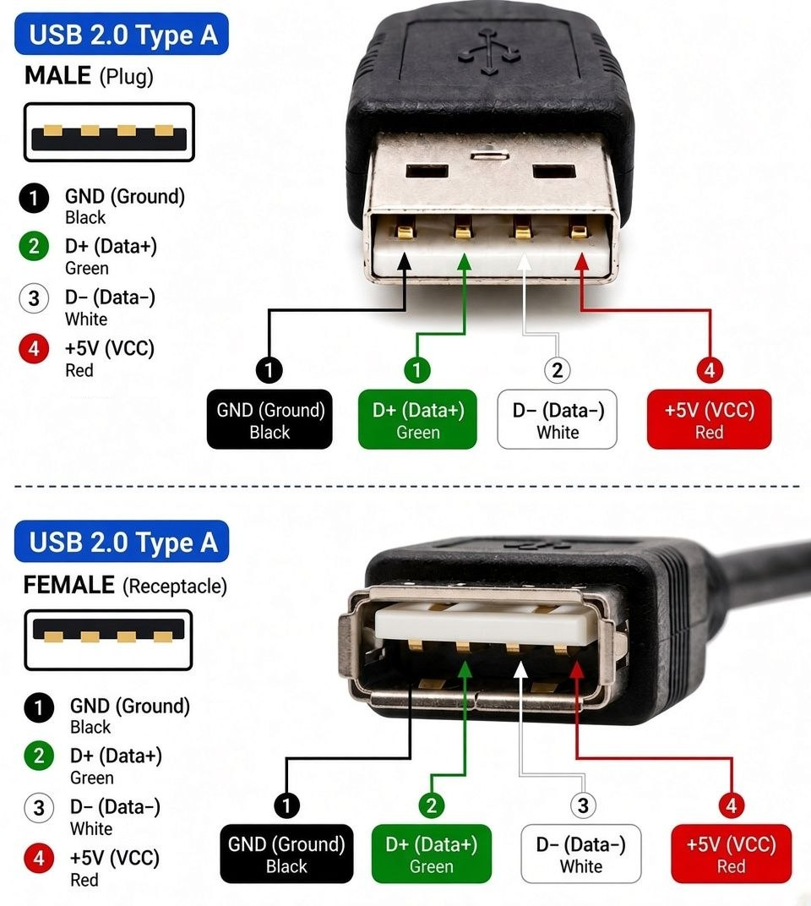

## Read the orientation before you read the pins

The picture shows both connectors head-on, in different positions, and that is where people usually go wrong:

- The male plug has its white insulator at the bottom of the metal shell, on the shell floor, with its four gold contacts facing up.
- The female receptacle has its white plastic tongue at the top of the opening, hanging from the shell ceiling, with its four gold contacts facing down.

That is how the two mate: the plug slides in under the receptacle tongue and the two rows press together, the plug contacts facing up into the receptacle contacts facing down. In the picture both connectors face you. To mate, one of them turns around to face the other, and that swaps left and right: the leftmost contact of the plug half touches the rightmost contact of the receptacle half. The plug half has each signal on the correct contact. The receptacle half repeats the plug's order, so its labels are mirrored: the contact it marks GND is +5V, the one it marks +5V is GND, and D+ and D- are swapped the same way (USB 2.0 specification, Figures 6-7 and 6-9).

Flip either connector over and the order mirrors left to right. That includes a plug held with its contacts facing down, the way it goes into a receptacle mounted with its tongue at the bottom. Get that wrong and you wire +5V into GND.

## Wire colors

| Plug seen head-on, contacts up (left to right) | Receptacle seen head-on, tongue at the top (left to right) | Signal | Wire color | USB-IF pin number |
| :---: | :---: | :--- | :--- | :---: |
| 1st | 4th | GND (Ground) | Black | 4 |
| 2nd | 3rd | D+ (Data+) | Green | 3 |
| 3rd | 2nd | D- (Data-) | White | 2 |
| 4th | 1st | +5V (VBUS) | Red | 1 |

Two warnings about the table:

- **The numbers printed on the plug half are not the USB-IF pin numbers.** They count 1 to 4 from GND, while the specification numbers the same four contacts the other way round: pin 1 is VBUS and pin 4 is GND. Every datasheet uses the specification's numbering, and so does the [passive adapter wiring table](#the-adapter-is-passive-it-moves-contacts-it-does-not-translate), so on the plug half go by color and function, never by the number. Wire a receptacle from the table's receptacle column, never from the picture.
- The outer pair is power and the inner pair is data: black and red on the ends, green and white in the middle. It is the fastest sanity check on any USB Type-A connector.

The colors are only a convention, and cheap cables and captive keyboard cables do stray from it. A cable built to the specification also has a bare drain wire, which goes to the metal shell of the connector. So before you solder onto anything you care about, check each conductor for continuity to the connector contacts with a multimeter.

# PS/2 pinout

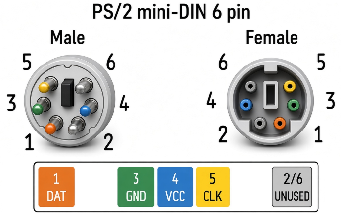

# Power consumption (measured with a Nordic PPK2)

I profiled okhi's real power draw with a Nordic Power Profiler Kit II (PPK2) in "Source Meter" mode, feeding the implant 5 V and logging its current at 100 kS/s for 10 s. Everything was running: during the capture I was connected to okhi's WiFi and typing on the keyboard while I watched the keystrokes live on the web page, so the RP2040 sniffer was capturing and the ESP32-C2 radio was on the whole time. The capture is not a worst case: a long transfer such as the download half of the [WiFi speed test](#wifi-speed-test-measured-from-the-browser), or a weak link that falls back to lower rates, keeps the radio transmitting longer and raises the average above the 107 mA below. Neither was measured. These are okhi's own numbers: a sniffed keyboard draws its own current on top.

| Measurement | Value |
|---|---|
| Baseline (very stable) | about 100 mA |
| Mean over the run | 107 mA (about 0.54 W at 5 V) |
| Peak | 430 mA (about 2.1 W at 5 V) |
| Consumption | about 107 mAh per hour |

The draw is not flat. On a rock steady 100 mA baseline the ESP32-C2 fires short current bursts while it transmits over WiFi, up to 430 mA and up to about 6 ms long. The bursts take only a few percent of the time and about 10 percent of the total charge, but they are what matters for powering okhi, because during a burst the implant is most sensitive to a weak supply. The 107 mA average dissipates only about half a watt, so heat is not a concern even with the implant hidden inside a keyboard.

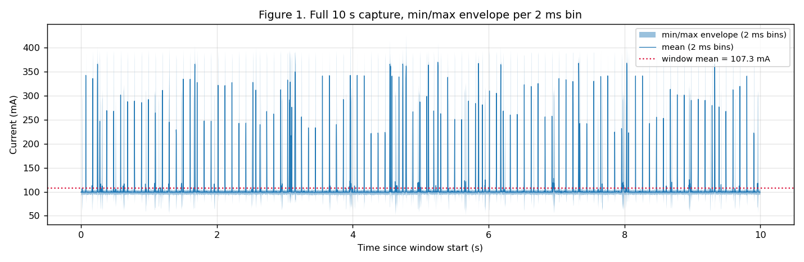

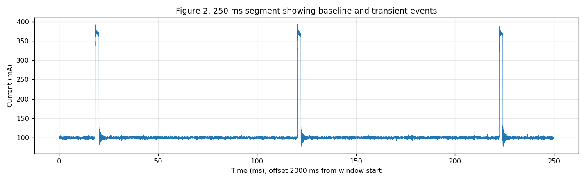

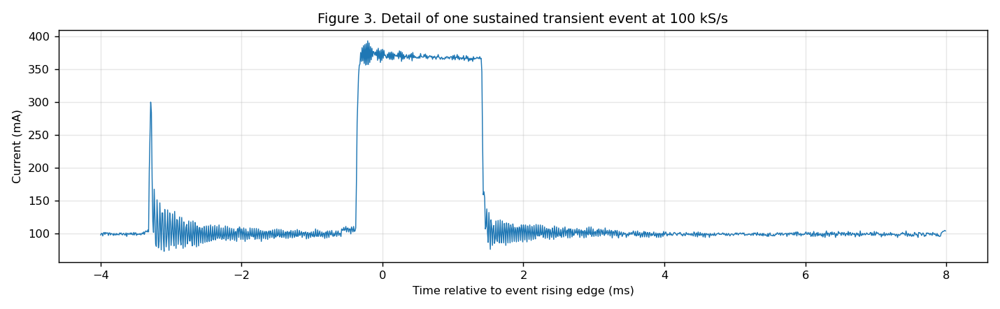

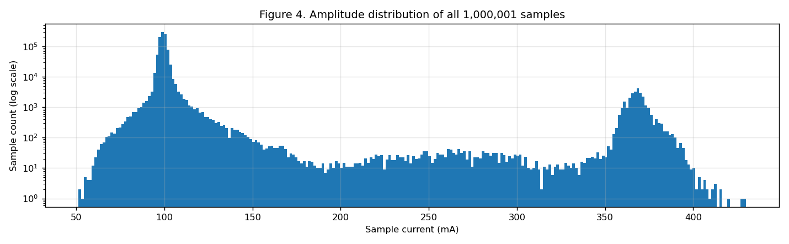

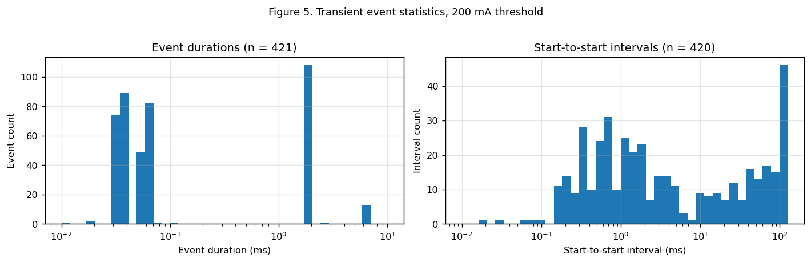

On a battery instead of the cable, the same average sets the runtime: at 107 mA, a USB power bank good for about 2000 mAh at its 5 V output runs okhi for roughly 19 hours, a little over 9 hours per 1000 mAh. Power banks are rated at the 3.7 V cell, so their real capacity at 5 V is lower than the printed number.

The full session was recorded from the instant the supply was switched on, so it also caught the power-on inrush that the 10 s table leaves out. At power-on okhi draws one brief spike that peaks at about 680 mA, roughly 1.6 times the 430 mA WiFi peak and about six times the average, but it lasts under a millisecond (0.37 ms at half its height) and carries about 260 µC, as much as okhi draws in 2.4 ms of normal running. It is the board's input capacitance charging at switch-on, the kind of spike any powered device produces. That charge is what about 50 µF holds at 5 V, some five times the 10 µF that USB 2.0 allows at the device end of a cable without surge current limiting (section 7.2.4.1). The board then sits at only about 45 mA for the first few seconds, while it boots with the radio not yet transmitting, and climbs to the roughly 100 mA baseline with WiFi bursts once the radio comes up.

The inrush is the highest current the supply path ever sees, but it does not upset okhi's start on a weak cable. It is gone within about 1 ms of power-on, and the board draws only about 6 mA until about 8 ms, before the 45 mA boot plateau. A thin cable only lowers and stretches the spike: 1 Ω of cable and the board's roughly 50 µF give a time constant of about 50 µs. A weak cable struggles later, with the sustained WiFi bursts once okhi runs. A large inrush can pull down the VBUS of the host or hub, which its other ports share, and that is why USB 2.0 limits it. I measured it under the PPK2's controlled turn-on, so a hard hot-plug into a live USB port may look different.

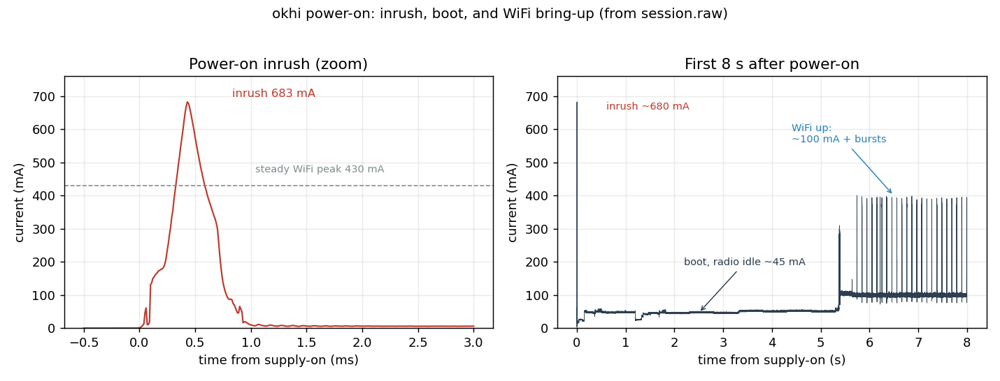

In this current range the PPK2 is specified to about ±15 percent typical on averaged readings, which covers the mean and the baseline. The peaks are single samples with no specified accuracy. For under 0.1 ms the inrush went past the 600 mA that "Source Meter" mode is rated to supply, still inside the 1 A measuring range. Treat the measurements as solid relative figures, not lab grade absolutes. Raw data: the [PPK2 session](stuff/ppk2-20260720T082307.ppk2) and its [CSV export](stuff/ppk-20260720T082257.csv).

## Powering okhi inside a real keyboard: what can go wrong

The real install is invasive: you open the target keyboard and solder okhi straight onto the USB lines where the cable lands on the keyboard PCB, tapping VBUS and GND for power and D+ and D- for sniffing at the same spot. That spot is the far end of the keyboard's own captive cable, the lowest-voltage point in the whole path, and both the keyboard's current and okhi's flow through that cable. So okhi gets the cable's full voltage drop, and there is no better tap near the PC: okhi lives behind whatever cable the keyboard ships with.

A realistic case: you buy some random cheap keyboard off Amazon or AliExpress to implant. It has a 1.5 to 2 m captive cable made of the thinnest wire the factory could get away with (a 28 or 30 AWG power pair), and okhi ends up soldered at the far end of that cable. A cheap hub or extension between the keyboard and the target PC adds more drop on top. Two separate things can go wrong.

1. The captive cable eats voltage exactly when okhi needs it. Thin wire has real resistance, and the drop is the current times the round trip resistance of the cable (out on VBUS, back on GND). A cheap 2 m 28 AWG captive cable, plug included, is roughly 1 Ω round trip; a keyboard with a short, thick cable has a fraction of that. okhi's WiFi bursts pull about 370 mA, with brief peaks up to 430 mA, so a 1 Ω cable loses about 0.4 V on every burst, and okhi, soldered at the far end, gets the worst of it. Add a power hungry backlit or RGB keyboard on the same wires and the voltage at the implant can drop to near 4.3 V during bursts. okhi makes its own 3.3 V on board and needs some headroom to ride through those sharp bursts, so when you starve it the ESP32-C2 browns out and resets, or WiFi drops and stutters. It only misbehaves during WiFi traffic, so it looks like a flaky firmware bug when the cause is the host keyboard's cable.

2. The current budget. The keyboard and okhi share whatever the port can give. okhi averages about 107 mA, but its WiFi bursts reach 430 mA, and USB 2.0 counts the peak against the classic per-port budget of 500 mA (section 7.2.1). That leaves about 70 mA for the keyboard during the bursts, and a modern RGB, backlit or gaming keyboard can already pull several hundred mA by itself, so keyboard plus okhi can cross 500 mA. A modern PC often has more to give: a USB 3.x port supplies up to 900 mA to a device running at SuperSpeed, a charging downstream port (USB Battery Charging CDP) up to 1.5 A to a device that detects it, and a USB-C port can advertise 1.5 A or 3.0 A at 5 V to a device that reads the CC pins. A keyboard that okhi can sniff runs at low or full speed, so the 900 mA is not for it. Unless the keyboard detects the CDP or reads the CC pins itself, USB 2.0 still caps keyboard plus okhi at 500 mA, and a combined draw near 900 mA works only on a port whose current limit sits above it. The tight case is an old USB 2.0 port or some laptop ports: there, keyboard plus okhi crossing 500 mA can trip the host's over-current protection and cut power to everything, so you lose the keyboard and the implant at once. An unpowered hub is tighter still: USB 2.0 gives each of its ports only one unit load, 100 mA (section 7.2.1), about what okhi alone draws between its bursts, and the hub and everything on it share the 500 mA of the port that feeds it. Size the install for the weakest port the target might actually use.

What to do:

- The target keyboard's own captive cable matters most, since okhi is stuck at its far end. Prefer a keyboard with a short, reasonably thick cable and avoid the ones with a long, hair-thin cable.
- Solder VBUS and GND right at the pads where the cable lands, and keep okhi's own leads short and of a decent gauge so you do not stack extra resistance on top of the cable.
- Check before you close it up: with okhi soldered in, power the keyboard, open the web page and measure VBUS at okhi's pads while it transmits. Near 5 V with only a small dip is fine. If it sags toward 4.4 V or dips hard on every burst, this keyboard is a poor host, so pick another.
- When you can, prepare and test the exact keyboard model on the bench first, so a marginal cable does not surprise you in the field.
- A tap inside a tower instead, at a motherboard header or a front panel connector, puts okhi close to the source: that is the easy case, with a small drop and nothing to worry about. A separate 5 V feed also fixes it, but a second wire out of a sealed keyboard usually gives the implant away, so it suits a tower install or the external test rig more than a covert keyboard implant.

# Hardware design

## What a mess of names!

The okhi board has two main processors: the RP2040 and the ESP8684-MINI-1-H4 / ESP8684-MINI-1-H4X. The RP2040 is a dual-core Arm Cortex-M0+ processor that runs at up to 200 MHz, with 264 KB of on-chip SRAM. It has no flash memory of its own, so the board adds 16 MB of external flash. It also overclocks well, and it is the chip on the Raspberry Pi Pico board.

The ESP8684-MINI-1-H4 module runs at up to 120 MHz and has 4 MB of internal flash and a PCB antenna on board, so it needs no external antenna. It is a PCB-to-PCB module that holds the ESP8684 chip and the other components it needs.

The ESP8684 / ESP8684H4X (Chip Revision v2.0) is the chip inside the ESP32-C2 modules (ESP32-C2 is a generic name): a 32-bit single-core RISC-V processor with 272 KB of SRAM (16 KB of it for cache) and 576 KB of ROM. It is a low-cost chip with WiFi 4 and Bluetooth 5 (LE), and it beats the older ESP8266 in size and performance.

The ESP8684-DevKitM-1 is the development board for the ESP8684-MINI-1-H4 module.


## ESP8684-MINI-1-H4 module (ESP32-C2)

okhi uses the small ESP8684-MINI-1-H4 module (ESP32-C2).

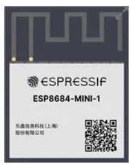

ESP8684-MINI-1-H4 module vs ESP8684-WROOM-02C-H4 module:

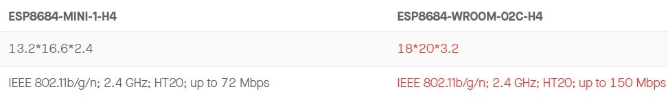

The 150 Mbps in the WROOM-02C-H4 column is wrong: both modules are built on the ESP8684 chip, which supports only 20 MHz channels and a single stream (1T1R), so the WiFi of either module tops out at 72.2 Mbps (about 9 MB/s). Real speeds are usually much lower, but still enough for a web page that shows keystrokes.

### Compatible with both modern and older ESP32-C2 versions

The okhi firmware is built to support every version of the ESP32-C2 chip: the legacy v1.x and the v2.0 revision.

**You must use an ESP32-C2 module with a 26 MHz crystal and 4 MB of flash memory.** The chip cannot detect the frequency of its crystal, and the firmware is built for 26 MHz (`CONFIG_XTAL_FREQ_26`). Some chips of revision v1.0 and earlier also do not work properly with a 40 MHz crystal: the symptoms include clock issues and garbled characters printed at power-on (erratum XTAL-5948 in the [ESP32-C2 errata](stuff/esp-chip-errata-en-master-esp32c2.pdf), fixed in v1.1).

[Compatibility Advisory for ESP32-C2 Chip Revision v2.0 ar2025-001_en.pdf](stuff/Compatibility%20Advisory%20for%20ESP32-C2%20Chip%20Revision%20v2.0%20ar2025-001_en.pdf)

The firmware gives up the extra SRAM and flash of v2.0 so that one binary, and one build to test, covers both revisions (see [ESP32-C2 firmware build & hardware notes](#esp32-c2-firmware-build--hardware-notes)).

## Old schematic v3

PCB revision 3.0 (2024). Later boards add the USB switch on GPIO8 and GPIO9, LEDs on GPIO26 and on the ESP's IO0, and the ADC on GPIO27. The latest revision also clocks the RP2040 from a TCXO on XIN in place of the crystal X1 and its C16, C18 and R6, and lengthens the startup delay on the RUN pin (see [TCXO](#tcxo--25-ppm-for-rp2040)). The firmware still uses this drawing's RP2040 to ESP32-C2 wiring and its D+ and D- on GPIO20 and GPIO21. The reference designators changed too: the U1 to U4, R7, R8 and R10 that the [self test](#built-in-self-test-what-it-checks-and-how-to-read-it) names are other parts in this drawing.

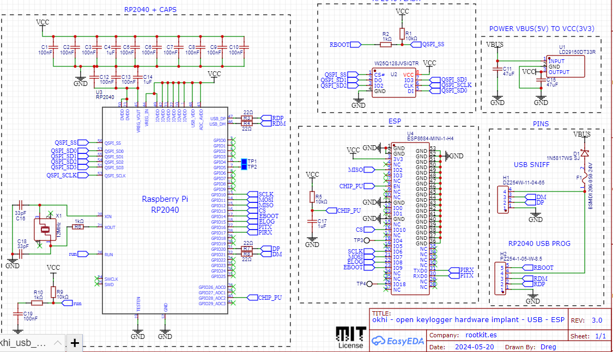

## USB switch

The latest okhi revisions put a TS3USB3000RSER USB switch (Texas Instruments) on the USB and PS/2 sniffing lines, so no voltage from the sniffed device reaches the RP2040's sniffing GPIO pins while the RP2040 powers on.

This is the current schematic:


While the RP2040 powers on, the switch routes the sniffing lines to USB+ and USB-, where there is no GPIO. Two things keep the GPIO side disconnected. First, SEL stays low, which selects the USB channel, until the firmware drives it. GPIO8, the RP2040 pin on SEL, leaves reset with its 50 to 80 kΩ pull-down on (RP2040 datasheet tables 615 and 625), and the TS3USB3000 adds an internal 6 MΩ pull-down, which TI states only in an application section of its datasheet (§9.2), outside the component specification. Second, while the switch has no VCC, its power-off protection holds every I/O pin at high impedance. Once the RP2040 firmware initializes, it drives SEL high to move the sniffing lines to MHL+ and MHL-, which go to the RP2040's GPIO pins. (This assumes the switch's VCC and the RP2040's IOVDD come from the same 3.3 V rail, so they power up together.)

For USB the switch is not needed for voltage reasons: the USB data lines D+ and D- carry 3.3 V logic (full and low speed) or only ~400 mV differential (high speed), never the 5 V of VBUS, so they are already safe for the GPIOs. What the switch adds is power-up isolation: it keeps the sniffing GPIOs disconnected from the target until the firmware is ready. If you cannot fit the 5V to 3V3 shifter board and must sniff 5 V PS/2 directly, you can still use the implant, but know what the switch does: it protects the timing (the GPIO is connected only once the RP2040 is powered and the firmware is ready), and it is not designed to reduce the 5 V level. I strongly advise against sniffing 5 V PS/2 lines directly with the implant: the switch is no safe substitute for the level shifter.

It is a high speed USB 2.0 analog switch, so it suits okhi's job as a USB sniffer (its 6.1 GHz bandwidth and ~5 Ω on-resistance are far beyond what USB or PS/2 need). One caveat about 5 V PS/2: the switch's I/O pins withstand up to 5.5 V (overvoltage tolerance), so the switch itself survives 5 V. But it is a passive pass-gate, not a level shifter, and it is not specified to limit the voltage it passes, so assume the full 5 V reaches the RP2040 GPIO. The TS3USB3000 datasheet has no on-state figures at 5 V (RON is 5.7 Ω typical at 1.65 V), and 5 V is already above the switch's own recommended analog I/O range of 0 to 3.6 V.

[TS3USB3000RSER datasheet](stuff/ts3usb3000.pdf)

If you search online or the forums for "RP2040 5V tolerance" and check the datasheet, the answer is: **the RP2040 GPIOs are not 5 V tolerant.** The datasheet sets the absolute maximum pin voltage at IOVDD + 0.5 V (§5.5.3.1), only ~3.8 V at a 3.3 V IOVDD, so 5 V is outside the rated range. When people say the chip "handles" 5 V, they mean less than it sounds: a Raspberry Pi engineer has stated [on the forums](https://forums.raspberrypi.com/viewtopic.php?p=2091977#p2091977) that the ordinary digital pins (GP0 to GP25, which have no ESD diode to IOVDD) do survive up to 5 V as an input. But that is explicitly unqualified and untested, it applies only while IOVDD (3.3 V) is powered, and it applies neither to a pin driven as an output nor to the ADC-shared pins GP26 to GP29 (which do have a clamp diode to IOVDD and must stay within the datasheet). With IOVDD unpowered, GP0 to GP25 tolerate only ~3.6 V, so 5 V applied before the 3.3 V rail is up over-stresses the chip. Per that engineer, the failure mode on the tolerant pins is voltage-driven transistor stress, not current, so a series resistor does not make 5 V safe. The only in-spec fix is to level-shift 5 V PS/2 down to ≤3.3 V.


### Why the forums insist "IOVDD must be present"

The phrase is everywhere, and it is easy to misread as "5 V is fine as long as the board is powered." It is a condition the pin needs to survive, not one that makes it safe. The non-ADC pins survive ~5 V while IOVDD (3.3 V) is up and only ~3.6 V with IOVDD at 0 V, the limits a Raspberry Pi engineer gave on the forums. What probably sets those limits:

1. The pin's overvoltage tolerance is referenced to IOVDD. With a solid 3.3 V on IOVDD the input transistors are biased to hold off about 5 V; with IOVDD at 0 V the same transistors are over-stressed at about 3.6 V.
2. The non-ADC pins have no ESD diode to IOVDD, and the datasheet calls them fault tolerant: very little current flows into the pin while it is below 3.63 V and IOVDD is 0 V. The ADC pins GP26 to GP29 do have the diode, and the datasheet says a voltage above IOVDD makes leakage current flow through it. With IOVDD missing or still ramping, that current can power the RP2040 "backwards" through the pin.

The trap is timing. In a typical setup the sniffed device's 5 V is up before okhi's 3.3 V, so at power-on there is a window with 5 V on the pin while IOVDD is still at 0 V: the exact case that does damage. The USB switch closes that window. It keeps the GPIO off the 5 V until the firmware, and so IOVDD, is up.

**WARNING**: if the RP2040 loses the 3.3 V on its IOVDD pins for any reason while a 5 V signal is on the GPIO pins, the chip could be damaged. Use the 5V to 3V3 shifter board with the implant to prevent it.

A Raspberry Pi Pico user reported that after their chips had 5 V on the GPIO pins, the affected pins still worked as inputs but no longer drove as outputs, a classic sign of a permanently damaged output driver. I have not tested this myself, but for input-only sniffing a chip that fails that way would still be usable :)

### Failure scenarios: what the switch protects, and what it doesn't

Sniffing 5 V PS/2 directly runs the RP2040 outside its ratings, so know where the safety net is and where it is not. Everything below rests on the TS3USB3000 and RP2040 datasheets, and says where they specify nothing. It assumes a sniff path from the target through the TS3USB3000 to the RP2040 GPIO, with the switch's VCC and the RP2040's IOVDD on the same 3.3 V rail.

The switch has one non-ideal path: per datasheet §8.3.3 (Figure 14), if a D+/D- (common) pin rises more than 1 V above VCC, a defined leakage path to VCC starts to conduct, with I_leak ≈ (V_pin − VCC) / 12 kΩ. At 5 V that is ~0.14 mA when VCC = 3.3 V, and ~0.4 mA when VCC = 0. It is small and current-limited (not a hard short), but not zero, so the isolation is not perfect.

| Scenario | What actually happens | Net result |
|---|---|---|
| okhi off, 5 V on the sniffed lines | VCC = 0, so power-off protection holds the pass-gates in Hi-Z and the 5 V does not pass through to the other throw / the GPIO. The only remaining path is the §8.3.3 leakage into the VCC rail (~0.4 mA at 5 V). | Isolated through the switch; ≤ ~0.4 mA can trickle into the dead 3.3 V rail |
| okhi powering up (3.3 V rising), 5 V present | GPIO8's 50 to 80 kΩ reset pull-down and the switch's internal 6 MΩ pull-down hold SEL low: the common is parked on the USB dead-end and the GPIO (MHL) side stays disconnected until firmware raises SEL, by which point IOVDD (same rail) is already up | GPIO protected during the power-up window |
| okhi loses 3.3 V mid-operation (brownout, yanked cable) | As VCC collapses the switch returns to power-off Hi-Z and pulls the 5 V off the now-unpowered GPIO, exactly the "5 V on an unpowered pin" danger the switch exists to mitigate | Big risk reduction; see caveats |
| Firmware running, sniffing 5 V PS/2 directly | SEL is high, the GPIO is connected, and the passive switch is not specified to limit the voltage it passes, so assume the full 5 V reaches the GPIO, over the RP2040's ~3.8 V absolute max | **Not protected**; only the level shifter fixes this |
| Spike > 5.5 V on the I/O or on SEL/OE | Switch I/O and control pins are rated 5.5 V absolute max (the 9 V rating on D+/D- only holds while VCC is powered and OE is high); beyond that the switch itself can be damaged | **Not protected** above 5.5 V |

Caveats on the "protected" rows:

- Power-off protection and the leakage figures are characterized for VCC ≈ 0. A real brownout can leave the rail at an intermediate voltage where neither the switch nor the RP2040 is cleanly powered or cleanly off. No datasheet guarantees anything in that gray zone, and the ~0.4 mA leakage into a dead rail can leave the RP2040 in an undefined, partly biased state. The switch greatly reduces the risk from a power loss, but it is no certified clamp.
- The switch only guards the path through it. Any 5 V that reaches the RP2040 by another route is not covered.

The TS3USB3000 is there for the power-sequencing hazards (5 V present while okhi is off, powering up or browning out), and within its specified conditions it handles them well. For anything you care about, use the 5V to 3V3 shifter board below. Sniffing 5 V lines directly without it runs the RP2040 outside its datasheet ratings, at your own risk. No guarantee is made or implied.

### Shifter board (5V->3V3)


## TCXO +-2.5 ppm for RP2040

The latest hardware revision uses an ATXAIG-H12-F-12.000MHz-F25 TCXO (temperature compensated crystal oscillator). It is much more stable and precise than a typical crystal, helps keep the clock accurate as the temperature changes, and needs no external capacitors whose values depend on the thickness and design of the PCB.

[ATXAIG-H12-F-12.000MHz-F25 datasheet](stuff/ATXAIG-H12.pdf)

This TCXO costs about €2.5, against €0.1 for a typical crystal, and its advantages are worth the difference.

It generates a 3.3 V square wave at 12 MHz that goes straight into the RP2040's XIN pin, with XOUT left unconnected, and it works without issues.

- The ATXAIG-H12-F-12.000MHz-F25 can drive the RP2040's XIN directly at 3.3 V. Its CMOS output specifies VOH ≥ 0.9·Vdd and VOL ≤ 0.1·Vdd, and the RP2040 in square-wave input mode on XIN requires VIH ≥ 0.65·IOVDD and VIL ≤ 0.35·IOVDD, so with both at 3.3 V the logic levels are comfortably met (XOUT left unconnected).
- Its output timing is specified for a 15 pF CMOS load (5 ns rise and fall time, measured at 10% to 90% Vdd). A heavier capacitive load slows the edge.
- For the output behavior this design assumes, keep the clock trace as short as possible, route it to a single destination, and avoid extra capacitive load from added connections, long stubs or measurement points.
- Per its datasheet, the tri-state control pin (INH, pin 1) must not be left floating: if you do not use the enable and disable function, tie it to Vdd (logic "1") so the oscillator always runs. The datasheet also recommends a ~0.01 µF bypass capacitor between Vdd (pin 4) and GND (pin 2).

Why a TCXO, if I already had a good design with a typical crystal? Because okhi is open source, and some people will order their own PCBs with different thicknesses or make their own modifications.

What does that have to do with the crystal? Look at this thread on the Raspberry Pi forums:

https://forums.raspberrypi.com/viewtopic.php?t=375990

```
custom RP2040 PCB - crystal does not oscillate
Report this post
Sun Sep 01, 2024 12:42 am

I'm designing PCBs around the RP2040 with KiCAD,
....
I've had a few wins! However, my second iteration
of this one fails to oscillate,
and I cannot figure out why.
....
What changed
The differences between PCB 1 and PCB 2:
- moved the crystal left and up,
but XIN/XOUT lengths changed only slightly
- switched from 1.6mm PCB to 1mm PCB - layer 2/3 dielectric
 thickness from 1.1mm to 0.45mm
- routed +1.1V under XIN/XOUT
...
Re: custom RP2040 PCB - crystal does not oscillate
Mon Sep 02, 2024 5:48 am

....
Again using an online microstrip capacitance calculator,
it's appears that my 0.2104mm dielectric DOUBLES
capacitance relative to a 1mm dielectric.
```

Search online and you will find more users in trouble with the crystal they picked, its capacitors, the layout of the crystal tracks, the PCB thickness, and so on.


The pico-sdk adds another problem: it assumes the crystal starts within a certain time. Some users have had to modify `PICO_XOSC_STARTUP_DELAY_MULTIPLIER` in their firmware to give the crystal on their custom RP2040 PCB enough time to oscillate correctly. Anyone working with such a board has to know about it and adjust `PICO_XOSC_STARTUP_DELAY_MULTIPLIER` in their firmware, or it will not work properly.

That is why the RP2040 datasheet and "Hardware Design with RP2040.pdf" strongly recommend the Abracon ABM8-272-T3 crystal with their suggested design, tracks and capacitors included, to avoid all these issues. It seems everything is designed to "encourage" you to use that crystal ;-)

(Some custom RP2040 boards also need `PICO_DEFAULT_BOOT_STAGE2=boot2_generic_03h` and `PICO_BOOT_STAGE2_CHOOSE_GENERIC_03H 1`. The USB build ignores that default: `pico_set_boot_stage2` gives it `boot2_okhi.S`.)

To keep the TCXO clear of these problems, I added a generous startup delay: when the RP2040 powers up, the oscillator is already fully stable and `PICO_XOSC_STARTUP_DELAY_MULTIPLIER` needs no change. The delay does not matter for PS/2. On USB it comes out of the time okhi has to start capturing before the PC reads the keyboard's descriptors.

This is the current design:


With such a generous delay, a modder who later fits a slower-starting oscillator needs no further changes.

### If you want to keep using a crystal in okhi

If you don't understand why a typical 10 pF passive oscilloscope probe at 10X on XIN or XOUT is a problem, use the TCXO!


From my experiments:

1. Choose a crystal that works well with the RP2040 and has characteristics similar to the Abracon ABM8-272-T3.

2. You may need to try several load capacitor values for the crystal you choose: adjust them with a frequency meter until the crystal oscillates at the frequency you want.

3. Design the crystal tracks correctly, with no interference from other signals: keep them as short as possible and do not cross other traces.

Adjust the 1 kΩ resistor specified in "Hardware Design with RP2040.pdf" to the crystal you selected and to your PCB design.

When selecting the crystal, also check:

- The load capacitance matches the crystal's specification. Wrong values can cause frequency deviations or startup problems.

- The ESR (equivalent series resistance) is low enough for the RP2040 to start the crystal. A higher ESR can keep the crystal from oscillating reliably. Raspberry Pi gives no ESR limit for the RP2040 oscillator, only the 50 Ω maximum of the ABM8-272-T3 its reference design is tuned for, so check the startup margin as shown below.

- There is a series resistor to limit the crystal's drive level. Over-driving can damage the crystal or shorten its life.

If the crystal takes time to start, modify `PICO_XOSC_STARTUP_DELAY_MULTIPLIER`.

The 12 MHz crystals I tested and found to work on earlier versions of okhi, with a 6-layer PCB 0.8 mm thick:

- ABM8-272-T3 (15 to 18 pF caps): use this one whenever possible.
- X322512MSB4SI (27 to 33 pF caps): popular for the RP2040 and used in the Bus Pirate v5, but you need to know what you're doing.
- ABM8-12.000MHZ-20-B1U-T (30 to 33 pF caps): worked in my prototypes and stress tests (what boredom can lead to, haha). I do not recommend it.

I know some of the crystals I tested are outside the RP2040 recommendations (max ESR, etc.), but I wanted to see whether they worked in my units once everything was properly characterized.

The table below has some results from my first tests, which ignored the crystal's startup time and only fine-tuned the frequency to 12 MHz. Its "Measured Stray" column comes from that tuning, not from a measurement of the bare PCB: each value is CL\_spec minus half the capacitor value that centered that crystal unit. So each value also carries that unit's frequency tolerance, about ±4 pF of load capacitance for the ABM8-272-T3 (±30 ppm) and ±3 pF for the X322512MSB4SI (±10 ppm). The 0.8 mm and 1.6 mm rows differ by less than that, and the two crystals move in opposite directions with thickness:


The C0 in the "Measured Stray" header does not belong there either. C0 is the crystal's own shunt capacitance and is not part of the load capacitance, which comes from the circuit around the crystal: its two capacitors in series plus the stray capacitance of the PCB and of the RP2040's XIN and XOUT pins (ST AN2867 §3.3). The values in that column, worked out from CL\_spec, contain no C0.

Sometimes you have to give up some frequency accuracy for a faster startup. As the designer, you decide what is best for your use of the board.

**WARNING**: a crystal that runs at a very precise frequency on your board with certain capacitors does not prove those are the best capacitor values for your PCB. Crystals have a tolerance and each unit is slightly different, so you must account for that tolerance and know how to measure the actual capacitance of your PCB design.

To measure the crystal of okhi, or of your own RP2040 board, with an oscilloscope in a "cheap", safer and more precise way, I used a 1.3 GHz FET probe.

https://hackaday.io/project/184924-diy-13-ghz-fet-probe
https://lectronz.com/products/-1300-mhz-fet-probe

A 1.3 GHz active scope probe with FET input and very low input capacitance (about 0.3 pF):

- AC coupled
- Minimum frequency: 100 kHz
- Attenuation: 1:10 (1:20 with 50 Ω termination)
- Supply: 5 V through u.Fl
- Reverse voltage protection
- Output through u.Fl
- Can be soldered directly to the device under test for minimal lead inductance

At about 0.3 pF the probe barely loads the crystal, so it is safer. My setup:


With the oscilloscope I usually check whether I am overloading or underloading the crystal, how long it takes to start, and any irregularities in the waveform. Do not look only at the frequency.

I also wrote pico-freq-meter-tcxo-ref to measure the frequency of my okhi RP2040 boards:

https://github.com/therealdreg/pico-freq-meter-tcxo-ref

It runs on a Pico with an external 12 MHz reference from the same TCXO model as the new okhi boards, and compares it with the crystal signal of the implant under test. The implant puts its crystal signal out on a pin as a 3.3 V square wave (`clock_gpio_init` + `CLOCKS_CLK_GPOUT0_CTRL_AUXSRC_VALUE_XOSC_CLKSRC`), so one of the okhi sniffing pins provides the clock without disturbing the crystal itself, which suits the fine-tuning of the board's capacitors.

The latest okhi boards have a TCXO, so I wrote firmware that makes these implants do the same job as pico-freq-meter-tcxo-ref. With it you can use an okhi TCXO implant to adjust the crystal capacitors of your RP2040 boards.

To measure the crystal of an okhi implant with an okhi TCXO implant:

1. Flash this firmware onto your okhi target board with a crystal installed: https://github.com/therealdreg/okhi/tree/main/stuff/clock/build/clock.uf2

2. Flash the frequency meter onto the TCXO implant: https://github.com/therealdreg/okhi/tree/main/stuff/pico_clock_calc/build/pico_clock_calc.uf2

3. Wire GPIO21 of the TCXO implant to GPIO21 of the target board and join the grounds.

4. Power both the okhi target board and the TCXO implant.

Connect teraterm to the TCXO implant over USB.


The reading shown comes from pico-freq-meter-tcxo-ref on a Pico, so the test signal is on GPIO 1 and the TCXO reference on GPIO 3. From that reading, slightly more pF on the crystal's capacitors brings it closer to 0, and too much makes it negative. Less pF raises the value. Aim for close to 0 ppm.

#### The same from the web page, without reflashing

Both okhi firmwares (USB and PS/2) carry these two tools, so a board does not have to be reflashed to become one. The web page has a menu for each, "Clock output (crystal reference)" and "Frequency meter (calibrate a crystal)":

- "Clock output" is `stuff/clock`: GPIO21 (sniff `-`) carries the board's 12 MHz crystal straight from the oscillator through GPOUT0. On a TCXO board that is a clean reference, good to a few ppm. GPIO20 (sniff `+`) stays high impedance.
- "Frequency meter" is `stuff/pico_clock_calc`: it counts the rising edges on GPIO21 for the gate time you choose, timed by the board's own crystal, and prints the frequency, the difference and the error in ppm against the target you choose (12 MHz and 5000 ms by default). Put a TCXO board in this mode, the board to tune in "Clock output", wire GPIO21 to GPIO21 and join the grounds. A positive error means the measured crystal runs fast, so add load capacitance; a negative one means it runs slow, so remove some.
- Every gate starts and ends exactly on a tick of the meter's µs timer, which runs from its own crystal, and each gate follows the last with nothing missed in between. So a reading resolves one edge of the measured clock over the gate: about 0.02 ppm with the default 5 s gate and 0.1 ppm with 1 s. The meter's own crystal sets the accuracy. The TCXO's datasheet terms add up to ±3.5 ppm at 25 °C in its first year: ±2 ppm of tolerance after reflow, ±1 ppm of aging and ±0.5 ppm for supply and load. Over -40 to +85 °C, temperature adds ±2.5 ppm, for a total of ±6 ppm.
- Tick the "Self-check" box in the meter menu and GPIO20 (sniff `+`) drives 12 MHz derived from the meter's own crystal. Bridge GPIO20 to GPIO21 and the reading should be exactly 12 MHz, 0.00 ppm with the default target. Without the box GPIO20 stays high impedance, so it never drives against whatever is wired to it.

The page shows the tool's console line by line, as teraterm does for the standalone firmware. While a tool runs, **the implant does not capture keystrokes**: the page says so in a red banner with the button that stops the tool. Starting, switching and stopping reboot the implant (the ESP restarts with it), so the page drops for about ten seconds and reconnects on its own. The mode survives a reboot but not a power cut: cutting the power always brings the keylogger back. If the RP2040 cannot reach the ESP for a minute while in a tool, it goes back to capture by itself, since without the ESP only a power cut would end the tool.

The frequency meter on the web page, reading the 12 MHz crystal of an RP2350 board wired to GPIO21, with 5 s gates: the crystal is 42.7 ppm slow against the meter's timebase, and consecutive readings move by a single edge (0.2 Hz, about 0.02 ppm):


Both pins must be free. On the PS/2 probe board the 5V to 3V3 shifter sits on GPIO20 and GPIO21: its outputs hold both pins, so the clock output drives against the shifter on GPIO21 and cannot drive the line (measured: the pin stays high and a few tens of millivolts of 12 MHz cross the shifter), and the meter only sees what crosses the shifter. For calibration use the implant on the USB probe board with nothing plugged into its sniff port, or wire its pins directly.

The same is available without the page: `GET /clock?set=out`, `/clock?set=meter&gate=5000&target=12000000&ref=0` (gate 100 to 600000 ms, target 1 to 200000000 Hz, `ref=1` for the self-check reference), `/clock?set=off`, and `GET /clock?from=N` for the mode and the console lines after line N. `/stats` reports `clock_mode=off|out|meter`, or `unknown` while the RP2040 link is down.

#### Example with ABM8-272-T3

ABM8-272-T3, 8 pF caps, 6-layer okhi 0.8 mm thick:


ABM8-272-T3, 15 pF caps, 6-layer okhi 0.8 mm thick:


ABM8-272-T3, 18 pF caps, 6-layer okhi 0.8 mm thick:


#### Example X322512MSB4SI 33pF: 0.8 thick vs 1.6 thick

X322512MSB4SI, 33 pF caps, 6-layer okhi 0.8 mm thick:


X322512MSB4SI, 33 pF caps, 6-layer okhi 1.6 mm thick:


Both boards use the same crystal model, PCB design, capacitor values and number of layers, and differ in PCB thickness. The readings are -7.68 to -7.75 ppm against -3.03 to -3.08 ppm, 4.6 to 4.7 ppm apart. Two units of the X322512MSB4SI can differ by up to 20 ppm (±10 ppm tolerance each), so with a different unit on each board this pair cannot separate the effect of the thickness from that of the crystal unit.

**WARNING**: the crystal's startup time matters as much as its frequency! Some crystals may have to be forced to start within the required delay at the specified frequency, which could shorten their life.

For your final design: with ±2.5 ppm for the TCXO and the tested crystal's ±10 ppm tolerance, the worst-case combined error is their linear sum, ±12.5 ppm, and the statistical combination is RSS ≈ √(2.5² + 10²) ≈ 10.3 ppm. The ±2.5 ppm is the TCXO's temperature-stability spec: its change over -40 to +85 °C from its frequency at 25 °C, so it adds little near 25 °C. Its full accuracy as a reference also carries ±2 ppm of tolerance after reflow, ±1 ppm of first-year aging and ±0.5 ppm for supply and load, so budget a few ppm in total. With ±3.5 ppm for the reference (the sum of the TCXO datasheet's terms at 25 °C in its first year), the two figures become ±13.5 ppm and √(3.5² + 10²) ≈ 10.6 ppm. Away from 25 °C the crystal's own stability over temperature, ±20 ppm for the X322512MSB4SI, comes on top.

A measurement with the TCXO calc firmware holds only for the crystal unit and the PCB tested. With the same crystal model from another batch, the capacitor choice and the ppm figures of the tested unit may no longer be valid. Always measure the actual crystal on your own PCB and adjust the capacitors or the calculations: do not assume results carry over unchanged between units, PCB thicknesses or designs.

Use the capacitor value that centers the crystal's frequency (brings it closest to the target), whether you test a worst-case or a best-case crystal.

That ±12.5 ppm is easily acceptable for the RP2040: USB full speed tolerates ±2500 ppm, so it is roughly 200× inside spec. For USB the batch does not matter, worst case or best case, and the capacitor value chosen on the tested unit can still be used in the final design.

Beyond the ppm, check that the oscillator starts reliably. In a Pierce oscillator the MCU provides negative resistance, and you want enough margin over the crystal's ESR for it to start across temperature, voltage and part variation. To measure that margin, put a test resistor in series with the crystal itself, between the crystal and the node of its XOUT-side load capacitor (ST AN2867 §3.8.2, Figure 8). Step it through increasing SMD values (e.g., 33 Ω, 68 Ω, 100 Ω, 150 Ω, 220 Ω, 330 Ω …), power-cycle after each swap, and record the smallest value where startup fails (R\_FAIL). Estimate the available negative resistance as $|R_{neg}| \approx R_{FAIL} + ESR_{crystal}$ and compute the safety factor $S_f = |R_{neg}|/ESR$; target $S_f \ge 5$ for MHz crystals (ST AN2867 uses $\ge 5$ for MHz and $\ge 3$ for 32 kHz; some vendors, e.g. TI in SWRA495 §1.3, want up to ~10 for extra startup margin).

If the board keeps a permanent series drive-limiting resistor $R_{ext}$ between XOUT and that load capacitor node, and you shorted it for the test as in Figure 8, that resistor is loss in the loop too. Per ST AN2867 (§3.5.3) you must then fold it into the ESR and judge the shipped circuit with $S_f = |R_{neg}|/(ESR + R_{ext})$, not with the bare-crystal figure. If you ran the test with $R_{ext}$ fitted, $|R_{neg}|$ already includes it. If the margin is low, reduce $R_{ext}$, trim the load caps slightly, or both, to recover gain. As a last check, verify that the drive level is within the crystal's µW rating, so you are not over-driving the unit; one common approximation is $DL \approx ESR \cdot I_{RMS}^2$ (measure or infer the current). This swap-and-cycle test is standard in vendor notes (ST AN2867 §3.8.2, TI SLAA322 §4.2) and gives a repeatable pass or fail criterion for startup.

#### Example: choosing \~1 kΩ by startup-margin sweep

Setup: RP2040 + 12 MHz crystal (ESR≈50 Ω), 3.3 V, load caps \~12 pF. We place a series resistor between XOUT and the crystal, where the 1 kΩ drive-limiting resistor goes, and power-cycle after each swap. AN2867's negative-resistance test puts the resistor in series with the crystal itself instead, so the $|R_{neg}|$ and $S_f$ below are not that measurement: they count the XOUT resistor as extra ESR, the rule AN2867 gives for $R_{ext}$ in its gain-margin check (§3.5.3).

| Series R at XOUT | Starts? | Cold start time (ms) |
| ---------------: | :-----: | -------------------: |
|            220 Ω |   yes   |                  0.25 |
|            330 Ω |   yes   |                  0.35 |
|            470 Ω |   yes   |                  0.45 |
|            680 Ω |   yes   |                  0.52 |
|           1.0 kΩ |   yes   |                  0.65 |
|           1.5 kΩ |   yes   |                  0.80 |
|           2.2 kΩ |   yes   |                 1.3 |
|           3.3 kΩ |   yes   |                 2.3 |
|           3.9 kΩ |   yes   |                 3.0 |
|           4.7 kΩ |    no   |                  n/a |

* Smallest value that fails to start: R\_FAIL ≈ 4.7 kΩ. The true threshold lies between the 3.9 kΩ that still started and 4.7 kΩ, so treat it as a range, not an exact number.
* Estimate $|R_{neg}|$, counting the XOUT resistor as extra ESR:

$$
|R_{neg}| \approx R_{FAIL} + ESR \approx 4700 + 50 \approx 4.75\ \text{k}\Omega
$$

* Bare-crystal safety factor (crystal-selection margin, no series resistor in the loop):

$$
S_f = \frac{|R_{neg}|}{ESR} \approx \frac{4750}{50} \approx 95
$$

That 95 describes the bare crystal only. The shipped board keeps a 1.0 kΩ drive-limiting resistor in the same XOUT position, and per ST AN2867 (§3.5.3) that resistor adds to the ESR when you judge startup, so the margin of the production board is:

$$
S_{f,\text{eff}} = \frac{|R_{neg}|}{ESR + R_{ext}} \approx \frac{4750}{50 + 1000} \approx 4.5
$$

So the shipped board's figure is ~4.5, not 95. That is below AN2867's $\ge 5$ target for MHz crystals (it rates $3 \le S_f < 5$ as not safe for them). In this example the 1 kΩ that protects the crystal from over-drive takes most of the startup margin, and extra stray capacitance (a thinner PCB or dielectric) or a higher-ESR crystal lowers what is left. The sweep confirms this unit still starts with far more than the 1 kΩ used, so ~1.0 kΩ is a reasonable compromise between drive limiting and startup margin. But characterize your own board: Raspberry Pi does not publish the RP2040 oscillator's transconductance or negative resistance ([pico-feedback #351](https://github.com/raspberrypi/pico-feedback/issues/351)), so there is no datasheet figure to lean on. For a clean $S_{f,\text{eff}} \ge 5$, drop the series resistor to 680 Ω (and check that the drive level stays in spec): that gives $3950/(50 + 680) \approx 5.4$ to $4750/(50 + 680) \approx 6.5$ for R\_FAIL anywhere from 3.9 to 4.7 kΩ. With these numbers a lower-ESR crystal alone does not get there while the 1 kΩ stays: even 0 Ω of ESR gives $4750/1000 = 4.75$.

A drive-level check, as an example: measure the crystal current with a current probe in series with the crystal (AN2867 §3.5.1). If that gives about I\_RMS ≈ 1.2 mA:

$$
DL \approx ESR \cdot I_{RMS}^2 \approx 50\,\Omega \cdot (1.2\,\text{mA})^2 \approx 72\,\mu W
$$

well under the ABM8-272-T3's 200 µW maximum drive level (10 µW typical). If your measured current is higher, increase the series resistor (re-check startup and DL).

If your R\_FAIL is low, say R\_FAIL ≈ 1.2 kΩ, then |R\_neg| ≈ 1.25 kΩ and picking 1 kΩ sits right on the cliff: with the 1 kΩ in the loop the effective $S_f = 1250/(50+1000) \approx 1.2$, barely oscillating. Improve the margin by reducing the load caps slightly, lowering losses (a smaller series R) or both, then re-run the sweep until the effective $S_f = |R_{neg}|/(ESR + R_{ext}) \ge 5$.

Once the PCB design is final, validate the crystal oscillator. Check that the crystal frequency matches the firmware and clock requirements, use the manufacturer's recommended load capacitance (accounting for PCB stray capacitance), and verify the crystal's ESR and any recommended series or damping resistor, so the drive level is safe and the oscillator stable. Check the layout too: short, symmetric traces to the MCU, load capacitors as close as possible to the crystal pins, a solid ground plane and no noisy signals nearby. Then validate on the bench with an oscilloscope and an active probe: frequency, waveform shape and amplitude, startup time, and any spurious or unstable oscillation modes, each compared against the crystal datasheet.

That is why a TCXO is better than a regular crystal: it saves you a lot of trouble, and it also gives you a TCXO frequency meter with an error of a few ppm (±6 ppm worst case in its first year) to measure the crystals of your own RP2040 boards.

Thanks to Carlos (@EB4FBZ) for his feedback on my work with crystals and TCXO.

## Heat and cold testing for the crystal and PCBs with TCXO

I like to test the crystals and the PCBs with a TCXO at different temperatures, to see how the components behave at the extremes and whether they work in different environments.

I cool the components quickly with a spray and test them hot with a heat gun.


With an infrared thermometer in hand, I looked for the temperatures at which the units I had at home would stop working. I heated and cooled them slowly while measuring the temperature, and on many units everything kept working properly. That gave me a better idea of how the product behaves under changing conditions.

I also check the cold and hot temperatures at which the unit powers on and works properly.

I know my method is not the best, but it is the best I can do with the tools, knowledge and resources I have.

# Project files

Gerber, pick and place files and the BOM are not published yet.

The step-by-step guides are written for Windows. Where a step has also been run on Ubuntu 26.04, its section says how: the [firmware update](#firmware-update-from-linux-or-macos) with `upload_firmware.sh` (its ESP32-C2 write, on a development board), the [RP2040 minimal command-line build](#rp2040-minimal-command-line-build-no-vs-code), ESP-IDF in [ESP-C2 dev setup](#esp-c2-dev-setup) and a whole release in [Generating a new release](#generating-a-new-release). Nothing has been run on macOS, although the release ships esptool for it. I am only one person, so please be patient....

# Diagnostics and benchmarks

## Built-in self test: what it checks and how to read it

Every board can test itself without any external instrument. The web page has a
"Hardware self test" card, and the raw endpoint is `/selftest`. Both chips take part: the
ESP32-C2 checks itself and then arms the RP2040, which runs its own list and streams each
result back over the SPI link. A full run is 36 rows and takes a few seconds.

```
# run everything, including the flash read/write probe and the USB switch
curl "http://<board-ip>/selftest?start=1&flash=1&sw=1"
# poll the summary and the rows (8 per page)
curl "http://<board-ip>/selftest"
curl "http://<board-ip>/selftest?from=8"
```

Rows come back as `t=id,verdict,a,b,text`, with verdict `0` pass, `1` fail, `2` warn,
`3` skipped, `4` informational and `5` waiting for you to answer. `flash=1` adds the
erase/write/read check on the spare sector, and `sw=1` adds the USB switch and sniff pin
tests. Both are opt-in because they touch state the running firmware otherwise owns.

A healthy hw v0F board with no target keyboard attached reports 29 pass, 0 fail and 0 warn,
with the rest informational, skipped or waiting on you. The ESP heap row judges the lowest
free heap since boot, so after a long session of heavy use it can warn until the ESP reboots.

| Area | Covered by |
|---|---|
| RP2040 core | firmware build, hardware straps, die temperature |
| Clocks | `clk_sys` and `clk_peri` at the build's rates (120 and 48 MHz on USB, both 125 MHz on PS/2), `clk_usb`/`clk_adc` 48 MHz, U4 TCXO (it also drives `clk_ref`, the reference the RP2040's frequency counter measures every clock against, so U4 reads 12 MHz whatever its real frequency), ROSC |
| U3 flash (W25Q128) | JEDEC ID, 16 MB size against what the build expects, erase/write/read |
| GPIO | pull-up and pull-down follow, push-pull drive, and a bridge scan of every pair, all on the 10 pins the sweep borrows (14 with `sw=1`) |
| U1 USB switch | mux select and output enable in both directions, sniff pair follows, previous state restored |
| SPI link | 256 real frames, magic and version verified, worst search offset reported |
| UART link | one real 460800 baud benchmark step, CRC and sequence checked in both directions |
| [Handshake lines](#5-the-two-handshake-gpios-are-also-esp32-c2-strapping-pins-on-purpose) | MASTERDATAREADY (RP14 to ESP IO9) and SLAVEREADY (ESP IO8 to RP15) both toggle |
| CHIP_PU | R7 holds the ESP enable up, also against the RP's internal pull-down |
| ESP32-C2 | chip revision, MAC, flash ID and size, heap, reset reason, partitions, SPIFFS, WiFi |
| LEDs | LED1 (ESP IO0 through R8) and LED2 (RP GPIO26 through its series resistor), you confirm these |
| Clean exit | every pin the sweep borrowed is verified to be back exactly as it was found |
| WiFi speed | filed by the browser after the throughput test below, both directions with CRC32 |

The two LED rows are the only ones a machine cannot judge: the board blinks and you
answer with `?led=1&ok=1` for LED2 or `?led=2&ok=1` for LED1 (the web page turns that
into a yes/no prompt). `ST_RP_ADC_PIN` reports skipped on both builds, even on boards with
the ADC on GPIO27, because neither build compiles the GPIO27 reading into the self test
(the row says `not fitted on this variant`). Nothing checks U2 (the 3V3 regulator), the
protection diodes and fuse, the RUN reset network, or the RP2040's own USB port on H2. The
first three have no output the firmware can read, and proving the USB port works needs a
host at the other end.

On the hw vFF development boards two rows always read badly, and neither is a fault. The
"GPIO pulls" row fails on LED2 because the LED on GPIO26 overpowers the RP2040's weak
internal pull. The "die temperature" row warns with an impossible reading (-874 °C on the
USB board, -1055 °C and later -661 °C on the PS/2 board), a quirk of the ADC on these
boards. Every vFF board measured gives exactly those two, so a vFF board whose only bad
rows are those is healthy.

Three design notes, because all three cost real debugging time:

- The link tests move real traffic instead of reading a status word. A burst that arrives
  intact exercises the whole path at once, so one row covers the clock, both data lines and
  chip select. The handshake lines need the latch test of the next note: the ESP never waits
  for MASTERDATAREADY, so a burst gets through even with that line open. The link tests
  reuse the code of the [link benchmarks](#link-speed-benchmarks-spi--uart-measured-limits)
  for frame checking.
- The handshake lines are latched, not sampled. Neither line can be probed by holding a
  level and then asking the far side, because the only way to ask is an SPI transfer and
  every transfer drives both lines itself: the question always arrives after the answer
  has been overwritten. So each side records both levels it sees while handshaking, and
  the test runs traffic and reads that latch.
- The board is fully usable the moment a run ends. The sweep drives, pulls and
  reconfigures pins that the running firmware owns, so each one is photographed before
  the run (function, direction, level, pulls) and put back exactly as it was. The
  peripheral function goes back last, so a pin that belongs to PIO or the UART is not left
  on SIO. Before the link pins return to their known running state, the RP's last check
  compares every borrowed pin with its photograph, so a test that forgets to clean up is
  caught at once instead of showing up later as a board that misbehaves after a self test.


### Proving the USB switch with a ground wire

The sweep can tell that the RP2040's pins driving the switch move and that the sniff lines
follow a pull, but not that the switch itself passes and blocks a signal: with nothing
attached, both sides of it look the same. So the web page has a guided check under the self
test that settles it with a single dupont wire. It only applies to boards with the
TS3USB3000. Earlier revisions without the switch skip it.

Unplug the target keyboard, then check one line at a time:

1. Bridge D+ (DATA on a PS/2 board) on the sniff header to GND and press "Check".
2. Move the wire to D- (CLOCK) and press "Check" again.

For each line, the RP holds it up with its internal pull-up and takes three readings:

| Reading | What it proves |
|---|---|
| the line goes low with the switch closed | the switch really passes the signal through |
| the other line stays high at the same time | no solder bridge between the two neighboring pins |
| the line springs back high with the switch open | the switch really isolates and is not stuck closed |

The bridge reading is why you ground one line at a time: if the two pads are bridged,
grounding one drags the other down with it and the check fails. The verdict names which of
the three readings went wrong: `no ground through it` means the wire or the switch,
`BRIDGED to its neighbour` means the two pads, and `will not open` means a switch stuck
closed. Afterwards both pins are put back exactly as they were, so the board is sniffing
again the moment you remove the wire.

## Rebooting the RP2040 as a USB drive

The card below "Reset the RP (reboots everything)" has a "Reboot the RP as a USB drive (BOOTSEL)"
button. It restarts the RP2040 into its own bootloader, where it enumerates as the usual RPI-RP2
mass storage device on the USB programming header, ready for a `.uf2` to be copied onto it.
This is the escape hatch when the OTA path is not an option, for instance to flash a
completely different firmware onto the RP.

The RP stops running the moment you press it, so the SPI link goes down and the page reports
the RP as missing until you flash something or power cycle the board. The ESP32-C2 is
unaffected and keeps serving the page throughout, which is what makes the button usable at all.

The RP reboots on its way there, and it has to. The request arrives inside the SPI poll,
which runs on core 1. `reset_usb_boot()` called from there does jump to the bootrom, but
never produces a usable device: core 0 is still running the capture, with its PIO programs
live, and it keeps feeding the watchdog. The bootrom only arms a watchdog reset into the
bootloader, a few milliseconds out, and waits for it on core 1. Every feed from core 0 puts
the watchdog back at 4 s, so that reset never comes. The board ends up stranded between the
two, neither keylogger nor bootloader, and only a power cycle recovers it.

So core 1 records the request in a marker that survives a reset, and reboots instead.
`ota_bootsel_check()` then enters the bootloader from the top of `main()`, on core 0, before
core 1 is launched and before anything feeds the watchdog. The marker is cleared before the
jump from `main()`. After a `.uf2` copy the bootloader reboots without clearing the RAM, so
an okhi `.uf2` would otherwise find the marker and boot straight back into the bootloader.

A board powered up with the physical BOOTSEL button held never reaches `main()`, which is why
the button always worked. The button pulls the flash chip select (QSPI_SS) low, and the
bootrom checks that pin right after reset and starts the bootloader instead of booting from
the flash.

To check whether the jump happened, watch `rp_link_age_ms` in `/stats` rather than `link`:
the age starts climbing at once, while `link` takes about three seconds to turn `stale`. A
link that goes quiet only proves that the RP stopped polling, not that the bootloader came
up.


## WiFi speed test, measured from the browser

The page has a throughput test under "WiFi speed". It runs from the browser that is
looking at the page, one direction after the other, and also files the result in the self
test table. "Time per direction" is a dropdown: 30 seconds, 1, 2, 5, 10 or 15 minutes.
Thirty seconds is enough to see roughly where a link sits. The longer settings show whether
it holds that rate, because a radio that starts fast and degrades, or an access point that
reshuffles rates under sustained load, only shows up over minutes.

The test takes nothing on faith:

- The payload is random, not zeros. The board generates the download from a linear
  congruential sequence and the browser fills each upload block with
  `crypto.getRandomValues()`, so the data is incompressible enough that no layer in between
  can flatter the result by squeezing it.
- Every block carries a CRC32 that the far end checks. On the way down the board appends
  the block's checksum as eight hex digits after the payload, and the browser recomputes it
  over what arrived. On the way up the browser sends the checksum of what it generated, and
  the board recomputes it over what landed and answers `ok=1` or `ok=0`. A block that
  arrives truncated or corrupted fails the test, even at a good rate. Before the check sees
  a block, 802.11 and TCP resend whatever the radio loses or damages, so radio errors show
  up as a lower rate.
- Nothing is stored. The board hashes the uploaded bytes as they arrive and discards them,
  so the test measures the network and the board's TCP and HTTP stack, not the flash.

The browser loops one block at a time until its own stopwatch runs out, instead of doing a
single huge transfer, so a slow link still makes progress and a fast one is not dominated by
one long request. The average is total bytes over elapsed time, so the figure is real
throughput with every per request overhead included, not a peak.

### What this PCB actually manages, a room away

The figures come from the page's own benchmark at the 15 minute setting (15 minutes down,
then 15 minutes up), on a production board joined to an ordinary home network as a client.
The board sat about five meters from the laptop, in the next room, with one wall in between.
The signal at the board was -45 dBm, a strong link. The self test reports it next to the
network name, as read when the self test starts, and `/stats` gives it on every request as
`wifi_rssi`, so a slow link can be told apart from a weak one.

| direction | rate | in bytes per second | moved in 15 min | integrity |
|---|---|---|---|---|
| download (board to browser) | 2.50 Mbit/s | 0.31 MB/s = 313 KB/s (0.30 MiB/s, ~305 KiB/s) | 268 MiB | every block verified |
| upload (browser to board) | 1.31 Mbit/s | 0.16 MB/s = 164 KB/s (0.16 MiB/s, ~160 KiB/s) | 141 MiB | every block verified |

The test reports Mbit/s because that is what radios are rated in, but most people picture
bytes per second, so the table gives both. Divide megabits by 8 to get megabytes:
2.50 Mbit/s is 0.31 MB/s. The values in parentheses are in binary units, MiB/s and KiB/s,
which divide by 1024 instead of 1000, so they run 2 to 5% lower for the same speed.

Every block of the 409 MiB passed its CRC. The link is slow, but at -45 dBm it is not
marginal.

#### Read these numbers for what they are

This is application throughput measured end to end from a browser, not the radio's raw rate,
and the gap between the two is large and normal. All of this is already taken out of the
figures:

- 802.11 itself: preambles and framing, an acknowledgment for every frame, retries, waiting
  for the channel to be free, and the rates the board and the access point each pick for
  what they send.
- TCP: the page fetches one block at a time and the board answers `Connection: close`, so
  every block pays a fresh three way handshake and starts again in slow start. That is a
  deliberate part of the test, because it is also how anything else will talk to this board.
- HTTP: request and response headers on every block.
- The ESP32-C2 doing the work: a single small core that also generates the payload and
  computes its CRC32 as it streams, on a four connection server with 2 KB response buffers, on
  top of lwIP. On a part this size the processor and the stack, not the antenna, usually set
  the ceiling.

So the table shows what a program pulling data off the board in 256 KiB blocks will see.
The persistent log comes off far slower, 1400 bytes per `/keylog` request: one download of
it ran at about 17 KB/s with the signal at -41 dBm. The table does not measure how good the
radio or the antenna is, and it should not be compared with a PHY rate or a phone's speed
test.

#### It is a range, not a figure

Download held 2.5 Mbit/s flat for the full fifteen minutes. Upload did not: it ran at roughly
2.1 Mbit/s for five minutes and then settled to around 0.8, which drags its fifteen minute
average down to 1.31. In later runs the whole link, both directions, sat at about 1.2 Mbit/s
and stayed there. Leaving the board idle for three minutes did not bring it back, and neither
did rebooting it, while the signal stayed at -45 dBm and the heap stayed flat at 31 KB free
with no leak. So the cause is neither the board running out of memory nor a weak signal at
the board: something outside it (the access point, the channel or the laptop's own link)
settled into a slower arrangement and kept it.

At five meters through a wall this board ran at 0.8 to 2.5 Mbit/s, which is 0.10 to 0.31 MB/s
(100 to 313 KB/s, or roughly 98 to 305 KiB/s). That spread is why the longer settings exist: a
30 second run would have reported 2.5 Mbit/s down and about 2.1 up, and told you nothing about
what the link does once it has to keep that rate up. Other boards and places give other
figures, so measure instead of assuming: a hw vFF development board gave 2.97 Mbit/s down in a
30 second run at -47 dBm ([Link speed benchmarks](#link-speed-benchmarks-spi--uart-measured-limits)).

#### Is that fast enough for a keylogger?

For the job the board does, the link is not close to the limit, even though 2.5 Mbit/s
sounds slow next to any modern link.

Capturing keystrokes needs almost nothing. Someone typing hard, around 120 words per minute,
produces roughly 20 key events per second, counting key down and key up. At the size these
records are stored and served, that is on the order of 300 to 1000 bytes per second. The
measured link moves 313,000 bytes per second downward, about 300 to 1000 times what the
keylogger generates. Sustained typing does not stress this radio and never will: the capture
side is bounded by the keyboard's bus (USB or PS/2) and by human fingers, not by WiFi.

The speed shows in two places. One is the persistent log: at the 17 KB/s measured above, a
full 680 KB log takes some 40 seconds. The other is the OTA. Uploading a 913 KB combined
package took 8.3 seconds on this link, an effective 110 KB/s, which is 67% of the 1.31 Mbit/s
the benchmark measured for uploads. The update is a single POST, so the per block overhead
above does not apply. The ESP32-C2 also writes its flash as the bytes arrive. Eight seconds
to upload a full two chip firmware update is comfortable. On a weaker link the log download
and the OTA get uncomfortable first, not the capturing.

For a device that is supposed to sit somewhere untouched and stay reachable, what those runs
proved matters more than the rate: a board that is slow but correct beats a fast one that
occasionally mangles a block. That is why the 15 minute setting is worth more here than the
30 second one.

Nothing depends on a page being open, either. The ESP keeps the latest 512 captured records
(`RING_ENTRIES`) in RAM for the live view, and the same records go to the persistent keystroke
log within a few seconds whether anybody is watching or not. While the page is open it polls
`/buffer` every 800 ms, which at 20 events per second is about 16 records per poll on a USB
board. A PS/2 board stores a record for every byte on the wire, three for an ordinary key
pressed and released, so the same rate comes to about 24 records per poll. A page that falls
behind, a laptop that slept with the page open for instance, can only catch up on the last
504 records (`RING_READABLE`, 8 fewer than the ring holds) and shows the rest as "DROPPED".
Those keystrokes are still in the persistent log, and "Download persistent log" gets them.

The result lands in the self test as "WiFi speed", which passes when both directions moved
verified data at a reasonable rate, warns when either direction crawls, and fails outright if
any block failed its checksum. The raw endpoints are there if you would rather drive it
yourself:

```
# download: <bytes> of payload followed by 8 hex digits, the CRC32 of that payload
curl -s "http://<board-ip>/wifidown?bytes=262144&seed=7" --output block.bin
# upload: the board replies bytes=, crc= and ok=, having hashed what it received
curl -s -X POST --data-binary @block.bin "http://<board-ip>/wifiup?crc=<crc32 as decimal>"
```

## Link speed benchmarks (SPI & UART): measured limits

okhi has a built-in link benchmark. It sweeps the RP2040 to ESP32-C2 links across clock and
baud rates, checks every frame with CRC32 and sequence numbers in both directions, and
reports the highest rate that stays clean. You drive it over HTTP (the web page has buttons,
and the raw endpoint is `/spibench`), so you can characterize your own PCB.

The numbers are from the production hw v0F board (firmware v7, 2026-08). A short sweep finds
the highest rate that survives one step (the `ms=` of the commands below), but that
overestimates the sustainable rate. A soak (the benchmark's `soak` mode, run here for a full
hour) is the honest test: it exposes rare errors the sweep is too short to catch. Three
numbers matter per link: the sweep ceiling, that ceiling held for an hour, and the highest
rate that survives an hour with zero errors.

| Link | Sweep ceiling (short burst) | Ceiling held 1 h | Safe max (0 errors, 1 h soak) | Normal operating rate |
|---|---|---|---|---|
| SPI (RP master, ESP slave, no core overclock) | ~34.5 MHz | 34.5 MHz: 20.7M frames, 2 corrupted, no reset (about 1 error per 10M) | 30 MHz: 22.4M frames, 0 errors, no reset | 4.8 MHz (~6x under the safe max) |
| UART (RP uart0, ESP UART0) | 3 Mbaud (ladder top) | 1.5 Mbaud: 9M frames, 3 corrupted and 9 lost, 142 bytes discarded while resyncing (3 Mbaud fails outright) | 1 Mbaud: 6.0M frames (computed for a full hour at line rate), 0 errors, no reset | 74880 baud (~13x under the safe max) |

So for this PCB the safe maximum link speeds are 30 MHz (SPI) and 1 Mbaud (UART), each verified
with a full hour of soak, zero errors of any kind and no board reset. Held for an hour, the
sweep ceilings corrupt or lose frames. The errors typically appeared after 20 to 30 min and
then leveled off, so they are likely thermal. For SPI the two soaks do not show that 30 MHz
is cleaner than 34.5 MHz: 2 errors against none could be chance. No measurement shows what
sets either limit. The SPI sweep ceiling is the same on the hw vFF development board below,
so it is not specific to this PCB. It is not set by how fast the RP2040 runs its firmware:
overclocking the RP2040 core to 240 MHz does not raise the SPI ceiling. An overclocked board
can also reset before it reaches that ceiling.

**Do not keep the web page open during a long run.** The ESP32-C2 has a single core, and
serving the page (or any other HTTP or WiFi work) now and then delays it enough to cut a
benchmark frame, which counts as an error even though the link is fine. On a development board
at the 4.8 MHz operating rate, a two minute confirmation polled every 3 seconds showed 2
corrupted and 2 lost frames out of 217,080, and the same run left alone until it finished
showed none. In normal use those cut frames are harmless, because the record delivery
described in the [SPI slave notes](#4-the-slave-can-never-start-a-transfer-so-everything-is-poll-plus-piggyback)
sends them again. To measure the link, start the run and look at the result only when it is
done.

On a hw vFF development board (firmware v7, 2026-10), with sweeps and two minute
confirmations, polled once a minute, every SPI sweep step passes up to 34.5 MHz. Each
confirmation from 31.5 to 34.5 MHz fails with one corrupted and one lost frame out of about
830,000, and every step from 35 MHz fails outright, the same wall as v0F. The UART confirms
1.5 Mbaud clean for two minutes, while 2 and 3 Mbaud fail. The WiFi speed test gave
2.97 Mbit/s down and 2.42 Mbit/s up at -47 dBm.

Reproduce it (replace the IP with your board's):

```
# SPI, no overclock, 2-40 MHz (values in kHz), 500 ms per step
curl "http://<board-ip>/spibench?start=1&kind=0&ms=500&min=2000&max=40000&steps=15&soak=0&down=0&oc=0"
# UART, full baud ladder 9600..3000000 (values in baud), 300 ms per step
curl "http://<board-ip>/spibench?start=1&kind=1&ms=300&min=9600&max=3000000&steps=13&soak=0&down=0"
# 1-hour soak at a single fixed rate (SPI 34.5 MHz here): min=max, steps=1, soak in ms
curl "http://<board-ip>/spibench?start=1&kind=0&ms=500&min=34500&max=34500&steps=1&soak=3600000&down=0&oc=0"
# then poll the result:
curl "http://<board-ip>/spibench"           # state= and best_khz=
curl "http://<board-ip>/spibench?from=0"    # per-step table
```

Parameters:

- `kind` is 0 for the SPI link or 1 for the UART.
- `ms` is the per-step duration.
- `min`/`max` are in kHz for SPI and in baud for UART.
- `steps` is the coarse sweep count.
- `oc=1` raises the RP2040 core to 1.30 V and doubles its clock for an SPI run whose `max`
  is above half the normal `clk_peri` (24 MHz on USB, 62.5 MHz on PS/2). It does nothing
  below that, and it can reset the board.
- `soak` runs a longer confirmation at the best rate.

The benchmark never stops at the first failure (a rate can fail while a higher one passes):
it sweeps the whole range and then reports the highest clean rate.


# Developers setup

## Start here

| Path | What it is |
|---|---|
| `firmware/usb/rp`, `firmware/ps2/rp` | the RP2040 capture firmware of each variant |
| `firmware/usb/esp`, `firmware/ps2/esp` | the ESP32-C2 project of each variant; its code (WiFi, the web server, the keystroke log, OTA) is in the shared `firmware/com/com_esp.h` |
| `firmware/com` | the headers both variants share: the SPI link, OTA, pins, the clock modes ([Taking it into your own project](#taking-it-into-your-own-project)) |
| `webusb`, `webps2` | the web page of each variant and `webgen.js`, which gzips it into `firmware/<variant>/esp/main/index.html.gz` for the ESP build to embed ([Web developers](#web-developers)) |
| `firmware/leonardo_uart2keyboard` | okhi-kbd, a Pro Micro that types what it gets over UART: the test keyboard ([PS/2 & USB keyboard by UART](#ps2--usb-keyboard-by-uart)) |
| `firmware/uart_bridge` | an RP2040 firmware that makes okhi a USB to UART bridge, to flash the ESP |
| `make_release.py` | builds `uart_bridge` and the RP and ESP firmware of both variants, then packs one `.pkg` per variant ([Generating a new release](#generating-a-new-release)) |

Use pico-sdk 2.3.1, ESP-IDF 6.0.2 and node 26.4.0, and no other versions. The two sections after the map set up pico-sdk and ESP-IDF, and [Web developers](#web-developers) sets up node.

How the code works: the [USB sniffing code documentation](#usb-sniffing-code-documentation) (with its [map of the source](#where-each-piece-lives-in-the-source) and its [gotchas](#12-gotchas-for-new-developers)), the [PS/2 sniffer firmware: developer's guide](#ps2-sniffer-firmware-developers-guide), the [OTA developer reference](#ota-developer-reference) and [the ESP32-C2 as an SPI slave](#the-esp32-c2-as-an-spi-slave-behavior-quirks-and-how-they-shaped-the-code).

When you change the code:

- keep the RP2040 clock of each build (120 MHz on USB, 125 MHz on PS/2), every RP image at `-O2` (pinned in each `CMakeLists.txt`), and the size and pins of the PIO programs: the USB capture timing depends on the clock and the PIO programs, `-O2` is the tested level, and on both builds the NOP delays around the SPI chip select scale with the clock ([quirk 2](#2-cs-setup-and-hold-matter-and-the-official-esp-example-shows-you-must-delay-around-cs));
- keep `SPI_FRAME_VERSION` the same on both chips: a release that bumps it cannot be installed from its `.pkg`, since the ESP half installs first and the old RP rejects the new ESP's frames and never gets the RP half ([the limits](#being-straight-with-you-about-the-limits));
- keep the pulls of the two handshake lines, which are ESP32-C2 strapping pins ([quirk 5](#5-the-two-handshake-gpios-are-also-esp32-c2-strapping-pins-on-purpose));
- run `webgen.js` before an ESP build whenever the page changed;
- bump `HID_STORE_VERSION` in `usb_hid.h` when a field of the HID maps changes meaning: the USB RP keeps them in the last 64 KB of its flash.

To see what the firmware does: the [RP2040 UART log](#the-rp2040-uart-log-is-the-best-debugging-tool-here), `/stats` and `/versions` on the ESP, and the [built-in self test](#built-in-self-test-what-it-checks-and-how-to-read-it).

## Map for new developers

### What runs where

| Where | What runs there |
|---|---|
| RP2040 core 0 | `main()`: the boot checks, then the capture loop that drains the PIO and feeds the 4 s watchdog. On PS/2 core 0 also writes the captured bytes into the record ring and takes the PIO interrupts (`pio0_irq()`, `pio1_irq()`) |
| RP2040 core 1 | `core1_main()`: on USB the decoder (`process_buffer()`, `print_packet()`), the HID parser of `usb_hid.h` and the HID maps in flash; on both variants the delivery of the record ring to the ESP (`usb_report_flush()`, `ps2_record_flush()`) and `poll_esp_if_due()` |
| ESP32-C2 | the FreeRTOS tasks that `app_main()` in `com_esp.h` starts: `spi_task` (the SPI slave, highest priority), `http_server_task` (every route, from one task), `keylog_task` (the RAM ring into SPIFFS), `uart_rx_task` (the RP's status lines) and `led_task`, which also runs `wifi_service()` |
| Browser | the page of `webusb/` or `webps2/`, which polls `/buffer` for live records and downloads `/keylog` |

`poll_esp_if_due()` is the RP's side of the link: every 50 ms while the link is up (500 ms while it is down) it trades a frame with the ESP, and the RP image fetch and commit, the self test, the benchmarks, the switch probe and the LED blink all run inside it, so no record goes out while one of them runs. The record ring, the HID maps and the SPI frame buffers (`spi_poll_tx`, `spi_poll_rx`) take no lock. On USB only core 1 touches them. On PS/2 only core 1 touches the SPI frame buffers, and the ring has one writer per index: core 0 writes each record and moves `write_index`, core 1 sends it and moves `read_index`. No interrupt handler touches them, and in a clock mode core 1 never starts and core 0 polls the ESP itself. Core 0 feeds the watchdog whatever core 1 does, so a stuck core 1 does not reboot the board: every wait on core 1 needs its own time limit, as `wait_esp_ready()`, `USB_PATIENCE_US` and `PS2_PATIENCE_US` give it. Core 1 runs on the SDK's default 2 KB stack (neither RP `CMakeLists.txt` sets `PICO_CORE1_STACK_SIZE`), so its buffers of 1 KB and more are `static`.

### The RP2040 parts this code leans on

- `copy_to_ram`: every RP image runs from RAM, `uart_bridge` too ([the boot](#boot-why-the-usb-build-has-its-own-boot-stage-2)). On the two okhi images core 1 erases and writes flash (an OTA, and on USB the HID maps) while core 0 keeps capturing.
- PIO: the PS/2 guide's [PIO crash course](#4-rp2040-pio-crash-course) explains the blocks and state machines. The comments of each `okhi.pio` number the instructions as pioasm does: `pioasm -o c-sdk okhi.pio out.h` (pioasm comes with the Pico SDK tools) prints each one with its index, and the build generates the same header into `build/`. The USB capture program fills all 32 slots of PIO0 ([gotchas](#12-gotchas-for-new-developers)). The PS/2 programs take 26 slots of PIO0 and 23 of PIO1, and the other programs of `firmware/ps2/rp/okhi.pio` are [not loaded](#11-the-auxiliary-programs-not-loaded).
- Flash: besides the [OTA map](#rp2040-flash-map) and the last 64 KB, the flash check of the self test writes the sector at 0x700000 (`ST_SCRATCH_OFFSET`). A new flash user avoids all of them.
- `.uninitialized_data`: crt0 leaves it as it was, so a variable placed there survives a watchdog reboot. The BOOTSEL request (`rp_bootsel_request`), the clock mode (`clock_boot`), the ESP reset carried across an RP reboot (`wait_20`) and the last hard fault (`rp_fault`) live there.

### What has to change in two places

- Seven files of `firmware/usb/esp/` and `firmware/ps2/esp/` are byte for byte equal and change together: `sdkconfig.defaults`, `partitions.csv`, `upload_firmware.sh`, `upload_firmware.bat`, `main/CMakeLists.txt`, `src/wifi_client.h` and `main/Kconfig.projbuild`.
- The SPI frames: `com.h` holds their layout for both chips, but a few header fields are bare offsets in their writers, `spi_fill_frame()` (`com_esp.h`) and `spi_build_control()` (`com_rp_ota.h`), and in their readers, `spi_handle_control_frame()` (`com_esp.h`), `poll_esp()` and `ota_fetch_block()` (`com_rp_ota.h`); 15 more functions of those two files test the version and type bytes (4 and 5) by number.
- The record text: `parseKeyboardHID()` in `webusb/index.html` reads the USB RP's `IN:` and `KB:` lines, `parseKeyboardPS2()` in `webps2/index.html` the PS/2 RP's, and the ESP cuts a record longer than `RECORD_PAYLOAD_MAX` (62 bytes).
- The self test ids and states of `com.h` and the `ST_NAME` and `ST_STATUS` tables of both pages; the benchmark rows (`s=`, 14 fields in a fixed order) and the page code that reads them by position.
- The `.pkg` header: `make_release.py` writes it and `ota_parse_package_header()` in `com_esp.h` reads it. Its variant tag at byte 8 must equal `WIFI_PREFIX` (each `main/okhi.c`) and the page's `OKHI_PKG_VARIANT`.
- `FIRMV` in `last_firmv.h`: it goes into byte 6 of every ESP frame and of every RP control frame and into `RP_IDENTITY`, which `make_release.py` matches with a regular expression and `rp_variant_name()` in `com_esp.h` reads.
- The line `const WEBGEN_STAMP = '@@WEBGEN@@';` of each page: `webgen.js` and `make_release.py` look for it as written.
- The SPIFFS partition `storage`: its name in `partitions.csv`, `main/CMakeLists.txt` and `com_esp.h`, its offset 0x2d0000 in both `upload_firmware` scripts, and its image `storage.bin` in both scripts and `make_release.py`.
- The `HWv` line of `report_packets_sent()` (`com_rp_hw.h`), from which `hw_version_refresh()` in `com_esp.h` takes the board's hardware version.
- Each `okhi.pio` and the instruction numbers, cycle counts and margins that the [USB](#usb-sniffing-code-documentation) and [PS/2](#ps2-sniffer-firmware-developers-guide) guides repeat.

### Traps

- Two builds of the same RP source differ in their build date and time (`RP_IDENTITY`, the boot banner and the SDK's binary info). To show that a change left the code alone, compare the images with `cmp -l` and check that only those characters differ.
- `build.py` rewrites the tracked `build/okhi_kbd.hex` and `build/okhi_kbd.elf` on every run that compiles, `--flash` or not, and a failed compile leaves both deleted.
- `upload_firmware.sh` prints its own header, from line 2 to the first blank line, as its `--help`, so a blank line in the header ends the help there. Both `.sh` files keep LF line ends (`.gitattributes`): with CRLF line ends, bash on Linux stops with a syntax error.
- An existing `sdkconfig` keeps every value it holds without a `# default:` line above it, so an edited line of `sdkconfig.defaults` has no effect until `sdkconfig` is deleted (`make_release.py --deep-clean` deletes it). For kconfgen a line `# CONFIG_X is not set` sets X to n.
- The ESP projects use `MINIMAL_BUILD`: an ESP-IDF header new to `com_esp.h`, outside the common components ESP-IDF always includes (`freertos`, `log`, `esp_system` and others), needs its component in `PRIV_REQUIRES` of both `main/CMakeLists.txt`.
- The USB and PS/2 RP builds pass `-Wno-unused-function`, `-Wno-format` and, with GCC, `-Wno-maybe-uninitialized`, so an unused static function, a wrong `printf` format or a variable that may be used uninitialized gives no warning.
- A macro that `com_rp_ota.h` tests with `#ifdef` or `#ifndef` must be defined before the `#include`.
- The page is served over plain HTTP, where browsers give no `navigator.clipboard`: the copy buttons fall back to `execCommand`.
- `webgen.js` gzips `index.html` with its comments ([Web developers](#web-developers)), and both OTA slots carry that copy, so what a comment adds to the gzip is stored twice in flash.

## RP2040 dev setup

The RP2040 firmware uses pico-sdk 2.3.1 (released September 2026). You need two extensions for Visual Studio Code. The official Raspberry Pi Pico extension downloads and sets up pico-sdk 2.3.1, the toolchain and picotool: https://marketplace.visualstudio.com/items?itemName=raspberry-pi.raspberry-pi-pico. Microsoft's CMake Tools (`ms-vscode.cmake-tools`) gives the `CMake:` commands below, and the Pico extension does not install it. It comes in the C/C++ Extension Pack, which the RP folder's `.vscode/extensions.json` recommends, so VS Code offers to install it the first time it opens that folder.

The code is designed for pico-sdk 2.3.1 and tested only with it. Other SDK versions and the standalone pico-setup-windows installer are not supported.

- Clone this repo or download the zip file: https://github.com/therealdreg/okhi/archive/refs/heads/main.zip

- Open Visual Studio Code with the Raspberry Pi Pico extension installed

- Open the okhi project with File > Open Folder...


- Select the RP folder `firmware\ps2\rp` and click Select Folder

- Click "Trust the authors" if VS Code asks


- Press shift+ctrl+p, type cmake cache and select "CMake: Delete Cache and Reconfigure"


- Press shift+ctrl+p, type cmake build and select "CMake: Build"


- If the build succeeds, the OUTPUT window (bottom) shows a message like this:


- The new `firmware\ps2\rp\build\okhi.uf2` is ready to be uploaded to okhi

The firmware always compiles at `-O2`, the level it is tested at, whatever build type the IDE picks (`target_compile_options` in each `CMakeLists.txt`). A fresh configure that passes no build type, like the command-line build below, gets `RelWithDebInfo`, the type `make_release.py` builds. CMake Tools configures with its default variant, `Debug`, until `CMake: Select Variant` picks another. Apart from the build type that `picotool info -a` shows, a `Debug` build differs only in leaving `NDEBUG` undefined, which keeps the SDK's `assert` checks and its other debug-only code. Without the `-O2` option, `Release` would build at `-O3`. These are `copy_to_ram` images, so the extra `-O3` code takes RAM: about 10 KB more on PS/2, and about 17 KB more on USB, which then overflows the 256 KB `RAM` region and fails to link.

### RP2040 minimal command-line build (no VS Code)

A plain terminal with the pico-sdk 2.3.1 sources and the standard build tools is enough to build the RP2040 firmware, with no VS Code and no extension. The tested images are built with the Arm GNU Toolchain 15.2.Rel1 that the Pico extension installs (`toolchainVersion` in each `CMakeLists.txt`). This example, for a Debian or Ubuntu Linux box, uses the distribution's `gcc-arm-none-eabi` instead (14.2.rel1 on Ubuntu 26.04 and Debian 13):

```
# 1. Install the build tools (cmake, ninja, the ARM cross-compiler, a native C/C++ compiler, git and Python 3)
sudo apt update
sudo apt install -y git cmake ninja-build gcc-arm-none-eabi libnewlib-arm-none-eabi libstdc++-arm-none-eabi-newlib build-essential python3

# 2. Get pico-sdk 2.3.1 (the ONLY tested/supported version) with its submodules
git clone --branch 2.3.1 --depth 1 https://github.com/raspberrypi/pico-sdk.git
cd pico-sdk
git submodule update --init
cd ..
export PICO_SDK_PATH=$PWD/pico-sdk

# 3. Get okhi and build the RP2040 firmware
git clone https://github.com/therealdreg/okhi.git
cd okhi/firmware/ps2/rp
cmake -G Ninja -B build
cmake --build build
```

When it finishes, the firmware is at `firmware/ps2/rp/build/okhi.uf2`, ready to be uploaded to okhi.

These steps ran as written on Ubuntu 26.04 with no `~/.pico-sdk` folder, on the code of 2026-11-08. The PS/2 image built with no warning and the USB one (`firmware/usb/rp`) with 9. With the distribution's GCC 14.2.1 the USB image came out 2664 bytes larger than with Arm 15.2.Rel1 and used 98.93% of the RAM, against 97.91%. An image built with GCC 14.2.1 has not been run on a board.

Notes:
- `PICO_SDK_PATH` must point at your pico-sdk 2.3.1 checkout; `pico_sdk_import.cmake` picks it up from that environment variable. On a machine that also has the Pico extension, the environment variable is ignored: the block at the top of each `CMakeLists.txt` loads `~/.pico-sdk/cmake/pico-vscode.cmake`, which points `PICO_SDK_PATH` and `PICO_TOOLCHAIN_PATH` at the extension's `sdk/2.3.1` and `toolchain/15_2_Rel1`. If the extension has not installed SDK 2.3.1, the configure stops at `Directory '<home>/.pico-sdk/sdk/2.3.1' not found` (seen on Ubuntu 26.04 with the extension's SDKs 2.2.0 and 2.3.0). Install that SDK from the extension, or name both folders on the cmake line, which built both images there: `cmake -G Ninja -B build -DPICO_SDK_PATH=$PICO_SDK_PATH -DPICO_TOOLCHAIN_PATH=<toolchain folder>`, with the folder of the Arm GNU Toolchain 15.2.Rel1.
- The same commands work on Windows and macOS as long as `cmake`, `ninja`, the `arm-none-eabi` GCC toolchain, git, Python 3 and a native C/C++ compiler are on your `PATH` (on Windows use a shell where you can set `PICO_SDK_PATH`, e.g. `set PICO_SDK_PATH=...` in cmd or `$env:PICO_SDK_PATH=...` in PowerShell). The SDK pads and checksums the RP2040 boot stage 2 with a Python 3 script, and it builds `pioasm` and `picotool` with the native compiler when they are not installed. Without an installed `picotool`, the configure step clones the `picotool` source from GitHub with git, so it needs network access.
- Compiling needs no board and no flashing tool: the build uses `picotool` only to turn the ELF into the `.uf2` that you then copy to the device ([Firmware update](#firmware-update)).

## ESP-C2 dev setup

The ESP firmware is built on the native ESP-IDF framework. One firmware runs on both the legacy ESP32-C2 and the new ESP32-C2 2.0 (H4X). Firmware built with an older ESP-IDF does not run on the 2.0 chips (Espressif advisory AR2025-001 gives the minimum of each branch: v5.0.8, v5.1.5, v5.2.4, v5.3.2 and v5.4).

esptool flashing an H4X (ESP32-C2 2.0):
```
....
esptool v5.0.2
Connected to ESP32-C2 on COM42:
Chip type:          ESP32-C2 (revision v2.0)
Features:           Wi-Fi, BT 5 (LE), Single Core, 120MHz
Crystal frequency:  26MHz
MAC:                80:f3:da:17:b1:00
....
```

The partition offsets and the raw esptool commands are in [ESP32-C2 firmware build & hardware notes](#esp32-c2-firmware-build--hardware-notes). The mandatory erase and the other traps of a cable flash are in [Flashing over a cable, and the traps in it](#flashing-over-a-cable-and-the-traps-in-it) below.

Follow the official ESP-IDF installation instructions for your platform:

https://docs.espressif.com/projects/esp-idf/en/v6.0.2/esp32c2/get-started/index.html#installation

Ubuntu 26.04 outside VS Code, as used for a whole release (the ESP-IDF extension was not tried on Linux): install the packages that https://docs.espressif.com/projects/esp-idf/en/v6.0.2/esp32c2/get-started/linux-macos-setup.html lists, then:

```
git clone -b v6.0.2 --depth 1 --recursive --shallow-submodules https://github.com/espressif/esp-idf.git
export IDF_TOOLS_PATH=$PWD/espressif
./esp-idf/install.sh esp32c2
. ./esp-idf/export.sh
idf.py -C okhi/firmware/usb/esp build
```

`make_release.py` builds each ESP project the same way and takes that install from `OKHI_IDF_PATH` and `OKHI_IDF_TOOLS_PATH` ([Generating a new release](#generating-a-new-release)).

Windows: https://docs.espressif.com/projects/esp-idf/en/v6.0.2/esp32c2/get-started/windows-setup.html

```
winget install Espressif.EIM
```

Open the EIM GUI app:


Create a new installation and select Custom Installation:


Select the esp32c2 chip:


Install ESP-IDF v6.0.2, even when the installer offers a newer version.


Click Next through the remaining prompts with the default values and finish the installation. It takes a few minutes.

- Install the ESP-IDF extension (`espressif.esp-idf-extension`, https://github.com/espressif/vscode-esp-idf-extension) from the VS Code Marketplace. The firmware is built with version 2.3.0.

- Go to File > Open Folder...


- Select the ESP folder `firmware\ps2\esp`


- Open the ESP-IDF extension and click "Full Clean"


- In the same extension, click "Select current ESP-IDF version" and pick v6.0.2 in the list it opens


- Then click "Build Project"


- Wait for the build to finish. After the Full Clean, the build prints the partition table near the start. It must match the partition layout in [ESP32-C2 firmware build & hardware notes](#esp32-c2-firmware-build--hardware-notes), with `ota_0` and `ota_1` and no `factory` slot.

The new ESP firmware is now built:


To build the USB firmware, follow the same steps with the `firmware\usb\rp` and `firmware\usb\esp` folders.

## ESP32-C2 firmware build & hardware notes

`sdkconfig.defaults` pins these settings, which are easy to get wrong when you touch the ESP build. Treat it as the source of truth: `sdkconfig` is generated and can be deleted at any time, and a regenerated `sdkconfig` silently drops any setting kept only there, which breaks devices in the field.

| Setting | Value | Why |
|---|---|---|
| `CONFIG_XTAL_FREQ_26` | 26 MHz, never 40 | every okhi board has a 26 MHz crystal; a wrong value garbles the serial console and breaks WiFi and timing |
| `CONFIG_ESP32C2_REV_MIN_1` | v1.0 | devices in the field are any revision from v1.0 to v2.0; a v2.0-minimum binary refuses to flash on anything older (Espressif advisory AR2025-001). Costs about 20 KB SRAM and about 100 KB flash that a v2.0-only build could reclaim, accepted on purpose |
| `CONFIG_ESPTOOLPY_FLASHSIZE_4MB` | 4 MB | the `storage` SPIFFS partition runs to the end of the chip; anything smaller does not fit |
| `CONFIG_PARTITION_TABLE_CUSTOM` | `partitions.csv` | the default single-app table has no `storage` partition |

The partition layout has two OTA slots and no `factory` slot on purpose (a third would leave under 60 KB of headroom per app):

    nvs       0x9000    16K
    otadata   0xd000    8K
    phy_init  0xf000    4K
    ota_0     0x10000   1408K
    ota_1     0x170000  1408K
    storage   0x2d0000  1216K

That is the full 4 MB, with no spare region. A bigger app takes space from `storage`, and since `ota_0` and `ota_1` must match, every extra 1 MB of app costs 2 MB of flash.

For ESP-IDF 6.0, `main/CMakeLists.txt` names the per-peripheral driver components `esp_driver_gpio`, `esp_driver_spi` and `esp_driver_uart`, and [firmware/com/com_esp.h](firmware/com/com_esp.h) includes `<sys/stat.h>` itself, since picolibc, the default C library, does not pull it in through other headers.

**Keep the SPI callbacks in IRAM** (`CONFIG_SPI_SLAVE_ISR_IN_IRAM`, `CONFIG_GPIO_CTRL_FUNC_IN_IRAM`, both callbacks marked `IRAM_ATTR`). The SPI slave ISR runs from IRAM and calls them to drive `ELOG_SLAVEREADY`, so raising and dropping the line needs no flash fetch. The interrupt is registered without `ESP_INTR_FLAG_IRAM` (`spi_task()` leaves `buscfg.intr_flags` at 0): ESP-IDF masks it while a flash operation has the cache disabled (a SPIFFS read, an NVS write) and lets it run once the cache is back on. Meanwhile the RP waits at most 2 ms for the line (`SPI_READY_TIMEOUT_US`, `SPI_CONSUMED_TIMEOUT_US`) and keeps each record until the ESP confirms it. With `ESP_INTR_FLAG_IRAM` the ISR would also run with the cache off, and a callback or GPIO function left in flash would then crash the ESP.

DIRAM is a single pool, the 256 KB of SRAM left after the 16 KB cache: the ESP32-C2 has no separate IRAM and DRAM, so anything placed in IRAM comes straight out of the heap. IRAM code and static data must fit the 191,344 bytes that `idf.py size` reports as DIRAM, an address range that ends where the second stage bootloader's loading code starts. Once the app runs, the heap also gets most of the space above that range. `CONFIG_ESP_WIFI_IRAM_OPT` and `CONFIG_ESP_WIFI_RX_IRAM_OPT` are both off (they default on and buy sustained WiFi throughput this firmware never needs), which returns about 17 KB, the size of the WiFi code they would move into IRAM. Watch `min_free_heap` in `/stats`, not the link-time "Remain" figure, since WiFi and lwIP allocate at runtime. Rule of thumb after a few minutes with the web page open: above 20 KB is comfortable, 10-20 KB leaves no margin, and below 10 KB, allocations start failing. `RING_ENTRIES` in `com/com_esp.h` at 256 instead of 512 would give back about 16 KB, but the persistent log's backlog (`keylog_pending` in `/stats`) reached about 450 entries during a log file rotation at 78 reports a second.

The HTTP server handles `HTTP_MAX_CONN` (4) connections in one `select()` loop on non-blocking sockets, so a browser's speculative preconnects that send nothing cannot stall it. Its endpoints:

| Endpoint | What it does |
|---|---|
| `/` | `index.html.gz`, streamed from the embedded copy |
| `/buffer` | HID or PS/2 records; `?from=N` for a stateless cursor |
| `/stats`, `/versions` | full counter dump; build identity of both chips plus link state |
| `/wifi` | network settings |
| `/selftest` | hardware self test, see [Built-in self test](#built-in-self-test-what-it-checks-and-how-to-read-it) |
| `/spibench` | SPI/UART link benchmark, see [Link speed benchmarks](#link-speed-benchmarks-spi--uart-measured-limits) |
| `/wifidown`, `/wifiup` | WiFi throughput test payload, see [WiFi speed test](#wifi-speed-test-measured-from-the-browser) |
| `/rpreset`, `/rpbootsel` | ask the RP to reboot normally, or into BOOTSEL |
| `/ota`, `/rpimage` + `/rpcommit` | firmware update, see [OTA developer reference](#ota-developer-reference) below |
| `/keylog` | the persistent keystroke log: `?from=N` downloads it in chunks, `?clear=1` deletes it |
| `/clock` | crystal calibration modes, clock output and frequency meter, see [The same from the web page, without reflashing](#the-same-from-the-web-page-without-reflashing) |
| `/esp`, `/rp` | the latest debug lines of each chip, as shown in the page's debug panels |
| `/ver`, `/hwver` | firmware version and hardware revision |

When neither `upload_firmware.bat` nor `upload_firmware.sh` is an option, use the raw esptool commands and run `erase-flash` first every time ([The full erase is not optional](#the-full-erase-is-not-optional) below):

    esptool --chip esp32c2 --baud 921600 erase-flash
    esptool --chip esp32c2 --baud 921600 write-flash -z --flash-mode dio --flash-freq 60m --flash-size 4MB \
        0x0000   bootloader.bin \
        0x8000   partition-table.bin \
        0x10000  okhi.bin \
        0x2d0000 storage.bin

Serial monitor: 74880 baud.

## Web developers

The web page is `webps2\index.html` for the PS/2 firmware and `webusb\index.html` for the USB firmware. Change it as you like: add keyboard layouts, improve the keyboard protocol parsing (JavaScript)...

Install node.js on Windows:
```
https://github.com/nvm-windows/nvm
```

Open cmd:

```
nvm.exe install 26.4.0
```

Switch to 26.4.0 with `nvm use`:
```
nvm.exe use 26.4.0
```

Check the node version:
```
node.exe -v
v26.4.0
```

**WARNING**: type `node.exe` instead of `node`.

`webgen.js` needs `html-minifier`, and the repository already carries it in `webusb\node_modules` and `webps2\node_modules`, so there is nothing to install.

Edit `index.html`, run the script from inside `webusb\` or `webps2\`, then rebuild the ESP firmware:

```
node.exe webgen.js
```

The script reads `index.html` and writes `..\firmware\<variant>\esp\main\index.html.gz` relative to that folder.

The page is very simple, only a proof of concept, and the ESP flash must be kept for other features: do not add tons of code, only what a useful feature needs.

The page is embedded in the binary, not in SPIFFS. `webgen.js` writes `main/index.html.gz`, which links into the app via `EMBED_FILES` and is served straight out of mapped flash (`http_reply_index()`). So a page change needs no separate `storage.bin` reflash, the firmware and the page cannot drift apart, and the page travels over OTA, which writes the new ESP image into the spare flash slot and never reflashes `storage.bin`. `webgen.js` gzips the original HTML, not a minified one. `html-minifier`'s JS minifier (`uglify-js` 3.19.0) does parse the page's template literals and arrow functions, but it turns `const WEBGEN_STAMP = '...'` into `let WEBGEN_STAMP="..."`, which the stamp checks in `webgen.js` and `make_release.py` do not match.

Rules for the page itself:

- Everything inline: no CDN, web font or remote image. As an access point the device has no route to the internet, so a remote resource fails to load for any viewer whose only network is that access point.
- `<meta name="viewport">` is mandatory, or phones render the page at desktop width and then zoom out.
- Inputs need `font-size:16px`, or iOS zooms the whole page on focus.
- Colors come from CSS variables redefined under `prefers-color-scheme: dark`. Status colors set from JS are inline on purpose and must stay readable in both themes.
- `webusb/index.html` and `webps2/index.html` must keep the same features. Apart from the variant's name, its package tag and the wording of the switch test, only the captured-data panel, its decoder and the USB bus warning (`busAlert`) differ.

## Putting the implant on your own WiFi

By default the ESP runs its own access point and you join it. During
development it is easier to have it join your network: the web page then lives
at an address on your LAN, you keep your normal internet connection while you
use it, and anything that can reach your LAN can poke the endpoints.

Create this file. It is in `.gitignore`, and its name differs from the
tracked `wifi_client.h` on purpose, so it has never been in the index and
cannot be committed by accident:

```
firmware/usb/esp/src/wifi_secret.h        (and/or the ps2 one)
```

```c
#ifndef __WIFI_SECRET_H__
#define __WIFI_SECRET_H__

#define OKHI_DEV_STA_SSID "your network"
#define OKHI_DEV_STA_PASS "your password"

#endif
```

Rebuild the ESP from a clean `build/` with ccache off (`IDF_CCACHE_ENABLE=0`;
`make_release.py --clean` does both): an incremental build can keep the object
compiled without the file. Check that the build prints the `#pragma message`
`wifi_secret.h is compiled in` (`make_release.py` does not show it, but `idf.py`
saves it in `build/log/`), then flash it. `wifi_client.h` is tracked and
holds no secrets; all it does is `#include "wifi_secret.h"` and emit that
`#pragma message` when that file exists next to it.

**Never put credentials in `wifi_client.h` itself.** Anything written into it can
end up in a commit, and removing it from history means rewriting that commit and
every commit after it.

### Build output holds the password

A build made with `wifi_secret.h` carries your SSID and password inside `okhi.bin`
and `okhi.elf`. The SSID and the password are each in plain text when they
have 12 characters or more, but a shorter one may be there only as instruction
immediates, so a search of a build can miss it. All of `build/` is gitignored,
so git never tracks those files. If you fork this and track build output, keep
builds made with `wifi_secret.h` out of it.

If you would rather not think about it at all, skip the header and set the
network from the Network card on the web page: it stores to NVS, touches no
build output, and is the same setting. The header only buys you a network that
survives a reflash, which wipes stored settings by design.

### What those two defines actually change

They change only the factory default. At boot the order of precedence is:

1. Whatever is stored in NVS, if the build stamp matches and the stored
   network name is not empty. This is what the Network card on the web page
   writes. Picking Access point there with the name field cleared stores an
   empty name, so a developer build joins its compiled-in network instead.
2. Otherwise `OKHI_DEV_STA_SSID` and `OKHI_DEV_STA_PASS`, if they were compiled in.
3. Otherwise the access point.

So a developer build comes up on your network the first time, and you can still
change the network from the web page without rebuilding.

### Finding the address it landed on

Two ways:

- The RP prints it on its
  [debug UART](#the-rp2040-uart-log-is-the-best-debugging-tool-here) (uart1)
  whenever it changes, in either mode: `esp wifi client, address 192.168.1.57`.
  The production implant has no serial header.
- The ESP sends the host name `okhi` with its DHCP requests, so look for that
  name in your router's client list or DHCP leases.

Once you can reach the board (in client mode it runs no access point),
`GET /wifi` returns the address too, along with the mode and the build stamp
the stored settings belong to.

### Settings are wiped by any ESP firmware change, on purpose

The ESP writes the first 8 bytes of the `app_elf_sha256` in its running image
(the `sha` on the ESP line at the top of the page) into NVS as the build stamp,
and compares it on every boot. A mismatch resets NVS (all but a pending RP
update) to the factory default above.

A board ends up joined to a network nobody remembers configuring, with no way
back except a serial cable, when its settings outlive the firmware that
understood them. Reflashing is the escape hatch, so it has to reset them. A
clean rebuild of the same source gets a new sha, so it resets them too.

A board that fails twice in a row to join a network that never worked comes
back as an access point. It keeps the setting on record, so you can see what it
was trying to join. A failure is 25 s from the start of a join without an
address, whatever stops it: no network by that name, a wrong password, or a
network that accepts the board but never gives it an address. The board reboots
after each failure, so a typo brings it back as an access point after two of
those 25 s windows. Once the board has joined a network, it retries that network
forever.

## Developers hardware pack

Debugging, testing and developing the firmware on the implant itself can be a pain, so I made some PCBs that make it easier.

The pack includes:
- 1 USB sniffer board for developers:


- 1 PS/2 sniffer board for developers, which converts the PS/2 signals to 3v3 for the RP2040 board:


Buy these yourself:

- 1 RP2040 board with 16 MB of flash in the Raspberry Pi Pico form factor (soldered version) + USB cable. A stock Raspberry Pi Pico is not enough: see the note below

- 1 Raspberry Pi Debug Probe (debugger) + USB cable
- 1 ESP8684-DevKitM-1-H4X or ESP8684-DevKitM-1-H4 (4 MB of flash, soldered version) + USB cable
- 1 kit of Dupont cables (female-female, male-male, male-female)
- 3-JST-SH to 3-Female Dupont cable
- 3-JST-SH to 3-Male Dupont cable
- 3-JST-SH to 3-JST-SH cable

With these three JST-SH cables, the Raspberry Pi Debug Probe connects over SWD and UART to any RP2040 board that brings them out on a Raspberry Pi 3-pin JST-SH debug connector or on 0.1 inch male or female headers:


Buy a couple of sets of each JST-SH cable, so you have spares and do not lose the connection while testing or debugging.

- 1 cheap logic analyzer, about $8 (compatible with the Saleae software if possible). Analyzers at that price sample at 24 MS/s at most: enough for PS/2 and low speed USB (16 samples a bit), too slow for full speed USB (2 samples a bit)
- Everything in [Buying the necessary components](#buying-the-necessary-components), though the USB extension cable and both keyboards are optional here

So this is okhi in a big format, built from development boards! The PCBs just make it easy to sniff and to connect the RP2040 board, the ESP32-C2 and the keyboard. The setup differs from the implant's circuit: the USB sniffer board has no USB switch, and the ESP8684-DevKitM-1 adds its own USB to UART bridge, a reset and boot circuit on EN and IO9, and an RGB LED.

### About the RP2040 board

A stock Raspberry Pi Pico is not enough: its 2 MB of flash leave the RP2040 OTA off (it [needs 8 MB or more](#rp2040-flash-map)). On the USB variant they also leave no room for the HID maps, which sit beyond the OTA map, so after a restart the RP cannot take back the format of a keyboard that stayed plugged in. You need a board with the Pico's 40-pin header layout (GPIO0 to GPIO22, GPIO26 to GPIO28 and the power pins where the Pico has them) and, like the implant, a 16 MB flash chip that the SDK's W25Q080 boot stage 2 can drive. Otherwise the firmware and the developer boards above will not line up. The regulator, LEDs and buttons may differ: okhi uses none of the GPIOs the Pico keeps on the board (GPIO23, GPIO24, GPIO25 and GPIO29).

There are plenty of cheap ones online, many with USB-C instead of micro-USB. I use and recommend the YD-RP2040 (16 MB version).


### Extract boards from the female header pins


https://github.com/therealdreg/removal_tool_cw308_ufo_chipwhisperer

Use this 3D-printable removal tool for the CW308 UFO ChipWhisperer platform to pull the RP2040 board out of the female header pins without damaging the board or the pins. It was made for the platform's target boards, and it fits the RP2040 board too.

Pry up each of the four corners a little at a time, going around the board, until it comes free from the female pins. Do not force it: work slowly.

[Short video of a safe extraction: stuff/images/extractfig.gif](stuff/images/extractfig.gif)

### Flash RP2040 board PS/2 firmware using Raspberry Pi Debug Probe

Connect the SWD and UART of the Raspberry Pi Debug Probe to the RP2040 board:


An example with a Raspberry Pi Pico and the Debug Probe:


The final setup for PS/2 development, with SWD and UART debugging:


Connect the Debug Probe and the RP2040 board to the computer, each with a USB cable.

In Visual Studio Code with the Raspberry Pi Pico extension, open the okhi PS/2 project, press Ctrl+Shift+P, type ">Tasks: Run Task", press Enter, select "Flash" and press Enter.

### Debugging RP2040 board PS/2 firmware using Raspberry Pi Debug Probe

Set up as for flashing, then open "Run and Debug" (Ctrl+Shift+D), select "Pico Debug (Cortex-Debug)" and press the green arrow.

The debugger stops at `main()` (`runToEntryPoint` in `.vscode/launch.json`), and from there you can set breakpoints, etc. Right before its capture loop, `main()` arms the watchdog with `watchdog_enable(4000, 0)`. Its second argument, `pause_on_debug`, is 0, so the watchdog keeps counting while the debugger has the cores halted: once it is armed, any halt longer than 4 s reboots the RP2040.

### RP2040 board debug UART console

The RP2040 board runs at 3v3, so use a 3v3 USB to UART adapter. Connect its GND to the GND pin of the RP2040 board, and its RX to the TX pin (GPIO4):


The Raspberry Pi Debug Probe also works as the adapter, since it has a USB to UART connector:


Open a terminal (PuTTY, Tera Term, etc.), select the COM port of the USB to UART adapter and set the baud rate to 921600. The debug messages show up in the terminal. The boot log in the Tera Term screenshot below comes from an older firmware.

On Ubuntu 26.04 the Debug Probe's UART is `/dev/ttyACM<n>` (`ttyACM0` on the test PC, `/dev/serial/by-id/usb-Raspberry_Pi_Debug_Probe__CMSIS-DAP__<serial>-if01`). A user in the `dialout` group opens it without root, at the same 921600 baud.


### Flash & monitor ESP32-C2 firmware using ESP8684-DevKitM-1

On Windows, install the CP210x Universal Windows Driver from Silicon Labs: https://www.silabs.com/documents/public/software/CP210x_Universal_Windows_Driver.zip

On Ubuntu 26.04 the DevKit's CP2102N needs no driver install. It shows up as `/dev/ttyUSB<n>` (`/dev/serial/by-id/usb-Silicon_Labs_CP2102N_USB_to_UART_Bridge_Controller_<serial>-if00-port0`), and `upload_firmware.sh` writes a release's ESP files through it ([Firmware update from Linux or macOS](#firmware-update-from-linux-or-macos)). The VS Code steps below were not tried on Linux.

Connect the ESP8684-DevKitM-1 to the computer with a USB cable.

- Open `firmware\ps2\esp` in VS Code, as in the ESP-C2 dev setup section

- In the ESP-IDF extension, pick "Select Flash Method", then "UART"


- Open Windows Device Manager to find the COM port of the ESP8684-DevKitM-1

- In the ESP-IDF extension, pick "Select Port to use" (COM, TTY, etc.) and choose the right port

- In the ESP-IDF extension, pick "Select Monitor Port to use" (COM, TTY, etc.) and choose the right port


- Click "Full Clean"


- Click "Build, Flash and monitor":


It takes a few minutes. When it works, the "TERMINAL" window at the bottom shows `Hash of data verified.` for each image, then the board resets and the debug UART window appears.

This flash also writes `otadata` and the `storage` image, which wipes the keystroke log, so it does not need the erase that raw `esptool` does. If old firmware in the flash still gets in the way, erase the flash first: build, press Ctrl+Shift+P, type "> ESP-IDF: Erase Flash Memory from Device", press Enter, then flash again. The erase also wipes [NVS and the keystroke log](#the-full-erase-is-not-optional).


## Flashing over a cable, and the traps in it

None of this is obvious from the commands themselves, and every item below has bitten someone
on a real board.

### Keep the machine idle while flashing

**Do not compile, run builds in the background, or do anything CPU heavy while a flash is in
progress.** Serial flashing sometimes just breaks when the PC is loaded: esptool has to keep
up with the port, and a CPU spike makes it lose frames.

### You have about 50 seconds after the first esptool reset

On a development board, when esptool resets the ESP over DTR/RTS through the
ESP8684-DevKitM-1's USB port, the RP2040 running okhi notices that reset on `ESP_RESET_GPIO`,
prints

    external ESP-RESET detected!
    rebooting in 50 secs!!!

and reboots itself, leaving a marker in `.uninitialized_data`. On the way back up,
`delay_boot_if_esp_reset_detected()` runs `sleep_ms(50000)`. During that deliberate 50 second
nap the RP stays off the SPI bus and the shared GPIOs, so you can flash the ESP in peace.

Only a fall of the line that lasts at least 10 ms counts as a reset. Through the DevKit's
auto-reset circuit, esptool pulled it under 1 V for about 105 ms each time (104.4 and 104.2 ms
on Ubuntu 26.04, 105.5 and 104.8 ms on Windows 11). Unplugging or plugging a keyboard in the
development board's sniff port can make the RP see a fall too: 4 times in 11 replugs of a
Corsair K63 on Ubuntu 26.04, and 10 times in 3 replugs of a Logitech Unifying receiver on
Windows 11. Every duration the RP logged for those was 0 or 1 µs (falls close together share
one log line). For such a fall the RP logs `esp reset line low for N us and back up`, releases
EBOOT for 5 ms in case the ESP did reset, and goes on capturing.

**After those 50 seconds the RP holds the ESP in reset while it starts again, and that kills
a flash still in progress.** The RP arms its reset detection again only after the nap, so a
second esptool command inside the 50 seconds gets no window of its own. The erase takes about
4 s and the write about 15 s: run them back to back, or wait for `SLAVE READY!` or
`ESP slave not armed yet` in the RP log before the next command. The RP prints one of the two
right after it arms its reset detection again. `esp link UP` does not appear between the erase
and the write: an erased ESP has no firmware to answer the RP's polls.

### The full erase is not optional

    esptool --port COMx --chip esp32c2 --baud 921600 erase-flash

`write-flash` does not touch `otadata` at 0xd000, so skipping the erase leaves a stale boot
selector there: a board that took an OTA can boot the old image in `ota_1`, and a pre-OTA
board misreads the old `nvs` bytes. The erase has three side effects:

- **It wipes NVS**, so any saved WiFi settings are gone. The board comes back on your network
  by itself only if the credentials are compiled in (see
  [Putting the implant on your own WiFi](#putting-the-implant-on-your-own-wifi)). Otherwise it
  returns as an access point at `192.168.4.1`.
- **It also erases the persistent keystroke log**, which lives in the `storage` partition.
  Download it from the web page first if you need it. `upload_firmware.bat` and
  `upload_firmware.sh` run this erase for you, so the same applies to them.
- `esp_partition` goes back to `ota_0`, because `otadata` is left at 0xff and the
  bootloader falls back to the base slot. So `ota_0` in `/versions` afterwards is expected.

### Two error messages that are harmless

Both can appear on a successful flash, so do not chase them:

- openocd, early in a perfectly good SWD flash, before `** Programming Started **`:
  `Error: [rp2040.core0] Execution of event reset-init failed:`, and the next line ends in
  `args[i] option value ('CX') is not valid`. It comes from a stray `0` in the `reset-init`
  handler of `rp2040.cfg` (`rp2xxx rom_api_call 0 CX`), in the openocd 0.12.0+dev that the
  Pico VS Code extension installed in versions 0.17.7 to 0.22.0. Updating the extension does
  not replace it. Look for `** Programming Finished **` and `** Verified OK **` instead.
- esptool, right after the last partition reaches 100%:
  `A fatal error occurred: Invalid head of packet (0x00): Possible serial noise or corruption`.
  esptool v5 prints it after `Hard resetting via RTS pin...`, but the error happens earlier,
  while esptool waits for one of the ESP's last replies. Its cause is not known. On a
  development board, with the commands run back to back as above, the erase and the write end
  long before the RP wakes from its 50 second nap, so the wake-up does not explain it. The
  partitions that matter each report `Hash of data verified` before the error.
  `upload_firmware.sh` counts those four lines instead of trusting esptool's exit code.

esptool can exit with an error on a good flash, and the openocd watchdog reset below exits
with an error on a good reset, so **never trust the exit code**. Check the device instead:

    curl http://<board-ip>/versions

`esp_image` is the first 8 bytes of the `app_elf_sha256` embedded in the binary itself, so you
can compare it directly with `okhi.bin[0xB0:0xB8]`. `rp_identity` holds the RP's build date
and time, which is unique to each compile. If both match what you built, it went in.

### Flashing the RP2040 over SWD

The Pico VS Code extension ships openocd in `~/.pico-sdk/openocd/0.12.0+dev/` but does not put
that folder on the `PATH`: add it, or run `openocd` by its full path. On Windows a CMSIS-DAP
probe needs no extra setup:

    openocd -f interface/cmsis-dap.cfg -f target/rp2040.cfg -c "adapter speed 5000" -c "program {path/to/firmware/usb/rp/build/okhi.elf} verify reset exit"

Pass the `.elf`, not the `.bin`, so openocd places every section correctly. To test the probe
without writing anything, swap the `program` line for `-c "init" -c "targets" -c "shutdown"`;
it should list `rp2040.core0` and `rp2040.core1`.

On Ubuntu 26.04 the distribution's openocd 0.12.0 examined both cores through the Debug Probe,
but `program` stopped at `Error: Unknown flash device (ID 0x00184068)` and wrote nothing. The
extension's openocd was not tried there, and the RP2040 got its firmware over the air instead.

On the USB variant openocd's `reset` leaves core 1 halted in the boot ROM and the board
silent. Follow the flash with a watchdog reset (openocd reports that write as failed, because
the RP resets under it):

    openocd -f interface/cmsis-dap.cfg -f target/rp2040.cfg -c init -c "mww 0x40058000 0x80000000" -c shutdown

Flashing the RP this way writes straight over the app slot and leaves the OTA meta record
describing the image that used to be there. The board boots normally, but the RP goes on
reporting that old image's CRC32 to the ESP as its running image, and the golden backup keeps
the previous firmware, until the next OTA commit rewrites both.

### The RP2040 UART log is the best debugging tool here

On a development board, connect a serial terminal to the RP's debug UART (TX on GPIO4, RX on
GPIO5: the TP1/TP2 header on a hw vFF board, see
[RP2040 board debug UART console](#rp2040-board-debug-uart-console)) at 921600 baud and log to
a file. It prints far more than the web page can show, and it is the fastest way to understand
what a board is doing:

    okhi USB started! Hardware vXX          identity and build timestamp
    flash JEDEC id / size detected          whether OTA is even possible on this part
    ota map: app/golden/staging/meta/esp    the flash layout in use
    ota boot check: ...                     what it decided at boot
    ota meta: state N attempts N            OTA state machine and trial-boot counter
    esp link UP/DOWN, esp fw vN             SPI link transitions
    esp wifi client, address 192.168.x.x    the IP it just got
    rp image offered / STAGED ok / ABORTED  every step of an OTA, with byte counts and CRCs
    rp commit: backing up ... to golden     the commit sequence, in order
    usb bus: low speed keyboard             what is on the capture port (USB variant)
    usb spi resent from the esp's ...       records sent again (ps2 spi resent on PS/2): recovery, not loss
    Synchronization error after N packets   the USB capture lost sync, the rest of that buffer is gone
    capture: N records dropped, ...         records that lost or gained a FIFO word, each left as an error record
    capture: PIO RX FIFO was full, ...      core 0 fell behind the PIO and samples were lost

`rp image transfer ABORTED at block N (attempt N)` means one block could not be fetched in 24 tries, or came back with the wrong length.
The RP tries the whole transfer again on a later poll, up to 6 attempts for the same image.

## PS/2 & USB keyboard by UART

A serial cable that types: send `TYPE hello` down a 9600 baud line and the target PC sees a real keyboard type `hello`, over USB or PS/2, with nothing installed on that PC. This is okhi-kbd, a self-contained firmware for the ATmega32U4 that runs on a Pro Micro or an Arduino Leonardo and shares no code with okhi.

It is not a Rubber Ducky. Keystroke injectors like that replay a script off a microSD card or over WiFi, and all they have to do is land the text in the OS. Here what matters is how the keys arrive on the wire, whether they reach the OS or not: which of the board's nine HID report formats carries them, low speed or full speed, the polling interval, how long each key is held down, the gap between keys, boot protocol or report protocol, 6KRO or NKRO, the keyboard layout the characters are built from (es-ES or en-US), USB or PS/2. The board gives fine-grained control over each of those except two, so the okhi sniffer can be tested one variable at a time. The host has a say in those two: it picks the protocol with SET_PROTOCOL and the board follows, and it can make the polling interval shorter than the bInterval the board declares.

For a developer this is the automated end-to-end test rig: script the board to type known input into a PC while okhi captures it, then compare what okhi logged against what you sent, all in code, the same way every time. Its full documentation, with the wiring, flashing and command reference, is in [firmware/leonardo_uart2keyboard/README.md](firmware/leonardo_uart2keyboard/README.md).


The photo shows one way to wire that end-to-end setup, for PS/2:

- An Arduino Leonardo (ATmega32U4) running the `okhi-kbd-avr` firmware is the keyboard that types. In PS/2 mode it drives two GPIO pins into a PS/2 breakout: D7 = CLK, A7 = DATA, plus GND. The okhi PS/2 implant plugs into that PS/2 socket, so the implant sees a normal keyboard. (The photo shows the PS/2 lines on A5/A4, but the firmware uses D7/A7 on both boards.)
- A USBasp clone on the Leonardo's 2x3 ICSP header (the gray ribbon cable) flashes and reads back the firmware. The board has no USB bootloader, so you program it over ISP, with the USBasp or any other AVR ISP programmer.
- An FTDI FT232 USB to UART adapter on the Leonardo's pins 0/1 (adapter TX to board pin 0), at 9600 8N1, is the command channel: the test PC sends `TYPE ...` lines there to make the board type on demand.
- The okhi PS/2 implant captures and logs those keystrokes, and the same PC then pulls the log back over WiFi to check it against what was sent.

For PS/2, power the board from a USB power bank or from the PS/2 port's +5 V: plugged into a PC's USB, it becomes a USB keyboard. For USB, skip the PS/2 breakout and let the implant sit between the Leonardo's USB and the host, with no other supply, so each plug is a real power-on.

The photo below is the same rig rebuilt properly, as a DIY Pro Micro board on perfboard. It does exactly what the Arduino Leonardo setup above does, with no Dupont jumpers anywhere: every connection is soldered underneath in enameled copper wire, so it is far more compact and tidier, and it survives being picked up and moved without a wire working loose.


What is on that perfboard, top to bottom:

- The FTDI FT232 USB to UART adapter, the small red board, on the Pro Micro's pins 0/1 (adapter TX to board pin 0), at 9600 8N1: the command channel, as before.
- A 2x5 ICSP header, added by hand: a stock Pro Micro has none, so this one is soldered to the SPI pins on the perfboard. The USBasp plugs into it instead of clipping jumpers onto pins 14, 15 and 16 on every reflash, and with no USB bootloader on the board you reflash over ISP a lot.
- The Pro Micro (ATmega32U4) running `okhi-kbd-avr`, the board that does the typing.
- The PS/2 breakout, the small green board at the bottom, with the mini-DIN-6 socket. In PS/2 mode the Pro Micro drives D7 = CLK, A7 = DATA, plus GND into it, and the okhi PS/2 implant plugs in there exactly as a real keyboard would.

Two pins differ from the Leonardo build. A Pro Micro leaves out PC7, so the status LED is the board's own RX LED on PB0. That LED is wired the other way around, and the firmware inverts it. PD6, which carries BUSY, has no pad either, so BUSY is lost. The details are in [firmware/leonardo_uart2keyboard/README.md](firmware/leonardo_uart2keyboard/README.md).

On the right of the photo are the okhi development board itself, with its ESP32-C2 and RP2040, a Raspberry Pi Debug Probe on the SWD header, and a powered USB hub that feeds the whole bench.

The same setup for USB keyboard tests, with the Pro Micro's USB plugged in:


## Generating a new release

The repository holds no build output for the five release targets, so every release starts
from source:

1. `python make_release.py` builds all five targets (`usb/esp`, `usb/rp`, `ps2/esp`, `ps2/rp`
   and `uart_bridge`) and packages them. `--no-build` packages what is already built, and
   `--deep-clean` rebuilds everything from scratch first.
2. The script gathers those artifacts into `release/<timestamp>/` and produces the combined
   `okhi_{USB,PS2}_ota.pkg` for both chips. That directory is gitignored, so a release you
   built for testing can never be committed by mistake.
3. It also writes a `MANIFEST.txt` with the values each variant must show at the top of the
   web page (see
   [Checking that an update really landed](#checking-that-an-update-really-landed-the-esp-the-rp2040-and-the-web-page)).

If it reports `[FAIL] MISSING <path>`, that target has not been built yet.

On Ubuntu 26.04, `python3 make_release.py` built and packaged a whole release, all five targets and both packages, with no warning from either ESP build. It found:

- ESP-IDF v6.0.2 through `OKHI_IDF_PATH` and `OKHI_IDF_TOOLS_PATH`. Without them it reads `IDF_PATH` and `IDF_TOOLS_PATH`, then looks in `~/esp/esp-idf` and `/opt/esp/idf`.
- The Pico SDK 2.3.1 and the Arm GNU Toolchain 15.2.Rel1 laid out by hand where the Pico extension keeps them, `~/.pico-sdk/sdk/2.3.1` and `~/.pico-sdk/toolchain/15_2_Rel1` (links in a stand-in `HOME`), with a copy of the extension's `~/.pico-sdk/cmake/pico-vscode.cmake`.
- cmake and ninja from the distribution, on the `PATH` (it looks under `~/.pico-sdk` first, and `OKHI_CMAKE` and `OKHI_NINJA` override both), and node 26.4.0 on the `PATH`.

`make_release.py` puts `upload_firmware.sh` in each variant folder and refuses a copy with CR line ends. On Linux or macOS it also sets the script's execute permission. A release built on Windows 11 held both copies with LF line ends. `make_release.py` has not been run on macOS.

**Before you publish a release for other people, build it without your network inside.** Move
both `wifi_secret.h` files out of the repository, run `python make_release.py --deep-clean`,
then put the files back. Use the deep clean: incremental builds and the compiler cache do not
always pick up a header that was added or removed, so only a build from scratch is safe either
way. While the header is in, the ESP build prints `wifi_secret.h is compiled in`
(`make_release.py` does not show it). That message must not appear in
`firmware/usb/esp/build/log/` or `firmware/ps2/esp/build/log/`, where `idf.py` saves the build
logs. Searching the release files for your network name is a quick final check, but it can
miss a name shorter than 12 characters. Afterwards, rebuild your own ESP projects from scratch,
so your next build has your network again.

I modified the original usb-sniffer-lite project by Alex Taradov, porting it to pico-sdk. I am not an RP2040 expert, so I am learning a lot with this project.

## OTA developer reference

How to use OTA is in [Firmware update over the air (OTA)](#firmware-update-over-the-air-ota). This part is the protocol level, for updating one chip at a time during development or for troubleshooting a failed update.

The package format that `make_release.py` builds (magic `"OKHI"`):

    0   4   magic "OKHI"              4   4   package format version
    8   4   variant tag, "USB\0" or "PS2\0"
    12  4   ESP image length          16  4   ESP image crc32
    20  4   RP image length           24  4   RP image crc32
    28  4   crc32 of bytes 0..27
    32  ..  ESP image, then RP image

`POST /ota` also accepts a bare ESP image (magic `0xE9`, detected from its first byte), to update just that chip.

To update one chip on its own:

    curl -X POST -H "Expect:" --data-binary "@ota_esp.bin" http://<board-ip>/ota

    curl -X POST -H "Expect:" --data-binary "@ota_rp.bin" http://<board-ip>/rpimage
    curl http://<board-ip>/rpcommit

`/rpimage` stores the image on the ESP's filesystem, and the RP copies it into its own staging slot on its next polls. `/rpcommit` tells the RP to verify that copy and apply it. Use the combined `.pkg` for anything that leaves the lab: it updates both chips from one release.

An `/rpimage` image lasts until the ESP restarts, and every RP boot restarts the ESP too: after a reset of either chip, upload it again. The RP's reboot after a commit is one of those restarts, so an upload sent while a commit is being applied is cut off: wait for the RP to come back. Before the first byte of an RP image (from `/rpimage` or a `.pkg`) lands on the filesystem, the ESP collects room for all of it, which can hold the upload for a few seconds. With no room left, even after dropping an RP image still staged, it answers 507 (500 for a `.pkg`): download the keystroke log, clear it, and upload again.

After a `.pkg`, the ESP offers the RP image, and asks the RP to commit it, only once its own new half is confirmed (the reason is in [How it flows](#how-it-flows)). The NVS marker of the pending RP image keeps the sha of the ESP image it came with, and at boot the ESP drops the RP image when another ESP image is running. Right after `nvs_flash_init()` in `app_main()`, a new ESP image on trial clears the marker flag that an older ESP firmware (v7) reads, so a rollback to that firmware from a later reset does not commit the RP image either. A reset earlier in the trial boot (a crash, a power cut) leaves the flag set, and a rollback to v7 then commits the RP image. The RP's control frames carry the app CRC32 from its OTA record, and once that CRC matches the ESP's copy, the ESP deletes the copy. The ESP asks for no commit before the first of those frames, nor for the image that CRC names, and an `/rpimage` of that image answers 409. An image not applied 5 minutes after its commit request (the RP restored golden before the new image ever polled, its flash map does not fit, or six transfers failed) is dropped, and `rp_restore` says so.

The RP flash map and the flash size it needs are in [RP2040 flash map](#rp2040-flash-map). The map is why a bad RP update recovers on its own, and `report_ota_state()` prints it at boot. The trial boots of a new RP image are in [Firmware update over the air (OTA)](#firmware-update-over-the-air-ota). A crash or a capture stall reboots the RP, but a missing ESP link does not.

The limits that bite during development (a `SPI_FRAME_VERSION` bump, a power cut while the RP rewrites its app) are in [Being straight with you about the limits](#being-straight-with-you-about-the-limits).

To check the result, watch these `/stats` fields:

    partition        ESP slot in use, ota_0 or ota_1
    pending_verify   1 if the ESP image is still on trial
    booted_pending   1 if this ESP boot started on trial
    rp_image_ready   1 while an RP image is still staged
    rp_restore       what the ESP did with the RP image
    ota_last_error   why the last /ota upload failed, if it did

# Design notes

## Reusable: dual-chip OTA for RP2040 + ESP32 boards

> Building your own board with an RP2040 and an ESP32? Take this: it is MIT. Use it in open
> source projects, in commercial products, in anything. Keep the MIT notice. There is no license
> fee and no other string.

The RP2040 has no radio. An ESP32 next to it gives your board WiFi, but then the RP2040 has no
way to update itself over the air. okhi solves that in a way that is not okhi-specific, so here
it is as a component you can lift out.

One file, uploaded from a browser, updates both chips. The ESP32 handles the WiFi side and keeps
its own half of the image, then feeds the RP2040 its half over the SPI link the two chips already
share.

### What you actually get

| | |
|---|---|
| A combined package format | one `.pkg` with both firmwares, each with a CRC32, and a variant tag so a board refuses an image built for a different board |
| A/B updates on the ESP32 | standard `ota_0` / `ota_1` slots, plus a rollback window: if the new firmware gets no request in 5 minutes, the old one comes back |
| Self-update on the RP2040 | it fetches its own new image over SPI, stages it, verifies it, then rewrites its own application flash |
| A golden image rescue | a backup of the RP firmware the last commit replaced. After three failed boots, the new image's own boot check restores it, with no host involved |
| Crash tolerance | the update state lives in flash, so a power cut while staging or backing up is harmless: the next boot carries on |
| A build and packaging script | `make_release.py` builds `uart_bridge` and the RP and ESP firmware of both variants, makes one `.pkg` per variant, checks that its CRC32 function (Python's zlib) gives the standard check value `0xCBF43926`, and re-parses what it wrote before reporting success. The script itself uses only the Python standard library (no pip installs), but the builds need ESP-IDF, pico-sdk and its toolchain, cmake, ninja and node ([Developers setup](#developers-setup)) |

### How it flows


The ESP writes and boots its own half first. The RP gets its half only once the new ESP firmware
has served a request, then stages it and rewrites its app. In the reverse order, a rolled back ESP
would leave the RP on the new release. If the new ESP firmware is not confirmed within 5
minutes, it deletes the RP image before it reboots to roll back. Any other reset during the trial
(a crash, a power cut, an RP2040 reboot) rolls back too, and the previous firmware does not commit
the RP image either, unless it is v7 and the reset came early in the trial boot (see
[OTA developer reference](#ota-developer-reference)). The RP2040 commits a staged image only when
the ESP offers that same image in the same frame, so a later commit does not apply an older copy
left in its staging slot.

### RP2040 flash map

The map ends at 0x601000, so it needs a flash part of 8 MB or more. At boot, `ota_map_fits_flash()`
checks the JEDEC-detected size and disables OTA on a smaller part rather than risk corrupting it.
Past the map, `rp_state_area()` in `com_rp_ota.h` gives a variant the last 64 KB of the flash
for its own state, and the USB variant keeps its HID maps there.

```
0x000000   app       1 MB    the running image
0x100000   golden    1 MB    the firmware the last commit replaced, the rescue path
0x200000   staging   1 MB    incoming image, verified before it is used
0x300000   meta      4 KB    state + sizes + CRC32s, magic 0x494B4B4F
0x301000   esp       3 MB    reserved for an ESP32 image, not used yet
```

The ESP takes RP images of up to 512 KB, half a slot, and refuses a `.pkg` or an `/rpimage`
upload with a larger one (`RP_IMAGE_MAX_SIZE` in `com_esp.h`).

[What it actually guarantees](#what-it-actually-guarantees) covers what a boot does when the copy
over the app is cut short.

### Taking it into your own project

Everything shared is plain headers in [firmware/com/](firmware/com/), with no build system to
adopt:

| file | what it is |
|---|---|
| [com_rp_ota.h](firmware/com/com_rp_ota.h) | RP2040 side: SPI poll, fetch, stage, verify, apply, golden image, boot check |
| [com_esp.h](firmware/com/com_esp.h) | ESP32 side: HTTP upload, package parsing, `esp_ota_*`, rollback window, block server. It is the whole ESP32 firmware (`app_main()`, WiFi, the web server, the keystroke log), so lift the OTA code out of it |
| [com.h](firmware/com/com.h) | the wire contract: frame layout, flags, the package variant tags |
| [com_rp_hw.h](firmware/com/com_rp_hw.h) | RP2040 flash helpers, SPI wrappers and board bring-up, pulled in by `com_rp_ota.h`. Its `isr_hardfault()` (prints the fault, then reboots) replaces the SDK's default hard fault handler, and `esp_link_uart_init()` makes its `gpio_callback()` the calling core's GPIO IRQ callback, replacing any earlier one |
| [com_rp_pins.h](firmware/com/com_rp_pins.h) | RP2040 pin map, pure macros, no SDK includes |
| [com_rp_clock.h](firmware/com/com_rp_clock.h) | crystal calibration modes; `com_rp_ota.h` calls three of its functions, so take it or stub them |
| [com_rp.h](firmware/com/com_rp.h) | LED blink helper that `com_rp_hw.h` includes |

On the RP2040 side, define `RP_VARIANT`, `FIRMV` and `FIRMV_STR` before you include `com_rp_ota.h`,
and set up the SPI master with `rp_spi_master_init()` from `com_rp_hw.h` before the first poll.
Beyond that the contract is four calls, documented at the top of `com_rp_ota.h`:

```c
ota_boot_check();      // very early in main(), BEFORE the watchdog and before touching flash
report_flash_size();   // optional
report_ota_state();    // optional
poll_esp_if_due();     // regularly, from whichever core owns the SPI bus
```

Change the RP pins in `com_rp_pins.h`, the ESP pins near the top of `com_esp.h`, the ESP partition
table and, if you want more than one board type, the variant tags. `SPI_FRAME_VERSION` is yours to
own. Keep the `CONFIG_BOOTLOADER_APP_ROLLBACK_ENABLE=y` line of `sdkconfig.defaults`: without it a
new ESP image is never on trial, so there is no 5 minute rollback window and the RP half is offered
as soon as that image boots.

With a watchdog you **must** define `OTA_WATCHDOG_UPDATE()` as `watchdog_update()`: applying an
image takes seconds, and the long loops feed it through that macro. Call `watchdog_disable()`
first in `main()` too: `ota_boot_check()` feeds the watchdog before `watchdog_enable()` sets its
timeout, which is harmless only while the watchdog is disabled.

### What it actually guarantees

The image is CRC32 checked three separate times before it can become the running app: in flight
over the SPI stream, read back from flash at commit time, and again after the copy. Reading
staging back from flash checks the bytes that were programmed, because the in-flight CRC covers
the copy in RAM. An interrupted transfer never gets that far: the RP marks the staging slot empty
in the meta record before it writes the first sector, and records the size and CRC32 only once the
whole stream has passed the in-flight check, so a commit finds nothing staged.

The crash safety comes from the write order:

1. The golden backup is written and verified by a read back before anything destructive.
2. Only then is the meta record armed with `OTA_STATE_APPLYING` and flushed to flash.
3. Only then is the app slot touched.

If the copy is cut short or fails its CRC, the next boot finds `APPLYING`: `ota_boot_check()`
re-verifies staging against its CRC32 and copies it again, as long as the app left in the slot
still runs that far. A power cut during the golden copy is harmless: `golden_size` and
`golden_crc` are only updated after that copy verifies, so a torn golden slot can never be
restored over a good app. The meta record has its own CRC32, so a torn sector reads as invalid
rather than as garbage that looks plausible.

### Being straight with you about the limits

This is a crash-tolerant updater, not a secure one:

- No signature, no authentication, no anti-rollback. CRC32 detects corruption, not tampering.
  Anyone who can reach the web endpoint can push arbitrary firmware to both chips. If your
  product needs signed updates, this is the layer you must add.
- The golden image is not a factory image: it is a rolling snapshot of whatever was in the app
  slot at the last commit. After two bad updates in a row, where the first one boots well enough
  to look healthy, your safety net is now a copy of the first bad image.
- "Healthy" means one successful SPI poll after at least 10 s of uptime (`OTA_HEALTHY_MIN_MS`),
  and that alone disarms the rollback. Firmware that boots and answers on SPI but is broken in
  every other way will happily disarm it.
- The meta sector has no A/B copy. `ota_meta_write()` erases and reprograms one sector, and a
  power cut inside that window loses the only state record there is.
- One window has no guaranteed software recovery: the couple of seconds while the RP2040 rewrites
  its own application flash. Lose power exactly there and the half-written app may not boot. If
  it does not, flash a `.uf2` over USB in BOOTSEL mode.
- Changing `SPI_FRAME_VERSION` breaks OTA for that release. Its ESP half still installs over
  WiFi, and the first HTTP request confirms it. Its RP half never arrives, because it needs the
  link that the release changes: the new ESP rejects the old RP's control frames, and the old RP
  rejects the new ESP's frames (`link=protocol mismatch` in `/stats`). That release ships over a
  cable, and so does one that changes the ESP partition table, since okhi's OTA never writes the
  partition table.
- An ESP OTA to a different build wipes NVS, by design: see
  [Settings are wiped by any ESP firmware change](#settings-are-wiped-by-any-esp-firmware-change-on-purpose).

Protocol-level details, the exact package byte layout and single-chip update commands are in
[OTA developer reference](#ota-developer-reference), in the developers part above.

## The ESP32-C2 as an SPI slave: behavior, quirks, and how they shaped the code

The two chips talk over a private SPI link plus two side-band GPIO lines. A UART between them (RP uart0, ESP UART0, 74880 baud) carries the RP's status line (shown at `/rp`) and the UART runs of the link benchmark. The RP2040 is the SPI master and the ESP32-C2 is the SPI slave. The RP is the real-time capture engine, so it owns the clock and decides when anything moves, while the ESP runs the WiFi, the web page and the OTA, and only ever answers. The slave side is ESP-IDF's `driver/spi_slave.h`, driven from [firmware/com/com_esp.h](firmware/com/com_esp.h), and the RP master side is in [firmware/com/com_rp_hw.h](firmware/com/com_rp_hw.h). Everything below is behavior of the ESP32-C2 slave and of the `spi_slave` driver in ESP-IDF v6.0.2 (set up in [ESP-C2 dev setup](#esp-c2-dev-setup)), and the protocol and its timing hacks exist to work around it.

The link runs SPI mode 0 (CPOL=0, CPHA=0), MSB first, at 4.8 MHz (`SPI_BAUD` in `com_rp_hw.h` asks for 5 MHz, and the RP2040's divider gives 4.8), with DMA on the ESP side. A frame is 256 bytes (`SPI_FRAME_SIZE` in [firmware/com/com.h](firmware/com/com.h)). The ESP's frames put a 16-byte lead before their `OKHI` magic, the RP's control frames have their `OKHC` magic at byte 0, and both go on with a small header and a payload area. A capture record has no magic, only the marker byte and sequence number of quirk 4. The ESP arms its DMA buffers at that full size, but the master does not always clock all 256 bytes (see quirk 3). Both ends stamp `SPI_FRAME_VERSION` into their `OKHI` / `OKHC` frames, and the ESP rejects a control frame whose version does not match (counted as `spi_proto_mismatch`), so a version skew between the two firmwares is caught rather than silently misparsed.

The ESP-IDF slave driver caps non-DMA transfers at 64 bytes, so the 256-byte frames need DMA, and the slave is set up with `SPI_DMA_CH_AUTO`. The ESP SPI pins (MOSI 7, MISO 2, SCLK 6, CS 10 in `com_esp.h`) are the ESP32-C2 IO_MUX defaults for SPI2, so the signals stay on the dedicated pins and skip the GPIO matrix. At 4.8 MHz that is not needed for speed: the latest ESP-IDF SPI slave docs say that both routings behave the same at 40 MHz and below, and 4.8 MHz is far below the slave's rated ceiling of 40 MHz (`stuff/esp8684_technical_reference_manual_en.pdf`, section 20.7).

### 1. The slave must be armed before the master clocks a single bit

An ESP SPI slave does not listen for free. The ESP has to queue a DMA transaction with `spi_slave_queue_trans()` before the master pulls CS and starts clocking. If the master clocks while nothing is queued, that data is not captured. Most of the design follows from this:

- At startup the slave queues a ring of 8 transactions (`SPI_QUEUE_DEPTH`, `spi_task()` in `com_esp.h`) and queues each buffer again as soon as it has processed it, so one is normally waiting. The master can still clock a frame at a slave with nothing armed, for example while the ESP writes flash. The record delivery of [quirk 4](#4-the-slave-can-never-start-a-transfer-so-everything-is-poll-plus-piggyback) sends again what such a frame loses.
- A dedicated ready line, `ELOG_SLAVEREADY` (ESP to RP), tells the master when the slave has a transaction loaded. The slave raises it in `spi_post_setup_cb()`, which the driver calls after it has loaded a queued transaction into the SPI hardware, and drops it in `spi_post_trans_cb()`. Both callbacks run in the SPI slave ISR and are `IRAM_ATTR`, as ESP-IDF advises for speed. That interrupt is registered without `ESP_INTR_FLAG_IRAM` (`spi_task()` leaves `buscfg.intr_flags` at 0), so ESP-IDF masks it while a flash operation has the cache disabled, and `ELOG_SLAVEREADY` keeps its level until the operation ends.
- The master treats that line as a hard interlock. `my_spi_to_esp_write_blocking()` in [firmware/usb/rp/okhi.c](firmware/usb/rp/okhi.c) raises `EBOOT_MASTERDATAREADY` (RP to ESP), waits up to 2 ms for `ELOG_SLAVEREADY` to go high, and only then drives CS and clocks the frame out. On a timeout it sends nothing. At boot, `init_esp_seq()` checks the line briefly and goes on either way, and the poll loop retries until the ESP answers.

The ESP-IDF slave docs ask for this. They say that "a Host should not start a transaction before its Device is ready for receiving data", and they recommend a dedicated GPIO handshake to sync the two sides. The official `spi_slave` receiver example raises that handshake line in its `post_setup_cb` and drops it in its `post_trans_cb`, as okhi's `spi_post_setup_cb` / `spi_post_trans_cb` do with `ELOG_SLAVEREADY`.

### 2. CS setup and hold matter, and the official ESP example shows you must delay around CS

The ESP slave can miss the last bit of a frame when CS deasserts too close to the last clock edge, that is, when CS reaches the slave faster than the clock does. The official ESP-IDF `spi_slave` "sender" example handles this on the master side: `cs_ena_posttrans = 3` in its master device config keeps CS asserted for a few SPI clock cycles after the last bit. That example master runs at 5 MHz in mode 0, the rate okhi asks for and the mode it uses. The comment above the `delay_cs()` macro in [firmware/com/com_rp_hw.h](firmware/com/com_rp_hw.h) quotes that example, its URL and its reasoning verbatim ("Keep the CS low 3 cycles after transaction, to stop slave from missing the last bit when CS has less propagation delay than CLK").

okhi cannot use `cs_ena_posttrans`: it is a setting of ESP-IDF's SPI master driver, and the master here is the RP2040. The RP2040's SPI block has no CS hold setting, and in mode 0 it pulses its own CS high between bytes (RP2040 datasheet, section 4.4.3.10), which would end the ESP transaction after every byte. So the RP drives CS in software (`rp_spi_master_init()` sets the CS GPIO by hand) and reproduces the same margins itself, inside the `CS_LOW()` / `CS_HIGH()` macros that wrap every transfer:

- Hold after the last bit: `delay_cs_pos()` keeps CS low for a short NOP delay after the last clock before releasing it, the direct analog of `cs_ena_posttrans = 3`. The comment in `com_rp_hw.h` works out the size: about 90 NOPs, a few SPI clock cycles at 5 MHz, matching the example's 3. Both variants use this default.
- Setup after asserting CS, before the first clock: the USB build waits 25 µs (`delay_cs_pre()` / `SPI_CS_SETUP_US` in [firmware/usb/rp/okhi.c](firmware/usb/rp/okhi.c)), and the PS/2 build keeps the same default NOP delay.

If you change the CPU clock or the SPI rate, re-check these delays, since the NOP timing scales with the clock (`com_rp_hw.h` spells out the 125 MHz and 250 MHz cases).

### 3. Fixed-size DMA buffers, word-aligned, with a separately reported transfer length

The slave's DMA works in fixed-length buffers, so the RX and TX buffers are a fixed 256 bytes each, and every transaction is armed for that full length (`length = SPI_FRAME_SIZE * 8` bits in `spi_task()`). The ESP-IDF docs say that `length` is only the buffer capacity: the master's clock and CS decide the real transaction length, which can only be read afterwards from `trans_len`. So the master does not have to clock all 256 bytes. The driver should report the real bit count in `trans_len`, but on the ESP32-C2 in full duplex it reports fewer bits, sometimes zero, even when all 256 bytes arrive. The ESP keeps `trans_len` only for diagnostics and finds the payload length by scanning the received buffer in `spi_payload_length()`. That is how the PS/2 variant can forward short keystroke lines, 29 bytes each, while the poll, status and OTA-data frames use the full 256-byte layout.

The same ESP-IDF docs also ask the master to write a multiple of 4 bytes when DMA is on, and say that other lengths are discarded. The v6.0.2 driver warns about such a length only on the original ESP32, and the ESP8684 technical reference manual asks only that a slave transfer be a whole number of bytes (section 20.5.9). On the ESP32-C2 the 29-byte lines arrive whole: in a 60 minute soak the ESP kept all 46,135 of them.

The RX/TX buffers are declared with `WORD_ALIGNED_ATTR`. With DMA the docs ask only that the RX buffer start on a 32-bit boundary and be a multiple of 4 bytes long, and the fixed 256-byte size meets the length part. The v6.0.2 driver on the ESP32-C2 checks only the start: `spi_slave_queue_trans()` returns an error when the RX buffer does not start on a 32-bit boundary.

### 4. The slave can never start a transfer, so everything is poll plus piggyback

A slave only responds. The ESP cannot push a byte when it wants to: it can only place data in its TX buffer and wait for the master to clock it out on MISO. The whole protocol is built around that constraint:

- The RP periodically clocks a control frame (magic `OKHC`, `SPI_CTRL_TYPE_POLL`) in `poll_esp()`, driven by `poll_esp_if_due()`, as one full-duplex 256-byte transfer. On that same transfer the ESP's TX buffer, queued earlier, rides back on MISO as a status frame with flag bits (`SPI_FLAG_RP_IMAGE_READY`, `SPI_FLAG_RP_COMMIT`, and so on). The ESP filled each of the 8 queued TX buffers when that buffer's transaction last completed, so the status the RP reads can be up to eight transfers old. Only two fields skip that delay, the record sequence and the clock line acknowledgment: the ESP writes them into every queued buffer as soon as they change.
- OTA of the RP image is pure request/response over polling. The RP asks for block N with `SPI_CTRL_TYPE_REQUEST_BLOCK`. The ESP acts on that request only after the transfer completes: it loads block N in `spi_fill_frame()` into the TX buffer of that same transfer and queues it again behind the other seven, so the RP reads the block back eight transfers later (`ota_fetch_block()` retries for this reason). The RP pulls the image 128 bytes at a time.
- Captured keystrokes travel the other way, from the RP to the ESP on MOSI, and the ESP confirms their delivery. Each record starts with a marker and a sequence number and ends in CRLF. The ESP keeps only well-formed records that arrive in order, files them into its ring (and from there into the persistent log), and reports the sequence of the last one it accepted in every status frame. The RP sends at most four records past the last confirmed one and polls between those windows. When the sequence has not moved for 30 ms, it sends those records again (go-back-N). A record leaves the RP's own buffer only once the ESP's sequence has passed it, so a frame cut short while the single-core ESP is busy writing flash or serving the page is sent again instead of being lost. If nothing is confirmed for 1.5 s, the RP treats the ESP as gone and keeps the records until the link answers again, as many as its buffer holds: 64 on USB, 2000 on PS/2 (one per captured byte). Once the buffer is full, the RP drops each new record. Both variants work this way (`usb_report_flush()` in [firmware/usb/rp/okhi.c](firmware/usb/rp/okhi.c), `ps2_record_flush()` in [firmware/ps2/rp/okhi.c](firmware/ps2/rp/okhi.c)). The PS/2 build sends no record until a poll has come back with a valid answer from the ESP (`esp_link_up`).

### 5. The two handshake GPIOs are also ESP32-C2 strapping pins, on purpose

This one catches people new to the ESP32-C2. On the ESP side, the two side-band handshake lines are the chip's two strapping pins:

| line | RP2040 pin | ESP32-C2 pin | ESP strapping role at reset |
|---|---|---|---|
| `EBOOT_MASTERDATAREADY` (RP to ESP) | GPIO14 | GPIO9 | selects the boot mode |
| `ELOG_SLAVEREADY` (ESP to RP) | GPIO15 | GPIO8 | selects ROM-log printing, and must be 1 for Joint Download Boot |

The pins are defined in [firmware/com/com_rp_pins.h](firmware/com/com_rp_pins.h) (RP side) and [firmware/com/com_esp.h](firmware/com/com_esp.h) (ESP side). The [old v3 schematic](#old-schematic-v3), `stuff/images/schematic.png`, shows the same two lines.

At power-up or reset, before any firmware runs, the ESP32-C2 samples a small fixed set of GPIOs, the strapping pins, to decide how it boots. It latches those values and then frees the pins for normal IO for the rest of the run. The datasheet says so (`stuff/esp8684_datasheet_en.pdf`, chapter 3 "Boot Configurations", tables 10, 12 and 13). Reusing these two for the SPI handshake afterwards is deliberate and legal, because the datasheet guarantees they are free after reset, and that is why they were picked. The names give the hint: `EBOOT` is ESP boot-select, `ELOG` is ESP ROM-log.

GPIO9, the `EBOOT` line, sets the boot mode. It is the ESP's BOOT pin, the equivalent of the BOOT button on a devkit. At reset:

- GPIO9 = 1 selects SPI boot (run the app in flash). This is the default: GPIO9 has an internal weak pull-up (datasheet table 10), so left alone it reads 1.
- GPIO9 = 0 with GPIO8 = 1 selects Joint Download Boot, the UART flashing mode that esptool drives (datasheet table 12).

The rule the okhi RP follows: **while the ESP is in reset, the RP must not pull GPIO9 low, or the ESP drops into flashing mode instead of running the app.** So the RP leaves `EBOOT` as an input with its pad pulls off (high-Z) during the ESP's boot (`rp_board_boot_init()` in [firmware/com/com_rp_hw.h](firmware/com/com_rp_hw.h)), and the ESP's own pull-up selects SPI boot. The pulls have to be off: an RP2040 pad leaves reset with a 50 to 80 kΩ pull-down that `gpio_init()` keeps. Against the ESP's 45 kΩ pull-up, that pull-down would hold GPIO9 at about 1.7 to 2.1 V, under the 0.75 × VDD the ESP needs to read a 1 (ESP8684 datasheet table 17). `rp_board_boot_init()` sets the `EBOOT` and `ELOG` pads while it holds the ESP in reset, so the boot that follows reads both straps high.

The ESP's power-on boot comes first. R7, the pull-up on CHIP_PU, lets the ESP out of reset before the RP firmware has set up those pads, so that boot reads both straps against the RP pads' reset pull-down and may not start the app. The RP's reset of the ESP follows about 93 ms after power-on on the USB build and about 1.2 s on the PS/2 build, measured on the development boards. `esp_link_master_init()` turns `EBOOT` into a driven output 1 s after the RP releases that reset (2 s on PS/2 and in the clock modes), long after the 3 ms the strap must hold. To enter flashing mode on purpose, hold GPIO9 low and GPIO8 high through a reset, as the `uart_bridge` firmware does.

GPIO8, the `ELOG` line, is the other strap: it controls ROM-log printing. For SPI boot its level does not matter for the boot mode itself (datasheet table 12), but together with the `EFUSE_UART_PRINT_CONTROL` eFuse it still decides whether the boot ROM prints its messages on UART0 (table 13). Unlike GPIO9, it leaves reset with no internal pull enabled (table 10, "N/A"), so whatever external pull you attach sets that strap at every reset. While it holds the ESP in reset, the RP turns on the internal pull-up of its `ELOG` pad (`rp_board_boot_init()` in `com_rp_hw.h`, and again later in `esp_link_uart_init()`), which pins the ROM-log strap high.

Because the RP holds `ELOG` high with that pull-up, there is a window right after any ESP reset (an OTA of the ESP, a WiFi settings change that restarts it, a brownout, the first seconds of power-on) where the ESP has not yet driven GPIO8, so the line floats high on the RP's pull-up. The master then reads `SLAVEREADY = high = armed` while the slave is still booting, clocks a frame at it, and those bytes are lost. **Never solve a strapping-pin problem by changing the strap.** Flipping the RP pull to a pull-down, so that a floating line reads not-ready, would change what the ESP samples at every reset, and Joint Download Boot needs that pin high (table 12). The ROM log would not change: with the `EFUSE_UART_PRINT_CONTROL` eFuse at 0, as okhi leaves it, the ROM ignores GPIO8 (table 13). The fix stays in software on the master side: the record delivery of [quirk 4](#4-the-slave-can-never-start-a-transfer-so-everything-is-poll-plus-piggyback) sends again what such a frame loses.

If you are wiring your own two-chip board:

- Read the strapping table before you assign a handshake to GPIO8 or GPIO9.
- Choose any pull on a strapping pin to match the level the strap needs at reset, not just the level your handshake wants when idle.
- During the other chip's reset, prefer to leave a strapping pin at its strap default (high-Z, so its own pull decides), and drive it only once that chip is past boot, as the `EBOOT` input-then-output flip does here. The strapping setup and hold window is short (datasheet table 11: hold 3 ms after CHIP_EN is released), but short is not zero, so the safe design is a line that stays quiet across the other chip's reset.
- On an RP2040, that includes the pad pulls: `gpio_init()` and `gpio_set_dir()` keep the reset pull-down, so call `gpio_disable_pulls()`, or set the pull the strap needs, before you release the other chip from reset.

### In hindsight: the master and slave roles are arguably backwards

Every quirk in this section comes from the ESP32-C2 being the slave. Flipping the roles, with the RP2040 as the SPI slave and the ESP32-C2 as the master, would likely have been the cleaner choice. The RP2040's PIO can implement a tightly timed SPI slave in hardware, and an ESP master could start a transfer whenever it wanted data instead of waiting to be clocked. That would have removed the `SLAVEREADY` / `MASTERDATAREADY` arming handshake and much of the software-CS setup and hold tuning that the current roles force. It was not built that way, and in practice it does not matter: with the record delivery of [quirk 4](#4-the-slave-can-never-start-a-transfer-so-everything-is-poll-plus-piggyback), the current design lost 0 of 46,135 keyboard bytes in a 60 minute PS/2 typing soak on the bench, so it stays as is.

## Developers notes for PS/2 PIO

The PS/2 firmware uses the RP2040's PIO (Programmable IO) to sniff and parse the PS/2 data. It can look unnecessarily complex, but it is the most reliable and stable way I found to parse PS/2 data, because of the adapter from hell (Amazon, adapter 1 in [the adapter list](#ps2-usb-adapters-working-with-okhi)). Please avoid this adapter!

This PS/2 to USB adapter is a little nightmare. It behaves very strangely, and the PIO code and the CPU code must cope with it.

PIO code for PS/2 should be very simple: wait for a start state after idle (keyboard to PC or PC to keyboard), then parse the data.

### Idle behavior (adapter from hell)

Normal PS/2 behavior: idle (CLOCK and DATA high), start state, finish state, back to idle:


The idle state of the adapter from hell:


In this adapter's idle state DATA is high (that is ok), but... wtf, CLOCK keeps going low? That is the adapter, the PS/2 host here, inhibiting the bus: it holds CLOCK low with DATA high for about 8 ms of every 16.7 ms, far longer than the normal CLOCK pulses of the PS/2 protocol.

Another PS/2 to USB adapter from AliExpress, with a fast 1.8 µs low pulse on CLOCK:


These "glitches" do not break the link between the PS/2 keyboard and the adapter, but they are a problem for a generic sniffer.

So the PIO code can't rely on a normal idle state like the ps2kbd library does:

https://github.com/lurk101/ps2kbd-lib/blob/master/ps2kbd.pio

```
.program ps2kbd

    wait 0 pin 1     ; skip start bit
    wait 1 pin 1

    set x, 7         ; 8 bit counter
bitloop:
    wait 0 pin 1 [1] ; wait negative clock edge
    in pins, 1       ; sample data
    wait 1 pin 1     ; wait for positive edge
    jmp x-- bitloop

    wait 0 pin 1     ; skip parity and stop bits
    wait 1 pin 1
    wait 0 pin 1
    wait 1 pin 1
```

Sometimes a wild, very short pulse also appears on the CLOCK line:


A pulse of about 8 µs! So there are two main problems: a long inhibit every 16.7 ms and short pulses before the real packet.

The PIO code must work with this adapter and with normal PS/2 adapters too, which makes the PIO code and the CPU code more complex than expected.

PIO code tasks:
- Track the idle state for all adapters (including the adapter from hell)
- Track the start state for all adapters
- Track host to keyboard and keyboard to host states and data
- Helper to discard short pulses and long inhibits

[Current PIO code for PS/2](firmware/ps2/rp/okhi.pio)

I coded (very fast) only what the adapter from hell and the others need, so the PIO code and the CPU code will be improved in the future. Not all the PIO code tasks are implemented yet (they may not be needed).

I tested the current PIO code and CPU code with different PS/2 adapters, and it works fine.

### PS/2 captures

I captured the signals of several PS/2 to USB adapters (pictured, with the same numbers, in [the adapter list](#ps2-usb-adapters-working-with-okhi)) and of real motherboards with the Saleae Logic software, PulseView and the pico-ps2-diagnostic-tool. The captures show how much these devices differ: the PIO code must work with all of them. The diagnostic tool can also replay a capture into the implant to check that it works.

All captures are in the `stuff/ps2caps` folder. The captures of adapters 6, 7 and 8 hold free typing with many Caps Lock presses. The Saleae and PulseView captures of the ASUS board, the adapter from hell and adapters 2 and 5 hold these keystroke events (the ASUS PulseView capture also has a Tab, pressed together with Caps Lock):

drg[Caps Lock]

Pressing [Caps Lock from another keyboard] also sends the PS/2 keyboard the LED SET event (`0xED`). The adapter 2 captures have no LED SET event. After each Caps Lock, that adapter sends `0xE0`, which the keyboard rejects with `0xFE` (resend). Then the adapter sends commands that detect and set up a PS/2 mouse: `F3 C8 F3 64 F3 50 F3 C8 F3 C8 F3 50 F2 E8 03 E6 F3 64 F4`.

#### ASUS 970 PRO GAMING/AURA ACPI BIOS Revision 1001

[Download captures: ASUS 970 PRO GAMING/AURA ACPI BIOS Revision 1001](stuff/ps2caps/asus_970_pro_gaming_aura_acpi_bios_revision_1001.zip)

This board has one PS/2 port, a keyboard/mouse combo port:


#### Adapter from hell (Amazon)

[Download captures: Adapter from hell](stuff/ps2caps/adapter_from_hell.zip)

Its quirks, and why the PIO code is built around them, are in [Idle behavior (adapter from hell)](#idle-behavior-adapter-from-hell).

#### Adapter 2 from AliExpress

[Download captures: Adapter 2 from AliExpress](stuff/ps2caps/adapter2_aliexpress.zip)

This adapter is somewhat easier to parse, but it still has its problems: the PS/2 parser of Saleae's Logic software can have trouble decoding some events.

#### Adapter 5 from AliExpress

[Download captures: Adapter 5 from AliExpress](stuff/ps2caps/adapter5_aliexpress.zip)

This adapter is one of the most reliable and one of the easiest to parse: Saleae's Logic software decodes all events.

#### Adapter 6 StarTech from Amazon

[Download captures: Adapter 6 StarTech from Amazon](stuff/ps2caps/adapter_6_amazon.zip)

This adapter is somewhat easier to parse, but it still has its problems. When it sends the LED SET event (`0xED`), it pulls DATA low about 0.12 µs before CLOCK, the reverse of the usual order. So the PS/2 parser of Saleae's Logic software decodes none of those events, and none of the keyboard's `0xFA` answers to them. Bounces of 4 to 24 ns on some rising CLOCK edges of this capture also make that parser misread some keystrokes.

#### Adapter 7 from AliExpress

[Download captures: Adapter 7 from AliExpress](stuff/ps2caps/adapter_7_aliexpress.zip)

This adapter is one of the most reliable and one of the easiest to parse: Saleae's Logic software decodes all events.

#### Adapter 8 from AliExpress

[Download captures: Adapter 8 from AliExpress](stuff/ps2caps/adapter_8_aliexpress.zip)

This adapter is one of the most reliable and one of the easiest to parse: Saleae's Logic software decodes all events.


# PS/2 sniffer firmware: developer's guide

> Written for someone who has never used the RP2040 PIO. Section 12 has the
> arithmetic behind the clock dividers and the timing windows.

The guide covers the two halves of the firmware:

- Sniffing, the hard-real-time half: the PIO state machines that recover the bits from
  the two PS/2 wires without ever driving them, and the interrupt handlers on core 0
  that decide when a byte on the bus is real.
- Parsing, the small, cheap half: turning the eight recovered bits of each frame back
  into a byte value and tagging it by direction of travel.

Anything above that (scancode to key translation, higher-level protocol meaning) is out
of scope, and so is the transport that carries captured bytes to the ESP: the guide
stops at the byte.

The code is in `firmware/ps2/rp`, where `.c` is `okhi.c` and `.pio` is `okhi.pio`.

## 1. What this firmware actually does

The firmware is a passive PS/2 bus sniffer running on an RP2040 (the chip on the
Raspberry Pi Pico). It sits on the two wires of a PS/2 bus, CLOCK and DATA, between a
real host (a PC, a KVM, a protocol converter) and a real device (a keyboard or mouse).
It records the bytes flowing in both directions, timestamps them, and hands them off for
logging.

Four facts shape the design:

1. While it captures, it never drives the PS/2 lines. `DAT_GPIO` and `CLK_GPIO` are
   inputs with pull-ups (set in `main()`), and every PIO program only reads those pins
   (`in`, `wait`, `jmp pin`, `mov osr, !pins`). The sniffer is neither the host nor the
   device, and nothing it does is visible on the bus.
2. The program names give the direction of the traffic. `host_to_device` captures
   bytes the host sends to the keyboard or mouse, and `device_to_host` captures bytes
   the keyboard or mouse sends to the host.
3. It captures raw bytes and decodes nothing: no scancode to key translation and no
   parity checking. It steps over the parity and stop bits without storing them.
4. The hard part is knowing when a byte is real. Some cheap PS/2 to USB adapters emit
   [runt pulses](#idle-behavior-adapter-from-hell), cut the last clock of a frame short
   and seize the bus for milliseconds. Most of the logic exists to drop that garbage
   before it becomes a byte in your stream, instead of logging it and filtering it later.

## 2. The 30-second mental model

Four PIO state machines work in two pairs, together with the two CPU cores:

| Role | Program | Where | Runs at | Job |
|---|---|---|---|---|
| Capturer | `device_to_host` | PIO0, SM1 | ~133.6 kHz | Read the 8 data bits of a device-to-host byte |
| Capturer | `host_to_device` | PIO1, SM0 | ~133.6 kHz | Read the 8 data bits of a host-to-device byte |
| Referee | `inhibited_signal` | PIO0, SM0 | 1 MHz | Detect the host inhibiting the bus; raise IRQs |
| Referee | `idle_signal` | PIO1, SM1 | 1 MHz | Detect the bus going idle; raise an IRQ |

- The two capturers skip the start bit, sample the 8 data bits, and `push` the byte into
  an RX FIFO. They store no timing and no framing bits.
- The two referees watch whether the bus is inhibited or idle and raise interrupts. They
  capture no data.
- Core 0 runs the interrupt handlers that arm, disarm, and restart the capturers at the
  right instants, plus a loop that drains the two FIFOs, tags each byte by direction,
  and timestamps it.
- Core 1 drains that log and ships it to the ESP (out of scope here).

```
        PS/2 bus (CLOCK + DATA, both open-collector)
                       |  (read-only tap)
        +--------------+-------------------------------------+
        v              v                                     v
  inhibited_signal   device_to_host / host_to_device   idle_signal
  (PIO0 SM0)         (PIO0 SM1 / PIO1 SM0)              (PIO1 SM1)
     | IRQ0/IRQ1         | push byte                     | IRQ0
     v                   v                               v
  +---------------- core0 (main) ------------------------------+
  |  pio0_irq / pio1_irq  ->  arm / disarm / restart capturers |
  |  main loop            ->  drain RX FIFOs, tag + timestamp  |
  +-----------------------------------------------------------+
                              v
                            core1  ->  ESP
```

## 3. PS/2 protocol crash course

The code uses Adam Chapweske's writeup as its reference throughout (it was at
`computer-engineering.org`). A 2007 printout of its protocol and keyboard pages is in
[stuff/PS2_Keyboard.pdf](stuff/PS2_Keyboard.pdf).

### 3.1 Open-collector lines

Both CLOCK and DATA have a pull-up to +5 V. Either side can only pull a line low. When
it releases the line, the pull-up brings it back high. So idle means both lines high:
nobody is pulling anything.

### 3.2 The four bus states

The device always generates the clock, but the host can seize the bus at any time.
You read the current state from the two line levels:

| DATA | CLOCK | Meaning |
|---|---|---|
| high | high | Idle: nobody is transmitting |
| high | low | Inhibited: the host holds the bus and nobody may transmit |
| low | high | Request-to-Send (RTS): the host wants to transmit |
| any | toggling | A transfer is in progress |

The first three rows come from Chapweske's writeup. The fourth only says that CLOCK
pulses while bits are moving.

### 3.3 Frame format: one byte per frame, LSB first

Each frame wraps its byte in framing bits:

```
  start   data (LSB to MSB)             parity   stop   [ACK]
   0    b0 b1 b2 b3 b4 b5 b6 b7           P        1    (host->device only)
```

- start bit: always 0 (the falling edge that announces a frame).
- 8 data bits: least significant first (`b0` leaves first, `b7` last).
- parity bit: odd parity. This firmware ignores it.
- stop bit: always 1.
- ACK bit: only on host-to-device frames, and the device drives it (section 3.5
  explains why that one bit is special).

### 3.4 Worked example: the byte 0x1C

The rest of the guide follows one byte: `0x1C`, the make code a keyboard sends for the
A key in the default scan code set. You can produce it on a real bus and watch it
travel through the whole pipeline.

Written on paper, `0x1C = 0001 1100` (MSB on the left, LSB on the right). PS/2 puts
the LSB on the wire first, so the bits leave in this order:

```
 byte value:   0x1C  =  0 0 0 1 1 1 0 0     <- how you read it (MSB ... LSB)
                        |             |
                   b7 --+             +-- b0
                  (=0)                   (=0)

 on the wire (LSB first, b0 leaves first):
     b0 b1 b2 b3 b4 b5 b6 b7
      0  0  1  1  1  0  0  0
      ^ first             ^ last

 full frame:  0     0 0 1 1 1 0 0 0     0      1
             start      <- data ->    parity  stop
                                    (odd -> 0)
```

`0x1C` has three `1` bits (an odd count), so odd parity sets the parity bit to `0` to
keep the total odd. A byte with an even number of `1` bits gets a parity bit of `1`.

The classic decode bug is to read that same wire stream `0 0 1 1 1 0 0 0` left to right
as if the MSB came first, and decode `0x38` (the bit reversal of `0x1C`) instead of
`0x1C`. Getting LSB and MSB backwards is a common mistake when reading a serial bus by
hand. Section 7 shows why the capture path gets this right for free.

### 3.5 Which edge samples the data (the crux of the two capturers)

One rule explains why the two capturers differ. The side that drives DATA changes it
during one half of the clock cycle, and the receiver samples on the edge that ends that
half, once the level has settled. The direction of the frame decides which side drives
DATA, so it also decides which edge is the valid sampling instant.

- Device to host: the device drives DATA, and the host samples on the falling edge of
  CLOCK. DATA is valid while CLOCK is low, so `device_to_host` samples in the low half
  of each clock cycle.
- Host to device: the host drives DATA, and the device samples on the rising edge of
  CLOCK. DATA is valid while CLOCK is high, so `host_to_device` samples in the high
  half of each clock cycle.

Side by side, with the sniffer sampling where the receiver would (`v` marks the sample
instant; not to scale):

```
device -> host   (DATA stable while CLOCK is LOW; sample after the FALLING edge)

           ____        ____        ____
 CLOCK ___/    \______/    \______/    \___
               |           |           |
               v           v           v          v = sniffer samples here
 DATA  ______<   bit0   ><   bit1   ><   bit2   >__ (each bit stable through the LOW half)


host -> device   (DATA stable while CLOCK is HIGH; sample after the RISING edge)

              ____        ____        ____
 CLOCK ______/    \______/    \______/    \___
               |           |           |
               v           v           v          v = sniffer samples here
 DATA  __<   bit0   ><   bit1   ><   bit2   >__    (each bit stable through the HIGH half)
```

The ACK bit (host-to-device frames only) is the exception. It is the one bit the device
drives, so it changes while CLOCK is high and would be sampled on the falling edge, the
opposite of the other eleven bits in that frame. This firmware does not need ACK, so it
steps over it (section 6.2).

### 3.6 Timing you can rely on

CLOCK runs at 10 to 16.7 kHz, so each half cycle (high or low) lasts about 30 to 50 µs.
In Chapweske's writeup, a host inhibit holds CLOCK low for at least 100 µs. IBM's PS/2
and PC AT technical references ask only for more than 60 µs before the host sends, and
the ASUS 970 PRO board, captured in `stuff/ps2caps`, holds CLOCK low for 95 µs before
one RTS. The inhibit referee uses the gap between the longest half cycle (50 µs) and the
100 µs inhibit: CLOCK held low for 100 µs is the host grabbing the bus, never a normal
clock pulse.

## 4. RP2040 PIO crash course

PIO (Programmable I/O) is a tiny, deterministic co-processor block. The RP2040 has two
PIO blocks (`pio0`, `pio1`), each with four state machines (SMs) that share the block's
32-instruction program memory.

The code uses these PIO concepts:

- State machine (SM): an independent little engine that runs PIO instructions. There are
  nine instructions (`jmp`, `wait`, `in`, `out`, `push`, `pull`, `mov`, `irq`, `set`).
  Each takes one PIO clock cycle unless it stalls (as a `wait` does until its condition
  is met) or carries a delay (`[n]` adds `n` idle cycles).
- Clock divider: the SM clock is `clk_sys / divider`. This project sets the divider so
  referees run at exactly 1 MHz (1 µs per instruction, which makes the timing math
  trivial) and capturers at ~133.6 kHz (about 7.5 µs per instruction). That gives at
  least 8 SM cycles per PS/2 clock cycle, so the `wait`s have room to work.
- `wait 0/1 pin N`: stall until input pin N reads 0 or 1. `N` is an index from the SM's
  IN pin base. Here the base is `DAT_GPIO`, so `pin 0` is DATA and `pin 1` is CLOCK.
- `in pins, 1`: sample 1 bit from the IN base pin (DATA) into the ISR (Input Shift
  Register).
- ISR and shift direction: the ISR is a 32-bit register that data shifts into. This
  project shifts it right, so each sampled bit enters at bit 31 and older bits slide
  toward bit 0. After 8 samples the byte sits in bits [31:24], the top byte (section 7
  explains why that matters).
- RX FIFO and `push`: `push` moves the ISR into the RX FIFO, a small hardware queue the
  CPU reads. `push noblock` never stalls the SM: with the FIFO full, it drops the data.
  `FIFO_JOIN_RX` merges the unused TX FIFO into the RX FIFO to make it 8 words deep.
- `jmp pin`: conditional jump, taken if one chosen GPIO is high. The pin is set
  separately from the IN base (via `sm_config_set_jmp_pin`). This project uses it two
  ways: as a real bus test (jump if CLOCK is high) and as a software arm/abort switch
  driven by a spare GPIO (section 6.1).
- `.wrap_target` / `.wrap`: define a hardware loop. After the instruction at `.wrap`,
  the program counter goes back to `.wrap_target` at no cycle cost, with no explicit
  jump.
- `irq nowait N`: set PIO IRQ flag N and keep going (do not wait for the CPU to clear
  it). Routed to the NVIC, the flag calls a C handler.
- `mov isr, null`: zero the ISR. Cheap, but required in `inhibited_signal` (section 7c).

## 5. Pin map, and why CLOCK must be DATA + 1

From the `.c`:

```c
#define AUX_H2D_JMP_GPIO 19 // software JMP helper for host->device SM (free GPIO)
#define DAT_GPIO         20 // PS/2 DATA
#define CLK_GPIO         21 // PS/2 CLOCK
#define AUX_D2H_JMP_GPIO 22 // software JMP helper for device->host SM (free GPIO)
```

The code keeps the order 19, 20, 21, 22 for two reasons. Only the first is a hard rule:

1. DATA and CLOCK must be consecutive (`CLK = DAT + 1`). The capture programs set their
   IN pin base to `DAT_GPIO`, so DATA is "in pin 0" and CLOCK is "in pin 1". Then a
   single call, `pio_sm_set_consecutive_pindirs(..., DAT_GPIO, 2 or 3, false)`, sets the
   PIO's direction bits to input for 2 or 3 pins starting at DATA. This changes no pad:
   the pins keep the SIO function from `gpio_init()`, where `gpio_set_dir()` makes DATA
   and CLOCK inputs, and a PIO reads every pin whatever its function.
2. `AUX_D2H_JMP_GPIO` (22) sits at base+2, so the 3-pin call for the `device_to_host` SM
   covers it too. Pin 22 stays the SIO output that core 0 drives, and that SM reads it
   through `jmp pin` as its arm/abort switch.

The two `AUX_*` pins are software-only GPIOs, not wired to the PS/2 bus. They exist only
so core 0 can steer a PIO `jmp pin`. `AUX_H2D_JMP_GPIO` is set up, but the loaded
`host_to_device` program keys off CLOCK instead (section 13, quirk 3).

At startup, `main()` also enables internal pull-ups on DATA and CLOCK, drives
`AUX_D2H` low (device-to-host capture armed) and `AUX_H2D` high, then loads the four
programs in a fixed order so the SM indices come out identical on every boot. The
author's reason: to "avoid mental uncertainty when solving problems and knowing where
things are."

## 6. The four loaded programs

Line numbers match the `; NN` comments in the `.pio`.

In both capturers, every `in pins, 1` follows a `wait ... [1]`. The SM waits for the
clock edge, then delays one PIO cycle (about 7.5 µs) so the sample lands in the settled
part of the half cycle. The `wait` sees the edge up to one cycle late and `in` runs two
cycles after that, so the sample comes 15 to 22.5 µs after the edge, inside the
15 to 25 µs sampling window of Chapweske's writeup. The divider leaves room for this,
with at least 8 SM cycles per PS/2 clock (section 10).

### 6.1 `device_to_host`: the device to host capturer (PIO0, SM1)

It captures one byte the keyboard or mouse sends to the host, sampling each bit just
after a falling edge (section 3.5).

Its `jmp pin` is `AUX_D2H_JMP_GPIO`, not CLOCK: a spare GPIO that core 0 drives as a
software arm/abort switch.

- AUX pin high parks the SM: line 00, `jmp pin wait_for_start_signal`, keeps jumping to
  itself.
- AUX pin low starts a capture: line 00 falls through.
- Raising the AUX pin mid-capture aborts it: line 10 tests the pin again right before
  the `push`, and if it went high, the SM jumps back to the top and pushes nothing,
  discarding the half-formed byte.

So core 0 can start, stop, and abort a device-to-host capture at will, with
`start/stop_device_to_host_sm()` (section 8).

```
.wrap_target
wait_for_start_signal:
    jmp pin wait_for_start_signal       ; 00 Parked while AUX_D2H_JMP_GPIO is high, falls through when low
    mov isr, null                       ; 01 Clear the ISR before a new capture
skip_start_bit:
    wait 0 pin 1                        ; 02 CLOCK low: the start bit
    wait 1 pin 1                        ; 03 CLOCK high: start bit skipped
proceed_to_capture:
    set x, 7                            ; 04 8 data bits (x = 7..0)
capture_8_bits_loop:
    wait 0 pin 1 [1]                    ; 05 Falling edge, then 1 cycle more to settle in the low cell
    in pins, 1                          ; 06 Sample one DATA bit into the ISR (LSB first, shift right)
    wait 1 pin 1 [1]                    ; 07 Rising edge (end of the bit cell), then 1 cycle to debounce
    jmp x-- capture_8_bits_loop         ; 08 Until all 8 data bits are in
skip_parity_and_stop_bits:
    wait 0 pin 1 [1]                    ; 09 Falling edge of the parity bit (not stored)
    jmp pin wait_for_start_signal [1]   ; 10 Abort hook: if core0 has raised AUX_D2H_JMP_GPIO, back to
                                        ;    line 00 with nothing pushed
    push noblock                        ; 11 Push the 8 bits to the RX FIFO (noblock: the SM never stalls)
    wait 1 pin 1                        ; 12 Rising edge of the parity bit
    wait 0 pin 1 [1]                    ; 13 Falling edge of the stop bit
    wait 1 pin 1                        ; 14 Rising edge of the stop bit: frame done
.wrap
```

The park, capture, and abort states, drawn as one loop:

```
       AUX HIGH
   +---------------+
   |   line 00     |  <----------------------------+
   |  (parked,     |                               | AUX raised mid-capture:
   |   spins here) |                               | line 10 jumps back, push skipped
   +-------+-------+                               |
           | AUX LOW                               |
           v                                       |
   +-----------------------------+                 |
   | lines 01..09: clear ISR,    |                 |
   | skip start, sample 8 bits   |-----------------+
   +--------------+--------------+
                  | AUX still LOW at line 10
                  v
   +-----------------------------+
   | line 11: push byte to FIFO  |
   | lines 12..14: ride out      |  --> .wrap back to line 00
   | parity/stop, stay aligned   |
   +-----------------------------+
```

Lines 12 to 14, after the push, only wait out the frame. They give core 0 a window to
notice an anomaly and reset the SM before the next frame, and they keep the SM
phase-aligned to the real clock.

### 6.2 `host_to_device`: the host to device capturer (PIO1, SM0)

It captures one byte the host sends to the keyboard or mouse, sampling each bit just
after a rising edge (section 3.5). A host transfer always opens with an inhibit (CLOCK
held low), so this program triggers itself off that inhibit and needs no software arm
pin. Its `jmp pin` is CLOCK.

```
.wrap_target
    mov isr, null                      ; 00 Clear the ISR before a new capture
wait_for_inhibition:
    set x, 5                           ; 01 6 low reads (x = 5..0), one per 2-cycle pass
check_inhibition_loop:
    jmp pin wait_for_inhibition        ; 02 CLOCK high: not inhibited, reload the counter
    jmp x--, check_inhibition_loop     ; 03 CLOCK low: next read, until X runs out and the gate passes
skip_start_bit:
    wait 1 pin 1                       ; 04 The host releases CLOCK (with DATA low, the start bit)
    wait 0 pin 1                       ; 05 The device's first falling edge: start bit skipped
proceed_to_capture:
    set x, 7                           ; 06 8 data bits (x = 7..0)
capture_8_bits_loop:
    wait 1 pin 1 [1]                   ; 07 Rising edge, then 1 cycle more to settle in the high cell
    in pins, 1                         ; 08 Sample one DATA bit into the ISR (LSB first, shift right)
    wait 0 pin 1 [1]                   ; 09 Falling edge (end of the bit cell), then 1 cycle to debounce
    jmp x-- capture_8_bits_loop        ; 10 Until all 8 data bits are in
skip_parity_and_stop_bits:
    wait 1 pin 1 [1]                   ; 11 Rising edge of the parity bit (not stored)
    push noblock                       ; 12 Push the 8 bits to the RX FIFO (noblock: the SM never stalls)
    wait 0 pin 1                       ; 13 Falling edge after the parity bit
    wait 1 pin 1 [1]                   ; 14 Rising edge of the stop bit
skip_ack_bit:
    wait 0 pin 1 [1]                   ; 15 Falling edge of the ACK clock (never runs with okhi.c's wrap)
.wrap
```

The inhibit gate at lines 01 to 03 lets this SM run without an arm pin. It waits until
the host has held CLOCK low for six samples 15 µs apart, then goes on. That is
75 to 90 µs, depending on where the falling edge lands, below the 91 to 93 µs window
that `inhibited_signal` uses. The firmware steps over the ACK bit, which the device
drives (section 3.5). After line 14 the SM wraps back to line 00, and the 30 to 50 µs
that CLOCK stays low during the ACK is too short to pass the inhibit gate.

The comment under line 15 of the `.pio` gives the change that would capture the ACK. It
was worked out from the code, the RP2040 datasheet and a cycle model, but not run on the
bench. Keep line 14, add `in pins, 1` and `push noblock` after line 15, and in the `.c`
set the SM up with the program's own getter
(`host_to_device_program_get_default_config(offset_kbd_h2d)`) so the wrap window covers
the new lines. The main loop then has to read the second FIFO word of each frame as the
ACK instead of logging it as a host-to-device byte.

> The default-config getter that the `.c` uses gives this 16-instruction program a
> 15-instruction wrap window, so line 15 (`skip_ack_bit`) falls just outside the loop
> and is dead code. It is harmless (section 13, quirk 1).

### 6.3 `inhibited_signal`: the inhibit referee (PIO0, SM0)

It watches for the host inhibiting the bus (CLOCK held low for about 90 µs, whatever
DATA does), then tells core 0 whether the host followed with an RTS. It runs at 1 MHz.

The window is about 90 µs instead of the 100 µs of Chapweske's writeup: it never fires
on an ordinary clock-low half cycle (at most about 50 µs), and it still catches an
inhibit a little shorter than that. IBM's PS/2 and PC AT technical references ask only
for more than 60 µs before the host sends, so an inhibit of 60 to about 90 µs before an
RTS does not trip this window.

```
.wrap_target
restart:
    mov isr, null                   ; 00 Clear the ISR, so Y at line 08 holds only the bit of line 07
wait_for_inhibited:
    set x, 30                       ; 01 31 passes (x = 30..0) of 3 cycles
check_inhibited:
    jmp pin wait_for_inhibited      ; 02 CLOCK high: not inhibited, reload the counter
    jmp pin wait_for_inhibited      ; 03 Read CLOCK again, 1 us after line 02
    jmp x-- check_inhibited         ; 04 CLOCK still low: next pass until X runs out
    irq nowait 0                    ; 05 CLOCK low at all 62 reads: IRQ0, inhibit
    wait 1 pin 1                    ; 06 Wait for the host to release CLOCK
    in pins, 1                      ; 07 Sample DATA just after the release
    mov y, isr                      ; 08 Y = that DATA bit
    jmp !y, restart                 ; 09 DATA low: an RTS, restart with no IRQ
    irq nowait 1                    ; 10 DATA high: released with no RTS, IRQ1
.wrap
```

The double `jmp pin` at lines 02 and 03 reads CLOCK twice per pass. A real inhibit must
read low at both samples, and a blip back to high reloads the whole counter if a sample
lands on it. Line 04 reads no pin, so the samples come alternately 1 µs and 2 µs apart,
and only a blip of 2 µs or more is sure to be seen.

This program never pushes, so lines 06 to 10 need the ISR clearing more than the
capturers do. Line 00 zeroes the ISR, line 07 samples exactly one DATA bit into it, and
`jmp !y` then tests Y, which holds just that bit.

The two IRQs mean different things to core 0:

- IRQ0: the host is inhibiting the bus. It may only be holding the device off, a
  host-to-device frame may be starting, or a device-to-host frame is being interrupted.
- IRQ1: the inhibit ended without an RTS (host let go, nothing coming).

If the inhibit is followed by an RTS (DATA low at line 07), this SM raises no IRQ1 and
just restarts, because the `host_to_device` capturer has already seen that same
inhibit on its own and will grab the byte.

### 6.4 `idle_signal`: the idle referee (PIO1, SM1)

It detects the bus going idle (CLOCK and DATA both high long enough to be sure it is
quiet) and raises IRQ0 so core 0 can re-arm the capturers for the next frame. It runs
at 1 MHz.

```
.wrap_target
wait_for_idle:
    set x, 30                           ; 00 31 passes (x = 30..0)
check_idle_loop:
    mov osr, !pins                      ; 01 OSR = the pins from DAT up, inverted (both lines high give 0s)
    out y, 2                            ; 02 Y = bits 1:0 of the OSR, the inverted DAT and CLOCK
    jmp !y, next_idle_check             ; 03 Y == 0: both lines high, keep counting
not_idle_detected:
    jmp wait_for_idle                   ; 04 A line is low: not idle, start over
next_idle_check:
    jmp x--, check_idle_loop            ; 05 Next pass until X runs out
idle_detected:
    irq nowait 0                        ; 06 Both lines high at all 31 reads: IRQ0, idle
.wrap                                   ; Back to 00: a long idle raises IRQ0 again every 126 us
```

The idle window is about 124 µs (4 cycles per iteration, 31 iterations, at 1 MHz). That
is more than twice the longest clock-high half cycle (about 50 µs), so a stray short
high pulse on CLOCK or a mid-frame gap is never taken for idle. It is a little longer
than the roughly 90 µs inhibit window because its loop has one more instruction per pass
(the invert and extract). `mov osr, !pins` then `out y, 2` tests both lines at once: two
high lines invert to two zeros, so a single `!y` test covers the whole idle condition.

## 7. From wire bits to a byte: the parsing step

Three details make rebuilding the byte almost free.

### 7a. LSB first plus shift right lands the byte in the top FIFO byte

PS/2 sends the data LSB first, and the firmware sets the ISR to shift right
(`sm_config_set_in_shift(&c, true, false, 0)`: shift_right = true, autopush = false).
Each `in pins, 1` puts the new bit in bit 31 and slides the older bits toward bit 0.

For the running example, `0x1C` (wire order `b0..b7 = 0,0,1,1,1,0,0,0`), the top byte
(bits 31 down to 24) fills from the left as each bit arrives (a dot is a slot not
filled yet):

```
 sampled bit     ISR bits [31..24]        note
   b0 = 0        0 . . . . . . .          b0 enters at bit 31
   b1 = 0        0 0 . . . . . .          b0 slid to bit 30, b1 at bit 31
   b2 = 1        1 0 0 . . . . .
   b3 = 1        1 1 0 0 . . . .
   b4 = 1        1 1 1 0 0 . . .
   b5 = 0        0 1 1 1 0 0 . .
   b6 = 0        0 0 1 1 1 0 0 .
   b7 = 0        0 0 0 1 1 1 0 0          8 bits in
                 ^bit31        ^bit24
```

After 8 samples, bit 31 holds `b7` (the last, most significant bit) and bit 24 holds
`b0` (the first, least significant bit). Read bits [31:24] as an ordinary byte and you
get `0b00011100 = 0x1C`, the value the keyboard sent, with its bits already in order.

Shifting right moves the first bit furthest, which undoes the LSB-first wire order.
Shift left instead and the first bit would land at the top, giving the bit reversal
(`0x38` for this byte), the decode bug of section 3.4. Section 12 checks it numerically.

### 7b. The C side reads only that top byte

Moving the byte down to bits [7:0] would cost one more PIO instruction (`in null, 24`),
and PIO instruction slots are scarce, so the firmware reads the top byte of the 32-bit
FIFO word directly:

```c
uint8_t byte = *((io_rw_8 *)&pio0->rxf[kbd_sm] + 3);   // "+3" = top byte [31:24] of the word
```

Casting the FIFO register to an 8-bit pointer and adding 3 selects bits [31:24]. (A DMA
channel could also read that top byte automatically.) The host-to-device path does the
same on `pio1->rxf[kbd_h2d_sm]`.

### 7c. `mov isr, null` clears the ISR constantly, on purpose

Both capturers zero the ISR before they sample DATA (`host_to_device` at line 00,
`device_to_host` at line 01, right after its park loop). Since core 0 can rewrite an
SM's program counter at any instant (to abort a bad capture, section 8), a capture
can be cut off half finished. Clearing the ISR first guarantees that no leftover bits
of a previous, aborted frame reach the next FIFO word. Even without the clear, the
eight `in pins, 1` before each `push` refill bits [31:24], so leftover bits could
only land in the low 24 bits of that word, which core 0 never reads. With autopush
(commented out in the `.c`), the logged byte would depend on the clear, because
`mov isr, null` also zeroes the input shift counter. The `.pio` file warns against
"optimizing" these lines away.

`inhibited_signal` has another reason to clear the ISR before its single DATA sample
(section 6.3). It never pushes, so nothing else clears its ISR, and `jmp !y` tests all
32 bits that `mov y, isr` copies. Without the clear, the 1 sampled at a release with no
RTS would stay in the ISR, and the SM would raise a false IRQ1 at the next RTS.

### 7d. What a captured byte looks like

For each byte it reads from the FIFO, core 0 adds a direction tag and a timestamp, then
formats the result as a short ASCII record:

```c
sprintf(..., "%c:0x%02X t:0x%08X ; ", 'D', byte, us_to_ms(time_us_64()));
```

For the running example, pressing A shows up in the log as roughly:

```
D:0x1C t:0x........ ;
```

The tag is `D` for a device-to-host byte or `H` for a host-to-device byte, `0x1C` is the
reconstructed byte, and the `t:` field is a timestamp: the RP2040 time in µs from
`time_us_64()`, converted by `us_to_ms`.

## 8. The choreography: how the interrupts steer everything

The referees raise IRQs, and two C handlers turn them into arm, disarm and restart
actions on the capturers. In the helpers, "restart" only forces an SM's program counter
back to its first instruction:

```c
// Force an SM back to its entry point.
static void restart_device_to_host_sm(void) {
    pio_sm_exec(pio0, kbd_sm, pio_encode_jmp(offset_kbd));
}
static void restart_host_to_device_sm(void) {
    pio_sm_exec(pio1, kbd_h2d_sm, pio_encode_jmp(offset_kbd_h2d));
}

// Disarm device->host: raise the arm pin, spin until we read it back HIGH (so the
// level really propagated), then restart the SM so it parks at line 00.
static void stop_device_to_host_sm(void) {
    gpio_put(AUX_D2H_JMP_GPIO, true);
    while (!gpio_get(AUX_D2H_JMP_GPIO)) { tight_loop_contents(); }
    restart_device_to_host_sm();
}

// Arm device->host: drop the arm pin LOW so the SM may leave its park loop, then
// restart it at the top to capture the next start bit cleanly.
static void start_device_to_host_sm(void) {
    gpio_put(AUX_D2H_JMP_GPIO, false);
    restart_device_to_host_sm();
}
```

`pio0_irq` handles the inhibit events from `inhibited_signal`:

```c
void pio0_irq(void) {
    if (pio0_hw->irq & 1) {           // IRQ0: host is INHIBITING the bus
        pio0_hw->irq = 1;             //   clear the flag (write-1-to-clear)
        stop_device_to_host_sm();     //   disarm D->H so a half-formed byte can't be pushed as garbage
    } else if (pio0_hw->irq & 2) {    // IRQ1: inhibit ended with NO Request-to-Send
        pio0_hw->irq = 2;
        start_device_to_host_sm();    //   re-arm D->H
        restart_host_to_device_sm();  //   re-align H->D for whatever comes next
    }
}
```

`pio1_irq` handles the idle events from `idle_signal`:

```c
void pio1_irq(void) {
    if (pio1_hw->irq & 1) {           // IRQ0: the bus is IDLE
        pio1_hw->irq = 1;
        start_device_to_host_sm();    //   arm D->H
        restart_host_to_device_sm();  //   re-align H->D
    } else if (pio1_hw->irq & 2) {    //   never raised by idle_signal; just clears the flag if it fires
        pio1_hw->irq = 2;
    }
}
```

What each bus event triggers:

| Event on the bus | Detected by | Signal | core 0 handler does | Net effect |
|---|---|---|---|---|
| Host inhibits (CLOCK low ~90 µs) | `inhibited_signal` | IRQ0 | `stop_device_to_host_sm()` | `device_to_host` disarmed and parked, so a half-formed byte cannot be pushed |
| Inhibit released with RTS (DATA low) | `inhibited_signal` | none | nothing | `host_to_device` grabs the byte on its own |
| Inhibit released without RTS (DATA high) | `inhibited_signal` | IRQ1 | `start_device_to_host_sm()` + `restart_host_to_device_sm()` | both capturers re-armed and re-aligned |
| Bus goes idle (both high ~124 µs) | `idle_signal` | IRQ0 | `start_device_to_host_sm()` + `restart_host_to_device_sm()` | both capturers armed, phase-aligned for the next frame |

## 9. Three complete lifecycles

A) Keyboard sends a scancode (device to host).

1. The bus was idle, so `idle_signal` raised IRQ0 and core 0 armed `device_to_host`
   (`AUX_D2H` low). The SM has left line 00 and waits for the first falling edge.
2. The keyboard starts clocking. `device_to_host` skips the start bit and samples the
   8 data bits, one per low cell.
3. Clock-low half cycles last about 30 to 50 µs, below the roughly 90 µs inhibit
   window, so `inhibited_signal` never trips and the capture runs undisturbed.
4. At line 11 the SM `push`es the byte, and core 0 reads the top FIFO byte, tags it
   `D`, timestamps it and logs it (`D:0x1C` for the A key, section 7d).

B) Host sends a command (host to device).

1. The host inhibits: CLOCK low for at least 100 µs in Chapweske's writeup, and for
   more than 60 µs in IBM's PS/2 and PC AT technical references. This lifecycle needs
   an inhibit longer than about 90 µs. Two SMs react to that inhibit.
   `inhibited_signal` trips at about 90 µs and raises IRQ0, and core 0 calls
   `stop_device_to_host_sm()` to disarm `device_to_host`, since this is not a
   device-to-host frame. The inhibit gate of `host_to_device` (lines 01 to 03) trips
   too, and that SM goes on to capture.
2. The host asserts RTS (DATA low) and releases CLOCK. `inhibited_signal` samples DATA
   at line 07, sees 0 (RTS) and restarts without raising IRQ1, because `host_to_device`
   is already on the job.
3. `host_to_device` skips the start bit, samples the 8 data bits (one per high cell)
   and `push`es at line 12. Then core 0 reads the byte, tags it `H` and timestamps it.
4. The SM steps over parity, stop and ACK. The bus returns to idle, `idle_signal`
   raises IRQ0 and core 0 re-arms `device_to_host` for the next frame.

C) Host interrupts a device-to-host frame (the same inhibit path also handles
lifecycle B and the adapter bus seizures of section 1).

1. The keyboard is mid-scancode when the host grabs the bus (holds CLOCK low longer
   than about 90 µs).
2. `inhibited_signal` raises IRQ0, so `stop_device_to_host_sm()` drives `AUX_D2H` high
   and restarts `device_to_host`. Two mechanisms drop the half-captured byte. First,
   the restart comes before the SM's `push`. Second, even without it, the IRQ1 handler
   would restart the SM when the host releases CLOCK without an RTS, and after an RTS
   the line-10 abort hook would find `AUX_D2H` still high.
3. No garbage byte reaches the FIFO. Chapweske's writeup says the device must retransmit
   an interrupted chunk, the whole make or break code or mouse packet. When the bus goes
   idle again, `device_to_host` is re-armed and captures the retransmission cleanly, so
   any byte of the chunk captured before the inhibit is logged twice. The IRQ0 restart
   of step 2 comes too late for an inhibit that starts more than one PIO cycle (about
   7.5 µs) after the rising edge that ends the last data bit. By then the SM has seen
   that edge, so line 09 takes the next falling edge (the host's or the parity bit's)
   and line 10 still finds `AUX_D2H` low. Line 11 pushes the byte 30 to 52 µs after
   CLOCK goes low, before IRQ0, which needs about 93 µs of CLOCK low. If the device
   retransmits that byte, it is logged twice too.

## 10. Timing budget and clock dividers

All values assume the default `clk_sys = 125 MHz`. The code reads it with
`clock_get_hz(clk_sys)`, so it adapts if you change the system clock.

| Quantity | Divider in the `.c`, or loop in the `.pio` | Result | Why |
|---|---|---|---|
| Capturer SM clock | `clk_sys / (8 * 16700)` | divider 935.63, so 133.6 kHz (~7.485 µs/cyc) | at least 8 SM cycles per PS/2 clock (max 16.7 kHz) |
| Referee SM clock | `clk_sys / 1000000.0` | divider 125, so 1 MHz (1 µs/cyc) | makes the µs windows trivial to count |
| Inhibit window (`inhibited_signal`) | 3 cyc/iter x 31 iters @ 1 MHz | ~93 µs | below the 100 µs minimum inhibit of Chapweske's writeup, above any clock-low half cycle. IBM's references ask only for more than 60 µs before the host sends, and an inhibit shorter than 91 µs never trips this window |
| Inhibit gate (`host_to_device`) | 2 cyc/iter x 6 iters @ 7.485 µs | ~89.8 µs | same reason as the inhibit window, counted in capturer cycles. The gate's six CLOCK samples span 10 cycles, so a low of 74.9 µs, too short to trip the inhibit window, can already pass if the falling edge lands just before a sample |
| Idle window (`idle_signal`) | 4 cyc/iter x 31 iters @ 1 MHz | ~124 µs | more than twice the longest clock-high half cycle (about 50 µs) |

## 11. The auxiliary programs (not loaded)

The end of the `.pio` holds eight helper programs that the current firmware does not
load. They are building blocks for bring-up and for measuring a misbehaving bus, such as
the adapters in [Idle behavior (adapter from hell)](#idle-behavior-adapter-from-hell).

Pin mirrors and inverters, run at the highest practical frequency, for bring-up, level
tests, and routing the two lines to scope-friendly outputs:

- `two_pin_mirror`: copy DATA to out0, CLOCK to out1 unchanged (`mov pins, pins`).
- `two_pin_reverse`: swap the two lines to the outputs (`mov pins, ::isr`, where `::`
  is bit reverse).
- `two_pin_inverter`: invert both lines in place (`mov pins, !pins`).
- `two_pin_mirror_reverse_inverter`: invert and swap the two lines.

Glitch detectors, run at 8 MHz (0.125 µs per instruction) with `AUTOPUSH` on at a
32-bit threshold, and CLOCK as the IN and JMP pin:

- `glitch_det_fast_rise`: measures from a falling edge to the next rising edge and
  flags a glitch if the rise comes within a window of about 8 µs (64 instructions = 32
  loop iterations of 2). The counter `X` does two jobs: it flags the event, and the
  value left in it is a coarse timestamp of when the rise landed inside the window.
- `glitch_det_fast_fall`: the same for the opposite transition (rising edge to an
  early falling edge).

High-resolution pulse timers, run at 125 MHz (8 ns per instruction) with `AUTOPUSH`
on, and CLOCK as the IN and JMP pin:

- `rise_counter`: times a CLOCK-low period. It sets `X = 0xFFFFFFFF`, counts down (a
  loop body of 2 instructions, 16 ns per iteration) until the rising edge, then pushes
  `X`. The elapsed time is `(0xFFFFFFFF - X) * 16 ns`. Overclocking to 250 MHz with
  divider 1 halves the step to 8 ns.
- `fall_counter`: the same for a CLOCK-high period (rising edge to falling edge).

Both counters carry a note: run them in parallel with a glitch detector so the glitch
event and its timestamp line up.

## 12. Verification notes

If you change a divider or a counter, redo this arithmetic.

- Capturer divider: `125e6 / (8 * 16700) = 935.63`, giving 133,600 Hz, period 7.485 µs.
- Referee divider: `125e6 / 1e6 = 125`, giving 1 MHz, period 1.000 µs.
- Inhibit window: `3 * 31 * 1 µs = 93 µs`. Idle window: `4 * 31 * 1 µs = 124 µs`.
  IRQ0 repeat in a long idle: `(1 + 4 * 31 + 1) * 1 µs = 126 µs`.
  `host_to_device` inhibit gate: `2 * 6 * 7.485 µs = 89.8 µs`. Its six CLOCK samples
  span `10 * 7.485 µs = 74.9 µs`, the shortest low that can pass.
- Glitch window: `64 * 0.125 µs = 8.0 µs`. Counter step: `2 * 8 ns = 16 ns`.
- ISR shift-right reconstruction: injecting data bits `b0..b7 = 0,1,0,1,0,1,0,1` leaves
  the top byte `0xAA`, confirming LSB-first order and the `+3` top-byte read. Injecting
  the running example `0,0,1,1,1,0,0,0` leaves the top byte `0x1C`; read MSB first, the
  same wire stream would give the bit reversal `0x38`.

## 13. Gotchas and known quirks

All five are in the code, and each is by design or harmless.

1. `host_to_device` runs with `device_to_host`'s default config. In the `.c`, it is set
   up with `device_to_host_program_get_default_config(offset_kbd_h2d)`, the wrong
   getter by name. Both programs put `.wrap_target` on their first instruction, but
   `device_to_host` is 15 instructions long (wrap top = offset+14) and `host_to_device`
   is 16 (offset+15). So the wrap window comes out one instruction short: after line 14
   (rising edge of the stop bit) the SM wraps back to line 00, and line 15
   (`skip_ack_bit`) is dead code. This is harmless because the firmware does not use
   ACK, and the short ACK clock-low (about 30 to 50 µs) can never pass the 75 to
   90 µs inhibit gate on the next loop. (The source documents it.)

2. `pio_sm_set_consecutive_pindirs` is called with `kbd_sm` where `kbd_h2d_sm` was
   meant. At that point in `main()`, `kbd_sm` is still 0, and
   `pio_claim_unused_sm(pio1, ...)` also returned SM 0 for `kbd_h2d_sm`, so both names
   happen to refer to the same SM. A PIO block has one pin direction register for all
   four SMs anyway, and it reaches neither pad: `gpio_init()` left DATA and CLOCK on the
   SIO function, where `gpio_set_dir(..., GPIO_IN)` makes them inputs, and a PIO reads a
   pin whatever its function. The coincidence is harmless, and nothing depends on it.

3. `AUX_H2D_JMP_GPIO` (GPIO 19) is set up but unused by the loaded program. It is
   initialized as an output and driven high, but the active `host_to_device` program
   keys its `jmp pin` off CLOCK, and its restarts rewrite the PC
   (`restart_host_to_device_sm`). Treat pin 19 as reserved.

4. Nothing checks the parity and stop bits. Both capturers skip them, so a byte with a
   parity error is captured and logged like any other. If you ever need error
   detection, `device_to_host` has a spare slot where parity could be sampled, and the
   frame check would run downstream of the PIO.

5. During a long idle, `idle_signal` raises IRQ0 again each time it completes its
   window, every 126 µs, so the handler re-arms the capturers over and over
   while the bus stays quiet. That is a little wasteful but intentional and harmless:
   re-arming an SM that is already waiting only restarts it at the top. The repeats
   also help with buggy hardware: some adapters emit
   [spurious CLOCK pulses during idle](#idle-behavior-adapter-from-hell) that can nudge
   a capturer into a half-started state. The long inhibits of the adapter from hell hold
   CLOCK low for over 8 ms, so they trip `inhibited_signal`: its IRQ0 parks
   `device_to_host`, and its IRQ1 restarts both capturers when the adapter releases
   CLOCK (section 8). A pulse shorter than 91 µs does not trip it, and the periodic
   re-arm puts the SMs back at a clean start, so the sniffer recovers on the next idle
   window instead of staying out of sync.

# Wired USB keyboards: report formats, bus packets and product classification

A reference for driver developers. It applies to USB 2.0 devices and the HID class definition version 1.11.

## 1. Scope and conventions

The reference covers wired keyboards on USB 2.0 at low speed (1.5 Mb/s), full speed (12 Mb/s) and high speed (480 Mb/s), the HID interrupt pipe that carries key state, and the control requests that configure it.

It leaves out Bluetooth, proprietary 2.4 GHz links, HID over I2C, PS/2, and vendor protocols layered on HID (lighting, macros, profiles).

Hexadecimal bytes are written as two digits (`C3`). Multi-byte descriptor and request fields are little endian on the wire. Packet bytes appear the way a byte-oriented bus decoder shows them, without SYNC and EOP. 6KRO and NKRO are product terms that appear in neither the USB nor the HID specification. Here 6KRO means at most six non-modifier keys reported at once, and NKRO means no fixed limit.

## 2. Timeline of keyboard report formats

The formats are numbered in the order they appeared, and later sections use these numbers.

| Order | Format | Introduced | Origin | Status today |
|---|---|---|---|---|
| 1 | Boot layout under boot protocol: 8-byte report, six-key array, no report ID | 1996, first HID class specification | Defined so that firmware (BIOS, later UEFI) can read a keyboard without parsing descriptors | Mandatory on every boot-capable keyboard interface; used by BIOS, UEFI, KVM switches and consoles |
| 2 | Boot layout under report protocol: the same 8 bytes described by a report descriptor, optional report ID | Same specification, adopted by operating systems as their HID stacks appeared | Report protocol is the default mode after reset; the descriptor for the boot layout is the reference example in the HID specification | The format of nearly all office keyboards and of the boot interface of many gaming keyboards |
| 3 | Extended array: the array scheme with more than six slots | Late 2000s to early 2010s, proprietary firmware of the first NKRO-over-USB keyboards; which product came first is not known for certain | Simplest change to the boot layout that raises the limit | Less common than the bitmap; the Ducky One 2 Mini, DREVO BladeMaster TE and Cooler Master CK352 declare 61- or 62-key arrays |
| 4 | Multiple six-key reports: several boot-layout reports on separate interfaces or report IDs | Same period as format 3 | Works with any host that already handles the boot layout; on separate interfaces the host sees several keyboards | Uncommon in current products |
| 5 | Bitmap: one bit per key usage, declared as Variable items | Early 2010s, open-source keyboard firmware (TMK, later inherited by QMK); adopted by most mechanical and gaming keyboards during the 2010s | Fixed size, unlimited rollover, cheapest diff on the host | The practical NKRO standard |
| 6 | Hybrid configuration: a boot-capable interface with format 1 and 2, plus a second interface or report ID with format 5 | 2010s gaming keyboards; the default configuration of QMK when NKRO is enabled | Keeps firmware compatibility while offering NKRO to operating systems | Common in gaming and mechanical keyboards; others, such as the Corsair K63 (section 8), put the bitmap on the boot interface itself |
| 7 | Sub-millisecond polling at high speed: the same formats, delivered on a 480 Mb/s device with bInterval 1 or 2 | October 2020 (Corsair K100 RGB, 4000 Hz), March 2021 (Corsair K65 RGB Mini, 8000 Hz), September 2021 (Razer Huntsman V2, 8000 Hz), February 2022 (Corsair K70 RGB PRO, 8000 Hz), 2024 (Wooting 80HE, 8000 Hz), October 2025 (Razer Huntsman V3 Pro 8KHz, 8000 Hz) | A full speed device cannot be polled faster than 1000 Hz, so rates above that need high speed | Premium gaming keyboards; the rate is set in vendor software |

## 3. USB transport as seen by a keyboard

### 3.1 Speed tiers

| Tier | Bit time | Max interrupt packet | bInterval | Fastest polling | EP0 max packet |
|---|---|---|---|---|---|
| low speed, 1.5 Mb/s | 666.7 ns | 8 bytes | Milliseconds. The descriptor field accepts 1 to 255; the interrupt transfer rules restrict low speed endpoints to 10 ms or more | 100 Hz declared, 125 Hz after host rounding | 8 bytes |
| full speed, 12 Mb/s | 83.3 ns | 64 bytes | Milliseconds, 1 to 255 | 1000 Hz | 8, 16, 32 or 64 bytes |
| high speed, 480 Mb/s | 2.083 ns | 1024 bytes (up to 3 transactions per microframe for high-bandwidth endpoints) | Exponent, 1 to 16: period = 125 µs × 2^(bInterval minus 1). bInterval 1 = 125 µs, 2 = 250 µs, 4 = 1 ms | 8000 Hz | 64 bytes |

Rules that follow:

1. Linux rounds full speed and low speed interrupt intervals down to a power of two, and so does Windows 11 on an xHCI controller. Windows caps the interval at 32 ms. A keyboard that declares 10 ms is polled every 8 ms (125 Hz); a full speed keyboard that declares 1 ms is polled every 1 ms. On the test bench, Ubuntu 26.04 (kernel 7.0) polled okhi-kbd at low speed with bInterval 10, 32 and 64 every 8, 32 and 64 ms, and Windows 11 every 8, 32 and 32 ms.
2. A report longer than wMaxPacketSize arrives as consecutive maximum-size packets, one transaction per polling interval on a normal (single-bandwidth) endpoint, until a short packet or the declared length. A 32-byte report on a low speed keyboard would take four polling intervals.
3. The host reads bInterval from the endpoint descriptor at enumeration, so changing the polling interval takes a new enumeration, or a SET_INTERFACE to an alternate setting with another bInterval. How a vendor tool triggers it is implementation specific.
4. A low speed device never receives SOF packets; the hub sends a low speed keep-alive (an EOP) on its port at least once per frame. On a full speed segment, a PRE packet comes before each host-to-device low speed packet. Behind a high speed hub, low speed and full speed transactions travel between host and hub as split transactions, handled by the hub's transaction translator. None of this reaches the HID driver, but it shows up in bus captures.
5. A device capable of high speed answers the device qualifier descriptor request at either speed; a device limited to full speed returns STALL. `lsusb -v` sends that request only when it can open the device (usually as root) and bcdUSB is exactly 2.00, and prints a `Device Qualifier (for other device speed)` block when the device answers. After a STALL, usbutils 008 to 013 (2014 to 2020) print `can't get device qualifier`; since 014 (August 2021) that line needs `-vv`. A missing block is only a hint: Linux root hubs and some quirky devices fail the request too. Linux 7.0 (Ubuntu 26.04) also sent that request three times to a Corsair K63 and a Logitech Unifying receiver, both full speed with bcdUSB 2.00, while it enumerated them, so a qualifier request on the wire does not show that `lsusb` ran.

### 3.2 The complete packet set

The USB 2.0 specification of 2000 names 16 PIDs in 15 of the 16 possible codes: PRE and ERR share `1100`, and `0000` is reserved. The Link Power Management (LPM) ECN of 2007 gives `0000` to EXT, so all 16 codes are now in use. The PID byte carries the 4-bit code in its low nibble and its complement in the high nibble. A capture taken at one point on a keyboard's path can show at most 13 distinct PIDs in the keyboard's own traffic, all 13 only between the host and a high speed hub. EXT travels only on the keyboard's own link, which carries 12 at most. Hubs repeat the host's packets to all their enabled ports (USB 2.0 11.1.2.1), so a capture can also hold other devices' PIDs.

| PID | Byte | Class | Structure after SYNC | When a keyboard driver sees it |
|---|---|---|---|---|
| IN | `69` | Token | PID, ADDR (7 bits), ENDP (4 bits), CRC5 | Every polling interval on the interrupt IN endpoint; data and status stages of control transfers |
| OUT | `E1` | Token | Same as IN | Data stage of SET_REPORT; status stage of GET_DESCRIPTOR; interrupt OUT endpoint when declared |
| SETUP | `2D` | Token | Same as IN | First packet of every control transfer |
| SOF | `A5` | Token | PID, frame number (11 bits), CRC5 | Every 1 ms at full speed, every 125 µs at high speed; never delivered to a low speed device |
| PRE | `3C` | Special | PID only | Precedes host-to-device low speed packets on a full speed segment |
| SPLIT | `78` | Special | PID, hub address, port and control fields, CRC5 | Between host and high speed hub for a low speed or full speed keyboard behind that hub; the keyboard never sees it |
| ERR | `3C` | Special | PID only | Handshake from a high speed hub's transaction translator on a split transaction error; same code as PRE |
| DATA0 | `C3` | Data | PID, 0 to N data bytes, CRC16 | Reports and control payloads; SETUP stage is always DATA0 |
| DATA1 | `4B` | Data | Same as DATA0 | Alternates with DATA0; first packet of a data stage and every status stage is DATA1 |
| DATA2 | `87` | Data | Same as DATA0 | Not used by keyboards (high-bandwidth isochronous endpoints at high speed only) |
| MDATA | `0F` | Data | Same as DATA0 | Between host and high speed hub for a low speed or full speed keyboard behind that hub: the transaction translator's data PID for the first part of an interrupt IN data packet still arriving at a microframe boundary; the next complete-split brings the rest as DATA0 or DATA1 (USB 2.0 11.20.4). The keyboard never sees it |
| ACK | `D2` | Handshake | PID only | Successful reception of a data packet |
| NAK | `5A` | Handshake | PID only | Keyboard has nothing new this interval, or cannot accept data yet |
| STALL | `1E` | Handshake | PID only | Endpoint halted, or unsupported control request |
| NYET | `96` | Handshake | PID only | At high speed: OUT data accepted but the next packet must be preceded by PING; also a transaction translator's answer to a complete-split not finished yet. With LPM, also at any speed: a device's answer to an LPM transaction when it is not ready to enter the L1 sleep state |
| PING | `B4` | Special | Same as IN | Only at high speed: flow control token for bulk OUT transfers and for the OUT data and status stages of control transfers |
| EXT | `F0` | Special | Same as IN, then an extended token packet: SubPID, an 11-bit field, CRC5 | Only with LPM (bcdUSB 2.01 or later, LPM bit in the BOS descriptor): first packet of each LPM transaction, which asks the device to put its link into L1 sleep |

In every packet, data fields go out least significant bit first, and the line code is NRZI with a zero stuffed after six consecutive ones. CRC5 (generator x^5 + x^2 + 1) protects the 11 bits after the PID in tokens (19 bits in the 4-byte SPLIT token), and CRC16 (generator x^16 + x^15 + x^2 + 1) protects the data field of data packets. Both CRC generators start at all ones, and the remainder goes out inverted, most significant bit first. A receiver that shifts the data and the CRC through the same generator gets the residual 0x0C for CRC5 and 0x800D for CRC16 when the packet is intact. The SYNC field is 8 bits at low and full speed and 32 bits at high speed. The EOP is SE0 for two bit times followed by a J at low and full speed, and a deliberate bit-stuffing violation at high speed.

### 3.3 Token and data packet layouts

Token packet, 3 bytes:

| Byte | Bits 0 to 7 as transmitted |
|---|---|
| 0 | PID |
| 1 | ADDR bit 0 to ADDR bit 6, then ENDP bit 0 |
| 2 | ENDP bit 1 to ENDP bit 3, then the five CRC5 bits, most significant first |

Worked tokens, each verified against the CRC residual:

| Token | Bytes |
|---|---|
| SETUP, address 0, endpoint 0 (first request after reset) | `2D 00 10` |
| SETUP, address 3, endpoint 0 | `2D 03 50` |
| IN, address 3, endpoint 0 | `69 03 50` |
| OUT, address 3, endpoint 0 | `E1 03 50` |
| IN, address 3, endpoint 1 (interrupt IN of a keyboard) | `69 83 E0` |
| IN, address 3, endpoint 2 (second interface of a hybrid keyboard) | `69 03 79` |

A data packet is the PID, the data bytes in order, then the two CRC16 bytes. The zero-length DATA1 packet of every status stage is `4B 00 00`.

### 3.4 One interrupt polling cycle, byte by byte

Device address 3, interrupt IN endpoint 1, full speed, bInterval 1. The keyboard uses format 1 and reports Left Shift, a and s held.

| Step | Direction | Bytes | Meaning |
|---|---|---|---|
| 1 | Host to device | `69 83 E0` | IN token |
| 2a | Device to host | `5A` | NAK, nothing changed. The host repeats step 1 at the next interval; no handshake follows a NAK. |
| 2b | Device to host | `C3 02 00 04 16 00 00 00 00 76 6A` | DATA0 with the 8-byte report and its CRC16 |
| 3 | Host to device | `D2` | ACK. Both sides advance the toggle; the next report is sent as DATA1. |

The same cycle carries every other format. Only the length of the data field changes:

| Report | Data packet |
|---|---|
| Format 1 or 2, nothing pressed | `C3 00 00 00 00 00 00 00 00 BF F4` |
| Format 1 or 2, Left Shift + a + s | `C3 02 00 04 16 00 00 00 00 76 6A` |
| Format 1 or 2, seven letters held with Left Shift (ErrorRollOver) | `C3 02 00 01 01 01 01 01 01 92 50` |
| Format 5 (QMK layout), Left Shift + a + s | `C3 06 02 10 00 40` followed by 27 bytes `00`, then CRC16 `7E 02` (32 data bytes) |

Three rules follow from the cycle:

1. The device never sends unsolicited data. The worst-case latency is the polling interval plus the device's scan and debounce time.
2. NAK is the normal answer when nothing changed. With idle duration 0 the keyboard reports only on change; with a non-zero idle duration it repeats the current report at that rate even when nothing changed.
3. SET_CONFIGURATION, SET_INTERFACE and CLEAR_FEATURE(ENDPOINT_HALT) reset the data toggle to DATA0. A receiver that sees the wrong toggle returns ACK and discards the packet. That is correct for a retransmission after a lost ACK, but a device whose toggle falls out of sync after a reset (a firmware bug) silently loses the next report. The ACK for that report puts both toggles back in sync.

### 3.5 Control transfers used with a keyboard

Every control transfer runs on endpoint 0. It has a SETUP stage (SETUP token, DATA0 with the 8-byte request, ACK), an optional data stage (IN or OUT tokens, data packets that start with DATA1 and alternate, ACK) and a status stage (a zero-length DATA1 in the direction opposite to the data stage, or IN when there is no data stage). The examples use address 3 and interface 0.

| Request | SETUP stage data packet (DATA0 with request and CRC16) | Data stage | Status stage |
|---|---|---|---|
| SET_PROTOCOL, boot | `2D 03 50` then `C3 21 0B 00 00 00 00 00 00 C6 E0` then `D2` | None | `69 03 50`, device `4B 00 00`, host `D2` |
| SET_PROTOCOL, report | `2D 03 50` then `C3 21 0B 01 00 00 00 00 00 C7 31` then `D2` | None | Same as above |
| SET_IDLE, duration 0, all reports | `2D 03 50` then `C3 21 0A 00 00 00 00 00 00 D6 20` then `D2` | None | Same as above |
| SET_REPORT, Output, ID 0, 1 byte (LED report, Caps Lock on) | `2D 03 50` then `C3 21 09 00 02 00 00 01 00 9D 70` then `D2` | `E1 03 50`, host `4B 02 C1 7E`, device `D2` | `69 03 50`, device `4B 00 00`, host `D2` |
| GET_DESCRIPTOR, Report descriptor, 63 bytes | `2D 03 50` then `C3 81 06 00 22 00 00 3F 00 F9 AF` then `D2` | `69 03 50`, device `4B` + up to 64 descriptor bytes + CRC16, host `D2`, repeated with alternating DATA1/DATA0 until the last packet | `E1 03 50`, host `4B 00 00`, device `D2` |
| GET_REPORT, Input, ID 0, 8 bytes | `2D 03 50` then `C3 A1 01 00 01 00 00 08 00 5E 80` then `D2` | `69 03 50`, device `4B` + 8 report bytes + CRC16, host `D2` | `E1 03 50`, host `4B 00 00`, device `D2` |

Request bytes are bmRequestType, bRequest, wValue (low, high), wIndex (low, high) and wLength (low, high). The GET_DESCRIPTOR row shows the request Linux sends. Windows 11 asks for the declared length plus 64 (section 4.1), so its DATA0 packet is `C3 81 06 00 22 00 00 7F 00 C8 6F`. The EP0 packet size limits the data stage: on a low speed keyboard with an 8-byte EP0, a 65-byte report descriptor arrives in nine IN transactions (eight full packets and one of a single byte). A device may answer NAK in the data or status stage; the host retries.

Packets per tier:

- At low speed: IN, OUT, SETUP, DATA0, DATA1, ACK, NAK, STALL, plus PRE on full speed segments, and SPLIT, NYET, ERR and MDATA between host and hub when a high speed hub is in the path.
- At full speed: the same without PRE, plus SOF. The exception is a full speed keyboard that shares its full speed segment with a low speed device (the same full speed hub, or the same transaction translator of a high speed hub): the hub repeats PRE and the low speed packet after it to its full speed ports too (USB 2.0 11.8.4).
- At high speed: IN, OUT, SETUP, DATA0, DATA1, ACK, NAK, STALL, PING and NYET, with SOF every 125 µs.

At any speed, the link of a keyboard that supports LPM can also carry LPM transactions, which the keyboard answers with ACK, NYET or STALL.

## 4. HID layer

### 4.1 Descriptors

A keyboard interface has bInterfaceClass 3. A boot-capable one also has bInterfaceSubClass 1 (Boot Interface) and bInterfaceProtocol 1 (Keyboard). A HID descriptor (bDescriptorType `21`) follows the interface descriptor and declares the length of the report descriptor (bDescriptorType `22`). The host reads the report descriptor with a standard GET_DESCRIPTOR addressed to the interface: bmRequestType `81`, wValue `2200`, wIndex = interface number, and wLength = the declared length on Linux, or the declared length plus 64 on Windows 11. So on Windows 11 the device ends the data stage with a short packet, or with a zero-length packet when the declared length is a multiple of the EP0 packet size.

Report descriptor items that set a keyboard's format:

| Item | Bytes | Role |
|---|---|---|
| Usage Page | `05 xx` | Selects the usage table: `01` Generic Desktop, `07` Keyboard/Keypad, `08` LED, `0C` Consumer |
| Usage, Usage Minimum, Usage Maximum | `09 xx`, `19 xx`, `29 xx` | Assign usages to the fields that follow |
| Logical Minimum, Logical Maximum | `15 xx`, `25 xx` | Value range of each field |
| Report Size, Report Count | `75 xx`, `95 xx` | Bits per field and number of fields |
| Report ID | `85 xx` | Prefixes every report of that ID with one byte. If any report on an interface declares an ID, every report on that interface carries its ID byte. Format 1 has none. |
| Input | `81 xx` | Declares fields of an Input report. Data byte: bit 0 Data (0) or Constant (1), bit 1 Array (0) or Variable (1), bit 2 Absolute (0) or Relative (1) |
| Output | `91 xx` | Declares fields of an Output report (LEDs), same data byte |
| Collection, End Collection | `A1 xx`, `C0` | A keyboard is an Application collection (`A1 01`) with Usage Keyboard (`09 06`) on the Generic Desktop page |

The whole difference between the six-key formats and the bitmap is the Array or Variable bit:

1. `81 00` (Data, Array, Absolute): each field holds a usage index, and the number of fields limits how many keys can be reported at once.
2. `81 02` (Data, Variable, Absolute): each field is one control, and with Report Size 1 every key has its own bit.

### 4.2 Class-specific requests

All requests target the interface (wIndex = interface number).

| Request | bRequest | bmRequestType | wValue | Notes |
|---|---|---|---|---|
| GET_REPORT | `01` | `A1` | High byte report type (1 Input, 2 Output, 3 Feature), low byte report ID | Polled read over EP0, not the usual path for key input |
| SET_REPORT | `09` | `21` | Same encoding | Standard path for the LED Output report when no interrupt OUT endpoint exists. Ubuntu 26.04 (kernel 7.0) sent the LED state this way right after binding the boot keyboard interface of okhi-kbd and of a Corsair K63. The second keyboard interface of okhi-kbd in its LSMULTI and HYBRID2 formats, not a boot interface, got none |
| GET_IDLE | `02` | `A1` | Low byte report ID | Returns the idle duration |
| SET_IDLE | `0A` | `21` | High byte duration in units of 4 ms (0 = indefinite), low byte report ID (0 = all) | The HID specification recommends 500 ms as the default for keyboards. Linux sets 0 when it binds the interface, so the keyboard reports only on change |
| GET_PROTOCOL | `03` | `A1` | 0 | Returns 0 (boot) or 1 (report) |
| SET_PROTOCOL | `0B` | `21` | 0 = boot, 1 = report | Meaningful only on a boot-capable interface. Devices start in report protocol after reset |

An interface may declare an interrupt OUT endpoint. When it does, the host sends Output reports on that endpoint, as Linux does. Otherwise they go through SET_REPORT on EP0.

### 4.3 The two protocols

| | Boot protocol | Report protocol |
|---|---|---|
| Selected by | SET_PROTOCOL with wValue 0 | Default after reset, or SET_PROTOCOL with wValue 1 |
| Report layout | Fixed 8-byte keyboard report, no report ID | Whatever the report descriptor declares |
| Host parses the report descriptor | No | Yes |
| Typical hosts | BIOS and UEFI firmware, KVM switches, game consoles, minimal embedded hosts | Operating systems |
| Rollover | 6 keys plus modifiers | Depends on the descriptor |

Whenever the host selects boot protocol, a boot-capable interface must send the fixed layout, whatever its descriptor declares for report protocol. Most boot-capable interfaces declare the boot layout itself as their report-protocol format, so both protocols give the same bytes.

## 5. Key input report formats, in chronological order

In every format a report is a snapshot of the keys currently held. The host keeps the previous snapshot and finds the presses and releases in the differences. USB keyboards have no auto-repeat: the host generates repeats from the held state.

### 5.1 Format 1: boot layout under boot protocol

Input report, 8 bytes, no report ID:

| Byte | Content | Encoding |
|---|---|---|
| 0 | Modifiers | Bit field, one bit per modifier usage `E0` to `E7` |
| 1 | Reserved | Constant, reserved for OEM use. `00` is recommended, and the host ignores the value |
| 2 to 7 | Key array | Up to six usages from the Keyboard/Keypad page; `00` marks an empty slot |

Modifier bits of byte 0:

| Bit | Usage | Key |
|---|---|---|
| 0 | `E0` | Left Control |
| 1 | `E1` | Left Shift |
| 2 | `E2` | Left Alt |
| 3 | `E3` | Left GUI |
| 4 | `E4` | Right Control |
| 5 | `E5` | Right Shift |
| 6 | `E6` | Right Alt |
| 7 | `E7` | Right GUI |

Reserved values in the key array:

| Value | Name | Meaning |
|---|---|---|
| `00` | No event | Empty slot |
| `01` | ErrorRollOver | Too many keys pressed, or the matrix cannot resolve the combination (ghosting). All six slots carry `01`, and the modifier byte stays valid. |
| `02` | POSTFail | Keyboard self test failure |
| `03` | ErrorUndefined | Undefined error |

The order of the usages in the array means nothing: the host must not assume that byte 2 holds the oldest key.

Output report, 1 byte: bit 0 Num Lock, bit 1 Caps Lock, bit 2 Scroll Lock, bit 3 Compose, bit 4 Kana (LED page usages `01` to `05`); bits 5 to 7 are constant padding.

Reference report descriptor for this layout, 63 bytes. Real products often widen Logical Maximum and Usage Maximum to `FF` and reorder items; the resulting report is identical.

```
05 01        Usage Page (Generic Desktop)
09 06        Usage (Keyboard)
A1 01        Collection (Application)
05 07          Usage Page (Keyboard/Keypad)
19 E0          Usage Minimum (E0, Left Control)
29 E7          Usage Maximum (E7, Right GUI)
15 00          Logical Minimum (0)
25 01          Logical Maximum (1)
75 01          Report Size (1)
95 08          Report Count (8)
81 02          Input (Data, Variable, Absolute)      byte 0: modifier bits
95 01          Report Count (1)
75 08          Report Size (8)
81 01          Input (Constant)                       byte 1: reserved
95 05          Report Count (5)
75 01          Report Size (1)
05 08          Usage Page (LEDs)
19 01          Usage Minimum (Num Lock)
29 05          Usage Maximum (Kana)
91 02          Output (Data, Variable, Absolute)     LED report, 5 bits
95 01          Report Count (1)
75 03          Report Size (3)
91 01          Output (Constant)                      LED report, padding
95 06          Report Count (6)
75 08          Report Size (8)
15 00          Logical Minimum (0)
25 65          Logical Maximum (101)
05 07          Usage Page (Keyboard/Keypad)
19 00          Usage Minimum (0)
29 65          Usage Maximum (101)
81 00          Input (Data, Array, Absolute)          bytes 2 to 7: key array
C0           End Collection
```

Examples (Left Shift = bit 1 of byte 0, a = `04`, s = `16`):

| Situation | Report |
|---|---|
| Nothing pressed | `00 00 00 00 00 00 00 00` |
| Left Shift + a + s | `02 00 04 16 00 00 00 00` |
| Release a, keep Shift + s | `02 00 16 00 00 00 00 00` |
| Seven letters held with Left Shift | `02 00 01 01 01 01 01 01` (ErrorRollOver) |

### 5.2 Format 2: boot layout under report protocol

The same 8 bytes, described by the report descriptor and parsed by the operating system's HID stack. Two differences from format 1 are possible:

1. A report ID may come first, which makes the report 9 bytes on the interrupt pipe. When the host selects boot protocol, the device drops the ID and sends the fixed 8-byte layout.
2. The descriptor may declare wider ranges (Usage Maximum `FF`, Logical Maximum `FF`). The byte layout stays the same.

### 5.3 Format 3: extended array

The array of format 1 with more slots: Report Count N (for example 10, 14 or 16) with `81 00`, so the report is 2 + N bytes and carries up to N keys. HID 1.11 Appendix C requires ErrorRollOver in all slots whenever more than N keys are held, but some products drop the surplus keys instead. Array items are standard, so any HID parser handles this format. It is less common than the bitmap, which gives unlimited rollover in fewer bytes than an array with a slot per key.

### 5.4 Format 4: multiple six-key reports

Several boot-layout reports, each with its own report ID or on its own interface. Separate interfaces enumerate as several keyboards. With report IDs on one interface, Windows makes one keyboard per top-level collection and Linux (hid-generic) makes one input device. The host merges the reports into one key state, which needs no coordination as long as a held key stays in one report. Without report IDs each report is 8 bytes and fits a low speed packet, but a low speed device can have at most two endpoints besides EP0 (USB 2.0 5.3.1.2), so 12 keys at most. HID 1.11 Appendix C counts the held keys against the Report Count of one array and says nothing about several six-key reports, so what a device sends when a pressed key finds no empty slot depends on the device.

### 5.5 Format 5: bitmap

The key field is declared Variable with Report Size 1, so each key usage has its own bit. QMK generates the descriptor below for its NKRO report with the default 30-byte bitmap. The item order may differ between firmware versions.

```
05 01        Usage Page (Generic Desktop)
09 06        Usage (Keyboard)
A1 01        Collection (Application)
85 06          Report ID (6)
05 07          Usage Page (Keyboard/Keypad)
19 E0          Usage Minimum (E0)
29 E7          Usage Maximum (E7)
15 00          Logical Minimum (0)
25 01          Logical Maximum (1)
95 08          Report Count (8)
75 01          Report Size (1)
81 02          Input (Data, Variable, Absolute)      modifier bits
05 07          Usage Page (Keyboard/Keypad)
19 00          Usage Minimum (00)
29 EF          Usage Maximum (EF)
15 00          Logical Minimum (0)
25 01          Logical Maximum (1)
95 F0          Report Count (240)
75 01          Report Size (1)
81 02          Input (Data, Variable, Absolute)      240-bit key bitmap
05 08          Usage Page (LEDs)
19 01          Usage Minimum (Num Lock)
29 05          Usage Maximum (Kana)
95 05          Report Count (5)
75 01          Report Size (1)
91 02          Output (Data, Variable, Absolute)     LED report
95 01          Report Count (1)
75 03          Report Size (3)
91 01          Output (Constant)                      LED padding
C0           End Collection
```

Resulting Input report, 32 bytes on the interrupt pipe:

| Byte | Content |
|---|---|
| 0 | Report ID `06` (QMK used ID 5 for this report from November 2018 until release 0.15.0 of November 2021, and before that sent it on its own interface with no report ID) |
| 1 | Modifier bits, the same as byte 0 of format 1 |
| 2 to 31 | 240-bit key bitmap: usage u is bit (u & 7) of byte 2 + (u >> 3) |

Examples:

| Situation | Report |
|---|---|
| Left Shift + a + s | `06 02 10 00 40` followed by 27 bytes `00`. a = `04` sets bit 4 of byte 2; s = `16` sets bit 6 of byte 4. |
| Seven letters held | Seven bits set; same 32-byte length, no error state |

The size is fixed, there is no overflow state, and the diff is one XOR with the previous report. The bitmap range also covers the modifier usages `E0` to `E7`. QMK reports modifiers in byte 1 and leaves those bits clear, so a host must accept a modifier from either place.

### 5.6 Format 6: hybrid configuration

A boot-capable interface with formats 1 and 2, plus a second interface or report ID carrying format 5 (rarely format 3 or 4). The boot interface keeps firmware compatibility, and the operating system gets NKRO from the other one. On some keyboards, such as the Mistel MD770, the operating system still gets the first six held keys from the boot interface and only the later ones from the other, so the host must read both. In QMK, enabling NKRO puts the bitmap report on a shared interface with report IDs, and the keyboard interface keeps its 8-byte boot layout. The keycode NK_TOGG switches between six-key and bitmap reporting, and the default state depends on the firmware build.

### 5.7 Format 7: sub-millisecond polling at high speed

The device enumerates at 480 Mb/s and declares bInterval 1 (125 µs, 8000 Hz) or 2 (250 µs, 4000 Hz) on its interrupt IN endpoint. The report bytes are the same as at full speed. Vendor software (iCUE, Synapse, Wootility) sets the polling rate. With idle duration 0 the keyboard answers NAK until a key changes (section 3.4), so faster polling adds no reports while the keys rest.

## 6. Differences at a glance

| Property | Formats 1 and 2 | Format 3 | Format 4 | Format 5 |
|---|---|---|---|---|
| Descriptor item for keys | `81 00`, Report Size 8, Count 6 | `81 00`, Report Size 8, Count N | Several `81 00`, Count 6 each | `81 02`, Report Size 1, Count = number of usages |
| Report length | 8 bytes (9 with report ID) | 2 + N bytes (+1 with report ID) | 8 bytes each (9 with report ID) | 1 + bitmap bytes (+1 with report ID); 32 bytes in the QMK layout |
| Rollover | 6 | N | 6 per report, at most 6 × the number of reports (12 at low speed without report IDs) | Unlimited |
| Overflow signaling | ErrorRollOver in all slots (QMK drops the surplus keys instead) | ErrorRollOver in all slots (some products drop the surplus keys instead) | Device specific, when a pressed key finds no empty slot | None needed |
| Host cost per report | Set comparison of up to 6 values | Set comparison of up to N values | Set comparison per report | XOR of the bitmap |
| Works without parsing the descriptor | Yes (boot protocol) | No | No | No |
| Fits one low speed packet | Yes (without report ID) | No (2 + N is at least 9 bytes) | Yes, per interface (without report ID) | Not at practical sizes |
| Typical use | Office keyboards, boot interface of gaming keyboards | Some NKRO mechanical keyboards | A few proprietary firmwares | Mechanical and gaming keyboards, QMK |

## 7. Host-side processing

1. Protocol selection. Firmware-level hosts send SET_PROTOCOL with wValue 0 and read fixed 8-byte reports. Operating systems leave the default (report protocol) or send SET_PROTOCOL with wValue 1. They fetch the report descriptor and build field maps from it.
2. Report ID demultiplexing. If any report on the interface declares a report ID, every report on that interface starts with its ID byte and field offsets are counted after it.
3. Array fields. Build the set of non-zero usages in the array. Usages that disappeared since the previous report are releases, and usages that appeared are presses. Modifiers come from the separate bit field, but the driver should also accept usages `E0` to `E7` inside the array, because some devices put them there. Linux maps these usages to modifier keys by usage value, whatever the item type.
4. ErrorRollOver. If an array field contains usage `01`, keep the previous keys but still use the modifier field. Releasing every held key would be wrong. Linux's HID core ignores only that array field.
5. Variable fields. XOR the new bitmap with the previous one. Each set bit of the result is a press or a release according to its new value. The usage of bit j in bitmap byte i is Usage Minimum + 8i + j.
6. Multiple keyboard collections. Treat each collection or interface as a separate source and merge into one key state. A well-behaved device never reports the same physical key in two collections at once.
7. Repeat and layout. Auto-repeat, keymap translation and modifier semantics are the host's job. The device sends only usages.
8. LEDs. Send the LED Output report (1 byte, 2 with its report ID) on the interrupt OUT endpoint if declared, otherwise with SET_REPORT. Keyboards take lock state from this report, not from their own key presses.
9. Idle rate. Send SET_IDLE with duration 0, unless you want the unchanged report repeated periodically.
10. Multi-packet reports. Reassemble reports longer than wMaxPacketSize before parsing. The host controller driver does this for a transfer sized to the report (USB 2.0 5.7.3), but code that reads one packet per transfer, as `usbhid-dump` does, must do it itself.

## 8. Commercial keyboards and their classification

The descriptor data comes from the devices' own USB descriptors, and for the Keychron boards from the QMK source. The 8000 Hz polling rates are the vendors' specifications. The Rollover column gives what each report format can carry.

| Product (VID:PID) | Speed tier | Interfaces and endpoints | Formats | Rollover |
|---|---|---|---|---|
| Logitech K120 (046d:c31c) | low speed (bcdUSB 1.10, EP0 8 bytes, 90 mA) | Interface 0: boot keyboard, report descriptor 65 bytes, EP1 IN 8 bytes, bInterval 10. Interface 1: HID with non-key usages (consumer and system control), report descriptor 159 bytes, EP2 IN 4 bytes, bInterval 255. Linux registers it as a generic HID device, not as a keyboard. | 1 and 2 on interface 0 | 6 keys |
| Dell KB216 (413c:2113) | low speed | Boot-capable keyboard interface with the 8-byte layout, media keys on a separate report | 1 and 2 | 6 keys |
| Corsair K63 wired (1b1c:1b40) | full speed (bcdUSB 2.00, bcdDevice 3.08, EP0 64 bytes, 500 mA, no device qualifier) | Interface 0: boot keyboard, report descriptor 132 bytes, EP1 IN 64 bytes, bInterval 1; report 1 is the modifier bits and a 152-bit key bitmap (21 bytes with its ID), report 2 consumer control, reports 3 and 14 vendor. Interface 1: vendor usage page FFC2, one 64-byte Feature, Input and Output report, EP2 IN and EP2 OUT 64 bytes, bInterval 1, used by iCUE. | 1 under boot protocol, 5 under report protocol, both on interface 0 | 6 keys under boot protocol, NKRO under report protocol |
| Keychron Q1, Q2, Q3 wired (QMK firmware) | full speed | Boot-capable keyboard interface with the 8-byte layout, plus a shared interface carrying the QMK reports with report IDs (NKRO bitmap = ID 6, or ID 5 in builds from QMK before 0.15.0, such as the first Q1 builds); NK_TOGG switches the mode | 1 and 2 on the keyboard interface, 5 on the shared interface (format 6) | 6 keys or NKRO |
| Corsair K70 RGB PRO (1b1c:1bb3), Corsair K65 RGB Mini (1b1c:1baf) | high speed (480 Mb/s, three interfaces, 500 mA) | Interface 0: boot keyboard, report descriptor 154 bytes, EP1 IN 16 bytes; report 1 is the modifier bits and a key bitmap, as on the K63. Interfaces 1 and 2 have no keyboard field; interface 1 carries the vendor commands on EP2 IN and EP1 OUT, 1024 bytes. Both boards ship at 1000 Hz (bInterval 4), and iCUE can raise polling up to 8000 Hz (bInterval 1). | 1 under boot protocol, 5 under report protocol, both on interface 0; 7 when raised to 8000 Hz | 6 keys under boot protocol, NKRO under report protocol |
| Razer Huntsman V2, Huntsman V3 Pro 8KHz | high speed | Boot keyboard interface plus NKRO reporting; 8000 Hz polling | 6 and 7 | NKRO |

Notes on the classification:

1. The K120 and the KB216 are the low speed reference case: one 8-byte report, six keys, and nothing else on the keyboard interface. The K120 declares bInterval 10 and is polled every 8 ms after the host rounds it. Published `lsusb -v` dumps of two KB216 units show bInterval 10 (bcdDevice 33.08) and bInterval 24 (bcdDevice 1.08) on the keyboard endpoint, so the first is polled every 8 ms and the second every 16 ms.
2. The K63 sends its NKRO bitmap on the boot interface itself. Under report protocol, interface 0, polled every millisecond, sends report 1 (21 bytes). Under boot protocol it must send the 8-byte boot layout. With iCUE running, each key change also arrives as vendor report 3 (64 bytes) on EP1, and iCUE writes its lighting to EP2 OUT.
3. Keychron QMK boards are the open-source reference case: the descriptor is public in the QMK source, and the NKRO report follows section 5.5 unless the vendor build changes the bitmap size.
4. The high speed products use the same report formats as full speed products. In published `lsusb -v` dumps of the K70 RGB PRO, the K65 RGB Mini and a Huntsman V3 Pro Tenkeyless 8KHz (1532:02d0), the keyboard endpoints stay within the full speed limit of 64 bytes. The declared bInterval, an exponent at 480 Mb/s (section 3.1), is 4 (1 ms) on every interrupt endpoint in seven of eight K70 RGB PRO dumps and in both K65 RGB Mini dumps. It is 1 (125 µs) in the eighth K70 RGB PRO dump and on the keyboard endpoints of the Huntsman. Interface 1 of both Corsair boards carries the vendor commands on 1024-byte interrupt endpoints, a size full speed does not allow. A driver written for the same formats at full speed works unchanged.
5. Format 3 shows up in published descriptor dumps. The Ducky One 2 Mini (3233:6301, firmware 1.0.9) has a six-key keyboard interface and a second one whose 64-byte report carries a 62-key array. The DREVO BladeMaster TE (1a2c:b51f) has 61- and 62-key arrays on its two boot keyboard interfaces. The Cooler Master CK352 (2516:017f) has 62- and 61-key arrays on two of its three boot keyboard interfaces. No product using format 4 was verified for this document.

## 9. Verification checklist on a host

1. `lsusb -t`: speed per interface (1.5M, 12M, 480M) and the bound driver.
2. `lsusb -v -d VID:PID`: bcdUSB, bMaxPacketSize0, bInterfaceSubClass and bInterfaceProtocol per interface, wMaxPacketSize and bInterval per endpoint, report descriptor length.
3. Report descriptor: `/sys/class/hidraw/hidrawN/device/report_descriptor` (binary) or `usbhid-dump -e descriptor`. Decode it with `hidrd-convert` (no package on Ubuntu 26.04) or any HID descriptor parser. Look at the key field, not the modifier bits: `81 00` with Report Size 8 is a key array, `81 02` with Report Size 1 a bitmap. The Topre REALFORCE R2 and the Mistel MD770 declare their bitmap as `81 00` with Report Size 1. The Linux kernel has a fix for each that patches the item to `81 02`: hid-topre for the R2, and for the MD770 a HID-BPF program that `udev-hid-bpf` loads. That tool was not installed on the Ubuntu 26.04 test PC, and its package there, 2.1.0 of July 2024, has no MD770 program.
4. Live reports: `usbhid-dump -e stream` or `xxd /dev/hidrawN` shows raw Input reports including report IDs. `usbhid-dump` prints one entry per packet, so a report longer than wMaxPacketSize spans several entries.
5. Bus level: Wireshark with usbmon (Linux) or USBPcap (Windows) shows each transfer (control requests, report data, completion status) as the host driver sees it. To see tokens, NAKs, PRE, SPLIT and CRCs you need a hardware analyzer.
6. Windows: USB Device Tree Viewer shows speed and descriptors. It decodes a report descriptor only when it can read one. For many keyboards the read fails and it prints `Error reading descriptor`.

Steps 1 to 4, all but `hidrd-convert`, were run on Ubuntu 26.04 against okhi-kbd in its MULTI format (report IDs 1 and 2). `lsusb -t` showed `Driver=usbhid, 12M` on its line, sysfs and `usbhid-dump -e descriptor` gave the same 105-byte report descriptor, and `usbhid-dump -e stream` and `xxd /dev/hidrawN` showed the same reports with their IDs. Read without Wireshark, usbmon showed the control requests, the report data and the completion status.

# USB sniffing code documentation

The USB sniffing code has two halves: two PIO state-machine programs that recover bits off the
wire, and a pipeline on the CPU that turns those raw samples into decoded USB packets. Flash
management, hardware version detection and the transport to the ESP32-C2 appear only where they
touch the capture path.

The firmware is a Raspberry Pi Pico SDK port of Alex Taradov's
[usb-sniffer-lite](https://github.com/ataradov/usb-sniffer-lite) (BSD-3-Clause) for USB
low speed (1.5 Mbit/s) and full speed (12 Mbit/s), with the same program and firmware for
both. It does not capture high speed.

The sections follow a byte along its path: the wire and its encoding (§3), the clock that makes
sampling possible (§4), the pins (§5), the two PIO programs that capture in real time (§6, §7),
the format they hand to the CPU (§8), the two-core pipeline (§9), and the software that decodes
and validates each packet (§10, §11). §12 lists the gotchas for new developers. If you only have
five minutes, read §1, §2 and Appendix A (one packet traced through every stage). Keep Appendix B
open while you work: it is a one-screen cheat sheet of line states, PIDs, flags and magic numbers.

The sniffer is a passive tap: while it captures, it never drives the bus or acknowledges a
packet. Its two PIO programs read D+ and D- but drive only START, the PIO1 to PIO0 signal (§7).

## Where each piece lives in the source

The code is in `firmware/usb/rp`, where `.c` is `okhi.c` and `.pio` is `okhi.pio`
(`com_rp_ota.h` is in `firmware/com`). The table names functions and PIO programs instead of
line numbers, which change, so a `grep` for the name always lands in the right place.

| Doc section | File | Function or program to read |
|---|---|---|
| §3 Signaling primer | `.pio` | Header comment block |
| §4 Clocking | `.c`, `usb_speed.h` | `set_sys_clock_khz(120000, ...)` in `main()`, the dividers in `usb_speed_set()` |
| §5 Pin mapping | `.c` | `DP_INDEX`, `DM_INDEX` and `START_INDEX`; `sm_config_set_in_pins` and `sm_config_set_jmp_pin` |
| §6 PIO0 sampler | `.pio` | `.program tar_lowsp_pio0` |
| §6 Speed switch | `usb_speed.h` | `usb_speed_set()`, `usb_speed_switch_due()`, `usb_speed_at_boot()` |
| §7 PIO1 start sync | `.pio` | `.program tar_pio1` |
| §8 FIFO format | both | PIO side (`push`, ISR), read by the capture loop in `main()` |
| §9 Two-core pipeline | `.c` | capture loop in `main()` (core 0), `core1_main()` (core 1), `dbuff1` and `dbuff2`, `multicore_fifo_*` |
| §9 Filter at full speed | `usb_speed.h` | `usb_fs_skip()`, `usb_fs_kind()` |
| §9 Boot | `boot2_okhi.S`, `.c` | the ring oscillator divider; `main()` up to the capture loop |
| §10 Software decoding | `.c` | `process_buffer()`, `process_packet()`, `crc5_usb()`, `crc16_usb()`, `handle_folding()`, `print_packet()` |
| §10 Report formats | `usb_hid.h` | `usb_hid_setup()`, `hid_ctrl_data()`, `hid_parse_config()`, `hid_parse_report()`, `usb_hid_in()`, `hid_report()`, `hid_park()`, `hid_adopt()` |
| §10 Maps kept in flash | `usb_hid.h`, `.c`, `com_rp_ota.h` | `hid_store_save()`, `hid_store_load()`; `hid_store_boot()`, `hid_store_tick()`, `hid_store_write()`, `hid_store_flush()`; `rp_state_area()` |
| §11 Data formats | `.c` | `dbuff_t`, `buffer_info_t`, the `CAPTURE_*` defines, the PID `enum`, `start_time()` |

## 1. What this code does

The firmware turns the RP2040 into a passive low speed and full speed USB bus sniffer. The
end-to-end flow:

```
USB D+/D-  ->  PIO1 (SE0 start sync) --START--> PIO0 (bit sampler)
                                                    |
                                           RX FIFO  |  raw, still-encoded line samples
                                                    v
   [CORE 0]  drains PIO0's FIFO into a double buffer (dbuff1 / dbuff2)
                                                    |
                            multicore FIFO handoff  |
                                                    v
   [CORE 1]  process_buffer() -> process_packet():
               - NRZI decode
               - bit de-stuffing
               - SYNC / PID / CRC5 / CRC16 validation
             display_buffer() forwards the interesting traffic onward
```

The two PIO blocks and the two CPU cores share the work so the capture keeps up with the bus:
the PIO recovers bits in hard real time, and the CPU does the slower protocol decoding.

## 2. The big idea: split real-time and heavy lifting

At full speed a USB bit lasts 83.33 ns, 10 cycles of the 120 MHz system clock. That leaves no
time to decode NRZI, remove bit stuffing and check CRCs for every bit, so the work is split by
latency budget:

- The PIO does the minimum needed to recover bits in real time: lock onto the bit clock,
  sample the line once per bit, detect start and end of packet, and push raw samples to the
  CPU. It does no decoding.
- The CPU does everything else later, from a buffer, where timing is relaxed: NRZI decoding,
  de-stuffing, and SYNC/PID/CRC validation.

Keeping the PIO this simple lets a 15 MHz state machine (120 MHz at full speed) keep pace
with the USB line while software does the rest, and nearly every design choice downstream
follows from that. The PIO does not interpret what it captures, so the FIFO carries encoded
line levels, not bytes (§8), and all of §10 runs on the CPU.

## 3. USB low-speed signalling primer

USB is a differential bus on two wires, D+ and D-. Only a few line states exist, and their
meaning depends on bus speed. At low speed:

| Line state | D+ | D- | Meaning |
|---|---|---|---|
| J (idle) | low | high | Bus idle, the logical resting state |
| K | high | low | The other signaling state |
| SE0 | low | low | Single-ended zero: end of packet, bus reset or detach |
| SE1 | high | high | Never driven on purpose (USB 2.0 7.1.1), but can appear for an instant where D+ and D- cross |

> At full speed the J/K polarity is reversed (J = D+ high, D- low), so the sampler watches the
> opposite line there: see the pin notes (§5) and the speed switch (§6).

USB sends bits in NRZI encoding: a data bit of 0 is a transition (J to K, or K to J), and a
data bit of 1 is no transition (the line holds its current J or K state). The PIO does not
decode NRZI. It records the raw D+ level each bit time and the CPU rebuilds the data. §10 shows
how one XOR undoes the encoding for a whole 32-bit word at once.

Bit stuffing makes sure the receiver always sees edges to synchronize to: after any run of six
consecutive 1s, the transmitter inserts a 0 (a forced transition). The stuffed bits are on the
wire, so the PIO captures them and the CPU strips them out (§10, step 2).

Every packet starts with the SYNC pattern KJKJKJKK. Its seven alternating transitions give the
receiver a burst of edges to lock onto, and the final `KK` (a missing transition) marks where
SYNC ends and the PID begins.

The packet layout on the wire:

```
SYNC (KJKJKJKK) | PID | [payload] | [CRC] | EOP
```

DATA packets carry 0 to 8 payload bytes at low speed and up to 64 at full speed (1023 for
isochronous). The fields and CRCs of every packet type are in
[Wired USB keyboards, 3.2](#32-the-complete-packet-set).

SOP (start of packet) is the idle J breaking into the first K of SYNC. EOP (end of packet) is
two bit times of SE0 followed by a return to J. A low speed bus has no SOF packet: the hub port
(the root hub on a PC) sends a keep-alive EOP at least once per 1 ms frame, which this code
treats as the low speed frame marker (§10 shows how it is classified). A full speed bus
carries a real SOF token every 1 ms.

## 4. Clocking: why 120 MHz matters

Both PIO blocks run at 15 MHz at low speed and at 120 MHz at full speed:

| Quantity                 | At low speed | At full speed |
|--------------------------|-------------|-------------|
| PIO cycle                | 66.67 ns (1 / 15 MHz) | 8.33 ns (1 / 120 MHz) |
| USB bit                  | 666.67 ns (1 / 1.5 MHz) | 83.33 ns (1 / 12 MHz) |
| Divider from 120 MHz     | 8 | 1 |
| PIO cycles per bit       | exactly 10 | exactly 10 |

Each sampling loop is hand-tuned to take those 10 cycles, so the state machine is its own bit
clock. §6 has the cycle budget of both loops.

> **The system clock must be 120 MHz, not the default 125 MHz.**
> At 120 MHz the PIO clock divider is `120 / 15 = 8.000` exactly: an integer divider with no
> jitter. At 125 MHz it would be `8.333…`, a fractional divider that makes the PIO alternate
> between /8 and /9, which moves the sample point by up to one 8 ns system clock cycle, 1.2%
> of a low speed bit. At full speed the divider is 1 at 120 MHz and would be `1.042` at
> 125 MHz: the same 8 ns is then about a tenth of an 83.33 ns bit. That is why
> `main()` calls `set_sys_clock_khz(120000, true)`, and `usb_speed_set()` sets each divider to
> `(float)clock_get_hz(clk_sys) / (fs ? 120000000.0f : 15000000.0f)`.

The firmware also runs entirely from RAM (`copy_to_ram` enabled), so no flash access stalls
core 0 while it drains the PIO's FIFO.

## 5. Pin mapping

The PIO reads D+, D- and START through a single IN pin base, so these three GPIOs
**must be consecutive and in this exact order**. Their absolute GPIO numbers can be anything,
as long as the `DP, DM, START` order holds.

| PIO-relative name | Signal | GPIO (this build) | Role                                  |
|-------------------|--------|-------------------|---------------------------------------|
| `PIN 0`           | D+     | `DP_INDEX` = 20   | Data line; also the low speed JMP pin |
| `PIN 1`           | D-     | `DM_INDEX` = 21   | Data line; also the full speed JMP pin |
| `PIN 2`           | START  | `START_INDEX` = 22 | PIO1 to PIO0 handshake signal        |
| `JMP PIN`         | D+ / D- | 20 / 21          | D+ at low speed, D- at full speed (`usb_speed_set()`) |

The pins arrive in the order D+ (bit 0), D- (bit 1), START (bit 2), and the state machines
want `{D+, D-}` without START. The `::PINS` bit-reverse trick gets it: `OUT` shifts from the
MSB end, so `mov OSR, ::PINS` first bit-reverses the pin snapshot into `OSR` (D+ to bit 31,
D- to bit 30), and `out Y, 2` then pulls the top two bits into `Y`. That leaves
`Y = {D+, D-}`, with START dropped:

| `Y` | D+ | D- | Line state (low speed) |
|-----|----|----|------------|
| 0   | 0  | 0  | SE0        |
| 1   | 0  | 1  | J (idle)   |
| 2   | 1  | 0  | K          |
| 3   | 1  | 1  | SE1        |

Both state machines read the line state with this `{ snapshot -> OUT 2 -> test }` idiom: in
the sampler (§6), in the reset poll and in the START synchronizer (§7). Memorize the `Y` column
above and those programs read almost like plain English.

## 6. PIO0: the bit sampler

The sampler, `tar_lowsp_pio0`, runs on PIO block 0. It locks onto the USB bit clock, samples
D+ once per bit, detects SOP and EOP, and streams the raw samples (still NRZI-encoded and
bit-stuffed) to the CPU through the RX FIFO.

The state-machine configuration, set in C:

- `FIFO_JOIN_RX`: RX FIFO depth 8, TX FIFO disabled (all FIFO space goes to capture).
- IN shift: left, autopush on, threshold 31 bits.
- OUT shift: left, autopull off, threshold 32 bits (used for the `::PINS` trick).
- `IN base` = D+; `JMP PIN` = D+ (D- at full speed).

J and K swap places between the two speeds, so full speed runs the same program with three
changes and nothing else: instructions 1 and 2 (`wait 1 PIN 1` and `wait 0 PIN 1`, the waits
on the line that is high in J) become `wait 1 PIN 0` and `wait 0 PIN 0`, the JMP pin moves
from D+ to D-, and both state machines go from divider 8 to divider 1. `usb_speed.h` does it
with the state machines stopped, rewriting the two words of instruction memory in place (the
program must stay at 32 instructions, so there is no room for a second program), and checks
at boot that those two instructions are the ones it expects. PIO1 follows PIO0's clock, so
its four-sample SE0 debounce (100 ns at full speed) fits inside the 167 ns of a full speed EOP.

Core 0 picks the speed. Whenever the PIO's FIFO is empty, `usb_speed_switch_due()` samples
D+ and D- (at most once every 32 µs) and calls for a change once 60 of 64 samples (2 ms) show
the idle level of the speed not being captured. An SE0 (a detach or a bus reset) or both
lines high keep the speed as it is. At boot `usb_speed_at_boot()` reads one such window and
starts at low speed unless the lines idle at full speed. On a change, core 0 drops the packet
it was receiving. It hands over the buffer up to its last whole packet if it holds a bus reset
or a packet long enough to be a report (else it drops it, §9), then starts a fresh one at the
new speed, so every buffer holds one speed (`buffer_info_t.fs`). The host waits at least
100 ms after a device attaches before it resets the port, so the capture is at the new speed
before the enumeration starts.

### The 32-instruction program and its two "wrap" behaviours

A PIO program can hold at most 32 instructions (indices 0..31), and this one uses all 32 on
purpose. It relies on two ways the program counter (PC) can return to the top, and it works
only because the entry `WAIT` sits in the last slot, index 31.

After every instruction the RP2040 updates the PC by this rule (from the datasheet):

1. If the instruction is a `JMP` whose condition is true, `PC` = the jump target.
2. Else if `PC` equals the wrap-top (the `.wrap` point), `PC` = the wrap-bottom (the `.wrap_target` point).
3. Else `PC = PC + 1`, or 0 if `PC` was 31 (the hardware roll-over).

The two wraps fall straight out of that rule:

- Wrap 1 is the explicit `.wrap`. `.wrap_target` sits on `idle` (index 0), and the `.wrap`
  sits right after instruction 30. When execution runs off the end of the loop body at
  instruction 30 (the tail of the bus reset path), rule 2 sends the PC back to `idle` without
  spending a cycle on a `JMP`. Only a sustained SE0 (a bus reset or a detach) takes this
  path. After a normal EOP the sampler leaves `poll_reset` earlier, through `jmp Y-- idle`
  (instruction 27), at the first poll that no longer sees SE0.

- Wrap 2 is the hardware PC roll-over. The entry point is instruction 31, a lone
  `wait 1 PIN 2` that blocks until PIO1 raises START. Index 31 lies outside the `.wrap`
  region, which ends at 30, so wrap 1 never touches it. When the `WAIT` unblocks, rule 3
  applies: `PC` was 31, so it rolls over to 0 and execution falls into `idle`, again with
  no `JMP`.

The control flow has two arrows into `idle` (index 0), and neither costs an instruction:

```
   index                                          how PC returns to idle
   -----                                          ----------------------
   00  idle:        <=====================\   <===============\
   01  wait D- high (J)                    |                   |
   02  wait D- fall (SOP)                  |                   |
   03  start0: nop[2]  (resync)            | rule 2:           | rule 3:
   04..10 read0 loop (jmp PIN back to 04)  | .wrap  falls      | PC 31 -> 0
   11..20 read1 loop --\                   | back to idle      | rolls into
          (4x jmp PIN)-/-> start0          | on a bus reset    | idle after
   21..23 eop: push samples + SIZE word    | or a detach       | START fires
   24..30 poll_reset: measure SE0 length --/ (.wrap here)      |
   ---------------------------------------------------------   |
   31  wait 1 PIN 2  (ENTRY: wait for START from PIO1) --------/
```

In a shorter program `idle` could not sit at index 0 with the `WAIT` at index 31, so the entry
`WAIT` could no longer fall into `idle`, and you would need an extra `JMP` (a slot, and one
cycle each time the capture starts, outside the 10-cycle sampling loops) or a different entry
point. With all 32 slots filled, the START gate (rule 3) and the bus reset tail (rule 2) both
fall into `idle` with no `JMP`, as if the program had two wrap points instead of one.

`usb_speed_start()` starts it with
`pio_sm_exec(pio0, usb_speed_sm0, pio_encode_jmp(USB_SPEED_ENTRY))`, which forces the PC to 31,
so execution begins at the entry `WAIT` and reaches `idle` only once PIO1 has signaled a clean
bus state.

### The sampling loop: two mirror loops, each exactly 10 cycles

After SOP the program enters two mirror-image sampling loops, `read0` and `read1`:

- `read0` tracks K, which is D+ high at low speed. It loops while D+ stays high, sampling once
  per bit, and falls through to `read1` when D+ drops (a K-to-J transition, an NRZI data `0`).
- `read1` tracks J (D+ low). It loops while D+ stays low and jumps to `start0` when D+ rises
  (a J-to-K transition, also an NRZI data `0`).

So every NRZI transition switches loops, and a run without transitions (NRZI `1`s) stays in
one loop, taking one sample every 10 cycles. That alternation is the bit clock. The bus
starts each packet with SOP (idle J breaking into the first K), so the sampler enters at
`start0 -> read0`, already assuming the line is K.

Each loop takes exactly 10 PIO cycles, one USB bit. `read0` spends its slack on a single
`nop [3]`, so its one transition test lands at the end of the loop, early in the next bit cell:

| Cyc | Instr (index) | What it does |
|-----|---------------|--------------|
| 0   | `jmp X--` (04) | tick the bit counter (target is just the next instruction) |
| 1   | `in PINS, 1` (05) | sample D+ into the ISR (auto-push every 31 bits) |
| 2   | `mov OSR, ::PINS` (06) | bit-reversed pin snapshot |
| 3   | `out Y, 2` (07) | `Y = {D+, D-}` |
| 4   | `jmp !Y eop` (08) | `Y == 0` means SE0: EOP |
| 5-8 | `nop [3]` (09) | 4-cycle pad: pushes the D+ test 3 to 4 cycles into the next bit cell |
| 9   | `jmp PIN read0` (10) | D+ still high: stay in `read0`, else fall into `read1` |

`read1` spends its slack differently: it spreads the transition test across four
consecutive `jmp PIN start0` instructions.

| Cyc | Instr (index) | What it does |
|-----|---------------|--------------|
| 0   | `jmp X--` (11) | tick the bit counter |
| 1   | `in PINS, 1` (12) | sample D+ into the ISR |
| 2   | `mov OSR, ::PINS` (13) | bit-reversed pin snapshot |
| 3   | `out Y, 2` (14) | `Y = {D+, D-}` |
| 4   | `jmp !Y eop` (15) | SE0: EOP |
| 5   | `jmp PIN start0` (16) | edge? resync (test 1 of 4) |
| 6   | `jmp PIN start0` (17) | edge? (test 2 of 4) |
| 7   | `jmp PIN start0` (18) | edge? (test 3 of 4) |
| 8   | `jmp PIN start0` (19) | edge? (test 4 of 4) |
| 9   | `jmp read1` (20) | no edge (line still J): loop for the next bit |

The four tests in `read1` are a phase resync, a software DPLL. The free-running PIO clock and
the incoming USB bit clock drift against each other, so a J-to-K transition can land on any of
those four cycles. Whichever test catches it jumps to `start0`, and `start0`'s `nop [2]`
re-centers the sample point near the middle of the next bit cell. Spreading the test over
four cycles absorbs the phase offset and keeps the sampler locked for the length of a packet.
(The re-centering happens on the `read1 -> start0` path. The `read0 -> read1` fall-through
keeps the existing cadence, which stays correct because every loop is exactly 10 cycles.)

With the 3 cycles of `nop [2]`, the four edge tests (instructions 16 to 19) start up to one
cycle before the expected J-to-K edge and end two to three cycles after it. An earlier edge is
caught too: the line is already K at the first test. With 2 cycles the tests run one cycle
earlier: an edge about one cycle late misses them, and the bit after it can be read twice.

In a cycle model of the program, 3 cycles tolerate 8 to 10 ns of jitter at full speed (7 ns with
all-0xFF data), 14 ns of skew between the D+ and D- crossings of an edge, and a low speed device
1.75% slow with 8-byte key reports (1.25% with all-0xFF data; USB allows 1.5%). With 2 cycles
the limits are 4 ns, 6 ns and 0.5%. The fast side pays for it: in that model, with all-0xFF
data, the limit is 1.0% fast at low speed, under the 1.5% USB allows, and 0.7% at full speed,
where USB allows 0.25%. A model of the whole capture path took the 46 full speed analyzer
captures of the test bench. With the analyzer's one-sample SE0 and SE1 at the crossings kept, it
replays all 46 exactly with 3 cycles and 13 with 2. With those merged, both replay all 46.

### End-of-packet and reset detection

When either `jmp !Y eop` sees SE0, the `eop` routine:

1. Flushes the ISR with `push noblock`, pushing the last sample word, possibly partial
   (`noblock` means it drops rather than stalls if the FIFO is full).
2. Moves the X counter into the ISR and pushes it as the SIZE word (§8).
3. Enters `poll_reset`, which counts how long the bus stays in SE0. If SE0 clears quickly,
   it was a normal EOP and the sampler returns to `idle`. If SE0 lasts for 32 polls 9 cycles
   apart (the `[5]` on instruction 28), about 2.4 µs at full speed and 19 µs at low speed, it
   counts as a bus reset: the sampler pushes `0xFFFFFFFF` (which the CPU reads as bit count 0),
   then returns to `idle`. A detach gives the same marker: the pull-downs on the host side
   then hold both lines low.

That threshold is longer than the 1.25 to 1.5 µs low speed EOP that a hub sends to its full
speed ports after each PRE (USB 2.0 11.8.4) and that ends a resume (7.1.7.7). With polls
9 cycles apart, the sampler is back at `idle` in time for a packet that follows at the 2-bit
minimum gap. Without the `[5]` a reset takes 1.07 µs at full speed, under that EOP, so each
one reads as a bus reset. On the test bench, with a low speed mouse behind the same full
speed hub as the keyboard, that gave 1495 false resets in 12 s (one per mouse poll) and logged
every key of 6 overlapped pairs twice, against none and every key once with it.

The PIO counts bits, not time, and core 0 leaves each packet's time slot at 0 (§11), so this
build records no inter-packet timing.

## 7. PIO1: the START synchroniser

The program `tar_pio1` runs on PIO block 1. Its only job is to start PIO0 cleanly. It watches
the bus and, once it sees a stable SE0 (both lines low: a reset, a detach or the boundary
between two packets), raises the START signal that releases PIO0's entry `WAIT`. So capture
begins from a known bus state, never mid-packet.

How it works:

1. Makes the START pin an output and drives it low, so PIO0 stays parked at its entry
   `WAIT` (§6, index 31).
2. Runs a start-up delay (four `nop [31]` instructions, about 128 cycles), so PIO0 is sure to
   have reached its entry `WAIT` before START can go high.
3. Reads `{D+, D-}` into `Y` with the same `{ snapshot -> OUT 2 -> test }` idiom (§5), and
   requires SE0 to hold across four consecutive samples (a debounce). Any non-SE0 sample
   restarts the debounce.
4. Once SE0 is stable, drives START high to release PIO0, then spins forever.

PIO1 is a one-shot: after it fires, it has nothing to do until the next speed change, when
`usb_speed_start()` runs it again from its first instruction.

## 8. The FIFO output format

For every captured packet, PIO0 emits a stream of 32-bit words of two kinds, told apart by bit 31:

| Word type | Bit 31 | Contents |
|-----------|--------|----------|
| DATA word | `0` | Up to 31 raw line samples, MSB-first. The ISR auto-pushes every 31 bits, so bit 31 is always clear for data. |
| SIZE word | `1` | The value of the X counter. X starts at `0xFFFFFFFF` and counts down once per captured bit, so its top bit stays set. The CPU recovers the bit count as `0xFFFFFFFF - word`. |

That is the whole contract between the PIO and the CPU, and it rests on X counting down from
`0xFFFFFFFF`: bit 31 alone tells the CPU which kind of word it holds, with no separate framing.

A SIZE word of `0xFFFFFFFF` (bit count 0), pushed for a sustained SE0 with no data, is read
as a bus reset. A detach gives the same word (§6).

A short packet of 20 sampled bits produces two FIFO words:

```
   word 0:  0b000...0xxxxx   <- DATA word: the 20 samples in the low 20 bits, bit 31 = 0
   word 1:  0b111...101011   <- SIZE word: 0xFFFFFFFF - 20 = 0xFFFFFFEB, bit 31 = 1
```

A packet of N sampled bits comes as N / 31 + 1 DATA words (integer division) followed by its
SIZE word, and a reset marker as a SIZE word alone. Core 0 checks every record against that
count (§9).

## 9. The processor side: two-core pipeline

The two CPU cores pipeline capture against decode, so core 0 keeps draining the PIO while
core 1 decodes. A speed change (§6) stops the PIO, and no traffic is captured until PIO1 sees
the next stable SE0 (§7).

### Core 0: capture (in `main()`)

Core 0 runs the tight capture loop: it polls PIO0's RX FIFO forever with
`pio_sm_is_rx_fifo_empty()` and reads each word with `pio_sm_get()`. While the FIFO is empty it
does its idle work: it feeds the watchdog (below), hands over a waiting report (double
buffering, below) and asks `usb_speed_switch_due()` whether the speed must change (§6). For
each word:

- A DATA word (bit 31 = 0) is appended to the current buffer at `index`. A record longer than
  `CAPTURE_RESERVE_WORDS` (64 words) is dropped whole. No key comes in one (each packet of a
  full speed report is 23 words at most, 21 DATA words plus its header and time slots), only
  line noise, isochronous data and the K of a resume, read at the old speed until core 0
  switches, about 2 ms into it.
- A SIZE word (bit 31 = 1) closes the current packet. When the record's word count fits its
  bit count (§8), core 0 writes the bit count (`0xFFFFFFFF - v`) into the packet's header slot,
  reserves a time slot, increments the packet count and opens the next packet. A record whose
  word count does not fit gained or lost a FIFO word. Stored, it would cost core 1 the rest of
  the buffer at a `Synchronization error`, so core 0 counts it (logged as
  `capture: N records dropped, their words did not fit their length`) and stores a 2-sample
  record in its place, which core 1 decodes as a packet with an error. That record also keeps
  the DATA after a lost IN from pairing with a token stored before it, one the host sent to
  another device and a hub repeated to this port: without it, the report would go to that
  device's address.

At full speed core 0 first asks `usb_fs_skip()` whether the packet is worth storing, from its
first 16 line samples (SYNC and PID, the same for every packet with that PID) and its length.
It keeps the SOFs, every IN answered by DATA, every SETUP with its DATA (the control requests
`usb_hid.h` follows, §10), a DATA with no token before it in the buffer and anything it cannot
classify. It drops the idle polls (IN + NAK), an IN followed only by the host's ACK (another
device's data), the tokens nothing answers on this port, the data the host sends after OUT,
a lone ACK or NAK, and a PRE with the low speed packet glued to it (no EOP between them,
noise when sampled at full speed). ACK and NAK are recognized at 17 samples, or 18 when a hub
stretched the last bit (USB 2.0 7.1.9.1).

The filter matters behind a hub running at full speed, or a high speed hub with one
transaction translator for all its ports. Such a hub repeats everything the host sends to
every full speed port, the PREs and low speed packets for a low speed device behind it
included (11.8.4), so this port also carries the host's side of the other devices' traffic,
while their replies leave by their own ports. Unfiltered, a USB serial adapter on the same hub
(polled 36,000 times a second while its port was open) filled a buffer in 0.1 s. Filtered, a
buffer lasts about 4 s at idle, as at low speed. The `Total:` line of a full speed buffer
adds how many idle polls and other packets were not stored. Nothing is filtered at low speed:
a low speed port gets no full speed traffic, only the host's low speed packets.

Core 0 also feeds the 4 s watchdog that `main()` arms, from the capture loop: on every word and
every 4096 turns of an idle loop (`capture_note_traffic()` and `capture_note_idle()`), so a quiet
bus never trips it and only a capture loop stuck for 4 s reboots the device.

Core 0 starts capturing as early as it can, because a keyboard powered up with the implant is
enumerated within a few hundred milliseconds and its report descriptors cross the wire only
then. After the boot checks (BOOTSEL, a pending update, the clock modes), the clock and the
PIO setup, it launches core 1 and enters the capture loop, while core 1 brings up the UART,
the ESP and the SPI link and then decodes the first buffer.

### Boot: why the USB build has its own boot stage 2

On a reset the RP2040's bootrom copies the first 256 bytes of the flash into SRAM and runs them
if their last 4 bytes are the CRC32 of the first 252 ([RP2040 datasheet](stuff/rp2040-datasheet.pdf)
2.8.1). Those 252 bytes are boot stage 2: they set the flash up for execute-in-place reads (quad
I/O in the W25Q080 one), then jump to the image. The chip boots on its ring oscillator and stays
on it while crt0 copies the whole `copy_to_ram` image, about 80 KB of code and data, from flash
to RAM. Only then does the SDK's `runtime_init()` move the clocks to the XOSC (crystal or TCXO)
and the PLL, just before `main()`.

The PS/2 build uses the SDK's boot stage 2 for its board, `boot2_w25q080.S`. The USB build
replaces it with `firmware/usb/rp/boot2_okhi.S` (`pico_define_boot_stage2()` and
`pico_set_boot_stage2()` in its `CMakeLists.txt`), the same file of pico-sdk 2.3.1 with two
changes:

- at the start of `_stage2_boot`, three instructions set the ring oscillator's divider to 4. It
  resets to 16, so the rest of the boot up to `runtime_init()`, the copy included, runs 4 times
  faster: at 7.2 to 48 MHz, where the datasheet gives 1.8 to 12 MHz at startup. The self test
  reads about 21.7 MHz on a USB board and 5.4 MHz on a PS/2 board, which keeps divider 16;
- the two writes of `SPI_CTRLR0` use an offset from `r3`, which already holds `XIP_SSI_BASE`,
  instead of a literal address. That frees a 4-byte literal so the code fits in 252 bytes, the
  most the bootrom checks: the build stops when it is longer.

On the USB development board with a Windows 11 PC, the RP captured its first packet 302 ms after a
watchdog reset with the SDK's boot stage 2, and 109 ms after one with `boot2_okhi.S`. The capture
still read a keyboard's descriptors when the RP restarted up to 200 ms after the keyboard
attached, against less than 20 ms with the SDK's boot stage 2. The first packet after a power-on
was not timed.

The ring oscillator keeps divider 4 after the boot, and nothing else in the firmware uses it:
the self test only reports its frequency. To move to another pico-sdk version, make the same two
changes to that version's `boot2_w25q080.S`, check that it still builds, and measure the boot
again. The USB build always uses this boot stage 2. For a board whose flash needs another one
(the `boot2_generic_03h` note in [TCXO +-2.5 ppm for RP2040](#tcxo--25-ppm-for-rp2040)), put a
copy of that one in place of `boot2_okhi.S` in `pico_define_boot_stage2()`, with the same
divider write to keep the faster boot.

### Double buffering (ping-pong)

Two buffers, `dbuff1` and `dbuff2`, alternate roles:

- `curr_dbuff`: the buffer core 0 is capturing into.
- `last_dbuff`: the buffer core 1 is decoding and displaying.

Core 0 hands `curr_dbuff` to core 1 through the inter-core FIFO, always between two packets,
at a speed change (below) and in two cases:

- The buffer is full: it has reached the packet limit (5000 packets in this build, hard-coded in
  `capture_limit_value()`) or has less room left than the largest possible packet
  (`CAPTURE_RESERVE_WORDS`). A packet is never split across the two buffers.
- A report is waiting: 100 ms (`CAPTURE_HANDOFF_US`) after a packet long enough to be an
  8-byte report (`CAPTURE_REPORT_BITS`). Without it a keystroke would wait until the buffer
  fills, up to a buffer's whole life on a quiet bus: 3.3 to 4.7 s at low speed on the test
  bench (set by how often the host polls) and about 4 s at full speed. Core 0 also checks
  while the FIFO is empty, between two packets, so the report is handed over when nothing
  follows it on the bus (a suspend, an unplug).

While the PIO runs, core 0 never waits for core 1. It swaps only into a buffer core 1 has
released (`dbuff_released[]`, set once `display_buffer()` is done with it) and keeps capturing
immediately. If the other buffer is still busy, core 0 skips an early handoff and keeps
filling. If core 1 is a whole buffer behind when the current one fills, core 0 keeps draining
the PIO, counts the packets it cannot store (`capture overrun` in the log) and swaps at the
first packet boundary after the release. Waiting for core 1 instead overflows the PIO's
8-word RX FIFO within about 3 ms and loses samples. Core 1 logs
`capture: PIO RX FIFO was full, samples lost` if that ever happens (the PIO's RXSTALL flag).

Core 0 waits only at a speed change (§6), and only when the buffer holds a bus reset or a
packet long enough to be a report. It stops the PIO first, so no FIFO word can be lost while
it waits. A buffer with neither holds nothing core 1 needs (SOFs, keep-alives, polls) and is
dropped instead. That matters at a resume, which switches the speed twice in about 25 ms (the
host drives K, the other speed's idle level, for 20 ms). Core 1 takes about 45 ms to decode
and forward a full buffer of 3984 SOFs (measured on the test bench), so waiting for it at the
second switch would keep the PIO stopped into the polls after it.

### Core 1: decode and forward (in `core1_main()`)

Core 1 checks the inter-core FIFO on every turn of its loop and, while it is empty, polls the
ESP and forwards queued reports. When core 0 hands over a buffer, core 1 runs `process_buffer()`
(decode) followed by `display_buffer()` (format and forward), then releases the buffer. Each
buffer is decoded and compacted in place: decoded output is never longer than the raw input,
so `process_buffer()` reads ahead of where it writes, with two cursors in the same array.
During decode, raw samples not yet read lie ahead of `g_rd_ptr` and finished decoded packets
behind `g_wr_ptr`.

## 10. Software decoding, step by step

`process_buffer()` walks each raw entry and classifies it by its bit count:

| Bit count | Meaning | Action |
|-----------|---------|--------|
| `0` | Bus reset or detach (sustained SE0) | Header tagged `CAPTURE_RESET`; never folded |
| `1` | A low speed keep-alive EOP | Used as the low speed frame marker (`CAPTURE_LS_SOF`); discarded at full speed, which has no keep-alive |
| `> 0xFFFF` | Impossible for a real packet | `Synchronization error`: the rest of the buffer is dropped. Core 0 stores no record this long (§9, §12) |
| otherwise | A real packet | Handed to `process_packet(size - 1)` |

> The bit count includes the first SE0 sample of the EOP, one bit more than the data, so
> `process_packet()` decodes `size - 1` data bits.

`process_packet()` is the software half of the capture: raw D+ samples (NRZI-encoded and
bit-stuffed) go in, and clean packet bytes plus error flags come out. It runs seven steps in
order: NRZI decode, de-stuffing, byte assembly, the SYNC, PID and CRC checks, then the write of
the header word. A failure sets a flag in the packet header instead of aborting, so a malformed
packet keeps its place in the buffer and is counted in the `Total:` line.

1. NRZI decode. The raw samples arrive packed 31 bits per word. For each word the code computes
   `v ^= (w ^ (w << 1))`, which sets a bit wherever two neighboring samples differ (a
   transition). XOR-ing into the running accumulator `v` carries the phase across word
   boundaries. Then, bit by bit, a transition is a data 0 and no transition a data 1. The
   accumulator is seeded with only its top bit set (`v = 0x80000000`), so the first decoded
   bit has a "previous sample" to compare with.

That one line decodes NRZI with no `if`s, and it is the line newcomers trip over. XOR is a
one-bit "did it change?" test: by definition `a ^ b` is `1` exactly when the two bits differ:

```
   0 ^ 0 = 0   (same)        0 ^ 1 = 1   (different)
   1 ^ 1 = 0   (same)        1 ^ 0 = 1   (different)
```

NRZI is defined entirely by "did the line change?", so for each sample the decoder only has
to ask whether it differs from the sample just before it. That question is one XOR.

A beginner would write it as a loop with a branch on every bit:

```
   prev = reference
   for each sample s:
       if (s != prev)  emit 0        // the line changed  -> a transition
       else            emit 1        // the line held     -> no transition
       prev = s
```

The trick does all of those tests at once, with one shift and one XOR. Take `w ^ (w << 1)` on
a real word, cut to 8 samples to keep it short (the real code packs 31 into each word), and
say the samples arrived as:

```
   w = 1 1 0 1 0 0 1 1
```

First, `w << 1` slides every bit one place to the left. The leftmost bit falls off the end
and a `0` comes in on the right:

```
   w        =  1 1 0 1 0 0 1 1
   w << 1   =  1 0 1 0 0 1 1 0      every bit moved one step left, a new 0 on the right
```

Now each column holds a sample on top and, below it, the sample right next to it.

Then `w ^ (w << 1)` XORs the two rows, column by column (`1` where they differ, `0` where
they match):

```
   w         =  1 1 0 1 0 0 1 1
   w << 1    =  1 0 1 0 0 1 1 0
                ---------------   XOR column by column
   result    =  0 1 1 1 0 1 0 1
                s d d d s d s d   d = the two differ = a transition,   s = same
```

Every `d` (a `1` in the result) is a place where the line changed between two neighboring
samples: an NRZI transition, which decodes to a data `0`. Every `s` (a `0`) means no change,
a data `1`.

Finally, `v ^= (...)` folds that result into `v` (`v ^= x` is short for `v = v ^ x`), the
running value the loop reads the decoded bits from. The loop walks that `result` from the
left, one bit at a time: it takes the top bit, flips it into a data bit (a transition, `1`,
becomes data `0`; no transition, `0`, becomes data `1`), then shifts `v` left to bring the
next bit up to the top:

```
   result (transitions):  0 1 1 1 0 1 0 1
   data bits (flipped) :  1 0 0 0 1 0 1 0     read from the left, top bit first
```

So the first seven columns decode to `1 0 0 0 1 0 1`. The last column holds the last sample
against the shifted-in 0, so it has no answer yet: the next word completes it. In a real word
bit 31 is always clear, so its top column compares the first sample with the one before it:
the seed for a packet's first word, the previous word's last sample for the others.

The CPU's XOR does all 31 "different?" comparisons in parallel, with no per-bit branch and no
lookup table. Two small pieces finish the job:

- The seed `v = 0x80000000` gives the very first bit its "previous sample" (the leftmost
  sample has nothing before it to compare with) and makes that previous sample high: D+ in the
  full speed J. At low speed, whose J has D+ low, the first SYNC bit then decodes as 1, which
  is why SYNC reads `0x81` there (step 4).
- The `^=` (accumulate) instead of `=` (assign) carries the phase across the 31-bit word
  seam: once a word is used up, its last sample still sits in the top of `v`, so XOR-ing the
  next word in compares that leftover with the new word's first sample. The boundary between
  two words decodes correctly with no special-case code.

The trick comes from seeing a 32-bit integer as 32 one-bit lanes you can work on all at once.
Then "compare every sample with its neighbor" turns into "XOR the word with a shifted copy of
itself": the shift lines the lanes up and the XOR compares them in parallel. This family of
tricks goes by bit twiddling, branchless programming, and SWAR ("SIMD within a register").
Good places to find more:

- Bit Twiddling Hacks https://graphics.stanford.edu/~seander/bithacks.html by Sean Eron
  Anderson: one page, dozens of these, each explained.
- Hacker's Delight by Henry S. Warren Jr.: the book on the subject.
- The Chess Programming Wiki https://www.chessprogramming.org/Bitboards bitboard pages:
  an entire engine culture built on doing 64 things per instruction.

2. Bit de-stuffing. A running `stuff_count` counts consecutive 1s. After six 1s the next bit
   is a stuffed 0, and it is dropped. If that bit is a 1, that makes seven 1s in a row: a
   packet its sender aborted on purpose (USB 2.0 8.6.4, 11.3.3, 11.18.6.1), or a stuffing or
   line error (`CAPTURE_ERROR_STUFF`).

The stuffed `0` is unconditional and carries no data. It depends only on the bit pattern,
never on where you are inside the packet, so undoing it needs no parser, no lookahead and no
separate pass. Say the device wants to send a run of eight `1`s:

```
real data   : 0  1 1 1 1 1 1 1 1  0        eight 1s the device meant to send
on the wire : 0  1 1 1 1 1 1 0 1 1  0      a 0 is stuffed in after the 6th 1
                             ^ stuffed 0 (forces an edge, carries no data)
```

The decoder walks the NRZI-decoded bits with one counter, `stuff_count`:

```
   wire bit  :  1  1  1  1  1  1    0     1  1
   run count :  1  2  3  4  5  6    *     1  2       (* = reset to 0)
   emitted?  :  y  y  y  y  y  y   DROP   y  y
                               ^    ^
                 count reaches 6    the next bit is the stuffed 0 -> drop it,
                                    reset the count, and keep going
   recovered :  1  1  1  1  1  1          1  1   ->  1 1 1 1 1 1 1 1  (eight 1s, whole)
```

Every `1` bumps the counter and every `0` resets it to `0`. When the counter reaches 6, the
next bit must be the stuffed one, so it is dropped and the counter resets: the eight real
`1`s come out intact. De-stuffing is one integer counter and two tests per bit, run inline
with byte assembly, with no buffering and no knowledge of SYNC, PID or CRC.

3. Byte assembly. Surviving bits are assembled into bytes LSB-first (USB bit order). A packet
   that does not end on a whole-byte boundary is flagged `CAPTURE_ERROR_NBIT`, unless the
   leftover is a single 1: the last bit stretched by hub switching skew (USB 2.0 7.1.9.1; up
   to 15 ns per hub at full speed and 200 ns at a low speed port, 7.1.14.1), while every byte
   before it is still checked by its PID or CRC. In a model of the capture path at full speed
   this keeps the reports exact up to 130 ns of stretch, past the five hubs a USB tree allows;
   without the exception, only up to 45 ns.

4. SYNC check. Byte 0 must be the SYNC field. SYNC (KJKJKJKK) decodes to `0x80`, but at low
   speed the inverted idle polarity turns the rebuilt byte into `0x81`. A mismatch sets
   `CAPTURE_ERROR_SYNC`.

5. PID check. Byte 1 is the PID byte: the low nibble is the PID, the high nibble its
   complement. The two nibbles must be complementary and the PID must not be 0 (reserved in
   USB 2.0, given to EXT by the LPM ECN); otherwise `CAPTURE_ERROR_PID`. For an `IN` token
   this byte is `0x69`: the low nibble `9` is the PID, the high nibble `6` its complement.

6. CRC check.

   - Token, SOF, PING and SPLIT packets carry a 5-bit CRC. The code checks the length first
     (counting the SYNC byte, SPLIT is 5 bytes and the rest are 4), then runs `crc5_usb()`
     over the field and the received CRC. An intact IN, OUT, SETUP, SOF or PING packet leaves
     the fixed residual `0x09`. It is not `0x06` (the specification's `0x0C` with its bits
     reversed) because `crc5_usb()` seeds its 8-bit register with `0xFF` instead of five 1s
     (`0x1F`): the three extra 1s invert the top three bits of the first byte, and the
     residual then depends on the length. An intact SPLIT would leave `0x0E` and be flagged
     `CAPTURE_ERROR_CRC`, but SPLIT travels only between the host and a high speed hub, never
     on a low speed or full speed bus.
   - DATA packets carry a 16-bit CRC. `crc16_usb()` runs over the payload and the received
     CRC, and an intact data packet leaves the fixed residual `0xB001` (the specification's
     `0x800D` with its bits reversed, since the code shifts least significant bit first).

Both CRCs use byte-wise lookup tables (`crc5_usb_tab`, `crc16_usb_tab`). Checking against a
fixed residual avoids splitting the received CRC out of the byte stream: you run the whole
field, CRC included, through the table and confirm the constant a clean packet always lands on.

7. Result. The packet's header word is rewritten in place as `error_flags | byte_count`, and
   the write cursor advances past the decoded packet.

During decode, `handle_folding()` tracks whether the current frame has stayed empty and flags
its frame marker retroactively. After decoding, `display_buffer()` walks the decoded packets
and folds frames. `print_packet()` skips an "empty" frame: a keep-alive or SOF with nothing but
`IN`/`NAK` polling after it. `display_buffer()` prints `... : Folded N frames` only for a run
of empty frames still open when the walk ends, and none ever is: `handle_folding()` flags a
frame marker only when it sees the next one, so the last marker of a buffer is never flagged
and closes any open run. `print_packet()` stops the walk early only at a time word more than
`MAX_PACKET_DELTA` (10000) above the one before it, and the time words of this build (§11)
never differ by that much. Of the traffic that survives folding, only the reports described
below are formatted and forwarded, plus the key state left when held keys are let go with no
report: all of them when a keyboard loses its address or its slot (`KB: 0x<addr> 0x0;`), and
those of a boot interface when the PC sends it SET_PROTOCOL.

`print_packet()` pairs each DATA with the IN or SETUP just before it, across a buffer handover
too, and forgets that token after a packet with an error and at a bus reset. `display_buffer()`
forgets it at the start of a buffer that follows an overrun (its first DATA may answer a token
core 0 dropped). So a DATA after one of those is not read with the layout of the token
before it.

On endpoint 0, `usb_hid.h` follows the control reads of each device's configuration
descriptor and of every HID report descriptor (the PC fetches them when the device is plugged
in) and maps every key field: modifiers, key arrays, key bitmaps, report IDs, interfaces. An
array on the keyboard page whose Logical Maximum stops short of its usages (Ortek keyboards, a
Skycable wireless presenter and an Aureal remote control declare 1) is read up to its last
usage. An interrupt report of a mapped device turns into that keyboard's key state (all its
reports together), forwarded as `KB: 0x<addr> 0x<modifiers>[ 0x<usage>]...;` when it changes.

A configured device that loses its address (a bus reset, or its address given to the device
being enumerated) keeps its maps, parked under its address with bit 7 set, which no device
has. A device that gives the same 18-byte device descriptor takes them back
(`usb hid: 0x<addr> has the device descriptor of a device reset before, its maps kept`). So
does interrupt traffic at the old address on one of its endpoints, in a packet its maps could
have made (`usb hid: 0x<addr> back at its address, its maps kept`), as when Windows reselects
the configuration after a port reset without reading the report descriptors again. The maps
also outlive a restart of the RP under the keyboard (an OTA commit or a watchdog reset). They
are written to a ring of 16 sectors in the last 64 KB of the flash: 1.5 s after they last
changed, no more often than every 5 s and only when they differ from the newest record, and at
once before the RP reboots on purpose (an OTA commit, or a reset, BOOTSEL or a clock mode
asked from the page). Each write goes to the next sector with the next record number
(`usb hid: maps of <n> devices kept in flash, <bytes> B, record <r> in sector <s>`). At boot
each device of the newest record is read back and parked under its old address
(`usb hid: 0x<addr> <vid>:<pid> maps from flash, parked until it shows up`). On the test bench
a Corsair K63 and a Logitech Unifying receiver each came through a watchdog reset and a reset
from the page with every key state exact (73 and 66 on the K63, 68 and 66 on the receiver),
and none of the receiver's 284 touchpad reports reached the keylog.

A device with no map takes the raw path: an 8-byte DATA packet answering an IN token on an
endpoint other than 0 is forwarded as `IN: 0x<addr>/0x<ep> 0x<b0> ... 0x<b7>;`, and the page
reads it as a boot report. Endpoint 0 is never forwarded. On the raw path a report identical to
the previous one on its endpoint holds no keystroke (a keyboard repeating at its HID idle rate,
a resend after a lost ACK, a second interface mirroring an empty report), so it is logged as
`IN: 0x<addr>/0x<ep> same;` and not forwarded. On a mapped device a resend (the same DATA
toggle and the same bytes, compared by a 16-bit hash of them) is dropped without a line; a
keyboard report that leaves the key state as it was is logged as `KB: 0x<addr> same;` and not
forwarded; and a report with no key field (a mouse, media or vendor report, a packet on an
endpoint that is not a HID input) is dropped without a line.

## 11. Buffer and packet data formats

Each capture buffer, a `dbuff_t`, holds a `uint32_t g_buffer[16000]` plus a `buffer_info_t`
of metadata (the speed, the capture limit, the counts the `Total:` line prints, the bus reset
markers core 0 stored and whether the buffer follows an overrun). During capture the buffer
holds raw words; after `process_buffer()` it holds decoded packets, compacted in place (§9).

The layout of each decoded packet in `g_buffer`:

```
[ header word: flags | byte count ] [ time word ] [ ceil(size / 4) payload words ]
```

The high bits of the header word are flags, and the low 16 bits hold the decoded byte count
(`CAPTURE_SIZE_MASK = 0xFFFF`):

| Bit    | Macro                   | Meaning                                             |
|--------|-------------------------|-----------------------------------------------------|
| 31     | `CAPTURE_ERROR_STUFF`   | Bit-stuffing violation (a 7th consecutive 1)        |
| 30     | `CAPTURE_ERROR_CRC`     | CRC5/CRC16 check failed                             |
| 29     | `CAPTURE_ERROR_PID`     | PID nibbles not complementary, or PID 0             |
| 28     | `CAPTURE_ERROR_SYNC`    | First decoded byte was not a valid SYNC             |
| 27     | `CAPTURE_ERROR_NBIT`    | Packet did not end on a whole-byte boundary         |
| 26     | `CAPTURE_ERROR_SIZE`    | Packet too short / wrong length for its PID         |
| 25     | `CAPTURE_RESET`         | Bus reset or detach (sustained SE0, bit count 0)    |
| 24     | `CAPTURE_LS_SOF`        | A low speed keep-alive, used as the frame marker    |
| 23     | `CAPTURE_MAY_FOLD`      | Frame is "empty" (only IN/NAK), foldable in display |
| 0-15   | `CAPTURE_SIZE_MASK`     | Decoded packet length in bytes                      |

The USB packet IDs are defined in an enum grouped by class: tokens (`OUT`, `IN`, `SOF`,
`SETUP`), data (`DATA0`, `DATA1`, `DATA2`, `MDATA`), handshakes (`ACK`, `NAK`, `STALL`,
`NYET`), and specials (`PRE/ERR`, `SPLIT`, `PING`). Each value is the 4-bit PID code, and
Appendix B lists them all with their codes.

Core 0 writes 0 into the time word, the second word of each packet, since this build reads no
timer there (the `TIMER slot` line in `main()`). `process_buffer()` then subtracts the
packet's length in µs, `(N * 5461) >> 16` for N / 12 at full speed or `(N * 43691) >> 16` for
N / 1.5 at low speed (the Cortex-M0+ has no divide instruction), and stores the result relative
to the first packet. So the word holds no time, and no log line prints it.

## 12. Gotchas for new developers

- The system clock must be 120 MHz, not 125 MHz: the PIO dividers would turn fractional and
  smear the sample point (§4).
- One firmware captures both speeds, one speed per buffer. `usb_speed.h` patches
  instructions 1 and 2 of PIO0, the JMP pin and the dividers at run time (§6). The `fs` flag in
  `buffer_info_t` records the speed a buffer was captured at and picks the CPU decode rules
  (the `0x81` or `0x80` SYNC value, the /1.5 or /12 timing reciprocal, keep-alives as frame
  markers or discarded). `g_capture_speed` is not wired up: the speed follows the attached
  device. If you edit instructions 1 or 2 of `tar_lowsp_pio0`, or change its length or load
  offset, the boot check fails and capture never switches to full speed: the log says
  `usb capture: unexpected PIO program, low speed only`. An edit of instruction 1 or 2 does
  not survive the boot: `usb_speed_set()` writes the low speed waits back, and capture runs at
  low speed. A program of another length or load offset captures nothing (§6).
- A keyboard's report format comes from its enumeration: `usb_hid.h` reads it from the HID
  descriptors the PC fetches when the keyboard is plugged in (§10). It keeps the maps in the
  last 64 KB of the flash (§10), so an OTA commit or a watchdog reset under the keyboard brings
  them back: each one waits at its old address until the keyboard's traffic or its next
  enumeration claims it. The maps have fixed pools (4 devices, 8 interfaces, 32 reports and 48
  key fields per device, 32 keys held), and each descriptor read has a 1 KB buffer
  (`HID_DESC_MAX`): a longer descriptor is parsed as far as it fits. Of the 167 published
  report descriptors it was tried on, the longest is 348 bytes.
- A keyboard whose enumeration the RP never saw (okhi powered up after it) has no map. Only
  its 8-byte reports are forwarded, as `IN:` records the page checks for the boot layout. Its
  longer ones (a bitmap, a longer array, a report ID) are counted in the `Total:` line
  (`reports over 8 bytes not forwarded`), the first one after a bus reset is logged, and the
  bus is published as `wide`, so the page warns until the keyboard is plugged in again.
- The three capture GPIOs must stay consecutive in `D+, D-, START` order. The PIO refers
  to them by relative position, not absolute number (§5).
- PIO0 must remain exactly 32 instructions. Its entry point at 31 and the roll-over to 0
  depend on the program filling the whole instruction memory (§6).
- The PIO captures raw, encoded line levels, not USB data. NRZI decode, de-stuffing and all
  validation happen later on the CPU. Do not expect readable bytes in the FIFO: a debugger
  dump of its words shows sample levels, not PIDs.
- The packet limit is hard-coded to 5000 in `capture_limit_value()` (an early `return`). The
  original configurable switch stays below it, unreachable for now. Read the other
  `g_capture_*` and `g_display_*` options the same way: present in the source, but not all
  wired up in this build.
- A bit count above `0xFFFF` means core 1 lost its place in the buffer. Core 0 stores no
  record longer than 64 words or with a word count that does not fit its bit count (§9), so a
  `Synchronization error` does not point at the bus. A FIFO word the PIO lost or gained costs
  the record it falls in (that record and the next when it is a SIZE word), never the rest of
  the buffer. The loss is counted in
  `capture: N records dropped, their words did not fit their length` and as one error in the
  `Total:` line. A lost bus reset marker (a SIZE word on its own) leaves no record behind, only
  `capture: PIO RX FIFO was full, samples lost`.
- During decode one buffer holds raw and decoded data at once (§9). If you poke at
  `g_buffer` in a debugger mid-decode, remember `g_rd_ptr` (raw, ahead) and `g_wr_ptr`
  (decoded, behind) point into the same array.

## Appendix A. Follow one packet end to end

The packet is a low speed IN token, the one a host sends when it polls a keyboard or mouse
endpoint to ask "anything for me?". Each § points back to the section that covers that step
in full.

On the wire (§3) the bus is idle (J) until the host starts the packet:

```
   J (idle) | SOP | SYNC (KJKJKJKK) | PID=IN | 7-bit ADDR + 4-bit ENDP | CRC5 | EOP
```

That is SYNC (8) + PID (8) + address/endpoint (11) + CRC5 (5) = 32 data bits, all
NRZI-encoded and subject to bit stuffing. EOP is two bit times of SE0 followed by a return
to J.

1. Start (§7, §6). PIO1 has already seen a clean SE0 and raised START, so PIO0 has left its
   entry `WAIT` and sits at `idle`. `idle` waits for D- high (J), then for D- to fall, which
   is SOP.

2. Sample (§6, §4). PIO0 runs its 10-cycles-per-bit loops (`read0` tracking K, `read1`
   tracking J). It resyncs only on a J-to-K edge, which the four `jmp PIN start0` tests of
   `read1` catch; a K-to-J edge only moves it from `read0` to `read1` (§6). It samples D+ once
   per bit for all 32 bits and once more in the first SE0 bit time of EOP, where `jmp !Y eop`
   fires. SE0 clears quickly, so this is a normal EOP, not a reset.

3. Hand to the CPU (§8). The 32 data bits plus that SE0 sample are 33 samples. Packed 31 to a
   word, that is two DATA words (31 samples, then 2) followed by one SIZE word of
   `0xFFFFFFFF - 33`. Bit 31 is clear on the DATA words and set on the SIZE word.

4. Close the packet (§9). Core 0 appends the two DATA words, then closes the packet on the
   SIZE word: it writes the bit count `0xFFFFFFFF - v = 33` into the header slot, reserves a
   time slot, and bumps the packet count.

5. Classify (§10). On core 1, `process_buffer()` sees bit count 33: not 0 (reset), not 1
   (keep-alive), not `> 0xFFFF` (desync), so it is a real packet. It calls
   `process_packet(33 - 1)` to decode the 32 data bits.

6. Decode (§10). `process_packet()`:
   - NRZI decode turns the D+ samples into data bits (`v ^= (w ^ (w << 1))`).
   - De-stuffing drops any stuffed `0`s (a bare token often has none).
   - Byte assembly, LSB-first, gives 4 bytes: `[0x81, 0x69, addr/endp low, endp/CRC5 high]`.
   - 32 bits is exactly 4 bytes, so no `CAPTURE_ERROR_NBIT`.

7. Validate (§10).
   - SYNC: byte 0 is `0x81` (the low speed value). Pass.
   - PID: byte 1 is `0x69`, so PID = `0x9` (IN) and its check nibble is `0x6`, complementary
     and non-zero. Pass.
   - CRC5: IN is a token, so the length must be 4 (it is), and `crc5_usb()` over the last
     two bytes leaves the residual `0x09`. Pass.

8. Record (§11). No error bits were set, so the header word becomes `0 | 4` (four decoded
   bytes, clean). The write cursor advances one payload word (`ceil(4 / 4)`).

9. Display (§10). `handle_folding()` was told the PID was `IN`, one of the "empty frame"
   packets. If the frame around it carries nothing but `IN`/`NAK` polling, `print_packet()`
   skips the whole frame. Otherwise it remembers the token's address and endpoint, and the
   `DATA` with a report that answers it leaves as an `IN:` or `KB:` line (§10).

At full speed the same token differs in four places. Both state machines run at 120 MHz
(divider 1, §4), `idle` waits on D+ and the JMP pin is D- (§6). Core 0 keeps the stored IN in
`usb_fs_skip()` until the next packet, and a NAK drops both as an idle poll (counted in the
`Total:` line) while a DATA keeps both (§9). SYNC decodes to `0x80`. Idle polls never reach
core 1, so the frames that fold are mostly SOFs with nothing after them.

## Appendix B. Cheat sheet

### Low-speed line states

| State | D+ | D- | Meaning |
|-------|----|----|---------|
| J (idle) | low | high | resting state; SOP breaks out of it |
| K | high | low | the other signaling state |
| SE0 | low | low | EOP; if sustained, a bus reset or a detach |
| SE1 | high | high | never driven on purpose; can appear for an instant where D+ and D- cross |

At full speed the J/K polarity is reversed: J is D+ high, D- low.

### Packet IDs (from the PID enum)

| PID | Code | Group | | PID | Code | Group |
|-----|------|-------|-|-----|------|-------|
| `OUT`   | `0x1` | token | | `ACK`   | `0x2` | handshake |
| `IN`    | `0x9` | token | | `NAK`   | `0xA` | handshake |
| `SOF`   | `0x5` | token | | `STALL` | `0xE` | handshake |
| `SETUP` | `0xD` | token | | `NYET`  | `0x6` | handshake |
| `DATA0` | `0x3` | data  | | `PRE/ERR` | `0xC` | special |
| `DATA1` | `0xB` | data  | | `SPLIT` | `0x8` | special |
| `DATA2` | `0x7` | data  | | `PING`  | `0x4` | special |
| `MDATA` | `0xF` | data  | | `Reserved` | `0x0` | special |

On the wire the PID byte holds `code` in the low nibble and its 4-bit complement in the high
nibble, so `IN` (`0x9`) is the byte `0x69`.

### Header word flags (per decoded packet)

The header word is `flags | byte_count`, the count in the low 16 bits (`CAPTURE_SIZE_MASK = 0xFFFF`).

| Bit | Macro | Meaning |
|-----|-------|---------|
| 31 | `CAPTURE_ERROR_STUFF` | 7th consecutive 1 (stuffing violation) |
| 30 | `CAPTURE_ERROR_CRC` | CRC5/CRC16 failed |
| 29 | `CAPTURE_ERROR_PID` | PID nibbles not complementary, or PID 0 |
| 28 | `CAPTURE_ERROR_SYNC` | byte 0 was not a valid SYNC |
| 27 | `CAPTURE_ERROR_NBIT` | did not end on a whole byte |
| 26 | `CAPTURE_ERROR_SIZE` | too short or wrong length for its PID |
| 25 | `CAPTURE_RESET` | sustained SE0: a bus reset or a detach (bit count 0) |
| 24 | `CAPTURE_LS_SOF` | low speed keep-alive (frame marker) |
| 23 | `CAPTURE_MAY_FOLD` | empty frame (only IN/NAK), foldable |

### FIFO word format (PIO0 to CPU)

| Word | Bit 31 | Contents |
|------|--------|----------|
| DATA | 0 | up to 31 raw line samples, MSB-first |
| SIZE | 1 | `0xFFFFFFFF - bit_count`; `0xFFFFFFFF` itself means a bus reset or a detach (count 0) |

### Decoded packet layout in `g_buffer`

```
[ header: flags | byte count ] [ time word ] [ ceil(size / 4) payload words ]
```

### Key numbers and constants

| Thing | Value | Where |
|-------|-------|-------|
| PIO clock | 15 MHz (66.67 ns/cycle) at low speed, 120 MHz (8.33 ns) at full speed | §4 |
| USB bit | 666.67 ns at low speed, 83.33 ns at full speed | §4 |
| PIO cycles per bit | exactly 10 | §4, §6 |
| System clock | 120 MHz (PIO divider 8 at low speed, 1 at full speed, both integer) | §4 |
| SYNC decoded byte | `0x81` at low speed, `0x80` at full speed | §10 |
| NRZI accumulator seed | `0x80000000` | §10 |
| CRC5 residual (clean IN, OUT, SETUP, SOF or PING) | `0x09` | §10 |
| CRC16 residual (clean DATA) | `0xB001` | §10 |
| Timing reciprocal, /12 (full speed) | `5461` | §11 |
| Timing reciprocal, /1.5 (low speed) | `43691` | §11 |
| Packet limit (this build) | 5000, hard-coded | §9, §12 |
| Capture buffer | `uint32_t g_buffer[16000]` | §11 |

### Reading the error flags (fast triage)

The log shows only how many packets had an error (`Total: N error`). The flags sit in each
header word, so reading them takes a debugger on `g_buffer`.

- `SYNC` on nearly everything means the wrong speed (§6, §12).
- A `Synchronization error` (a bit count above `0xFFFF`) means core 1 lost its place in the
  buffer: core 0 stores no such record (§9, §12). A FIFO word lost or gained shows instead as
  `capture: N records dropped, their words did not fit their length` plus one error in the
  `Total:` line, but a lost bus reset marker leaves no record (§12). A full FIFO shows as
  `capture: PIO RX FIFO was full, samples lost`, and so does an SWD flash until the reset: the
  flash runs on core 0, which then stops draining the FIFO.
- `STUFF` means a 7th consecutive 1 got through: a packet its sender aborted on purpose
  (§10, step 2), line noise, or sampling drift from a bad clock divider or from a device
  clock past the sampler's limits (§6).
- `PID` means the PID byte's two nibbles were not complementary, or the PID was 0: a corrupted
  PID byte, or the EXT token of an LPM transaction. The corruption usually comes from a
  sampling problem, not from a bug in the decoder.
- `CRC` alone (SYNC and PID clean) means the payload did not match its CRC: bus corruption on
  that packet, a device error, the extended token packet of an LPM transaction (its SubPID is
  the `DATA0` code), or a bit the sampler read twice or missed (§6). Such a slip leaves
  `NBIT` clear when the de-stuffing drops one bit more or one fewer, or when the leftover is a
  single 1 (§10, steps 2 and 3).

# Developers doc

- https://datasheets.raspberrypi.com/pico/getting-started-with-pico.pdf

- https://datasheets.raspberrypi.com/pico/raspberry-pi-pico-c-sdk.pdf

- https://datasheets.raspberrypi.com/rp2040/rp2040-datasheet.pdf

- https://docs.espressif.com/projects/esp-idf/en/v6.0.2/esp32c2/get-started/index.html

- https://www.espressif.com/sites/default/files/documentation/esp8684_datasheet_en.pdf

- https://www.espressif.com/sites/default/files/documentation/esp8684_technical_reference_manual_en.pdf

- https://esp32.com/

- https://forums.raspberrypi.com/

- https://web.archive.org/web/20250415152420/https://www.usbmadesimple.co.uk/ (an archived copy: the site is offline) or [USB_made_simple_part_1-7_2025.pdf](stuff/USB_made_simple_part_1-7_2025.pdf)

- https://www.beyondlogic.org/usbnutshell/usb1.shtml

- https://wiki.osdev.org/Universal_Serial_Bus

The [stuff](stuff) folder also has these documents:

- [PS/2 Keyboard (Adam Chapweske).pdf](stuff/PS2_Keyboard.pdf)

- [USB Documentation (Christopher D Leary and Devrin Talen).pdf](stuff/USB_doc.pdf)

- [USB 101: An Introduction to Universal Serial Bus 2.0](stuff/infineon-an57294-usb-101-an-introduction-to-universal-serial-bus-2.0-applicationnotes-en.pdf)

# Related

- https://github.com/therealdreg/pico-usb-sniffer-lite

- https://github.com/therealdreg/pico-ps2-sniffer

- https://github.com/therealdreg/pico-ps2-diagnostic-tool

- https://github.com/therealdreg/pico-freq-meter-tcxo-ref

- https://github.com/therealdreg/pico-esp-flasher

# Credits

- Juan M Martinez Casais: my friend, a GOD mode electronic engineer

- Alex Taradov (PIO USB and code): https://github.com/ataradov/usb-sniffer-lite

- Álvaro Fernández Rojas (pico-uart-bridge, the base of `firmware/uart_bridge`): https://github.com/Noltari/pico-uart-bridge

# Developers

Dreg is the main developer.

# Thank you

Thank you to our sponsors, early adopters, and everyone for your support! We will keep improving this project every day.

Special thanks to the early adopters, who were the first to buy our products.
